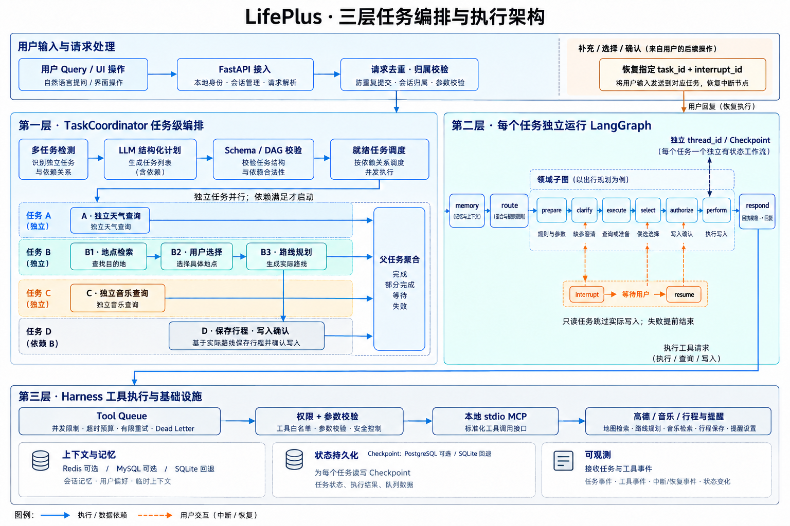
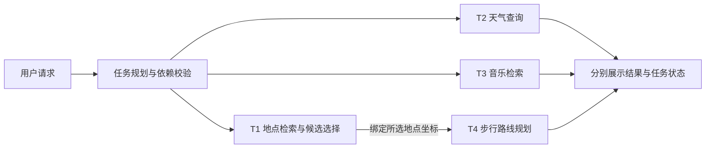

# LifePlus

**生活健康与出行服务智能体：支持多轮对话、并行任务、信息澄清与可视化执行链路。**


基于 **LangGraph + Agent Harness + MCP** 构建，将用户需求转为可执行任务，通过真实模型与工具完成天气查询、地点检索、路线规划、音乐检索和日常对话，并在前端展示执行进度与结果。

## 核心功能

| 功能 | 说明 |
| --- | --- |
| 多任务编排 | 拆分复合请求；独立任务并行，依赖任务绑定前置结果后执行 |
| 多轮对话与记忆 | 管理会话历史、任务槽位、候选快照和用户偏好，支持上下文补全与裁剪 |
| 信息澄清与恢复 | 缺参追问、候选选择、写入确认、取消及 Checkpoint 恢复 |
| 会话事件理解 | 规则处理明确回复，LLM 解释复杂补充与新需求；支持一次回复恢复旧任务并新增任务 |
| 地图与本地生活 | 高德地点和商家检索；在回复内展示地图，切换驾车、步行、骑行及可用路线方案 |
| 天气、音乐与生活清单 | 天气查询、歌曲检索、行程保存、提醒创建与站内通知 |
| 流式输出与可观测 | SSE 增量回复、任务依赖 DAG、可展开的领域子图、工具回执和 bad case 标记 |
| 工具执行治理 | 参数与权限校验、并发限制、超时预算、有限重试及 Dead Letter |

当前接入 **11 个 MCP 工具、7 个领域**。音乐检索不代表播放，路线规划不代表启动设备导航；健康内容仅供一般生活参考，不提供诊断。

## 功能演示

### 全流程视频

https://github.com/user-attachments/assets/c0949cfa-de63-4e2f-b7e6-9a1c90ad8b65

GitHub 页面内可直接播放（约 1 分 21 秒，已内嵌中文字幕）。[源 MP4](docs/assets/videos/lifeplus-demo.mp4) · [独立字幕](docs/assets/videos/lifeplus-demo.srt) · [章节与剪辑说明](docs/assets/videos/lifeplus-demo-chapters.json)

覆盖输入、四任务并行与依赖、候选选择、执行 DAG、领域子图、步行/驾车/骑行切换、备选路线及检查点。真实模型与 MCP 实际执行；采用 computer use 低帧率分段采集，无旁白。剪辑版保留真实交互顺序，将纯等待段以 2–3 倍加速，并烧录解释性中文字幕；非原生连续录屏，不用于衡量端到端延迟。

以下为 **2026-10-26 通过 computer use 操作本地应用截取的真实界面**，使用真实模型与 MCP，非设计稿。点击图片可查看原图；工具数据、路线和候选随时间变化。

### 路线与出行方式

路线直接显示在 LifePlus 回复中：支持驾车、步行、骑行切换，并选择上游实际返回的路线方案。本次演示从步行切换到驾车，再选择第二条备选路线。


<details>
<summary>查看更多：步行默认方式、地点消歧与中断恢复</summary>


</details>

<details>
<summary>本地生活：饭店、KTV、电影院与咖啡店检索</summary>

演示检索校区附近饭店，选择商家后展示真实地址、评分、参考人均及到店路线入口；不代表已预订。


</details>

<details>
<summary>生活清单：写入确认、行程、提醒与站内到期通知</summary>

提醒请求进入真实写入确认节点；本轮截图后选择拒绝，验证取消，不新增演示提醒。下方清单为已有记录，不是本轮新建结果。


</details>

### 多轮对话与记忆

支持“杭州今天天气 → 那明天呢”、在主输入框选择“第二个”，以及根据有效的已选地点“骑行过去”。多个任务均可匹配时不猜测，写操作仍需专门确认。

用“记住：出行偏好=步行”保存跨会话偏好，用“忘记偏好：出行偏好”删除。问“请原样返回我第一次输入的query”时，系统直接查询本会话持久化历史原文，不依赖模型是否还记得第一轮。[多轮与记忆设计、用法及验证](docs/conversation-memory.md)

候选等待时，可以在主输入框或原任务卡片回复“第二个吧，杭州那边的天气也帮我看看”。明确回复由规则处理，复杂表达交给 LLM 生成事件建议，再由宿主核对原文、任务归属、候选和状态。仍有歧义会追问；写入仍需专门确认。[事件理解设计、限制与测试](docs/input-event-routing.md)

<details>
<summary>查看演示：历史结果追问与用户偏好管理</summary>

四任务中选定《晴天》后，追问“刚才搜索到的周杰伦歌曲叫什么”，实际回答“晴天”。偏好截图仅展示管理入口，不代表本轮验证了跨会话偏好读写。


</details>

## 整体架构



- **全局 Planner**：只输出完整子任务描述、领域、依赖和结果绑定，不提取工具参数。
- **TaskCoordinator**：校验与调度任务 DAG，将前置真实结果绑定到后继并聚合结果。
- **LangGraph**：每个任务独立运行主图与领域子图，管理状态、澄清和恢复。
- **领域执行理解**：进入领域子图后加载宿主允许的候选工具及 Schema，联合选择工具和提取该领域槽位，再校验、澄清、执行。
- **Agent Harness**：统一管理模型、上下文、工具执行、预算、持久化与 Trace。

配图为架构示意，非页面截图；参数和权限在工具入队前校验，MCP 服务端再次校验。详细说明见 [架构、执行链路与面试指南](docs/LifePlus-Agent-Harness-架构执行与面试指南.md)。

2026-10-29 的分层实现、兼容边界及真实模型测试限制见 [领域工具选择与参数提取](docs/domain-execution-routing.md)。旧规划评测数字不代表新版的效果；该次真实模型对比受到超时及 HTTP 429 影响，尚未证明准确率或延迟改善。

单任务领域仲裁采用 **Jev 优先、原 LLM 兜底**：配置模板为 `DOMAIN_ROUTE_PROVIDER=jev_cascade`，需要填写独立 `JEV_API_KEY`；不使用 Jev 时设为 `llm`。置信度不足、defer、1.5秒超时或服务异常均回退原模型；规划、领域工具选择、槽位提取及回复不替换。事件解释仍为 `INPUT_EVENT_PROVIDER=llm`。[本次启用范围与回滚](docs/jev-domain-rollout.md) · [真实局部/全局 A/B 结果](docs/jev-front-ab-2026-10-29.md) · [接入与复跑](docs/jev-integration-and-ab.md)。

新增默认关闭的事件明确性审核与合并前序判定实验：`INPUT_EVENT_PROVIDER=jev_gate`、`PLANNING_GATE_PROVIDER=jev_front`。同一Jev请求判断目标数量和单目标领域，复杂规划仍由原模型生成。原数量粗筛默认仍为`rules`；此次并未证明全局稳定提速或总Token降低，不自动启用。[三模块实测与失败归因](docs/jev-front-ab-2026-10-29.md)。

## 四任务：并行与依赖

在对话中输入：

> 请完成四项任务：①检索杭州东站这个车站的地点坐标；②查询无锡今天的天气；③搜索周杰伦的歌曲；④第一项选择完成后，以所选车站坐标为起点，步行规划到杭州西湖的路线。前三项并行，第四项依赖第一项；有多个候选时让我选择，不要猜起点。



**T1 / T2 / T3 并行，T4 等待 T1。** 某分支等待用户选择，不阻塞其他分支；前置失败时不继续依赖任务，保留已完成结果。


<details>
<summary>查看中间状态：独立分支完成，其他分支等待选择或前置结果</summary>


</details>

本轮浏览器演示同样完成 **4/4 子任务**，包含用户选择、过期候选刷新和依赖路线恢复；截图操作与人工等待不用于性能统计。

已有真实模型与 MCP 验收记录：**4/4 子任务完成**，独立分支执行区间重叠，路线起点绑定所选地点。[查看脱敏记录](docs/assets/showcase-four-tasks-20261026.json)；这是单次用例，不代表线上完成率或延迟 SLA。

### 查看领域子图

在任务结果中打开 **Agent 执行链路**，切换 **任务依赖 / 展开子图**，查看节点状态、工具参数、回执及中断恢复事件。


<details>
<summary>查看多领域子图总览、执行数据与检查点</summary>

展开子图可观察每条分支的内部节点；独立链路页可进一步查看节点耗时与恢复记录。


</details>

## 安装与使用

### 本地运行

需要 **Python 3.12、uv、Node.js 22**。在仓库根目录执行；已有 `.env` 时保留原配置。

```bash
cp -n .env.example .env
# 在 .env 填写 MODEL_BASE_URL、MODEL_API_KEY、MODEL_NAME、AMAP_MAPS_API_KEY
uv sync --frozen --extra dev --extra music
cd frontend
npm ci
npm run build
cd ..
uv run --frozen --extra dev --extra music uvicorn car_agent.api.app:app --host 127.0.0.1 --port 8000
```

打开 [LifePlus](http://127.0.0.1:8000)。默认使用 SQLite；Redis、MySQL、PostgreSQL Checkpointer 和 Chroma 可按需配置。真实调用需要有效模型与高德凭据，不会在调用失败后伪造成功。

### Docker 部署

```bash
cp -n .env.example .env
# 配置模型与高德凭据，并设置至少 24 字符的 SHOWCASE_PASSWORD
docker compose up -d --build
```

打开 [本地展示页](http://127.0.0.1:8088)，使用 `.env` 中的 `SHOWCASE_USERNAME` 和 `SHOWCASE_PASSWORD` 登录。镜像包含前端，数据保存在持久卷；默认仅监听本机。公网部署请配置 HTTPS，步骤见 [部署手册](docs/deployment.md)。

### 开始体验

1. 新建对话，使用真实模型模式，输入“查无锡今天天气”或上面的四任务请求。
2. 信息不足时补充参数，有多个候选时点击选择；写入操作核对后确认。
3. 在 **LifePlus 回复内**切换路线方式与方案，在执行链路中查看并行分支与领域子图。
4. 进入本地生活、行程与提醒或运行数据页，查看服务结果及执行记录。

[架构与面试指南](docs/LifePlus-Agent-Harness-架构执行与面试指南.md) · [18 问与测试验收](docs/LifePlus-Agent-Harness-18问与测试验收手册.md) · [路线交互](docs/route-preview.md) · [执行链路](docs/execution-graph.md) · [评测说明](evaluations/README.md) · [安全说明](SECURITY.md)
