# LifePlus

**生活健康与出行服务智能体：支持多轮对话、并行任务、信息澄清与可视化执行链路。**


基于 **LangGraph + Agent Harness + MCP** 构建，将用户需求转为可执行任务，通过真实模型与工具完成天气查询、地点检索、路线规划、音乐检索和日常对话，并在前端展示执行进度与结果。

当前模型组合：**DeepSeek Flash（关闭思考）＋ Jev 单目标领域分类**。文本事件、全局目标规划和领域执行理解分工处理，宿主负责依赖、权限、预算、恢复及结果证据。本文按 2026-10-30 工作区源码整理；源码更新不代表已有容器自动加载新版本。

## 核心功能

| 功能 | 说明 |
| --- | --- |
| 多任务编排 | 拆分复合请求；独立任务并行，依赖任务绑定前置结果后执行 |
| 多轮对话与记忆 | 管理会话历史、任务槽位、候选快照和用户偏好，支持上下文补全与裁剪 |
| 信息澄清与恢复 | 缺参追问、候选选择、写入确认、取消及 Checkpoint 恢复 |
| 会话事件理解 | 自由文本由 LLM 提出新建/恢复/取消/澄清事件，宿主核验；结构化按钮走协议，支持恢复旧任务并新增需求 |
| 地图与本地生活 | 高德地点和商家检索；在回复内展示地图，切换驾车、步行、骑行及可用路线方案 |
| 天气、音乐与生活清单 | 天气查询、歌曲检索、行程保存、提醒创建与站内通知 |
| 流式输出与可观测 | SSE 增量回复、任务依赖 DAG、可展开的领域子图、工具回执和 bad case 标记 |
| 工具执行治理 | 本域工具与参数契约、权限校验、并发限制、超时预算、有限重试及 Dead Letter |
| 规划契约与修复 | 校验目标、依赖、绑定接收字段和证据路径；结构化输出失败最多一次修复，提供脱敏字段诊断 |

当前接入 **11 个 MCP 工具、7 个领域**。音乐检索不代表播放，路线规划不代表启动设备导航；健康内容仅供一般生活参考，不提供诊断。

## 功能演示

### 全流程视频

https://github.com/user-attachments/assets/c0949cfa-de63-4e2f-b7e6-9a1c90ad8b65

GitHub 页面内可直接播放（约 1 分 21 秒，已内嵌中文字幕）。[源 MP4](docs/assets/videos/lifeplus-demo.mp4) · [独立字幕](docs/assets/videos/lifeplus-demo.srt) · [章节与剪辑说明](docs/assets/videos/lifeplus-demo-chapters.json)

覆盖输入、四任务并行与依赖、候选选择、执行 DAG、领域子图、步行/驾车/骑行切换、备选路线及检查点。真实模型与 MCP 实际执行；采用 computer use 低帧率分段采集，无旁白。剪辑版保留真实交互顺序，将纯等待段以 2–3 倍加速，并烧录解释性中文字幕；非原生连续录屏，不用于衡量端到端延迟。

### 整体流程架构

[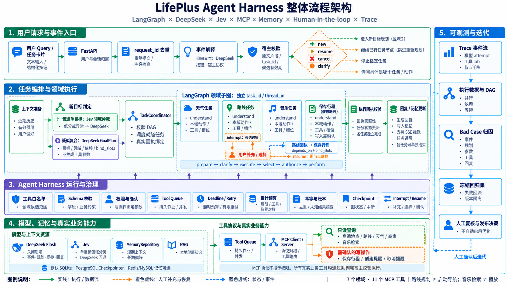](docs/assets/lifeplus-architecture-layered-v2.png)

天气、路线与音乐展示独立并行任务，保存行程消费路线任务的真实回执；文字回复恢复原任务，结构化按钮走宿主协议。图为分层总览，不是逐语句执行图：所有工具调用都经队列与权限校验，SSE 可在执行期间持续返回进度。点击图片查看原图。

以下为 **2026-10-26 通过 computer use 操作本地应用截取的真实界面**，使用当时的真实模型与 MCP，非设计稿。视频和截图用于展示交互，不代表当前模型、节点结构或性能；以本文架构和源码为准。工具数据、路线和候选随时间变化。

### 路线与出行方式

路线直接显示在 LifePlus 回复中：支持驾车、步行、骑行切换，并选择上游实际返回的路线方案。本次演示从步行切换到驾车，再选择第二条备选路线。

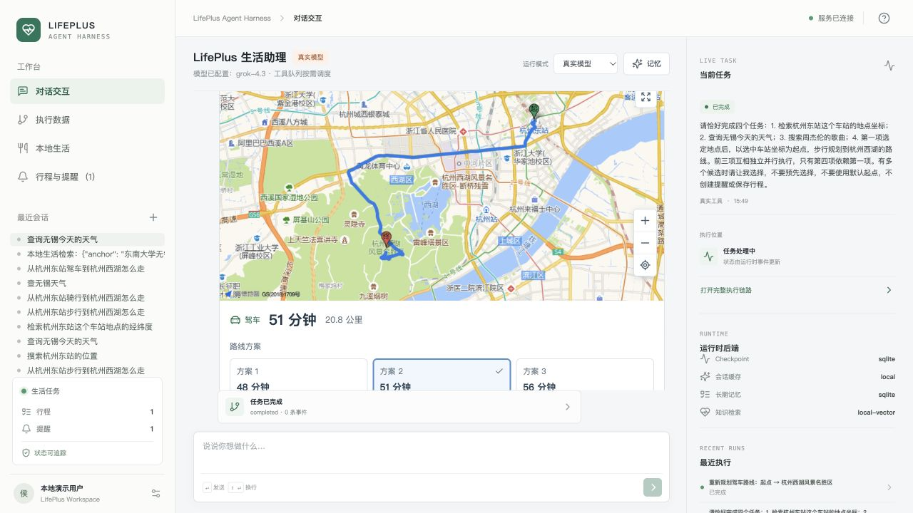

<details open>
<summary>查看更多：步行默认方式、地点消歧与中断恢复</summary>

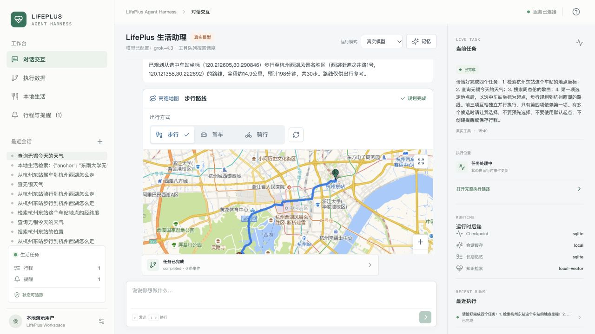
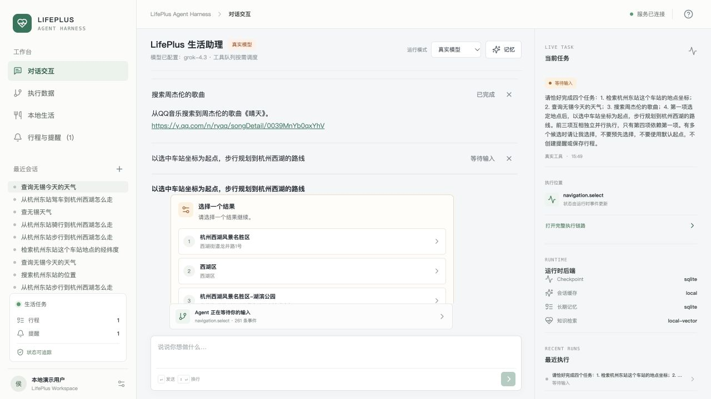

</details>

<details open>
<summary>本地生活：饭店、KTV、电影院与咖啡店检索</summary>

演示检索校区附近饭店，选择商家后展示真实地址、评分、参考人均及到店路线入口；不代表已预订。

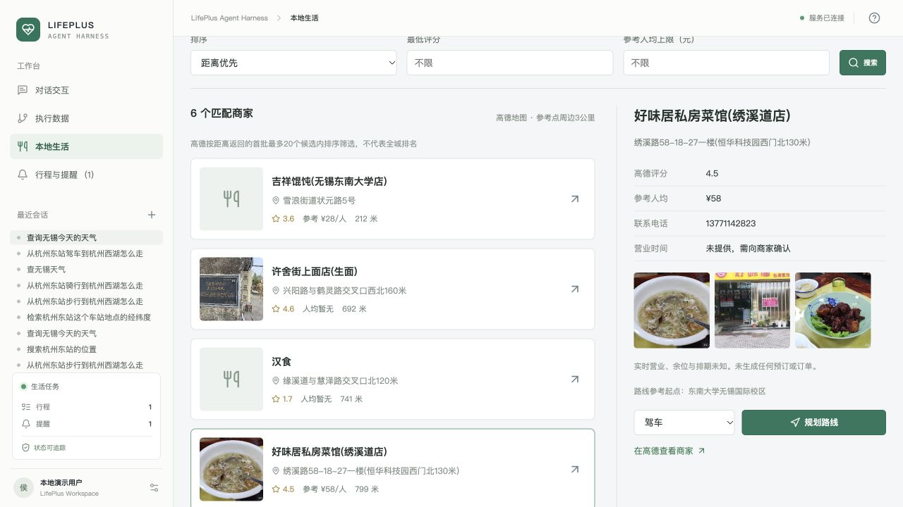

</details>

<details open>
<summary>生活清单：写入确认、行程、提醒与站内到期通知</summary>

提醒请求进入真实写入确认节点；本轮截图后选择拒绝，验证取消，不新增演示提醒。下方清单为已有记录，不是本轮新建结果。

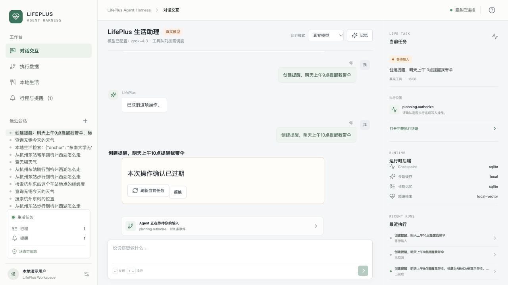
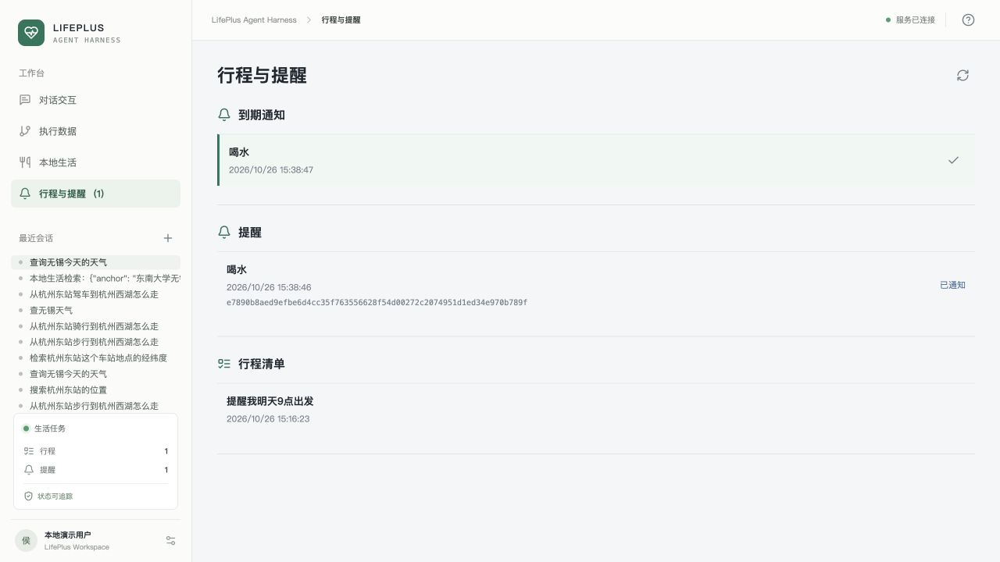

</details>

### 多轮对话与记忆

支持“杭州今天天气 → 那明天呢”、在主输入框选择“第二个”，以及根据有效的已选地点“骑行过去”。多个任务均可匹配时不猜测，写操作仍需专门确认。

用“记住：出行偏好=步行”保存跨会话偏好，用“忘记偏好：出行偏好”删除。问“请原样返回我第一次输入的query”时，系统直接查询本会话持久化历史原文，不依赖模型是否还记得第一轮。[多轮与记忆设计、用法及验证](docs/conversation-memory.md)

候选等待时，可以在主输入框或原任务卡片回复“第二个吧，杭州那边的天气也帮我看看”。当前所有 live 自由文本（包括卡片内手工输入）先由 DeepSeek 生成事件建议，再由宿主核对原文片段、任务归属、候选、有效期与状态；歧义时追问，写入仍需专门确认。候选索引、确认/拒绝、取消按钮不调用文本事件模型。[当前事件策略与边界](docs/llm-direct-rollout.md)

<details open>
<summary>查看演示：历史结果追问与用户偏好管理</summary>

四任务中选定《晴天》后，追问“刚才搜索到的周杰伦歌曲叫什么”，实际回答“晴天”。偏好截图仅展示管理入口，不代表本轮验证了跨会话偏好读写。

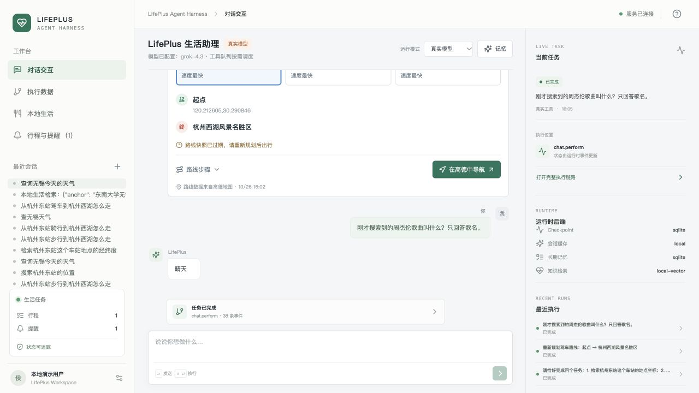
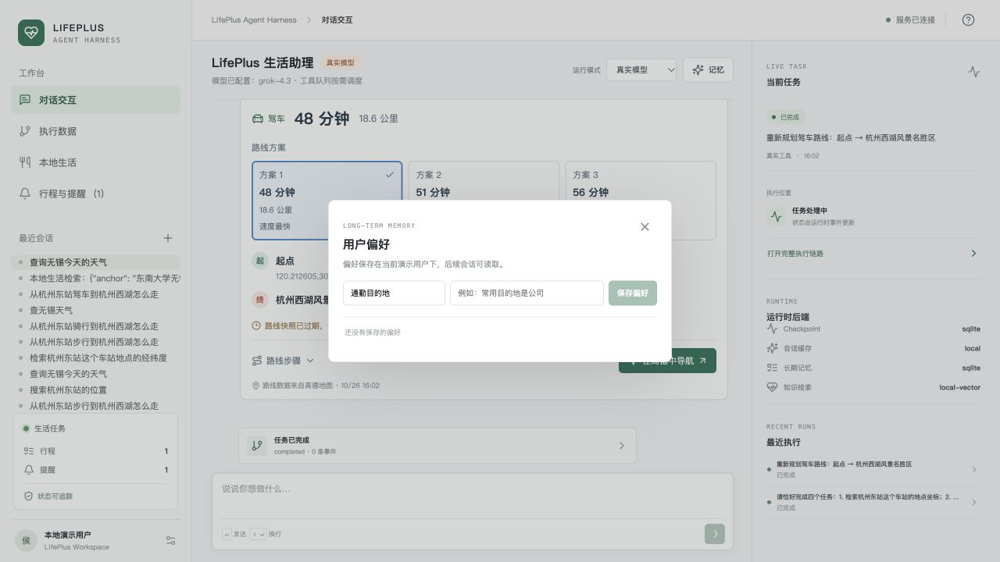

</details>

## 整体架构

总览见上方[整体流程架构](#整体流程架构)。中断恢复继续原节点，不重新规划；多目标的领域来自已校验计划，通常不重复 Jev 分类。精确节点与条件边见[架构执行指南](docs/LifePlus-Agent-Harness-架构执行与面试指南.md)。

| 层级 | 当前职责 | 执行边界 |
|---|---|---|
| 事件解释 | 判断 `new/resume/cancel/clarify`，保留旧回复与新需求原文 | 宿主再核对归属、片段和候选；一次最多作用于一个旧任务 |
| 全局 Planner | 输出 `GoalPlan`：`id/query/domain/depends_on/bind_slots` | live 默认由 DeepSeek 判断单/多任务；不输出 action、slots 或工具参数 |
| TaskCoordinator | 校验与调度 DAG，独立目标并发，依赖完成后绑定真实证据 | `depends_on` 管先后，`bind_slots` 管数据来源 |
| 领域子图 | `understand` 联合选择本域动作、工具和槽位，再准备、澄清与执行 | 候选与字段由宿主限制；chat/wellbeing 固定内部动作，可信表单与恢复有独立路径 |
| Harness / Tool Queue | 管理模型、上下文、权限、预算、持久化作业、取消和 Trace | 工具 Schema 合法不等于用户目标完成，写入需要绑定参数的确认 |

**最新规划校验：** 接收字段白名单、来源路径格式、领域归属、直接依赖与无环检查。解析失败沿异常链提取脱敏字段诊断，最多追加一次修复；真实路径存在性在前置执行完成后核验。不会把非法 key 静默改成写入参数，也不会删依赖绕过校验。

### 当前模型策略

| 配置 | 当前模板值 | 说明 |
|---|---|---|
| `MODEL_NAME` / `MODEL_THINKING` | `deepseek-flash` / `disabled` | 事件、规划、领域提参与回复角色默认继承基础模型 |
| `DOMAIN_ROUTE_PROVIDER` | `jev_cascade` | Jev 只分类单目标领域；低分、defer、超时或异常回退 DeepSeek |
| `INPUT_EVENT_PROVIDER` | `llm_direct` | live 文本直接解释；按钮仍走宿主协议，不叠加事件 Jev |
| `PLANNING_GATE_PROVIDER` | `llm` | 所有 live 请求由 DeepSeek Planner 判断单/多任务并输出目标关系；`rules`、Jev 门控仅保留为实验 |

Jev 默认超时 1.5 秒，接管要求置信度至少 0.8、所选概率至少 0.9；这是可配置工程门槛，不是准确率保证。当前只启用单目标领域 Jev；事件 Jev 与单多目标 Jev 门控保留为实验。`PLANNING_GATE_PROVIDER=llm` 表示 live 请求直接交给 DeepSeek Planner，不经过规则预筛。

[架构、执行链路与面试指南](docs/LifePlus-Agent-Harness-架构执行与面试指南.md) · [文本事件策略](docs/llm-direct-rollout.md) · [模型配置与回滚](docs/deepseek-rollout.md)

## 四任务：并行与依赖

在对话中输入：

> 请完成四项任务：①检索杭州东站这个车站的地点坐标；②查询无锡今天的天气；③搜索周杰伦的歌曲；④第一项选择完成后，以所选车站坐标为起点，步行规划到杭州西湖的路线。前三项并行，第四项依赖第一项；有多个候选时让我选择，不要猜起点。

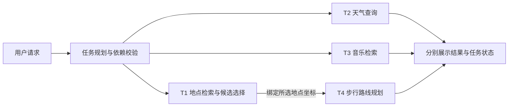

**T1 / T2 / T3 并行，T4 等待 T1。** 某分支等待用户选择，不阻塞其他分支；前置失败时不继续依赖任务，保留已完成结果。

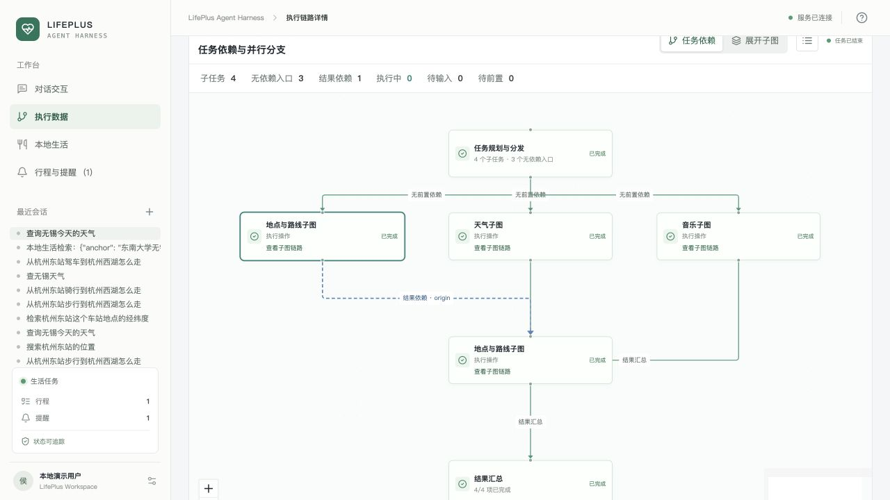

<details open>
<summary>查看中间状态：独立分支完成，其他分支等待选择或前置结果</summary>

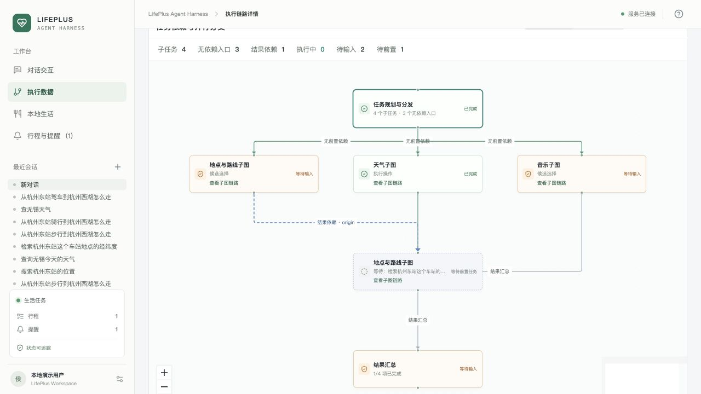

</details>

上述历史浏览器演示完成 **4/4 子任务**，包含用户选择、过期候选刷新和依赖路线恢复；截图操作与人工等待不用于性能统计，也不作为当前代码的四任务重测。

历史真实模型与 MCP 记录显示独立分支执行区间重叠、路线起点绑定所选地点。[查看脱敏记录](docs/assets/showcase-four-tasks-20261026.json)。依赖参数来自实际前置回执，不从模型预生成摘要取值；并行和绑定都应独立验收，不能只看图画得并排。

### 查看领域子图

在任务结果中打开 **Agent 执行链路**，切换 **任务依赖 / 展开子图**，查看节点状态、工具参数、回执及中断恢复事件。

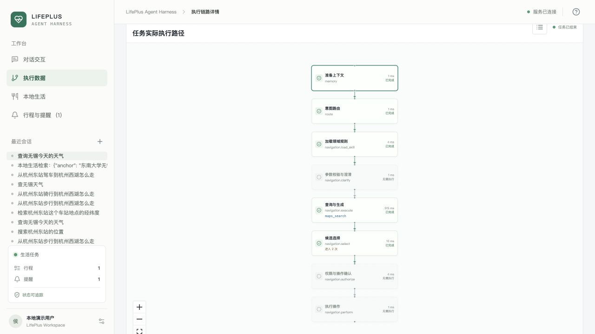

截图来自旧版；当前领域子图已增加 `understand`（工具选择与参数提取），完整顺序以源码和架构指南为准。

<details open>
<summary>查看多领域子图总览、执行数据与检查点</summary>

展开子图可观察每条分支的内部节点；独立链路页可进一步查看节点耗时与恢复记录。

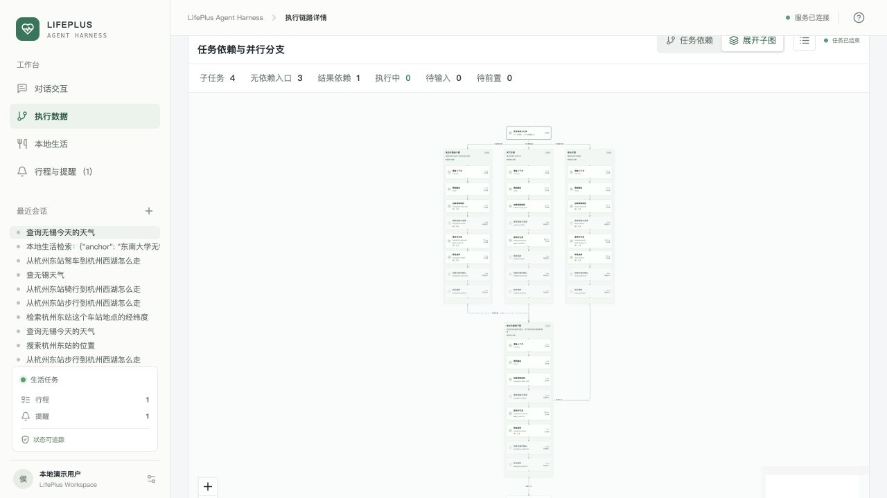
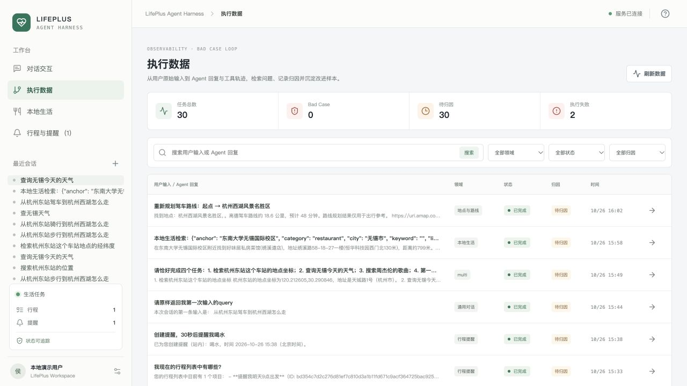
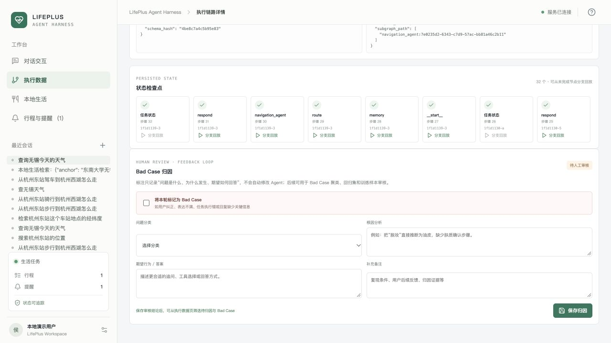

</details>

## 测试与已知边界

统一入口：[测试总文档](测试回报/测试总文档.md) · [数据集与标签说明](测试回报/测试数据集/README.md) · [逐条冻结结果](测试回报/测试数据集/结果记录/2026-10-30-01/README.md)。

以下为 **2026-10-30 绑定契约修复前**的 DeepSeek 基线，不能当作最新修复的效果：

| 范围 | 结果 | P50 / P95 |
|---|---|---|
| 领域＋动作 | 30/30 | 1.127 / 1.887 秒 |
| 已标注槽位 | 44/44 字段、30/30 整组 | 1.242 / 2.217 秒 |
| 全局规划 | 23/30 | 1.005 / 2.322 秒 |
| 完整会话 | 82/90 会话、117/130 子目标 | 4.132 / 6.551 秒 |

完整会话使用真实模型、Graph、MCP 与隔离存储，单并发、自动用户回复；关闭默认位置以匹配标签，不包含浏览器/TCP 和真实人工等待。失败和超时保留在分母与分位数中；Token 总量至少 357868，2 次用量未知。默认位置开启的独立审计另报，不能与此轮拼接或当作优化收益。

基线失败集中于非法绑定接收字段和同领域目标合并遗漏。源码已收紧绑定契约、补充字段诊断，并明确同领域独立目标分别覆盖。关闭思考、同模型的[修复前后规划配对](测试回报/测试数据集/结果记录/2026-10-30-planner-binding-fix-01/README.md)结果如下：

| 规划专项 | 通过/提交 前→后 | P50 秒 前→后 | P95 秒 前→后 | Token 前→后 |
|---|---|---|---|---|
| 原七条失败 | 0/7 → 7/7 | 2.110 → 1.099 | 2.324 → 1.239 | 11584 → 8232 |
| 新增三十条长尾 | 3/30 → 30/30 | 2.081 → 1.047 | 2.742 → 2.291 | 46377 → 37870 |

两组新增退化均为 0；原完整 30 条规划回归另测 30/30，属于单臂补充。上述为针对绑定缺陷的规划层测试，不执行真实工具，不能外推为生产准确率。**修复后完整 90 会话、同域遗漏的端到端效果及整体时延/消费仍待复测**，不改写上面的 82/90 基线。

[DeepSeek/Jev 配对](evaluations/jev/2026-10-29-deepseek/v1/README.md)中，领域局部 21/21 持平，P50 0.748→0.302 秒；领域全链路 12 例均 10/12，P50 3.731→3.265 秒，但 Token 增加。文本 Jev 过滤在该批数据更慢，因此未启用。局部提速不等于整体准确率、成本或生产 SLA 改善。

本项目当前为单实例实现：默认 SQLite 业务表、进程内协调器和执行锁；可选 PostgreSQL Checkpointer、Redis/MySQL 记忆不等于已具备分布式调度或高可用。公网展示需认证与 HTTPS，生产并发、跨实例恢复、数据保留及人工质量评分仍需专项验收。

## 安装与使用

### 本地运行

需要 **Python 3.12、uv、Node.js 22**。在仓库根目录执行；已有 `.env` 时保留原配置。

```bash
cp -n .env.example .env
# 填写 MODEL_API_KEY、AMAP_MAPS_API_KEY 和 JEV_API_KEY
# 不使用 Jev 时，将 DOMAIN_ROUTE_PROVIDER 改为 llm
uv sync --frozen --extra dev
cd frontend
npm ci
npm run build
cd ..
uv run --frozen --extra dev uvicorn car_agent.api.app:app --host 127.0.0.1 --port 8000 --workers 1
```

打开 [LifePlus](http://127.0.0.1:8000)。模板已设置 DeepSeek URL、模型名及关闭思考；切换供应商时需同步 URL/模型/Key，并移除不兼容的 `MODEL_THINKING`。模板启用领域 Jev，缺少独立 Key 会启动失败；不使用时明确选择 `llm`，不要只留空 Key。

音乐检索直接使用 HTTP，无需安装可选 `music` SDK。默认 SQLite 无额外数据库依赖；Redis、MySQL、PostgreSQL Checkpointer 和 Chroma 可按需安装 `production` extra 并配置。默认参考位置是配置的无锡校区，不是 GPS；如需体验缺起点澄清，可清空 `DEFAULT_CURRENT_LOCATION` 后重启。

### Docker 部署

```bash
cp -n .env.example .env
# 配置模型、高德与 Jev 凭据（或关闭领域 Jev）
# 设置至少 24 字符的随机 SHOWCASE_PASSWORD
docker compose up -d --build
docker compose ps
```

打开 [本地展示页](http://127.0.0.1:8088)，使用 `.env` 中的 `SHOWCASE_USERNAME` 和 `SHOWCASE_PASSWORD` 登录。镜像包含前端，数据保存在持久卷；默认仅监听本机。公网部署请配置 HTTPS，步骤见 [部署手册](docs/deployment.md)。

配置更新后使用 `docker compose up -d --build --force-recreate app`；单纯 restart 不会重新读取 env_file。Compose 使用 `restart: unless-stopped`，Docker 运行时可自动恢复已启动服务。健康检查只表示进程存活，模型和工具能力仍需真实请求核验。

Dockerfile 包含构建与入口导入检查；此前本机曾因依赖下载超时复用已有镜像依赖运行，不能据此保证空白服务器构建成功。部署前应独立验证完整构建、持久卷、认证和真实 SSE；不要使用 `docker compose down -v` 删除已有业务数据。

### 开始体验

1. 新建对话，使用真实模型模式，输入“查无锡今天天气”或上面的四任务请求。
2. 信息不足时补充参数，有多个候选时点击选择；写入操作核对后确认。
3. 在 **LifePlus 回复内**切换路线方式与方案，在执行链路中查看并行分支与领域子图。
4. 进入本地生活、行程与提醒或运行数据页，查看服务结果及执行记录。

### 运行受控测试

以下测试使用模型桩或 MockTransport，不请求付费模型：

```bash
uv run --frozen --extra dev python -m pytest -q \
  tests/test_llm_direct_policy.py tests/test_domain_understanding.py \
  tests/test_planning_binding_fix.py tests/test_jev_routing.py \
  tests/test_model_thinking.py tests/test_deployment_layout.py
```

全量测试需隔离私有 `.env` 并固定 provider/模型桩，避免将个人模型配置注入旧夹具。真实模型和 MCP 评测另行运行、单独记录消费；准备了测试数据或工程测试通过不代表真实任务全部通过。

## 仓库导航

| 路径 | 内容 |
|---|---|
| `src/car_agent/api/` | HTTP 接入、事件分流、任务控制与 SSE |
| `src/car_agent/harness.py` / `orchestration.py` | 主图、领域子图、任务 DAG 与真实回执绑定 |
| `src/car_agent/task_planning.py` / `domain_understanding.py` | 全局目标契约、领域动作工具及槽位契约 |
| `src/car_agent/tool_queue.py` / `tools/` | 作业治理与真实服务适配 |
| `frontend/` | 对话、地图、生活清单、执行图与运行数据 |
| `tests/` / `evaluations/` | 受控测试、真实评测脚本与版本化证据 |
| `测试回报/` / `docs/` | 持续测试入口、数据标签、架构与部署文档 |

包名 `car_agent` 为代码命名遗留，当前产品为生活与出行服务应用，不代表接入真实座舱。

[架构与面试指南](docs/LifePlus-Agent-Harness-架构执行与面试指南.md) · [18 问与测试验收](docs/LifePlus-Agent-Harness-18问与测试验收手册.md) · [路线交互](docs/route-preview.md) · [执行链路](docs/execution-graph.md) · [评测说明](evaluations/README.md) · [安全说明](SECURITY.md)
