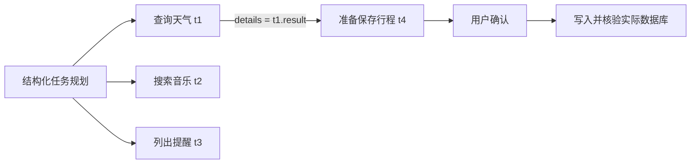

# LifePlus Agent Harness：18 问与测试验收手册

> 初稿与测试日期：2026-10-26；面试深化更新：2026-10-27；最新实测合并：2026-10-28。本文把设计答辩、测试方法、故障归因和改进证据放在同一个入口。每个模块统一回答：当前怎么实现、为什么这样设计、失败如何处理、怎么测试、证据与边界，并补充取舍复盘与约三分钟口述。
>
> 与[架构执行指南](LifePlus-Agent-Harness-架构执行与面试指南.md)配套：该指南按执行顺序精读，本文按面试问题和验收目标查阅。已吸收分层评测、完成率测试、发布验证的口径；原始报告保留，避免覆盖失败证据。
>
> 2026-10-26 确实新增故障注入测试并修改代码。2026-10-27 前次面试深化只更新文档；本次图片补充新增文档示例验证和针对已有边界的回归，不启用提速实验、不修改真实模型配置。历史结果与本次结果分别记录。工业场景指契约漂移、限流、取消、幂等、隔离和恢复等故障模型；不等于已经完成生产流量压测、跨机房容灾或全量真实服务验收。
>
> 2026-10-28 补测报告已完整合并到[附录 G](#appendix-g)，并更新相关章节。该轮完成真实规划、125 次分配置端到端会话执行、真实 MCP 和新增边界检查，没有修改业务代码。发现的多任务漏触发、在途任务重启恢复和旧知识残留仍未修复；10-26/27 的数字保留为历史记录，最新结果以附录 G 的条件和分母为准。
>
> 同日后续已接入“规则优先＋LLM 解释不确定输入”的事件模块，当前实现见第 2、11 章与[事件理解说明](input-event-routing.md)。附录 G 保留改造前的审计快照，不覆盖原始分数；事件模块的独立测试与业务完成率分开报告。

## 阅读导航

| 问题 | 入口 | 问题 | 入口 |
|---|---|---|---|
| 1 | [整体架构与执行入口](#q1) | 10 | [澄清与候选选择](#q10) |
| 2 | [输入与事件分类](#q2) | 11 | [中断恢复与复合回复](#q11) |
| 3 | [上下文与历史记忆](#q3) | 12 | [调度与 Agent Loop](#q12) |
| 4 | [改写与上下文补全](#q4) | 13 | [异常与容错重试](#q13) |
| 5 | [意图与请求仲裁](#q5) | 14 | [写入、幂等与取消](#q14) |
| 6 | [任务拆分与依赖](#q6) | 15 | [结果校验与反馈](#q15) |
| 7 | [工具选择与治理](#q7) | 16 | [SSE、路线与执行图](#q16) |
| 8 | [槽位与语义校验](#q8) | 17 | [Trace、延迟与归因](#q17) |
| 9 | [结构化输出异常](#q9) | 18 | [评测与上线策略](#q18) |

[附录 A：数据结构与标注](#appendix-a) · [附录 B：指标计算](#appendix-b) · [附录 C：本次发现与改进](#appendix-c) · [附录 D：复跑命令与证据](#appendix-d)

**最新测试入口：** [附录 G：2026-10-28 实测报告与模块验收总表](#appendix-g)。包含任务拆分准确性、各模块测试方法、测试集位置、失败归因、真实四任务并发证据和复跑方式。

### 图片题号索引（2～18）

图片题号与本手册章节编号不同，不重新编号原有 18 问。先读对应主章节，再看下列专项补充；“设计扩展”不当作已经交付的能力。

| 图片题号与问题 | 合并入口 | 必须说明的边界 |
|---|---|---|
| 2：输入到输出，各环节输入输出 | [完整执行示例](#io-chain)、第 1、6、10、11 章 | 示例候选为教学数据，不是现场高德回执 |
| 3：Agent Loop、Token/时间/重试预算 | [循环控制](#loop-control)、第 12 章 | 有调用/时间硬上限；无累计 Token/货币预算池 |
| 4：参数、权限、沙箱、结果回灌 | [执行边界](#execution-boundary)、第 8、9、14、15 章 | 当前是结构化 JSON，不是通用原生 tool_calls 执行器 |
| 5：死循环、指纹、去重、回退 | [无进展检测](#no-progress)、第 12～14 章 | 已有幂等不等于已有语义指纹止环 |
| 6：短期压缩、摘要遗漏、跨步关联 | [证据补回](#memory-repair)、第 3、4 章 | 当前是字符裁剪和摘录，不是无损摘要 |
| 7：多 Agent 拆分、共享状态、冲突 | [任务状态与仲裁](#state-sharing)、第 6、12 章 | 领域子图不等同自由自治 Agent 群 |
| 8：并发写文件/资源与锁粒度 | [共享资源专项](#resource-concurrency)、第 14 章 | 当前没有任意文件写工具与跨实例资源锁 |
| 9：服务重启与 Checkpoint | [重启矩阵](#restart-matrix)、第 11 章 | 图状态、任务表、job 和业务账本不是同一个存储 |
| 10：人工驳回、超时与续跑 | [HITL 结果表](#hitl-outcomes)、第 10、11、14 章 | 过期不是默认批准；等待不是活跃执行 |
| 11：大返回、重试、熔断与保底 | [大结果与故障隔离](#large-result)、第 13、15 章 | 当前没有通用字节上限与跨请求断路器 |
| 12：Function Calling、MCP、按需工具 | [调用方式与协议](#functioncall-mcp)、第 7～9 章 | 它们不是替代关系；当前目录实际为 11 个工具 |
| 13：RAG 触发、改写与 rerank | [RAG 专项](#rag-agent) | 当前是小型本地检索，不含 BM25/混合召回/rerank |
| 14：Prompt 注入、危险调用、脱敏 | [安全专项](#security-boundary) | 提示词约束不等于宿主隔离或统一 DLP |
| 15：线上成功率、工具/参数错误、成本埋点 | [线上指标口径](#metrics-online)、第 18 章、附录 B | 事件证据不等于自动获得用户目标真值 |
| 16：bad case 分层归因与回流 | [归因流程](#badcase-triage)、第 17 章 | 找最早错误，不按最终失败节点草率归因 |
| 17：工具事件到前端、断线恢复 | [SSE 时序](#sse-contract)、第 16 章 | 可重放事件不等于前端 exactly-once，也不重发业务 |
| 18：扁平 JSON 转树、返回根节点列表 | [附录 F：编码题](#appendix-f) | parent_id 树不能替代多依赖 DAG |

[附录 E：RAG、安全、共享资源深问](#appendix-e) · [附录 F：可执行编码题与测试](#appendix-f)

### 三分钟口述怎么使用

每章末尾的“面试回答”可以独立练习。建议按“发现 20 秒 → 根因 30 秒 → 处理链路 60 秒 → 其他方案与取舍 40 秒 → 验证与边界 30 秒”组织，约三分钟。原有 18 段口述各约 700～800 个字符（含英文术语和标点）；附录 E 另补 RAG、安全与资源冲突口述。按正常解释节奏并预留停顿准备；实际语速不同，首次练习应录音校准，时间不是要求逐字念完全部技术解释。

“实际复现”指已存在用户反馈、失败报告或故障注入证据；“设计推演”指用于解释风险的教学场景，不冒充真实生产事故。“方案比较”表示工程分析，除非提供同条件实验，不代表已经实现并 A/B 验证过所有备选方案。口述使用项目负责人的第一人称，面试时应按自己的真实职责调整。

快速进入口述：[1](#answer-1) · [2](#answer-2) · [3](#answer-3) · [4](#answer-4) · [5](#answer-5) · [6](#answer-6) · [7](#answer-7) · [8](#answer-8) · [9](#answer-9) · [10](#answer-10) · [11](#answer-11) · [12](#answer-12) · [13](#answer-13) · [14](#answer-14) · [15](#answer-15) · [16](#answer-16) · [17](#answer-17) · [18](#answer-18)。

### 证据标签

| 标签 | 能证明什么 | 不能证明什么 |
|---|---|---|
| 代码 | 当前路径、条件和默认值存在 | 真实分布准确率或生产稳定性 |
| 受控测试 | 给定输入/故障下状态、次数、证据符合断言 | 模型理解准确率、第三方长期可用性 |
| 真实模型 | 真模型实际产生决策或文字 | 所有工具都真实执行、训练泛化成立 |
| 真实 MCP | 实际协议与外部查询/隔离本地写入 | 自然语言一定理解正确 |
| HTTP 联测 | 实际应用入口及其后续链路 | 采用 ASGI 时不含浏览器、TCP、代理 |
| 待补 | 明确的测试方案或生产门禁 | 不计入已通过数量 |

### 2026-10-26 测试驱动改进摘要

基线完整后端为 **450 passed、1 skipped（22.11 秒）**。新增专项的第一次运行 **28 failed、5 passed**；针对相同 33 个用例修复后为 **33 passed（0.98 秒）**。最终完整回归为 **483 passed、1 skipped（22.62 秒）**。这些是独立运行，不相加为 966 次验证，也不是端到端完成率。

本次定位到三组契约问题：计划槽位过宽、业务失败标记漏判、MCP 结构化结果解析不严。33 项用例含参数化变体，不能称为发现 28 个互不相同的线上事故。修复和证据见附录 C、D；最后一轮完整结果以验收记录为准。

修复后另起隔离 HTTP 服务，使用真实配置模型、高德和音乐做四任务联测：**4/4 目标、15/15 证据检查通过，26.453 秒**。核验三条独立分支实际重叠、后继等地点选择完成且绑定其坐标、没有业务写入。它验证接口兼容性，不证明相较历史 45.598 秒已有稳定性能提升。

同一隔离服务的真实模型记忆联测也通过 **7/7 检查，总耗时 41.596 秒**，覆盖话题接续、明确保存/跨会话读取/删除偏好、首条输入原文及来源证据。数据库归档读取不计为模型记忆推理，整套联测耗时不当作单请求时延。

### 2026-10-28 最新实测摘要

| 检查 | 结果 | 如何解释 |
|---|---:|---|
| 严格任务规划冻结集 | 28/30；其中常规多任务 25/25 | 两条红项分别涉及领域偏差和地点名称等价评分 |
| 新增四类分隔表达的双目标请求 | 完整接口 0/4；每条仅完成 1/2 目标 | 规划入口未触发，音乐遗漏，任务仍 completed |
| 当前默认定位下的原始 90 会话 | 77/90 | 单任务 30/30、多任务 30/30、澄清 17/30；13 条与旧位置澄清标签冲突 |
| 无默认定位的澄清组 | 30/30 会话，32/32 目标 | 仅独立测试进程关闭默认值，验证缺参补充链路 |
| 四任务并行与依赖写入 | 4/4 目标，23.702 秒 | 三分支调用区间重叠；保存绑定天气真实回执，确认后落库 |
| 原有后端 / 前端回归 | 563 / 43 项通过，各跳过 1 项 | 不替代模型和用户目标准确率；新增重启检查另有两项失败 |
| 受控候选 / 恢复 / 工具故障，真实 MCP 分层 | 各 30/30 | 使用各自独立分母；另有全工具专项 28/28 |
| 新增在途重启 / Docker 知识删除检查 | 各两项失败 | 原始通过用例没有覆盖这些契约，缺口仍存在 |

最新[公开测试摘要](assets/testing-audit-20261028.json)只包含计数、条件和证据边界；原始 Trace、数据库和失败记录保留在本地 `data/testing-audit-20261028/`。完整解释见[附录 G](#appendix-g)，不把不同配置和重复会话相加计算一个总体准确率。

---

<a id="q1"></a>

## 1. 整体架构与执行入口

### 当前怎么实现

| 组件 | 负责的决策 | 不负责的事情 |
|---|---|---|
| LLM | 将语言解释为领域/动作/槽位，必要时拆任务，生成文字 | 不拥有执行权限，不替代外部结果 |
| Harness | 上下文、权限、预算、队列、确认、持久化和证据约束 | 不是另一个模型，也不是单个 Prompt |
| TaskCoordinator | 创建与调度任务 DAG，绑定前置实际结果，聚合部分完成 | 不负责每个领域内部所有节点 |
| LangGraph | 每个任务的主图、领域子图、状态更新与中断恢复 | 不自动解决远端写入恰好一次 |
| Tool Queue | durable job、worker、并发限制、超时、重试、取消与死信 | job 完成不等于用户全部目标完成 |
| MCP | 工具发现和调用的协议边界；当前使用本地 stdio 连接 | 不天然提供业务授权、规划或重试策略 |

自然语言入口为 `POST /api/sessions/{id}/messages`。先验证归属、请求去重和有限的待恢复事件，再准入新任务。协调器先判断是否可能多需求；可能时调用 `plan_tasks()`，否则直接进入图。

单任务：`接入 → 协调器的低成本判断 → memory → route → 领域子图 → respond`。多任务：`接入 → 模型 TaskPlan → DAG 校验 → 各子任务独立图 → 聚合`。规划已经产出合法 `prepared_decision` 时，子任务路由复用它，不再必然调用意图模型。

因此不存在“所有请求先做一次 LLM 意图识别，再做一次 LLM 规划”的固定顺序。每个请求的模型调用阶段要看 Trace，不能只凭节点名猜。

<a id="io-chain"></a>

### 图片第 2 题：用一个请求说清各环节输入输出

贯穿例子：用户说“导航到东南大学”，工具返回多个校区；系统暂停后，用户在原任务卡片回复“无锡校区，搜索周杰伦的音乐”。以下 ID、候选和坐标均为讲解用符号，不冒充真实高德查询结果。明确表达走规则，不确定复合回复交给事件 LLM 后再校验；任意自然表达都能正确拆分仍不是已有保证。

| 执行位置 | 输入 | 输出及去向 |
|---|---|---|
| API 接入 | 已认证 owner、session_id、request_id、原文、mode | 去重后的 task_id/thread_id；先返回任务受理，不宣布导航成功 |
| 事件分类 | 当前输入、有效待回复任务集合 | 新任务，或绑定指定 task/interrupt 的恢复事件；本轮第一句是新任务 |
| 协调器 | 原文、可能多需求的低成本判断 | 此句一般不做多任务模型规划，进入单任务图；不是先规划再固定做分类 |
| memory | user/session、近期消息、当前任务状态 | MemoryBrief、受限历史、偏好、有效引用；默认位置标配置来源 |
| route | 原文、上述上下文、结构化输出契约 | `domain=navigation/action=navigation_search/slots.destination=东南大学`；出行方式缺失时宿主有业务默认，不能说模型知道校区 |
| prepare/clarify | 决策与可信默认值 | `maps_search` 参数、服务规则、缺失字段；名字非空不代表实体已消歧 |
| Tool Queue/MCP | 受检参数、领域权限、job 幂等键、deadline | 实际地点候选、来源、job_id、attempt、时效；错误不是候选 |
| select/interrupt | 同一回执的多个校区候选 | `waiting_user`，固化候选快照和 interrupt_id；还没有调用路线规划 |
| resume | 原 task_id/interrupt_id、“无锡校区，搜索周杰伦的音乐” | 规则或事件 LLM 提议两个原文片段；校验后恢复原候选选择、提交新音乐任务，不整句覆盖 destination |
| 导航 perform | 校区选择对应的真实坐标、可信起点、方式 | `maps_route` 真实路线回执；不是模型根据“无锡”手写坐标 |
| 音乐独立图 | 新 task/thread、歌手关键词 | `search_music` 候选；可再次独立等待用户选择，不覆盖导航中断 |
| respond | 各自的实际回执、任务状态、结果校验 | 地点与路线卡片、歌曲与官方链接；不把“规划路线/搜到歌”说成“设备已导航/音乐已播放” |
| 持久化与展示 | 图状态、job、事件、最终答复 | Checkpoint、任务表、操作证据、SSE 与 Trace；不同存储各管一类事实 |

这个例子展现的是“新任务接入 → 检索后消歧 → 挂起 → 恢复旧任务并创建独立新任务 → 分支交付”。候选名字、坐标来自工具，选哪个来自用户，调用权限来自宿主，模型只承担解释和生成。

面试展示 Trace 时依次点出：路由事件、地点 job、候选中断、用户恢复事件、路线 job、新音乐 task、两条各自的结果。测试要断言选择前路线 job 为 0、选后目的地绑定正确、音乐 thread 不同、失败或取消不串任务。对应现有 `test_one_reply_can_resume_selection_and_create_a_new_task`、依赖结果绑定及候选消歧用例；上述整句和各个实际候选并未因此自动变成一条已实测新样例。

### 为什么这样设计

常见业务路径明确，却经常缺参数、等待选择或依赖其他结果。将任务关系、领域流程和工具作业拆成三层，可以分别测试与恢复。全塞进一个自由 Agent Loop，会把语言理解错误、调度错误和执行错误混在一起。

单任务绕过不必要的规划，降低成本；多任务用显式 DAG，避免把“先说的需求”误当成所有后续任务的前置。

### 失败如何处理

live 未配置模型时拒绝新请求，不静默切 demo。规划非法则失败关闭，不创建业务工具；一个领域失败不抹去已成功兄弟任务。有效结构化表单和路线方式切换可跳过 LLM 再理解，但仍走 Harness 的执行治理。

### 怎么测试

| 场景 | 断言 | 状态 |
|---|---|---|
| 单任务天气 | 未发生多任务模型规划，最终有天气回执 | 现有回归 |
| 天气、音乐并行 | 分别进入独立 task/thread，工具同时在途 | 现有回归 |
| 无模型配置 | 503，未创建 demo 任务 | 现有回归 |
| 表单与路线切换 | 不调用语言路由，仍有 job 与 Trace | 现有回归 |
| 真实四任务 | 三入口一依赖，所有目标按独立证据核验 | 已有真实冒烟 |

### 证据与边界

源码：[api/app.py](../src/car_agent/api/app.py)、[orchestration.py](../src/car_agent/orchestration.py)、[harness.py](../src/car_agent/harness.py)。测试：[test_multi_task_api.py](../tests/test_multi_task_api.py)、[test_route_presentation.py](../tests/test_route_presentation.py)。真实四任务历史报告为 4/4 目标、15/15 检查，45.598 秒，见[脱敏摘要](assets/showcase-four-tasks-20261026.json)。一个样例不能证明任意复合 Query 都拆对。

**面试核心：** 模型解释需求，协调器处理任务关系，图控制状态，队列管理调用；单任务和多任务的模型路径不同。

### 架构与数据存储选型补充

#### 存储不是“所有数据找一个库”

| 数据/组件 | 当前位置 | 为什么这样选 | 边界 |
|---|---|---|---|
| 会话、任务、运行预算、事件、bad case | SQLite | 当前为单机展示/验收，单文件、零服务依赖，可以直接查证据 | 单进程写锁，未验证多实例 HA |
| durable tool job、dead letter、操作账本 | SQLite | 作业与回执可追踪，重启后能区分待运行、失败和结果未知 | 是本地 durable queue，不是多节点消息集群 |
| 行程/提醒 + `tool_receipts` | 同一 SQLite 工具事务 | 业务写入和本地幂等回执一起提交 | 只覆盖本地工具；远程副作用要上游幂等/结果查询 |
| LangGraph 图状态 | 默认 AsyncSqliteSaver；可选 PostgreSQL Saver | 本地便于复现，生产可换成服务端 Checkpointer | 换 Saver 不会迁移应用任务表 |
| 会话 MemoryBrief/ModelHistory | 可选 Redis 缓存 + MySQL/SQLite 持久层 | 高频、有 TTL 的上下文与持久偏好分开 | Redis 不是业务回执；当前未验证 Cluster/主从切换 |
| 用户长期偏好 | 可选 MySQL，否则 SQLite | 偏好跨会话，但不属于任务 Checkpoint | 临时位置等字段仍要有短 TTL，不能当永久真相 |
| RAG 索引 | 可选 Chroma，否则 local-vector | 小型本地知识库容易持久化和重建 | 原文才是权威源；当前无混合检索/rerank 实测结论 |

#### 为什么当前不直接全部使用 PostgreSQL

SQLite 是基于项目阶段的主动选择，不是因为它比 PostgreSQL 更适合最终生产。当前最重要的是让面试官或开发者拉取代码后，不先搭数据库集群也能复现任务、工具、恢复和 Trace。SQLite 支持事务、唯一约束和实际表数据，比全内存 demo 有更真实的恢复与幂等证据；每个测试又可以创建独立临时库。

但上线条件变成多实例、高并发写入和自动故障切换时，选型也应变。需要把 `tasks/tool_jobs/events/operations` 等权威表迁到 PostgreSQL 或明确分库边界，使用原子 job 领取，增加 schema migration、outbox/inbox、对账、备份恢复和故障注入。只配置 PostgreSQL Checkpointer 不能宣称整个系统已分布式化。

#### 其他技术为什么这样选

| 技术 | 选型理由 | 没有解决的问题 |
|---|---|---|
| FastAPI + Pydantic | 模型与工具是 I/O 密集型；异步 API、Schema 校验和 OpenAPI 契约适合 | CPU 密集任务与跨节点调度 |
| LangGraph | 显式状态、条件边、中断和恢复比自由 loop 更容易测试 | 外部副作用幂等和分布式事务 |
| TaskCoordinator + 每任务子图 | 请求级 DAG 与单任务领域流程分开，等待澄清不阻断独立分支 | 任意自治多 Agent 协商 |
| 持久 Tool Queue | 为工具提供独立预算、并发、deadline、有限重试和死信 | 当前不是 Celery/Kafka 级多节点队列 |
| MCP stdio | 用标准协议解耦工具发现/调用，本地环境无额外网络运维 | 不提供授权、重试、成功判定或远程传输安全 |
| SSE | 主要是服务端单向输出进度/结果，可基于事件序号续读，比 WebSocket 更简单 | 用户选择和确认仍走显式 HTTP 命令；SSE 本身不是消息队列 |
| React + TypeScript | 方便把动态任务、路线方案和执行 DAG 做成类型化 UI | 前端状态不能取代后端权威状态 |

#### 失败、测试和证据边界

- SQLite 失败时不能把任务当成成功；工具本地写入在异常时 rollback。
- Redis miss 可以回源，但不给过期持久摘要重置完整 TTL；旧候选不会因缓存回填而续命。
- Chroma 不可用时当前可使用 local-vector，但这只保证小型知识功能可运行，不保证两种后端排序完全相同。
- 当前广泛回归和真实工具验收使用 SQLite；有假 Redis 时效与回源测试，但没有 Redis Cluster、MySQL 主从、PostgreSQL HA 和 Chroma 集群的实测报告。
- 应用表、Checkpoint、外部工具不在同一原子事务中；当前依靠状态机、幂等键和结果未知隔离，不声称 exactly-once。

源码证据：[persistence.py](../src/car_agent/persistence.py)、[memory.py](../src/car_agent/memory.py)、[api/app.py](../src/car_agent/api/app.py)、[rag.py](../src/car_agent/rag.py)。实测边界：[回归报告](regression-2026-10-23.md)。

### 面试追问：为什么用 SQLite，数据怎么规划（约三分钟）

> 这个项目的默认存储是 SQLite，但这是对当前单机展示和工业化验收阶段的选择，不是把 SQLite 当成最终的分布式方案。我们需要让仓库在没有外部数据库的情况下也能运行真实任务、持久 job、中断恢复和 Trace。SQLite 是单文件，支持事务和唯一约束，测试又能每例创建临时库，比全内存 demo 更能检查写入和恢复证据。
>
> 我没有把所有数据当成一种。任务、工具 job、操作账本和业务回执是权威事实；LangGraph Checkpoint 只保存图状态和待续位置；Redis 只缓存带 TTL 的 MemoryBrief 和受限历史；MySQL 可以持久长期偏好和会话摘要；Chroma 是从知识原文可重建的向量索引。这个分层保证 Redis 丢失能回源，索引损坏能重建，但用户行程是否写成功只能看业务行和 receipt，不能问模型。
>
> 上线到多实例时，SQLite 的写竞争、备份和故障切换就不够。我会把应用权威表、job 和 Checkpoint 迁到 PostgreSQL 或为分库建立明确的状态权威，用原子领取代替进程内锁，再补 schema migration、outbox、对账和备份恢复演练。当前代码支持 PostgreSQL Checkpointer 和 Redis/MySQL 记忆配置，但没有把它包装成已验证的集群容灾。
>
> 这套原则也解释了其他架构选型：FastAPI 处理异步 I/O 和 SSE，LangGraph 管明确状态与中断，TaskCoordinator 管跨任务 DAG，Tool Queue 管调用生命周期，MCP 只管工具协议。我选的不是技术名词的组合，而是让每一层的失败可以单独定位和验证。

### 取舍复盘：架构为什么要拆三层

**问题性质：设计推演，执行隔离和真实并发已有测试。** “查天气、找地点，再把路线存下来”同时包含并发、数据依赖和写授权；一条按文本顺序执行的链无法准确表达三种关系。

| 方案 | 适用性与代价 | 当前选择 |
|---|---|---|
| 一个大 Prompt + 自由工具循环 | 原型快，但暂停、授权、分支状态和重放都需额外约束 | 不作为全部执行控制 |
| 整个请求一张巨型图 | 全局拓扑直观，但动态子任务和独立中断状态较难维护 | 单任务内仍使用图，跨任务交给协调器 |
| 协调器 + 每任务领域图 + 工具队列 | 边界更多，需要明确 ID 与状态权威，但各层可单独验证 | 当前实现 |

排查入口不要只看有没有 plan 事件：协调器可以记录阶段事件却没有调用规划模型。应关联 model.attempt 的 stage 和 prepared_decision 来源，证明是否真的省去一次 LLM 调用。

<a id="answer-1"></a>

### 面试回答（约三分钟）

> 这个项目最开始需要解决的，不是模型能否回答一句话，而是一个请求里可能同时查天气、找地点、规划路线，有的任务还能继续保存行程。我在设计和联测时重点检查三个现象：独立任务是否被串行拖住，某个任务澄清时是否卡住整个会话，以及工具返回后系统是否过早宣称全部完成。这些现象需要从任务和状态层分析，不能只修改提示词。
>
> 根因是语言理解、任务依赖、领域流程和外部调用具有不同生命周期。如果都放进一个 Agent 循环，一个共享状态里就会同时混入天气城市、路线目的地、歌曲候选和写入授权，恢复时很难确定应该继续哪一步。因此我把执行分成三层：TaskCoordinator 管任务拆分、依赖和聚合；LangGraph 管每个任务的领域流程和中断；Tool Queue 管每次调用的并发、期限、重试与回执，Harness 负责把这些约束统一接起来。
>
> 具体顺序并不是所有请求先意图识别、再规划。新输入先过归属、去重和恢复判断。普通单任务直接进入记忆、路由、领域图和回复；检测到可能多需求时才调用规划模型，得到结构化计划后校验 DAG，再分别启动子任务。计划已经带着合法的领域、动作和槽位，子任务就复用，不必再调用一次相同的分类模型。模型负责解释需求，宿主负责决定能不能执行。
>
> 其他方案我主要从适用场景比较。一个大 Prompt 加全部工具做原型很快，但不能替代授权和恢复机制；全请求一张大图也可行，但动态分支和各自中断容易耦合。当前业务路径比较固定，三层分工便于定位失败，代价是必须把任务、线程、作业和业务回执关联清楚，而不是简单堆组件。
>
> 验证时我不只看最终文本，而是检查模型阶段、任务状态、独立分支时间重叠以及前置结果绑定。已有真实四任务联测完成了四个目标，并通过十五项证据检查。这说明这条受测链路成立，不代表所有复杂需求都正确，也不代表已经达到生产并发规模。我的核心取舍是让模型承担不确定理解，把必须确定的执行条件留在代码里。

<a id="q2"></a>

## 2. 用户输入与事件分类

### 当前怎么实现

事件分类回答“输入作用于哪个任务”，领域分类回答“业务上要做什么”，两者分开。

| 输入 | 主要依据 | 是否需要 LLM |
|---|---|---|
| 新需求/日常对话 | 普通消息进入规划或领域路由 | 一般需要 |
| 补充城市 | 唯一未过期 city clarification + 明确城市；开放表达结合等待上下文 | 明确输入走规则，其他 live 表达可触发事件 LLM |
| 选择候选 | 当前候选快照 + index/序数/唯一名称；复杂表达再解释 | 明确选择不需要，复杂归属与复合回复可需要 |
| 写入确认 | 绑定任务的 approval 中断 + approve/reject | 不让模型代替确认 |
| 取消 | 明确 cancel API；文本须绑定有效旧任务并通过宿主校验 | 显式接口/规则不需要；不确定解释不直接赋予取消权限 |
| 恢复同时有新需求 | 明确规则，否则结合卡片焦点、等待状态与有限历史 | 复杂拆分用事件 LLM；新增业务再走领域理解 |

主输入框先处理唯一有效候选、明确城市和显式复合命令；无法完整解释的 live 输入交给 `input_events.resolve_input()`。模型只提议 `new/resume/cancel/clarify`，答案和新需求必须来自当前原文。卡片输入携带任务焦点，普通聊天输入结合有效等待任务判断。“第二个”若同时匹配两个列表，就要求明确任务；“好的”在写入确认场景由规则提示使用确认按钮。

### 为什么这样设计

让 LLM 猜“好的”属于哪个任务，会把概率判断变成授权。协议携带 `task_id + interrupt_id + action` 明确定位；规则覆盖高确定性情况，LLM 负责上下文中的不确定表达。它只能从提供的有效任务中提出目标，不能输出 approve 或工具调用；执行前还要检查片段完整性、候选、状态、期限与权限。

### 失败如何处理

旧 interrupt、过期候选、越界序号、错误动作和越权归属都不能消费当前授权。入口请求 ID 用于重传幂等；同 ID 换内容、模式或结构化请求返回 409。恢复输入与任务创建共用冲突检查，避免同一个 ID 在两个入口各执行一次。

未知自然表达不代表已经安全理解“取消”。例如“那个算了，先查天气”还缺取消范围，不能宣称通用事件仲裁已经完成。

事件解析共用默认 25 秒独立预算，格式修复最多一次、总调用最多两次；模型不可用或连续解析失败返回 503，原任务保持等待。任务归属、原文覆盖或候选不明确返回 409 并给出澄清问题；模型自报置信度不能替代这些检查。明确旧任务后仍在生命周期锁内复验，防止模型等待期间被取消或更换中断。

### 怎么测试

| 场景 | 关键断言 | 状态 |
|---|---|---|
| 一个列表，“第二个” | 恢复原任务、只记录一条补充输入 | 已测 |
| 两个列表，“第二个” | 409，两个任务均仍待选择，零误选 | 已测 |
| approval 中输入“好的” | 不调用模型、不调用写工具；要求确认按钮 | 已有专项；另测恶意 resume 提议被宿主拒绝 |
| 同 ID 并发提交 | 一个任务/一个工具作业；返回同一回执 | 已测 |
| 同 ID 内容变化 | 409，任务和参数不被覆盖 | 已测 |
| 取消与恢复/刷新竞争 | 终态不被迟到执行覆盖 | 已测 |
| “第二个吧，杭州那边天气也看看” | 主输入框与卡片均恢复旧任务、创建独立新任务 | 受控 handler 集成；真实模型/MCP 另测 |
| 模型编造目标、丢弃片段或越权授权 | 不新增错误任务、不消费旧中断 | 已测 |
| 模型超时、错误格式、旧恢复后新增失败 | 预算/次数有界，失败可见，重复输入不再次恢复 | 已测 |

### 证据与边界

[事件解释模块](../src/car_agent/input_events.py)、[选择/拆分规则](../src/car_agent/user_events.py)、[交互执行门禁](../src/car_agent/interactions.py)、[事件专项测试](../tests/test_input_events.py)、[30 条开发案例与 6 条留出案例](../evaluations/input_event_cases.py)及[设计与复跑说明](input-event-routing.md)。`input_event_decisions/input_event_spans` 记录模型提议、最终决策、预算和 attempt；`GET /api/sessions/{id}/input-events` 按归属查询。锁仍为单进程机制，尚无多实例原子 outbox。

本轮受控专项 **39/39**；真实配置模型的开发集最终 **30/30**，其中规则 13 条、模型解释 17 条；六条留出场景 **6/6**；两条真实模型/MCP 会话达到 **4/4 子目标**。开发过程的 25/30、28/30、29/30 原始失败均保留，不能将迭代开发数据当独立生产样本。[公开证据摘要](assets/input-events-20261028.json)与[完整方法](input-event-routing.md)分别给出条件、分母和适用范围。

### 取舍复盘：“第二个”和“好的”为什么不能统一猜测

**问题性质：候选归属、复杂回复与重复恢复已有受控复现；模型解释仍须宿主验证。** 一句话至少有 event_type、target_task、target_interrupt、payload 四个维度。识别出“选择”仍不足以确定操作对象。

| 方案 | 风险 | 适用边界 |
|---|---|---|
| 默认作用于最近任务 | 并发分支完成顺序不稳定，容易选错列表 | 不用于有歧义或写授权 |
| 每条输入先让 LLM 仲裁 | 表达覆盖广，但增加时延、成本和误关联 | 可作为复杂表达的候选解释层，不能直接授权 |
| 显式任务协议 + 唯一匹配规则 | 覆盖较窄，但选择对象可验证 | 当前方式；不唯一时返回对应卡片 |
| 高精度规则 + 有界 LLM 解释 + 宿主复验 | 兼顾明确输入成本与开放表达覆盖 | 当前已接入；最多处理一个旧任务与一个新增需求片段 |

“同一 ID 重传”与“不同 ID 的两个独立输入”也要分开测试：前者应幂等，后者可能是用户真的提出两项任务，不能无条件去重。

<a id="answer-2"></a>

### 面试回答（约三分钟）

> 我把事件分类和业务意图分成两层。事件分类先回答这句话是在创建新任务、补充旧任务、选择候选，还是确认或取消；业务意图才回答查天气还是搜音乐。这个区分来自一个很实际的测试场景：导航和音乐都在等选择，用户输入“第二个”，如果直接重新路由，可能新建一个无意义任务；如果默认给最近任务，又可能选错列表。
>
> 根因不是模型不知道“第二个”的含义，而是输入缺少操作对象。一个会话里可能有多个 task，每个 task 还有自己的 interrupt，单靠一句文本或全局的“当前任务”无法安全定位。特别是“好的”，它可能只是应答，不能当成对任意写入的授权。
>
> 我的处理是协议和状态优先。选择、补参和确认卡片带 task_id、interrupt_id 和 action，后端检查归属、等待类型、有效期和允许动作。主输入框只自动接住确定性较高的情况，比如唯一有效候选中的“第二个”，或唯一城市缺参任务的“杭州”。如果多个列表都匹配，明确要求到对应卡片选择，不让模型替用户猜。写入则必须进入绑定具体操作的确认流程。
>
> 去重也在事件入口做。相同请求 ID、内容、用户和会话一致时返回原回执；同 ID 换内容或模式返回冲突。恢复输入和新建任务之间也检查 ID 冲突，避免一次重传在两个入口各执行一遍。锁只保护接入和生命周期变更，不会把整个会话锁到所有任务结束，所以一个任务等待时，用户仍然可以发新请求。
>
> 复杂表达也已经接入有界模型解释。例如“第二个吧，杭州那边天气也看看”不依赖固定的“同时查”模板，模型给出旧答案和新增需求的原文片段，宿主再核对目标、候选和未消费内容。我们测了双入口、错误目标、丢片段、否定、超时与取消竞争；解析不能批准写入，格式修复最多一次。对比全规则与每轮都用模型，混合方案减少明确输入的调用，又能补开放表达。当前仍是单进程、最多一个旧任务加一个新需求片段，不能扩展成任意多任务仲裁或分布式原子提交已经解决。

<a id="q3"></a>

## 3. 上下文准备与历史记忆

### 当前怎么实现

模型不是直接看到数据库全部历史。模型阶段不同，看到的内容也不同：

| 模型阶段 | 实际上下文 |
|---|---|
| 任务规划 | 当前 Query、MemoryBrief、受限偏好、有效会话引用、当前时间 |
| 普通意图理解 | 当前 Query、Schema、MemoryBrief、偏好、引用、当前时间；不是全部历史消息逐条传入 |
| 闲聊生成 | 受限 ModelHistory，加偏好/引用等系统背景 |
| 业务结果回复 | 当前任务槽位与受限工具证据；地图大几何不进入 Prompt |

ModelHistory 默认最近 12 条、总计 12000 字符、单条 2000 字符；MemoryBrief 为较早/近期片段和当前约束的受限拼接，最多约 2000 字符，不是 LLM 长期滚动摘要。偏好最多注入最近 20 项、总计 4000 字符。

归档消息、任务 slots、候选快照、工具回执、临时引用和稳定偏好分别保存。归档中可能有失败/取消任务的背景，不能把所有历史语句当成已成功执行的事实。实体引用只读取归属一致、仍为 completed 且未过期的来源任务。

### 为什么这样设计

语言连续性与执行正确性需要不同数据。摘要适合背景，候选 ID 和授权必须结构化保存；不能因为摘要里写了“同意”，就允许另一任务写入。按用户隔离偏好、按会话隔离临时引用、按任务隔离槽位，减少污染。

### 失败如何处理

缓存 miss 可从 MySQL/SQLite 回填，但不能给旧摘要重新续命。会话上下文默认 30 分钟，候选默认 5 分钟，路线回执默认 2 分钟；过期归档仍可展示，不能继续当最新事实。

“返回第一次输入”走数据库原文检索：按 user/session 过滤最早根任务，返回 query，记录 `conversation.history_retrieved + source_task_id`。显式读取旧档不受模型窗口 TTL 限制，不允许跨会话猜测第一句。

### 怎么测试

将首轮时间改成过期，追加超过窗口的多轮输入，再要求原样返回；断言整个字符串等于原文，来源 task 相同，其他会话不能读到它。偏好测试要验证真正保存、跨会话传给模型、删除后重新加载，而不仅是页面能列出值。

引用测试包含：来源取消、不同用户/会话、重启后读取、过期、两个不同地点并存。天气追问必须新增工具调用，旧城市可用不代表旧天气有效。

### 证据与边界

[memory.py](../src/car_agent/memory.py)、[conversation.py](../src/car_agent/conversation.py)；`test_first_input_is_exact_after_window_trim_and_context_expiry` 等 9 项会话专项。已有真实模型 HTTP 记忆联测 7/7 检查，见[摘要](assets/memory-live-20261026.json)。其中原文查询是数据库能力，不计算为模型“记忆推理准确率”。未验证无限长历史、任意历史搜索或 Redis/MySQL 集群容灾。

<a id="memory-repair"></a>

### 图片第 6 题：摘要丢信息以后，怎么补回来

先明确当前不是“摘要后删除原始数据”。`ModelHistory` 是给模型的受限视图，归档消息和工具 job 回执仍保留；`_brief()` 是摘录拼接，并不保证保留全部否定、数字和日期。字符上限也不能精确等价为 Token 上限。

| 信息 | 当前权威位置 | 压缩时的处理原则 |
|---|---|---|
| 待补字段、task/thread、候选选择 | 图状态、任务中断与候选快照 | 不能只写在自由文本摘要里，也不从摘要恢复授权 |
| “预算不超过 80 元”“不要骑行” | 原文与结构化 slots/当前约束 | 显式更新优先；旧默认不覆盖当前否定；不能把缺失字段当已知 |
| POI ID、坐标、路线、写入状态 | 来源工具回执、选中候选、操作账本 | 只注入相关且有效的证据；摘要不能成为新回执 |
| 第一次输入的完整措辞 | user/session 隔离的归档查询 | 直接查原文并携带来源，不要求模型复述摘要猜答案 |
| 稳定偏好 | 用户作用域持久化记忆 | 当前明确要求覆盖偏好；删除后下次构建上下文不再注入 |

“那明天呢”可以沿有效天气引用取城市，再发起新天气调用；“导航过去”必须确定唯一有效地点。“刚才第二个”必须找回当时那个候选快照，而不是使用最新搜索列表的第二项。引用有歧义、来源取消或过期，就澄清/重新检索；数据存在于历史不代表仍能执行。

**还没实现的通用补偿：** 当前没有面向所有历史消息的语义检索器，也没有自动检查摘要遗漏并召回原片段的统一模块。可扩展为 `缺失字段 → 受限 source_id/job_id 查询 → 权限/时效复验 → 注入证据包`；仍找不到才问用户。证据包宜有 task_id、来源 job/候选 ID、观测时间和来源类型，不能仅凭摘要字符串补数字。

验证分两层：现有测试证明窗口外首条输入仍能原样检索、跨用户拒绝、过期引用不复用；新增通用摘要补偿若要上线，需另测否定条件被裁剪、日期跨天、候选换代、同名地点和“旧资料仍在但不再有效”。不能把前一层通过写成后一层已实现。

### 取舍复盘：精确历史查询与执行上下文分开

**问题性质：用户真实反馈 + 超窗口/过期受控复现。** 第一条 Query 回答失败，应先核对归档是否存在、是否进入模型、是否因窗口或 TTL 排除，不能直接断定数据库丢消息。

| 方案 | 适用能力 | 为什么不单独依赖 |
|---|---|---|
| 放大历史窗口 | 改善较近话题衔接 | 成本增加，仍不能保证逐字复制或无限历史 |
| 摘要/向量记忆 | 回忆主题、偏好和语义线索 | 可能改写原文，不适合首条输入的精确证明 |
| 带归属条件的归档查询 | 返回明确指定的首条原文与来源 | 当前只覆盖有限元问题，不等于通用历史搜索 |

历史查询可读旧记录，但沿用天气、路线或候选时仍检查时效；两者不能共享一个“过期就删/过期仍执行”的笼统策略。

<a id="answer-3"></a>

### 面试回答（约三分钟）

> 我实际遇到过一个问题：用户让 Agent 返回第一次输入的 Query，系统没有正确答出来。排查时我没有先扩大模型上下文，而是把链路拆开，核对数据库有没有首条记录、历史组装时有没有读到，以及最后哪些内容真正进入模型。这个问题说明“界面有聊天记录”和“模型能精确引用全部历史”不是一回事。
>
> 根因是我们给模型的是受限窗口和简报，不是整个会话数据库。最早一轮可能超出最近十二条消息，也可能超过上下文有效期。即使原文还在，模型看不到就只能猜；把压缩摘要再交给模型，也不能保证逐字还原。因此精确历史查询不应该依赖生成能力。
>
> 我把数据分成几层：会话归档用于展示和查原文，ModelHistory 与 MemoryBrief 用于语言理解，任务槽位和候选快照用于恢复执行，工具回执用于事实，长期偏好按用户跨会话保存。普通意图和规划主要看到简报、偏好、有效引用及当前输入；闲聊才使用受限消息历史。这样不会误认为所有阶段都拿到了全部对话。
>
> 针对首次输入，我增加的是明确的只读检索路径：按当前用户和会话找到最早根任务，返回 Query 原文，并记录来源任务和历史检索事件。它不受近期模型窗口限制，但仍受归属校验；新会话不能擅自读另一个会话。天气和路线则不同，旧记录能查不代表能继续当最新事实，执行仍要检查期限并重新查询。
>
> 其他方案里，扩大窗口有助于近期对话，语义摘要或向量记忆适合主题回忆，但都不能替代精确原文读取。验证时我把第一轮移到过期时间，再追加超过窗口的对话，要求返回首句，逐字比对原文并核对 Trace 来源，同时验证其他会话不泄漏。真实模型联测还覆盖了偏好保存、跨会话读取和删除。这个改进证明归档检索正确，不是证明模型具有无限记忆；任意历史全文搜索和完整隐私生命周期仍需单独建设。

<a id="q4"></a>

## 4. Query 改写与上下文补全

### 当前怎么实现

没有独立的“改写模型节点 + 专项准确率报告”。`resolved_query` 通常仍是原 Query。已有多轮能力由三条路径组成：模型使用摘要理解，已有任务通过恢复补参，部分追问由宿主绑定真实引用。

| 表达 | 当前处理 | 不应做的事 |
|---|---|---|
| “那明天呢” | 最近有效引用是天气时继承城市，计算新日期并重查 | 把旧天气换个日期复述 |
| “导航过去/骑行过去” | 唯一有效地点坐标 → navigation_followup → 真实算路 | 用模型常识编坐标 |
| “第二个” | 恢复当前候选快照 | 重新搜索再按新排序选第二个 |
| “换一个” | 没有通用的确定性换候选协议 | 声称所有领域都可靠切到下一项 |
| “介绍一下陶喆” | 应进入人物文字回答，不继承上轮搜歌动作 | 把所有歌手名称都当音乐检索 |

### 为什么这样设计

可绑定结构化实体时，绑定比把句子改写得更流畅可靠。真正开放的省略交给理解模型，但缺少引用时应澄清。改写只能补省略，不能新增预算、城市、操作或用户授权。

### 失败如何处理

多个近期地点、过期引用或跨会话“那里”不自动复用。当前有限规则未命中时进入常规理解，这不保证“换一个”一定问对；它应作为下一版冻结评测的重要失败切片，而不是用规则命中率包装总体改写准确率。

### 怎么测试

标注输入应包含整段必要历史、任务状态和工具候选，不只标一条孤立 Query。正确答案可以是结构化引用，也可以是“必须澄清”；不强制唯一改写句子。

| 切片 | 正确标注 | 状态 |
|---|---|---|
| 域内天气追问 | 保留 city，替换 date，必须重查 | 已有回归 |
| 地点转路线 | 引用 source_task/selected.location，保持方式 | 已有回归 |
| 两地点并存 | 不绑定目的地，要求明确 | 已有回归 |
| 省略与跨域改口 | 原目标不被继承错误动作 | 部分样例；需独立多轮集 |
| “换一个，不要川菜” | 更新约束，不能当作候选名称 | 待补通用修订协议与测试 |

### 证据与边界

证据来自 `test_weather_followup_retains_city_but_requeries_date`、`test_navigation_followup_binds_real_selected_coordinate` 和引用歧义测试。后续改写评测应分别看实体引用正确率、约束保留、无新增意图率和应澄清召回率。**当前没有可引用的独立改写 92% 指标。**

### 取舍复盘：补全的是对象与约束，不只是句子

**问题性质：有限追问已有测试；通用改写与约束修订是待补能力。** 测试应把“正确继续”“必须澄清”“切到新领域”列为三种合法决策，而不是强制每个输入都产出一条完整改写句子。

| 方案 | 优点 | 代价或风险 |
|---|---|---|
| 所有追问先独立 LLM 改写 | 输入统一，便于后级复用 | 多一次模型调用；错误改写会传播意图和实体偏移 |
| 全部依靠历史 Prompt | 接入简单、语言覆盖较广 | 难证明“那里”绑定哪份工具证据 |
| 结构化引用优先，开放表达再理解 | 候选选择和坐标来源明确 | 规则覆盖有限，不能声称解决任意“换一个” |

标注“介绍歌手”应允许切 chat；标注“明天呢”应保留城市但重新查询日期；出现多个有效目的地时必须留空并澄清。

<a id="answer-4"></a>

### 面试回答（约三分钟）

> 我没有把项目的所有多轮能力都称为 Query 改写。设计测试时最容易暴露问题的，是用户只说“那明天呢”“导航过去”或者“第二个”。这类输入语法很短，但真正要确定的是省略了哪个对象、哪些条件仍有效，以及是不是已经换了任务。单纯把句子补得通顺，可能掩盖执行对象错误。
>
> 根因是语言补全和实体绑定不是同一个问题。比如把“第二个”改写成“去第二家饭店”，再重新搜索，列表排序一变就可能换店；音乐搜索后用户说“介绍一下陶喆”，如果机械继承旧动作，就会再次搜歌。这些都不是把历史多放几轮就一定能解决的。
>
> 当前我采用结构化绑定优先。候选选择恢复原任务，绑定原列表中的实际 POI；有限天气追问继承有效城市、计算新日期并重查；“骑行过去”只有在当前会话有唯一有效地点坐标时才生成后续路线任务。多个地点并存或引用过期，就明确追问。开放表达仍交给上下文理解，但不能把当前没有覆盖的“换一个，不要川菜”包装成已完成的通用修改协议。
>
> 我比较的替代方案是统一独立改写模型和全量上下文理解。前者能统一后级输入，但增加时延，而且一次错误改写会污染后续路由；后者实现简单，却难追溯实体来源。现在这套方式对高确定性追问更可审计，代价是规则覆盖有限，所以需要把无法消歧当作正确行为之一，而不是为了完成任务强行补出参数。
>
> 测试上，我会给出必要历史、任务状态和候选证据，分别标注应该保留的城市、应该更新的日期、实体来源和禁止推断项。正确答案不一定是一句固定改写，也可能是必须澄清或进入新领域。现有回归已覆盖天气重查、真实坐标复用和多地点歧义；跨域省略、否定修订等还需要独立冻结集。因此我能说明实现路径和验证范围，但不会沿用没有独立报告的百分之九十二改写准确率。

<a id="q5"></a>

## 5. 意图识别与请求仲裁

### 当前怎么实现

领域表示处理范围，动作表示具体业务步骤。七个领域为 weather/navigation/music/local_life/planning/wellbeing/chat。planning 同时包含保存、创建、列出和取消，不能仅“落域正确”就认为动作正确。

单任务由 LLM 输出 `Decision(domain, action, slots)`；唯一动作领域做标准动作归一，多动作领域必须校验动作集合。多任务由 TaskPlan 携带各自决策。宿主再做字段、日期、交通方式等规范化。

没有已落地的 BERT Top-K + LLM 两级路由，也没有独立训练的无效语义拒识器。空白、超长和非法控制字符在接口拒绝；可读但业务不支持的输入通常落到 chat 或能力解释，不能声称已有完整 OOD 仲裁和高召回拒答模型。

### 为什么这样设计

当前十一工具、七领域，结构化理解加确定性治理足以建立可测路径。先建立领域、动作、参数、澄清和目标核验的分层指标，比为工具数量不大的项目强行引入召回模型更合适。

### 失败如何处理

输出格式错误走有限修复；合法但错域/错动作属于语义错误，不靠工具重试解决。Schema 外领域拒绝；Schema 内 chat 不等于已正确判断“应拒答”。安全风险规则和宿主权限仍是独立层。

长尾表达通过脱敏坏例、新表达和反事实对照补充，不编造训练数据量、GPU 或训练时长。候选外意图当前应理解为超出能力集合，而不是“Top-K 漏召回”。

### 怎么测试

v1 记录 `id/group/query/expected/source/runner`，单任务组 30 条，标注 domain/action；城市、歌手、否定和易混类别都应做对照。数据来自人工设计，不是生产日志。

混淆矩阵建议按标注领域作行、预测领域作列，另设 `schema_error/runtime_error` 输出列；不要把连接失败伪装成某个错误领域。动作矩阵只在同域样本上另做，并同时保留 domain+action 联合正确率。

当前脚本已有逐条预测、领域和联合准确率，**没有独立输出完整混淆矩阵的现成报告**。可据 results 聚合，但必须标为后处理，不声称本次测得新矩阵。新增长尾集需按语义模板隔离，不能把同一模板换城市当独立泛化。

### 证据与边界

[intent_schema.py](../src/car_agent/intent_schema.py)、[harness.py](../src/car_agent/harness.py)、[数据构造](../evaluations/dataset.py)、[评分逻辑](../evaluations/run.py)。历史分层复测为领域/动作 30/30，仅适用于那组数据。slot、OOD 和实际完成仍须独立评估，不能把它写成当前线上路由 ≥97%。

### 取舍复盘：先分错误层，再决定是否训练

**问题性质：动作别名/null 槽位来自历史失败；大规模两级召回属于未接入方案。** v1 中出现过天气动作别名和无槽位闲聊解析失败，说明部分“意图错误”其实是输出契约不一致，不应一律增加训练数据。

| 方案 | 何时值得使用 | 当前判断 |
|---|---|---|
| BERT/小模型分类 + LLM 精判 | 高频稳定分类、工具规模大，且有独立数据和成本收益证据 | 当前没有训练与候选召回证据，不冒充已实现 |
| LLM 结构化理解 + 宿主规范化 | 类别相对有限，任务与语言变化较多 | 当前主链路 |
| 全规则分类 | 确定性强、容易覆盖少量显式输入 | 保留局部规则，不承担全部自然语言理解 |

分析混淆时将“领域对、动作别名”“字段缺失”“模型连接失败”“真实语义选错”分开，再选规范化、Schema、提示词或数据迭代。

<a id="answer-5"></a>

### 面试回答（约三分钟）

> 我在意图识别上先定义领域和动作，而不是直接让模型输出任意工具名。领域表示天气、导航、音乐等处理范围，动作才表示具体业务，例如行程领域里创建提醒、查询提醒和取消提醒是完全不同的事。项目里有一个实际发现：历史分层测试中，天气领域识别正确，但模型把动作叫成了另一个别名；还有无需参数的闲聊返回空槽位，导致解析失败。
>
> 这些问题的根因并不完全是模型语义不准。有的是内部动作契约与模型自然命名不一致，有的是结构约定过严或缺少规范化。如果把它们全部当分类错误去微调，既没有解决执行契约，也可能掩盖真正的动作混淆。
>
> 所以当前方案是让模型输出受约束的领域、动作和槽位，再由宿主校验。只有一个标准动作的领域可以做明确别名归一；行程、本地生活等多动作领域仍必须区分具体动作，不能统一覆盖。空白、超长和非法控制输入在接口拒绝，缺参数进入澄清，日常对话进入聊天。超出能力的请求要解释边界，但当前没有独立训练的通用拒识模型，不能把 chat 兜底称为完整的候选外意图识别。
>
> 其他方案包括小模型分类加大模型精判，或者全部规则路由。前者在稳定高频分类和大工具池场景可能更省成本，但要有训练数据、候选召回和最终选择的独立评测；后者确定性强，却很难覆盖长尾表达。当前七领域、十一工具，我优先建立结构化理解和执行约束，没有虚构 BERT 训练时长或两级召回指标。
>
> 测试分别标 domain、action 和必要槽位，领域正确率与领域动作联合正确率分开统计。分析时还要把网络失败单列，不能把没有产生预测的请求硬归成错域。历史三十条组内通过只能说明该批样本成立，不证明线上分布达到同样水平。后续扩展会收集真正混淆的长尾对照，按模板隔离，再决定改提示词、Schema 还是训练，而不是先假设所有问题都需要微调。

<a id="q6"></a>

## 6. 任务拆分与依赖规划

### 当前怎么实现

`may_have_multiple_tasks()` 用连接词和部分标点正则作为硬门槛，命中后才让模型规划；逗号、地名中的“和”本身不直接决定任务数量。`TaskPlan` 最多六项，包含 `id/query/domain/action/slots/depends_on/bind_slots`。2026-10-28 已复现空格、换行、句号、顿号分隔双目标请求漏过该门槛，随后只能进入单任务意图结构；此缺口尚未修复。

教学示例：

```json
{
  "tasks": [
    {"id":"w","query":"查无锡天气","domain":"weather","action":"weather_lookup","slots":{"city":"无锡"},"depends_on":[],"bind_slots":{}},
    {"id":"r","query":"从杭州东站步行到西湖","domain":"navigation","action":"navigation_search","slots":{"origin":"杭州东站","destination":"西湖","travel_mode":"walking"},"depends_on":[],"bind_slots":{}},
    {"id":"m","query":"搜索周杰伦歌曲","domain":"music","action":"music_search","slots":{"keyword":"周杰伦"},"depends_on":[],"bind_slots":{}},
    {"id":"s","query":"把路线保存为行程","domain":"planning","action":"save_itinerary","slots":{"title":"出行路线"},"depends_on":["r"],"bind_slots":{"details":"r.route"}}
  ]
}
```

独立任务无边；数据依赖同时要求前置完成和结果绑定。控制依赖可用 `depends_on` 等待成功，但当前没有通用的条件表达式/OR/失败补偿 DSL。写入“必须用户确认”是子图门禁，不是额外模型任务。

本次补强计划槽位共享 `SlotValues` 校验，禁止模型直接注入 user_id、tool_name、selection。依赖 ID 必须存在、唯一且无环，重复依赖边拒绝；绑定来源只能是直接前置的 `selected/route/result/slots`，目标也必须是允许业务字段。

### 为什么这样设计

“然后”只是语言顺序，不自动代表计算依赖；“先查天气，然后搜歌，两件事独立”不应加边。“把刚才路线保存”则需要真实 route，而不仅是按时间后执行。图与绑定同时存在，才能防止用模型先验内容代替前置结果。

### 失败如何处理

非法计划在执行前拒绝；绑定路径语法正确但实际字段不存在，后继失败且不执行。上游失败/取消不猜值启动写入。ID 重复与依赖重复可确定性拒绝；内容不同 ID 但语义重复的任务，仍需模型与评测识别，不能宣称已自动去重全部语义。

### 怎么测试

现有测试覆盖未知依赖、环、超六项、无效方式和直接结果绑定。本次新增错误槽位、伪造归属字段、错误绑定目标、重复依赖边等 13 个参数化拒绝用例，并保留缺字段交给澄清和任意业务 details 的正例。

等价计划不按 ID 字符串和数组顺序比较。推荐先对“目标/动作/对象/约束”做节点匹配，再比较必需边、禁止边及结果来源；同一个领域出现两次要用多重集合，不可当集合去重。

当前分层 `score_plan()` 已忽略任意 ID 命名并检查领域多重集合、独立/依赖策略；严格规划集的 `grade()` 进一步排列匹配任务，核对动作、标注槽位、禁止推断字段、依赖与结果绑定。两者都不是完整 DAG 同构与所有参数语义评分器。比如“检索后算路”合为一个领域子图还是拆成两个任务，需在测试标注 `acceptable_plans` 或目标级等价条件；该字段为下一版设计，未假装已有。

### 证据与边界

[task_planning.py](../src/car_agent/task_planning.py)、[工业契约专项](../tests/test_industrial_contracts.py)、[test_completion_reliability.py](../tests/test_completion_reliability.py)。新增拒绝测试证明入口更严格，不证明所有自然语言计划语义都正确；真实四任务只提供一个成功会话证据。

### 2026-10-28 实测：入口召回、计划语义和目标完成分别检查

[严格规划集及评分器](../evaluations/planner_cases.py)的冻结 30 条为 **28/30**；其中 25 条常规多任务全部通过，5 条单任务防过拆为 3/5。一条将睡眠卫生路由为 chat 而非 wellbeing，另一条因“南京新街口”与“新街口＋城市南京”的地点字符串等价性未被评分器接受。保留原始分数，不事后改标签刷成通过。

另加的 8 条边界数据为 4/8；失败集中在四种分隔表达。完整接口再次提交“查无锡今天天气 搜索周杰伦歌曲”等双目标请求，四条均未调用规划模型，只创建天气任务，音乐遗漏但任务 completed。于是“常规 25/25”与“新表达 0/4 全目标完成”同时成立。模型没有被调用时，换模型或只改规划提示词无法解决入口问题。

下一轮应先冻结无连接词、否定、同领域多任务和单任务比较句的对照集，再验证多意图检测或统一理解方案。不能把所有句号/顿号直接切开，“南京、杭州哪个适合出游”可能仍是一项比较。完整案例、配置和指标见[附录 G](#appendix-g)；本轮尚未实施这些修复。

<a id="state-sharing"></a>

### 图片第 7 题：分工、共享状态与结果冲突分别归谁管

当前“多智能体”应如实描述为领域流程分工：协调器维护计划，每个任务一套 thread/slots/候选/中断，领域子图执行天气、地图、音乐等能力。没有让多个自治模型在一个共享消息列表里反复讨论，也没有 A2A 跨进程 Agent 通信协议实测。

| 状态层 | 可以共享什么 | 不能如何共享 |
|---|---|---|
| 会话上下文 | 同用户会话的有效背景与引用 | 不把所有运行任务的 slots 合成一个全局字典 |
| 父任务计划 | 子任务 ID、依赖边、状态、汇总结果 | 不让子任务随意改兄弟依赖或将父任务标全部成功 |
| 子任务执行状态 | 由该 thread 的图更新；引用已完成前置的指定结果 | 不拿同名字段覆盖另一分支的 city/destination/selection |
| 依赖证据 | bind_slots 指向允许路径，调度时读实际 Checkpoint/回执 | 不用前置的自然语言介绍代替真实 POI 坐标 |
| 工具与操作 | job 管一次调用，operation/receipt 管业务结果 | 不把工具并发完成顺序当业务优先级 |

冲突先看是否同一对象：天气城市与音乐关键词不是冲突；同一地点的两份坐标、同一提醒的不同时间才需要仲裁。当前默认隔离解决的是前一类问题，并没有通用“两个 Agent 给出相反结论”的可信度投票器。

设计扩展时，先按权限、对象 ID、来源、时效和用户显式要求做确定性仲裁。一份过期、一份新鲜时不能平均两份坐标；两份有效结果仍无法确定时，展示差异并让用户选择。LLM 可以解释差异，不应创造胜出依据，更不能投票决定写授权。测试应注入冲突有效结果、过期来源、前置失败及重新选择，断言只有明确绑定的一份证据进入后续工具。

### 取舍复盘：依赖边与参数绑定必须同时验证

**问题性质：计划契约缺口已由故障注入复现。** 仅禁止环不够：原计划 slots 能接受额外归属字段、非法范围和任意绑定目标；接受这些字段不等于最终越权成功，但会延迟失败并污染状态。

| 方案 | 可解决的问题 | 仍需补充 |
|---|---|---|
| 开放文本计划 | 便于给人看思路 | 不适合直接执行、检验依赖与结果来源 |
| 仅顺序列表 | 简单串行任务 | 会丢失独立并发和实际数据绑定 |
| DAG + 结果绑定 + Schema | 依赖、来源、入口契约可检查 | 语义重复、等价计划与复杂条件仍需独立评测 |

一个 task 的 ID 唯一，不代表用户目标不重复；一个绑定路径语法合法，也不代表运行时字段一定存在。两层验证都要保留。

<a id="answer-6"></a>

### 面试回答（约三分钟）

> 我把任务拆分分成入口识别、计划语义和执行完成三层验证。最近一次补测中，常规多任务规划二十五条全部通过，但把“查无锡天气，同时搜索周杰伦歌曲”改为空格、换行、句号或顿号分隔，四条完整接口测试都只完成了天气，音乐被遗漏，状态却是 completed。
>
> 我先沿 Trace 看最早出现偏差的地方，发现不是模型生成了错误计划，而是规划前有连接词和部分标点的正则门槛，四条请求根本没调用规划模型。它们随后进入只能表达一个领域动作的单任务路径。这个定位很重要，因为仅换模型或者改规划提示词，并不能处理没有到达规划器的请求。
>
> 当前一旦进入规划，输出是任务 ID、独立 Query、领域、动作、槽位、依赖和结果绑定。独立分支没有边；“保存这次天气结果”明确绑定前置的 result。宿主检查六任务上限、唯一 ID、未知依赖、环、重复边和槽位契约，运行时再检查前置是否真实完成、被引用字段是否存在。写入仍然由领域子图请求确认，不能让模型计划代替授权。
>
> 我们还实际跑了天气、音乐、提醒查询以及保存天气这四个任务，四个目标都完成。三个独立工具调用存在重叠，保存只依赖天气，在确认后落库，保存内容也与真实天气回执一致。这证明现有调度可以表达并行和依赖，但不能抵消入口漏掉用户目标的问题。
>
> 针对入口缺口，下一步会比较扩充规则和统一结构化理解。扩规则成本低，但容易把比较句、名称和否定误拆；统一理解覆盖表达更广，却增加模型成本。因此要用同一份多任务正例和单任务负例，同时测入口召回、过拆、计划全对和端到端全目标完成。当前严格冻结集是二十八比三十，新增四种分隔表达仍失败，修复尚未交付，我不会把拟采用的方案讲成已经提升了多少。

<a id="q7"></a>

## 7. 工具选择与工具池治理

### 当前怎么实现

模型主要输出领域/动作，不是直接从所有 MCP 名称中自由调用。领域 `prepare` 把动作映射成工具和参数，队列在执行作用域内检查归属、白名单和 Schema，服务端再验证一次。

工具目录 `TOOL_CATALOG` 维护输入模型、描述、读写属性和单次超时；`DOMAIN_TOOLS` 维护宿主权限。例如 music 只能 search_music，navigation 可 maps_search/maps_route，planning 还要求工具名等于当前 action。

Skill 是 SKILL.md 的服务规则与处理策略，经 Registry 加载；Tool 是带参数与结果契约的执行能力；MCP 是发现/调用协议。读取 Skill 或发现 MCP 工具不能扩大宿主权限。

### 为什么这样设计

不把安全边界寄托给工具描述。描述用于解释用途，Schema 用于结构验证，白名单和确认用于真正限制执行。三者可以分别变更和测试。

### 失败如何处理

未知或越权工具在 job 创建前拒绝。合法但语义选错，通常不会被 Schema 自动发现；例如歌手介绍被当成歌曲检索，应归因到理解/动作定义，通过对照 Query 和目标级 Oracle 发现，不对错误工具反复重试。

工具服务不可用时明确失败/部分完成，不切模拟。描述漂移、Schema 与服务实现不一致，应做契约回归，而不是把所有错误都转交模型猜参数。

### 怎么测试

| 测试层 | 核验内容 |
|---|---|
| 目录契约 | 工具名唯一、Schema 合法、写属性和超时配置正确 |
| 宿主权限 | 跨领域/错 action/伪造归属，在入队前零 job |
| Skill | 更新规则后正常/风险/冲突用例；文本不得扩权 |
| MCP | list_tools 与可调用能力一致；错误/非法结果处理 |
| 语义选择 | 介绍歌手 vs 搜索歌曲、POI 检索 vs 周边餐饮检索 |

### 证据与边界

[tool_policy.py](../src/car_agent/tool_policy.py)、[工具服务](../src/car_agent/tools/service.py)、[Registry](../src/car_agent/skill_registry.py)。现有权限与 Schema 测试、28 项真实 MCP 历史检查均有证据。

扩展至数百工具时可设计“领域过滤 → 工具召回 → 小候选精判”，分别测 Recall@K、最终工具选择及参数正确率、上下文 Token 和任务完成率。当前十一工具没有对应的大工具池检索实测，不报告虚构的 400 工具召回指标。

<a id="functioncall-mcp"></a>

### 图片第 12 题：Function Calling 与 MCP 为什么不是替代关系

Function Calling/原生 tool calling 解决的是模型如何表达一个结构化调用意图；Tool 是具体能力；MCP 解决宿主与外部服务如何发现能力、交换 Schema 和调用结果。即使采用 MCP，宿主仍需决定如何让模型选工具、谁有权限、是否确认以及如何重试。MCP 不强制某一种用户交互形式，见[官方工具规范](https://modelcontextprotocol.io/specification/2025-06-18/server/tools)。

**本仓库当前路径：** LLM 通过 json_mode 返回受校验的领域/动作/槽位，领域 prepare 映射具体工具，队列做执行治理，MCP 客户端发起协议调用；不是把模型返回的任意 tool_calls 原样执行。因此可以解释原理，但不能声称当前已处理所有 tool_call_id 的原生多轮循环。

若未来接原生 tool calling，调用名、arguments、call_id 要先规范化到同一宿主命令对象；结果以匹配 call_id 的工具结果回灌，失败也结构化返回。当前则先写入 tool_result/operation_result，respond 据此生成，依赖绑定读指定证据，不能把两种模式混着讲。

数百工具场景下，先做宿主权限和能力可用性过滤，再按 Query、领域和任务阶段召回候选，模型只见候选描述与 Schema。注册表应有版本、只读/写、限额、超时和幂等语义。分别测正确工具是否入候选、最终选对率、漏召回后的澄清/扩召回和 Token 成本。向量检索适合近义表达，词法检索适合精确业务术语；组合和 K 值用自己的数据选择，不套历史 Top-5 成绩。

当前实际注册 11 个工具；按需加载领域服务规则不等于已经动态检索 400 个工具。新增工具必须同时更新输入契约、领域映射、宿主白名单、MCP 实现、结果 Oracle 和权限负例，不能只补一段 description。

### 取舍复盘：选错能力和执行失败要用不同修复入口

**问题性质：权限拒绝已有测试，语义选错以目标对照定位。** “介绍歌手”被映射为搜歌，即使 search_music 正常返回也不正确；错误 code 的重试逻辑无法修复这个问题。

| 方案 | 适用时机 | 主要限制 |
|---|---|---|
| 全量工具描述给模型 | 工具较少且场景开放的原型 | 上下文和描述干扰随工具增加，仍需宿主权限 |
| 领域/动作映射到有限工具 | 路径相对稳定、有明确业务流程 | 需要维护映射和变更回归 |
| 工具检索 + 小候选精判 | 工具规模明显增长后 | 必须新增候选漏召回与最终选择评测 |

新增工具的验收应同时检查注册描述、参数模型、读写属性、超时、领域白名单和结果证据；“MCP 已发现”不等于功能已经完整接入。

<a id="answer-7"></a>

### 面试回答（约三分钟）

> 工具治理上，我首先区分工具选错和工具执行错。排查时会对照用户目标、结构化领域动作、实际工具和回执。例如用户要了解陶喆，却进入歌曲搜索，接口可能完全成功，但用户目标没有完成。反过来，选择正确的地图工具却超时，应该处理执行容错。把这两类都交给重试，会产生大量看似有效、实际上无关的调用。
>
> 根因是工具调用有三种不同约束：描述告诉模型能力是什么，Schema 约束参数结构，宿主权限决定能否执行。如果只依赖描述，模型可能选错；如果只依赖 Schema，一个语义不相关但参数合法的调用仍会通过。MCP 解决协议发现和调用，也不会自动替我们提供这些业务约束。
>
> 当前模型主要输出领域、动作和槽位，领域节点映射成有限工具，队列再检查当前任务归属、领域动作白名单和参数，服务端也会验证。比如音乐只能进入歌曲检索，行程领域要求具体工具与当前动作一致，不能从查提醒顺手变成创建提醒。目录中还维护每项工具的读写属性、超时和回执要求，让新增能力有统一入口。
>
> Skill 在这里是业务规则文本，不是工具的别名。它可以说明地点不明确时怎样服务，或者风险场景怎样保守回答，但不能注册可执行函数或扩展权限。Tool 是执行能力，MCP 是协议，Harness 才控制授权、预算和恢复。我会把这几个边界讲清楚，避免把加载规则包装成模型一定遵守。
>
> 替代方案是把全部工具给模型，或者工具增长后先检索小候选。前者原型方便但描述干扰和上下文成本会上升；后者适合规模扩展，但新增了候选漏召回，需要单独衡量。当前只有十一工具，所以没有虚构几百工具召回成绩。验证时分别测目录契约、非法工具零入队、规则不能扩权和语义对照样例，再看最终任务目标。已有权限和真实 MCP 测试证明了受测边界，但不能替代大规模工具选择的独立效果评测。

<a id="q8"></a>

## 8. 工具参数提取与语义校验

### 当前怎么实现

参数不是由一次 LLM 抽取后原样使用。理解输出与规范化形成初始 slots，澄清补齐，候选选择绑定真实对象，协调器将前置回执填入后继，最后构造工具 Schema。

建议理解优先级：当前明确表达 > 本次有效澄清/选择 > 明确前置证据 > 辅助偏好 > 可解释默认。**当前不是一个统一实现所有字段来源与优先级的通用引擎**：交通方式显式约束、起终点解析、位置默认和结果绑定分别在对应代码中执行。

如用户明确“步行”，不能被历史驾车偏好覆盖；来源是当前文本。默认无锡校区仅在规则适用时补入位置，事件标记 configured_default，不是 GPS。用户 ID 和幂等键来自宿主，不能由模型提供。

### 为什么这样设计

类型合法、业务有效、语义正确是三层要求：`city="南京"` 类型正确，但用户要查无锡就不对；合法 POI ID 也可能不属于刚才选定商家。结构校验只能承担其中一部分。

### 失败如何处理

非法类型、枚举、半径/评分范围拒绝；缺字段进入澄清；过期提醒要求重新提供未来时间；实体不唯一先检索消歧。未知预算/评分不能补一个常见值，用户没给位置也不能让模型编坐标。

本次计划和普通路由共享槽位结构校验，缩小了“路由严格、规划却可携带任意键”的差异。`details` 仍为任意业务 JSON，不能被解释为代码或授权。

### 怎么测试

标注不仅写 value，还要记录允许的来源、规范化规则与禁止推断字段。例如半径“2 公里”标 2000 米；提醒按带时区的同一时间点比较；城市可定义去“市”后缀等价；未知 anchor/POI 标 null 或 must_not_infer。

当前 v1 `expected.slots` 可标 null 检查不猜值，但没有逐字段来源的通用评分。下一版建议加入 `source=current_query/task_selection/predecessor/config_default` 与 `forbidden_inference`，不能把设计字段说成当前数据已具备。

分别统计：字段级正确率、所有已标注字段全对的样本率、工具 Schema 参数合法率。前两者需要标注语义，后一项只判断契约，不相乘当联合准确率。

### 证据与边界

[SlotValues](../src/car_agent/intent_schema.py)、[位置默认](../src/car_agent/location_defaults.py)、[评分实现](../evaluations/run.py)、[test_travel_modes.py](../tests/test_travel_modes.py)、[工业专项](../tests/test_industrial_contracts.py)。历史为 44/44 已标注字段、30/30 整样本，不是全槽位 F1，更不是源信息归因准确率。

<a id="execution-boundary"></a>

### 图片第 4 题：模型给出调用后，还要经过哪些执行门

| 门禁 | 本项目当前检查 | 具体反例 |
|---|---|---|
| 解析与 Schema | 结构化输出校验；工具服务再验类型/范围；有限格式修复 | travel_mode=plane、错字段不应成为业务 job |
| 用户与任务归属 | owner/session/task 检查；scope 中 job.task_id 必须一致 | A 用户不能 resume B 用户中断 |
| 能力权限 | DOMAIN_TOOLS；planning 工具须匹配 action | 音乐任务不能因模型建议而保存行程 |
| 语义与时效 | 候选消歧、显式出行方式、过期拒绝 | Schema 合法的“东南大学”仍可能有多个实体 |
| 写入确认 | 绑定操作参数、operation_key 与期限；dispatch 前复验 | 标题/时间变化不能沿用旧确认 |
| 作业执行 | worker/semaphore、deadline、分类重试、取消和结果标准化 | 超时不无限重试；写入未知不自动再写 |
| 结果回灌 | 回执、来源、时效和完成证据；记录后据证据回复 | 路线规划成功不意味着设备导航启动 |

**沙箱必须单独回答：** 当前工具是宿主注册的 Python/HTTP/数据库适配器，没有让模型提交任意 Python、Shell、SQL 或文件路径执行。MCP 的 stdio 子进程不等于 OS 沙箱，Docker 部署也不自动提供每工具隔离。若扩展 Coding Agent，需另设受限工作目录、路径解析及符号链接检查、只读挂载、低权限身份、网络/系统调用与 CPU/内存/时间限制；这些是设计扩展，不是已实现项。

证据优先引用 `test_host_checks_tool_permission_and_schema_before_job_creation`、跨用户访问、过期 approval dispatch 拒绝、success=false 与非法 MCP 返回测试。它们证明已注册能力受约束，不证明恶意可执行代码已被沙箱安全处理。

### 取舍复盘：字段来源比“有一个值”更重要

**问题性质：起点解析覆盖曾由历史评测发现；来源统一治理仍不完整。** “从杭州东站步行到西湖”不能抽成起点“杭州东站步行”；用户没有给出商家 ID 时也不能生成一个格式正确的 ID。

| 来源 | 可用条件 | 失败时动作 |
|---|---|---|
| 当前明确 Query、有效补充 | 对应本次任务与字段 | 保留原约束，必要时继续明确 |
| 已选候选、前置回执 | 对象绑定和来源仍有效 | 不猜对象，阻断后继或澄清 |
| 偏好、配置默认 | 当前没有相反要求且业务规则适用 | 标注来源，不伪装用户明确输入或 GPS |

直接扩大提示词、全部靠正则和完全依赖 LLM 都有局限；当前选择局部确定性规范化配合模型理解，评测必须包含交通词属于地名的反例。

<a id="answer-8"></a>

### 面试回答（约三分钟）

> 参数提取里，我会先说明合法不代表正确。一个实际的历史问题是，用户说“从杭州东站步行到西湖”，确定性补充逻辑把起点处理成了“杭州东站步行”，反而覆盖了模型原本正确的理解。这说明不是规则越多越可靠，宿主补充也可能引入错误，必须和模型输出一起评测。
>
> 根因在于槽位有不同来源和语义。城市、日期、起终点可能来自当前输入，候选坐标来自工具，保存内容来自前置回执，偏好和默认配置只是在信息缺失时辅助。如果没有来源边界，一个格式合法的值就可能掩盖错误对象，或者把配置默认点说成用户当前 GPS。
>
> 我的处理是先保留当前明确约束，再用任务内有效补充、候选和前置证据绑定具体值。交通方式等明确表达由宿主约束，地点规范化避免把动作词吞进地址；没有起点且配置适用时可以使用可解释的默认值，否则追问。用户 ID、操作凭证和选择索引这些执行字段则由宿主管，不能让模型在 slots 里自行提供。计划和普通路由现在也共用字段校验，减少两条入口的契约差异。
>
> 校验分三层：类型和范围，比如半径、评分；业务有效性，比如提醒必须是未来时刻；对象与原意一致，比如无锡不能抽成南京，选中的商家不能换成另一个 POI。只有类型通过不能宣布语义正确，缺信息应澄清，不通过重试补造一个常见值。
>
> 其他方案可以用更强模型、更多抽取示例或纯正则。更强模型仍会猜值，纯规则覆盖长尾有限，所以我选择可追踪的混合处理，并用对照用例防止规范化误伤。测试会标清值、单位、允许空值和禁止推断字段，分别算字段级正确率、整组全对率和参数合法率。历史四十四个标注字段通过只代表那些字段，不是全槽位 F1。当前还没有统一逐字段来源引擎，所以我会把来源标注和跨任务污染继续作为后续评测，而不声称所有偏好都已可靠自动应用。

<a id="q9"></a>

## 9. LLM 结构化输出异常

### 当前怎么实现

当前用 `with_structured_output(..., method="json_mode", include_raw=True)` 输出 Decision 或 TaskPlan，不是直接执行原生 `tool_calls`。SDK 返回 parsed 后仍 `model_validate`，再进行动作、依赖、权限和工具参数校验。

本次将 SlotValues/Decision 提取为共享 Schema，计划的 slots 也按同一模型校验。顶层及槽位额外字段拒绝；多动作领域非法动作拒绝；唯一动作领域允许规范化标准别名。有效但缺少业务字段可以保留为空，交澄清处理。

### 为什么这样设计

JSON Mode 只帮助格式，不证明符合业务 Schema。更不能因为 JSON 合法就让用户输入成为工具名或执行命令。共用 Schema 能避免“单任务拒绝字段，多任务接受同字段”的契约分叉。

### 失败如何处理

只对解析和 ValidationError 最多额外修复一次。保留原需求，反馈字段路径/类型的有限诊断，不把不可信原始输出当新指令。总计至多两次尝试，修复消耗模型调用额度、活跃时间和已知 Token。

网络超时/认证错误不走格式修复；格式正确但槽位猜错靠来源、业务校验和目标测试发现；不可修复则失败，不 eval、不宽松猜函数名。TaskPlan 的字段校验现在可更早触发有限修复，而不是把非法计划拖到工具执行层。

### 怎么测试

构造 SDK 表面声称已解析、实际包含额外字段的字典；截断 JSON、错误类型、重复输出非法结构和纯函数调用文本。检查模型最多调用两次；无合法决策时 **零工具 job/零外部调用**；失败尝试的 Token 不被丢弃。

现有测试覆盖解析修复、恶意额外字段、预算不足和失败 usage；本次又覆盖规划槽位与绑定入口。修复后的合法对象还应与原始目标比对，不能只断言最后解析成功。

### 证据与边界

[structured_output.py](../src/car_agent/structured_output.py)、[test_runtime_hardening.py](../tests/test_runtime_hardening.py)、[test_industrial_contracts.py](../tests/test_industrial_contracts.py)。当前不是原生 tool_calls，因此调用 ID 对齐、流式 arguments 拼接和并行 tool_call 依赖尚未独立实现/验收，不能套用不存在的协议经验。

### 取舍复盘：有限修复不等于放宽执行门槛

**问题性质：解析异常、额外字段和修复额度已有故障注入。** SDK 返回 parsed 只是一个适配结果，仍需宿主重新验证；修复只能修输出契约，不能为原请求增加业务参数。

| 方案 | 为什么考虑 | 为什么不作为无限兜底 |
|---|---|---|
| 首次格式失败立即终止 | 确定性最强，调用成本低 | 暂时格式问题会使可完成请求过早失败 |
| 有限重试一次 | 给模型修正结构的机会 | 必须计入额度，二次失败结束 |
| 宽松正则、eval 或一直重试 | 表面上能提高解析通过数 | 可能吞恶意字段、改变原意或造成无界费用 |

格式正确但目标错误要进入语义测试；JSON Mode、严格 Schema 和授权分别解决不同问题。

<a id="answer-9"></a>

### 面试回答（约三分钟）

> 这个问题我会先澄清当前协议：我们让模型输出 JSON 模式的结构化意图和任务计划，再由宿主映射工具，不是直接执行任意原生 tool_calls。测试时我重点检查过一种容易忽略的情况：SDK 已经返回 parsed 对象，但里面仍包含非法字段或不符合业务约定的类型。如果把“已解析”当作“已可信”，错误会继续进入图和工具层。
>
> 根因是 JSON 能解析、符合 Schema、参数语义正确以及用户授权，是四个不同层次。字段名合法不证明城市正确，动作格式正确也不证明用户同意写入。所以边界不能止步于 SDK 的一次解析，更不能通过宽松字符串处理把任何返回都变成可执行结构。
>
> 我在结构化调用层统一重新校验。解析或字段校验失败时，保留原始请求，只反馈有限的字段路径和类型诊断，要求模型重新输出，最多额外一次。修复后的对象仍经过动作、依赖、槽位和工具权限检查；缺业务信息就进澄清，不让模型为了通过校验猜起点、时间或资源 ID。修复也消耗模型调用额度、活跃时间和已知 Token，不能绕过预算。
>
> 如果第二次仍非法就明确终止，没有合法决策不能创建业务作业。网络超时或认证问题不属于格式错误，不进入这条修复链；格式合法但用户意图错了，也不是再要求一遍 JSON 就能解决，要靠对照标注、实体绑定和目标核验发现。
>
> 我比较过直接失败和无限容错两端。直接失败最简单，但会让可修正的格式问题过早终止；无限重试、正则猜结构甚至 eval，可能放大费用和执行风险，所以选择一次有限修复。测试用非法字典、额外字段、纯调用文本和连续错误输出，检查尝试次数、预算、已知用量以及零工具入队，而不只是最后解析成功。本次也统一了计划和路由的槽位契约。当前没有实现原生调用 ID 对齐和流式 arguments 协议，我不会把这套 JSON 决策经验包装成另一套已经接入的实现。

<a id="q10"></a>

## 10. 信息澄清与候选选择

### 当前怎么实现

澄清至少分三类，发生位置不同：

| 类别 | 触发位置 | 例子 |
|---|---|---|
| 必需信息缺失/无效 | 调用前 clarify | 无城市的天气、无未来时间的提醒 |
| 真实实体不唯一 | 查询后 select 或工具 requires_clarification | 学校多个校区、同名起点 |
| 写操作授权 | 对象与参数确定后的 authorize | 保存该路线、创建该时刻的提醒 |

“东南大学”可以是语法合法的目的地字符串，但地图搜索才能提供真实的多个校区。图保存 POI ID、名称、地址和坐标，发 selection interrupt；用户选定后才用其坐标算路。LLM 不必事先知道学校有几个校区，也不能预先保证高德恰好返回南京、无锡两个候选。

当前主要依赖必填字段、业务约束、真实候选数量和确认规则，不是统一的“LLM 置信度 <0.8”模块。配置了有效默认起点时可以明示使用，没有可用默认点再追问。

### 为什么这样设计

模型知道地名不等于知道用户指向。先做安全只读检索，再按证据消歧，能把语言层不确定性转成可检查的选择。确认则控制副作用，不应让所有天气/地点查询都额外走写入式批准。

### 失败如何处理

选择绑定 task/interrupt/候选快照，范围必须合法、名称必须唯一。旧列表过期后拒绝恢复，显式刷新会清除旧选择/旧回执/旧授权并重查，不能把旧“第二个”自动套到新排序。地理编码无结果可以要求更明确地址，不虚构坐标。

### 怎么测试

正例有缺城市、无时间、工具多校区、起点消歧、过期选择；负例有信息完整、唯一候选、无需写入确认的查询。固定候选用来验证机制，真实地图用来验证适配与实体来源，两种不能混算模型准确率。

必要澄清召回的分母是标注必须澄清的输入；多余澄清率分母是无需澄清的明确输入；澄清后完成率分母是获得有效补充的会话。同时要报告所有预设澄清场景的端到端通过率，防止只统计成功进入补充阶段的幸存样本。

2026-10-28 重跑原澄清组，当前默认定位下为 **17/30**，13 条失败集中于数据集要求追问 anchor/origin、而系统使用默认无锡校区的场景。随后仅在独立测试进程关闭默认定位，同一 30 条得到 **30/30 会话、32/32 目标完成**。两轮均保留；后者验证无默认位置时的补充与恢复，不能回写前者的分数，也不等于重新测得必要澄清召回 100%。下一版标签应明确默认位置、历史引用和有效期这些前置条件。完整配置与样本见[附录 G](#appendix-g)。

### 证据与边界

历史分层组为必要澄清 15/15、多余澄清 0/15；90 会话另测澄清后真实完成。用例见 [test_agent_flow.py](../tests/test_agent_flow.py)、[test_production_policies.py](../tests/test_production_policies.py)。这些结果不证明任意长尾表达正确。当前多结果通常要求选中，是否对纯“看列表”过度追问仍需细化产品策略和回归。

### 取舍复盘：先查实体，再决定是否消歧

**问题性质：当前流程与候选绑定有代码和测试；校区列表是随工具变化的教学场景。** “东南大学”非空意味着可以安全检索，不意味着已经能直接算路到某一校区。

| 方案 | 代价 | 适用性 |
|---|---|---|
| LLM 凭常识列校区 | 候选和地址可能不全或过时 | 不作为执行证据 |
| 一律问用户完整地址 | 增加无必要的交互 | 缺少检索能力时可用，不是当前默认 |
| 真实检索 + 必填与歧义规则 | 一次安全查询换取真实候选 | 当前方案，选择后使用工具坐标 |

必要澄清与操作确认不可合并：“你指哪个校区”决定对象，“是否保存这条路线”决定是否授权副作用。

<a id="answer-10"></a>

### 面试回答（约三分钟）

> 我会用“导航到东南大学”解释澄清。这个例子不是要求模型先知道学校有几个校区，而是区分两个阶段：调用前检查有没有可用起点和目的地，调用后再看地图是否给出多个可能实体。用户说出了学校名称，字符串可以合法，但还不能证明他要去哪个真实地点。
>
> 我在设计和回归中重点检查的错误，是系统把“参数不为空”当成“对象已明确”，直接选第一条结果；或者为了避免错误，所有请求都先问一遍详细地址。前者可能误执行，后者会增加很多多余追问。根因是把类型检查、业务检查和实体消歧混在了一起。
>
> 当前处理先由结构化理解得到目的地；没有可用起点时追问，配置默认点适用时明确说明来源。然后安全地搜索真实地图。工具只有一个适用候选可以继续，多候选则保存 POI、名称、地址、坐标和有效期，通过 interrupt 暂停。用户选择后校验任务、中断和索引，再用原候选的坐标算路，不重新搜索后换一个排序。起点地理编码如果仍有歧义，也可以再次针对起点中断。
>
> 这里目前主要依赖字段、业务规则和真实候选，而不是模型自报低于某个置信度就问。以后可以做风险校准的自动选择阈值，但要在标注集上比较误执行成本和追问成本。其他方案是让模型凭常识消歧，或者全部要求用户给完整地址；前者缺少执行证据，后者交互负担大，因此我们采用真实检索后的明确选择。
>
> 测试上必须同时有缺参正例和信息完整负例，检查问的是不是必要字段；候选测试还覆盖索引越界、名称不唯一、旧列表过期以及刷新后重新绑定。必要澄清召回、多余澄清率和澄清后完成率分别用不同分母，不能用一个总通过率代替。历史十五个正例和十五个负例验证了那批条件，但不能说明全部长尾都可靠。当前多结果策略还偏保守，纯列表查询是否一定要选中，仍是后续可优化的产品判断。

<a id="q11"></a>

## 11. 中断恢复与复合回复

### 当前怎么实现

Checkpoint 保存图状态 values、后继 next、中断、thread/namespace/checkpoint 元数据；应用任务表另存 UI 状态，队列另存 job，操作记录另存副作用证据。它不保存整个 Python 进程，也不等于数据库事务回滚。

恢复沿原 thread 传 `Command(resume=...)`。中断节点可能重新执行，中断前逻辑必须可重入。父/子图状态也要按 namespace 读取，不能只检查主图顶层 slots。

用户在路线选择中回复“无锡校区，搜索周杰伦音乐”：

1. 客户端带原 task/interrupt 调用 resume。
2. 校验归属、状态、时效和 action，规则优先；不确定时由有界事件 LLM 提议答案与新命令原文片段，再经宿主验证。
3. “无锡校区”只匹配原候选快照，恢复路线图。
4. 音乐需求通过接入创建新 task/thread。
5. 路线和音乐独立执行，各自中断、各自回执。

新增任务通常是同会话另一个根任务，不自动变成原 DAG 子节点；响应可能携带 `created_task_id`。

### 为什么这样设计

整句塞进旧槽位会污染地址，只重新路由又会丢掉旧任务。将恢复事件与新任务事件分开，才可分别幂等、取消和展示部分完成。写入放在 authorize 后的 perform，避免节点重入时在确认前发生副作用。

### 失败如何处理

无锡名称不唯一时旧任务继续等待，新命令可独立执行。错误操作凭证重新中断，不写入。重复恢复使用状态/interrupt/生命周期锁阻止再消费。

**当前不足：** “恢复旧任务 + 创建新任务 + 保存复合事件回执”仍不是一个原子事务。现在新增任务使用稳定派生请求 ID，主输入框相同 request_id 复用已保存回执；新增提交失败返回 `additional_task_error`，前端明确显示未提交需求。它们覆盖正常重复提交与部分准入失败，但不解决两个步骤之间杀进程的原子恢复，生产仍需步骤状态与 outbox。

### 怎么测试

现有用例检查两个需求都完成、独立中断、同会话多个线程、错误凭证、重启后仍显示等待项。并发重复消息要断言只恢复一次，且历史不多出重复补充。

待补的原子性专项应在三个切点注入崩溃：旧恢复后/新建前、新建后/响应前、步骤回执落库前。分别检查旧任务、新任务数量、事件回执及重投行为。仅 happy path 成功不足以宣称复合输入可靠。

### 证据与边界

[interactions.py](../src/car_agent/interactions.py)、[user_events.py](../src/car_agent/user_events.py)、[test_multi_task_api.py](../tests/test_multi_task_api.py)、[test_task_retry.py](../tests/test_task_retry.py)。现有六条无标点复合回复数据不等于已经全部真实跑过；步骤级崩溃恢复与原子 outbox 仍列为上线门禁。

<a id="restart-matrix"></a>

### 图片第 9 题：重启恢复的不是 Python 栈，而是四类持久化事实

| 保存位置 | 当前内容 | 重启后的作用与限制 |
|---|---|---|
| Checkpointer | 图 values、next、thread、namespace、checkpoint、中断等 | 加载任务状态和待续位置；不存 HTTP socket、协程栈或远端事务 |
| 应用 tasks/events | owner/session、状态、原文、答复、中断展示、父子关系、事件序号 | 鉴权、找回等待任务、展示和重放；不能仅凭它推断外部写入成功 |
| tool_jobs / dead letters | 参数、状态、attempt、依赖、期限、结果或未知错误 | 只读调用可重新排队；运行中写调用先隔离，不能盲重放 |
| operations / tool_receipts | 幂等操作与真实本地写回执 | 证明业务是否已落库；远端系统仍需自己的幂等或结果查询能力 |

配置 PostgreSQL DSN 时图 Checkpoint 使用 PostgreSQL，否则是 SQLite；不是“所有数据都进 PostgreSQL”。任务、job、事件与本地业务账本仍由当前应用数据库管理，长期偏好可配置 MySQL，Redis 是上下文缓存。换 Checkpointer 不会自动完成全部数据的分布式一致性。

当前启动会把应用表中 running 标为 interrupted，队列启动重新排队遗留只读 job、隔离结果未知的运行中写 job。它没有恢复所有旧 asyncio task，也没有完整自动重建父 DAG 调度器。等待中的交互可沿原 thread 恢复。2026-10-28 新增两项启动恢复契约检查确认：遗留 queued 读任务保持 queued，遗留 running 读任务变为 interrupted；两者都没有 runner，且 `can_retry=false`，因此目前不存在已验证可用的在途读任务接管入口。这是已复现、尚未修复的缺口，不能由等待中任务或队列恢复的通过用例替代。

| 崩溃切点 | 正确处置 | 验证标准 |
|---|---|---|
| 候选中断已落库 | 重新展示同一候选与中断；仍需校验期限 | 重启后 ID/候选/归属一致，不能把旧序号用到新列表 |
| 只读工具运行中 | 可重查，但新结果重新观测，不把旧缓存续命 | 次数有界、结果非过期快照、兄弟任务不重做 |
| 写入前/确认后 | 重验确认参数和期限；过期重新问 | 过期零 dispatch |
| 写入已成功、回执未收到 | 先查业务 receipt/远端结果；未知保持人工核对 | 不为“恢复成功”重复写入 |
| 根任务多分支中途 | 用父子记录和各自 Checkpoint 分别判断 | 一个完成、一个等待、一个未知时不能全部 reset 后重做 |

`replay` 与恢复又不同：当前历史分支回放接口强制 demo 模式，用于观察分支，不是现场重放真实写操作。[LangGraph 持久化说明](https://docs.langchain.com/oss/python/langgraph/persistence)也把线程 Checkpoint 与跨线程长期数据分开；应用账本和多实例接管仍需应用自己设计。

<a id="hitl-outcomes"></a>

### 图片第 10 题：驳回、超时、补充与取消不是同一个分支

| 用户/系统事件 | 下一步 | 不能做什么 |
|---|---|---|
| 有效候选选择/字段补充 | 原 thread 恢复，复验后继续 | 不用另一任务最新候选覆盖原快照 |
| 明确 approve 且参数、凭证、期限仍有效 | 进入 perform，幂等执行 | 不把“好的”当任意写任务通用批准 |
| 明确 reject | 结束当前操作/分支，反馈未执行 | 不改个相似工具再次请求执行 |
| 选择或确认已过期 | 拒绝旧答案；显式刷新后重新选择/确认 | 不自动批准，不自动挪用原授权 |
| 用户取消 | 取消本分支和所属作业，保存迟到证据 | 不假装已撤销远端正在发生的不可逆效果 |
| 没有回复/前端断线 | 保持等待；应用期限照常检查 | 不把 SSE 断线当用户同意或取消 |

LangGraph 的 interrupt 本身等待后续恢复，不是自动的业务超时调度器；应用需要自己的期限与过期策略，见[官方 interrupt 语义](https://docs.langchain.com/oss/python/langgraph/interrupts)。当前主要在恢复、刷新和派发时惰性检查，不能声称后台已有定时扫描把所有 waiting_user 自动结案。

测试不只看最终文本：驳回后写调用次数为 0；过期回复未消费新中断；旧确认无法授权新参数；同一 interrupt 并发只恢复一次；一个分支等待不阻塞无依赖兄弟。人工等待时间单列，恢复后继续扣同一累计活跃额度。

### 取舍复盘：恢复和新建是两个生命周期

**问题性质：复合恢复 happy path 与隔离有测试；跨步骤崩溃原子性待补。** 一次输入可以有“恢复旧任务”和“创建新任务”两个效果，不能用单个更新旧 slots 的操作表达。

| 方案 | 局限 | 当前采用程度 |
|---|---|---|
| 整句重新规划 | 可能丢失旧候选与授权位置 | 不代替明确的恢复 |
| 把复合输入当一个槽位 | 把搜歌命令污染进地址等字段 | 拒绝这种解释 |
| 独立恢复 + 独立新建 | 状态隔离清楚，但跨步骤可能部分成功 | 当前路径，明确暴露原子性边界 |
| 持久化复合事件 + outbox | 可重投和对账更完整，需要额外事件状态机 | 后续方案，不写成已上线 |

强原子语义需要解决恢复后崩溃、新建后响应丢失和重投幂等；只给两步各加一个 try/except 不够。

<a id="answer-11"></a>

### 面试回答（约三分钟）

> 我准备过一个专门的复合交互场景：系统在问东南大学哪个校区，用户回复“无锡校区，搜索周杰伦音乐”。这个输入既是旧导航任务的答案，又是一个新音乐请求。测试这个场景，是为了防止两种常见错误：整句塞进目的地，或者只识别出音乐而让原导航一直等待。
>
> 根因是两个部分属于不同生命周期。导航已经有自己的候选、中断和检查点，音乐还没有任务。如果重新让一个全局状态覆盖两者，就会丢失候选绑定或者串槽位。因此我没有把它当成更复杂的一次槽位抽取，而是当作恢复事件加新任务事件。
>
> 具体上，客户端携带原 task 和 interrupt 提交答案，后端先校验归属、等待状态和期限；明确表达走规则，复杂表达交给事件模型，再检查原文片段、任务归属和候选。旧答案只恢复原 thread，新需求创建独立 task 和 thread。导航和音乐各自推进，如果音乐也有多个候选，就有自己的中断。新增音乐通常是同会话另一根任务，不是自动加入原计划树，这点要在返回和展示中区分。
>
> Checkpoint 保存的是图状态和待继续位置，不是整个 Python 进程。恢复时中断节点可能重新进入，所以确认前不能做不可逆写入，工具与业务层还要幂等。验证时我检查旧任务确实恢复、新任务只创建一次、两套状态不串，以及某一任务失败时另一个结果仍保留，而不是只看最后是否生成一段话。
>
> 其他方案是整句重新规划或维护一个全局当前任务，简单但容易丢状态。更完整的方案是持久化复合事件加 outbox，按步骤记录和重投；当前没有完成这层原子性。如果旧恢复成功但新建失败，我们不能承诺整体回滚，所以文档把这点列为边界，并设计了恢复后、新建后、响应前的崩溃注入切点。我能说明已有路径和验证，也会明确哪些是后续建设，不把两个正常分支都跑通等同于故障下原子完成。

<a id="q12"></a>

## 12. 多任务调度与 Agent Loop

### 当前怎么实现

协调器将依赖满足的 blocked 子任务变成 queued，通过 `asyncio.create_task()` 启动独立图。只有前置全部 completed 且实际证据绑定成功才启动后继；失败、取消或 interrupted 的前置阻断后继。用户等待只阻断依赖它的分支。

单任务图的领域骨架为 `prepare → clarify → execute → select → authorize → perform`，失败可提前结束，缺参/选择/确认可中断。队列 worker 与单工具 semaphore 构成另一层执行并发。

定位应为**受约束任务规划 + DAG 调度 + 有状态领域工作流**。不是模型在任意工具间自由无限 ReAct。领域子图也不必然等同自治 Agent。

### 为什么这样设计

确定性状态机把必须依次发生的步骤固定下来：先确定对象再算路，先确认再写入；跨任务无依赖则并发。这样比让多个模型自由讨论更便于断言时序、重启恢复和控制成本。

### 失败如何处理

| 限制 | 默认值 | 计数范围 |
|---|---:|---|
| 计划项 | 最多 6 项 | 单次计划，依赖无环 |
| 图执行步数 | 64 | 每次图调用的 super-step |
| 模型调用 | 8 次 | 每任务累计，含格式修复和回复 |
| 工具提交 | 24 次 | 每任务提交入口，不是底层重试 attempt |
| resume / refresh / retry | 8 / 5 / 3 | 持久化控制次数 |
| 活跃时间 | 120 秒 | 每任务跨阶段累计，人工等待不计 |
| 单次规划阶段 | 至多 45 秒 | 同时受剩余活跃预算约束 |

耗尽后停止推理和提交、清理所属作业，但不禁止安全取消。节点内部 while 不一定增加图 super-step，因此格式尝试次数和跨恢复额度也要限制。

### 怎么测试

用双分支 barrier 断言真实同时在途，不依赖“跑完很快”；慢分支未结束前，快分支必须已有回执和 SSE。依赖测试断言后继 started 不早于前置 completed，绑定字段与选中实体一致。失败兄弟不重做成功分支。

预算测试覆盖跨 resume 计数不清零、人工等待不耗活跃时间、格式修复计费、循环图硬停止、额度耗尽后仍能取消。本次 36 次并发提交、12 个相同键组在 3 worker 下只 dispatch 12 次，峰值在途不超过 3，并且最后没有遗留 queued/running 作业。

### 证据与边界

[runtime_limits.py](../src/car_agent/runtime_limits.py)、[Tool Queue](../src/car_agent/tool_queue.py)、[工业突发提交测试](../tests/test_industrial_contracts.py)。该 36 次提交是单机受控突发，不是 36 QPS、真实工具并发容量或长时间压测。

没有通用“相同状态指纹连续 N 次”的语义无进展检测；没有根任务跨所有子任务共享的总 deadline/费用池。现有硬限制可止损，但不能描述成所有语义死循环和组级成本已经彻底解决。

<a id="loop-control"></a>

### 图片第 3 题：除 max_turns，还要限制什么

把 Agent Loop 解释为“取得可信状态 → 理解决策/计划 → 校验 → 选择等待或执行 → 读取证据 → 更新状态 → 判断停止”。当前通过图和协调器表达，而不是一个任意工具都能调用的 while True。

```text
准备上下文与有效引用
  → 复用合法 prepared_decision 或请求模型
  → 验证计划/槽位/权限
  → 缺信息：interrupt；收到有效回复后重新检查状态与额度
  → 已取消/过期/预算耗尽：终止，不再提交工具
  → 依赖未就绪：blocked；就绪后绑定真实结果
  → 执行工具：单次 timeout 与总 deadline 同时约束
  → 校验回执，必要时按分类有限重试或澄清
  → 更新证据与状态；按终态回复，而不是仅凭模型说 done
```

**Token 预算不能夸大：** 当前默认 `model_max_output_tokens=2048` 限制单次模型输出，ModelHistory 等有字符限制；模型次数与活跃时间也有限制。但没有按 tokenizer 计算完整输入硬上限、累计输入/输出 Token 额度、货币预算或父任务跨子任务共享的成本池。因此“8 次 × 2048”不是总 Token 预算，还漏掉输入、供应商推理用量及子任务。

扩展预算控制应在调用前估计输入和最大生成量并做额度预留，结束后按实际 usage 结算；失败/修复也消耗额度，未知 usage 保守记录而不补零。组级预算要让并发子任务原子预留，不能每个分支都以为剩余全额可用。硬上限要测试并发预留、取消返还、超额拒绝以及恢复后不重置；当前只把它写为待建设方案，不增加未经验证的配置开关。

<a id="no-progress"></a>

### 图片第 5 题：状态指纹、幂等与回退不要混为一谈

| 机制 | 当前状态 | 解决的问题 |
|---|---|---|
| request_id 去重 | 已有 | 重传不再创建同一请求；换内容不能冒用旧 ID |
| 工具 job 幂等键 | 已有 | 同任务同参数作业复用；读结果需再看时效 |
| 业务写入幂等/回执 | 已有本地路径 | 重放不重复创建资源，参数冲突拒绝 |
| 图步数/调用/时间上限 | 已有 | 无论原因怎样，最终有界停止 |
| 通用语义状态指纹与无进展判定 | 未实现 | 在到达硬上限前发现“重复做但无新信息” |

指纹设计扩展可使用 `(task/thread, action, 规范化参数, 当前状态阶段, 候选版本, 输入/依赖版本)`，另跟踪进展信号：缺失字段减少、候选版本推进、取得新回执、外部状态变化。不要把当前时间、随机 ID 或全部历史文本纳入稳定指纹，也不要只按工具名去重。

“查明天天气”与“查后天天气”参数不同，合法；同样天气在 TTL 过期后重新查也合法；原参数在上游 429 后按允许 attempt 重试，是执行层恢复。只有同一逻辑状态、同一输入和仍有效的同一结果被反复消费，却没有进展，才应触发语义止环。连续 2～3 次只能作为**待调试的设计阈值示例**，不是当前配置或线上验证结论。

处理建议：先复用有效只读证据，必要时做一次有依据的补参/重规划；仍无进展则向用户说明阻塞点或转人工，不随机换工具。写操作结果未知必须查账，不能换幂等键“试一次”。回退检查点是重新选择后续路径，不是撤销已经发生的真实写入；不能无界“回退—重试—再回退”。

测试需区分重复无进展、合法轮询、时效刷新、用户改参数和已批准写入重入。现有预算与幂等测试只证明相应保护，不能当作指纹算法已通过测试。

### 取舍复盘：并发、进度交付和停止条件分别验证

**问题性质：并发和预算已有受控测试，语义无进展检测不是已实现能力。** 不同任务可以并行，但单个领域中“检索、选择、算路”仍有真实依赖；不能为了图看起来并行而同时执行所有节点。

| 方案 | 能力 | 当前取舍 |
|---|---|---|
| 全串行计划 | 容易追踪，但慢分支拖延无关工作 | 只保留真实依赖 |
| 自由 ReAct 循环 | 探索性强，需要工具、状态与预算护栏 | 不作为当前主要领域执行方式 |
| DAG 调度 + 有状态工作流 | 可表达并行、依赖、中断和部分成功 | 当前主实现 |

次数、时间和图步数解决“有上限地停止”，重复状态指纹解决“更早发现无进展”；二者不是同一能力，不能互相冒充。

<a id="answer-12"></a>

### 面试回答（约三分钟）

> 这个项目的执行方式更准确地叫受约束规划加有状态工作流，不是模型无限自由选择工具的 ReAct。我用多任务测试检查过两个层面：天气和音乐是否真正同时在途，以及即使天气先完成，用户能否在音乐仍等待时看到它。只把代码改成并发、最后仍等全部结束才交付，用户体验依然会被最慢分支拖住。
>
> 根因是执行并发、结果展示和依赖约束是三件事。单任务内部先确定目的地再算路是合理串行；不同任务没有数据关系却互相等待，才是错误。还需要防止某个任务反复澄清、修格式或重试，表面上一直有事件，实际消耗却没有边界。
>
> 当前协调器把前置完成且证据绑定成功的任务启动为独立异步运行；没有依赖的一起启动，有依赖的保持 blocked。一个分支等用户，只阻断自己的后继；失败也不删除兄弟任务的成功结果。每个任务再通过自己的 LangGraph 处理缺参、查询、选择、确认和实际执行，工具队列提供另一层 worker 并发。
>
> 停止条件也不只依赖图步数。计划最多六项且无环，单次图有步数限制，模型调用、工具提交、恢复和刷新有持久化累计额度，还有默认一百二十秒活跃预算。等待用户不计入活跃时间，恢复也不能清零额度；节点内部 while 不一定增加图步数，所以格式修复还必须显式限次。耗尽后停止并清理作业，但仍允许用户取消。
>
> 替代方案包括全串行和自由 Agent 循环，前者损失无关任务的时效，后者适合探索但治理成本更高。验证我用 barrier 证明同时在途，用事件顺序证明依赖，用慢分支未结束时的快结果证明增量交付。还有三十六次提交对应十二个幂等作业的小突发，检查 worker 上限和最终清理。它不是吞吐压测；当前也没有通用语义无进展检测或整组共享预算，因此我只报告已有硬上限，不会声称已彻底解决所有死循环和成本问题。

<a id="q13"></a>

## 13. 工具执行异常与容错重试

### 当前怎么实现

先分执行层故障和业务回执，不用一个 retry 包住全部异常。

| 情况 | 当前处理 |
|---|---|
| 连接中断、超时、HTTP 429/5xx | 适配器标明暂时故障，只读在预算内重试 |
| 非法参数、未知工具、权限/Key 错误 | 永久错误，停止或走可补充的澄清 |
| 非法上游结构、程序 TypeError/KeyError | 失败关闭，不自动反复尝试 |
| `ok=false` / error | 进入 ToolFailure，按 code/retryable 分类 |
| `success=false` | 本次新增归一为业务失败，不能当作业完成 |
| `ok="false"` 或标记冲突 | 本次新增类型/一致性拒绝 |
| 合法空列表 | 允许查询正常返回，但不等于“找到目标” |
| requires_clarification=true | 保留结构化载荷，交领域图中断，不重复原查询 |

单次超时：天气/POI/详情/音乐 10 秒，路线/周边搜索 15 秒，本地行程/提醒相关工具 5 秒；是护栏，不是平均/P95。MCP 客户端还有外层等待，实际取更紧的有效边界。

默认只读最多额外重试两次。退避为 `min(2^(attempt-1) × U(0.5,1.5), 8)` 秒；适配器解析数字 Retry-After 到 `retry_after_seconds`，不早于该值重试。每次 dispatch 只用 `min(单次超时, deadline剩余)`；连退避都放不下就停止。

### 为什么这样设计

参数非法重试不会变合法，实体歧义要用户决策，超时重放写操作可能重复副作用。按性质分类，可同时控制无效请求、尾延迟和重复写风险。

### 失败如何处理

等待超时和调用方取消会取消所属 job；批量提交后半段出错，清理已创建作业。已发到上游的请求可能结果未知；本地停止等待不代表远端撤销。

MCP 本次优先读取对象 `structuredContent`，兼容文本中的 JSON 对象/数组；非 JSON、HTML、截断结构和纯函数文本不再回落成“成功文本结果”。MCP isError 或未知断连异常失败关闭，**不是所有 MCP 断连都已自动重连并安全重放**。

### 怎么测试

| 注入 | 必须检查的证据，不只看最后回复 |
|---|---|
| 两次暂时故障后成功 | attempt 数、退避事件、相同 job ID、合法最终回执 |
| 永久错误却标 retryable=true | 永久 code 优先，dispatch 一次 |
| Retry-After 超剩余预算 | 一次调用后结束，不安排超预算新请求 |
| 字符串 false/矛盾成功标记 | job 非 completed，死信记录存在，零额外重试 |
| 失败写入谎称可重试 | 三类写工具各只调用一次 |
| 合法空结果或真实澄清 | 不被误分成网络故障，不多次查询 |
| HTML/截断 MCP 回复 | 协议边界拒绝；不交给回复模型编造业务结果 |
| 等待取消 | worker 可继续服务下一任务，无遗留活跃作业 |

### 证据与边界

[tool_policy.py](../src/car_agent/tool_policy.py)、[mcp_client.py](../src/car_agent/adapters/mcp_client.py)、[工具服务](../src/car_agent/tools/service.py)、[test_runtime_hardening.py](../tests/test_runtime_hardening.py)、[本次工业专项](../tests/test_industrial_contracts.py)。本次失败回执及 MCP 变体已复现并修复；尚未进行所有 SDK 版本断连、真实 Key 限流风暴、HTTP-date Retry-After、供应商熔断和长期 soak test。

<a id="large-result"></a>

### 图片第 11 题：大结果、重试、熔断和保底要分四层回答

**当前的大结果控制是分散的，不是通用输出网关：** 模型历史限制条数/字符，知识片段最多取约 4000 字符、默认 top-3，商家和歌曲候选有数量上限，路线最多保存部分方案/步骤；`without_map_geometry()` 避免把地图几何塞进结果回复 Prompt。它不等于所有 MCP 返回都有统一字节上限，且部分上游响应先完整读取后才处理。

扩展时应把“完整业务证据”“模型视图”“UI 分页/附件”分开：原始大回执存受控对象或数据库，模型只见结构化字段、选中实体和有来源摘要，前端按权限读取路线几何/详情。摘要必须保留 error/success、来源、过期、候选 ID、分页/截断标记、金额/时间/单位和授权信息。不能直接 `json_text[:N]` 得到半个 JSON，更不能把被截断的候选重新编号后沿用旧 selection。

| 故障能力 | 当前已经有 | 不要误称 |
|---|---|---|
| 重试 | 明确瞬态错误、退避抖动、Retry-After、单次 timeout 和总 deadline | 所有异常都让模型重试；同一 deadline 耗尽后继续排队 |
| 隔离 | 有界 worker、工具 semaphore、分支独立失败、死信 | 跨请求熔断器已上线 |
| 熔断 | 尚无按工具/供应商统计的 closed/open/half-open 断路器 | “超时了就是熔断” |
| 保底 | 明确失败/部分成功，回复流失败可回到工具证据模板 | 供应商失败后用模拟天气、假路线或无授权写入兜底 |

断路器若要增加，应按供应商/能力分组计算传输与服务故障，排除用户参数错误、正常无结果和业务澄清；打开时快速失败，半开只放少量探测，不让并发恢复造成重试风暴。阈值、窗口和冷却时间需压测选，不在本文编造已用参数。

大结果测试应覆盖单字段超大、中文/二进制附件、返回上限外候选、截断后的 ID 绑定、恶意超大错误信息，以及总结失败是否仍能取到原始证据。重试测试断言每次 attempt、清理、deadline 和最终状态，而不只看“第三次成功”。

### 取舍复盘：HTTP 成功与业务成功不能混用

**问题性质：success=false、非法布尔标记和 MCP 非法文本已实际注入复现。** 此处的失败前后数字是同一组受控断言，不是模型准确率的提升，也不等于用户侧一定已经出现虚假成功。

| 方案 | 问题 | 当前处理 |
|---|---|---|
| 所有异常自动 retry | 参数、权限、写入未知结果都可能被重复执行 | 先分类型与副作用 |
| 把任意返回包装成文本交模型 | HTML、截断 JSON 可能被描述成业务结果 | 协议边界拒绝非法结构 |
| 规范化回执 + 分类重试 + 剩余预算 | 兼顾可恢复故障和失败关闭 | 已实现有限范围，未知错误仍保守结束 |

验收要检查 attempt、最终 job 状态、死信、工作协程可用性和业务资源数。仅断言“最终返回失败”可能漏掉后台仍在重试的危险行为。

<a id="answer-13"></a>

### 面试回答（约三分钟）

> 这个问题我有一组真实的故障复现。补测试时，我不只模拟连接抛异常，还让适配器正常返回 success=false、字符串形式的 false 和互相矛盾的成功标记。结果发现原队列主要判断 ok 和 error，部分返回会被当作作业完成；MCP 里非 JSON 文本也可能回落成普通文本结果。回复层虽还有校验，但错误状态已经进入执行链路。
>
> 根因是传输成功、协议有效和业务成功没有完全分开，同时不同适配器的回执约定不一致。网络没报错只说明收到了响应，不能证明找到地点或写入成功。反过来，合法空列表和地点多候选也不是网络失败，不应该一律重试。
>
> 我做了两层改进。协议和回执边界先检查结构、布尔类型与成功标记一致性，把可兼容的业务拒绝统一成标准失败；HTML、截断 JSON 和冲突标记直接拒绝。然后按错误性质和副作用分类：参数、权限和永久配置错误不原样重试，缺参或歧义交给图澄清；连接、超时、限流和服务端暂时错误，只有只读调用才在预算内重试。
>
> 重试最多额外两次，指数退避加抖动，考虑适配器解析出的 Retry-After。每个作业有绝对 deadline，每次只能用剩余时间，不会重试一次又拿到完整预算。调用方超时和取消还要清理所属 job，不能用户看到失败了，后台继续跑。写操作更保守，超时不代表未发生，不自动重放，而是保留未知结果和账本供核对。
>
> 我比较过全重试和交给模型自修，前者会放大负载和重复副作用，后者也无法修复 Key 权限或证明写入没发生，所以选择契约与分类治理。新增三十三项专项修复前二十八项失败，修复后全部通过，其中也保留了合法空结果和澄清的正例。完整回归通过，并做了真实模型和 MCP 冒烟。这个结果证明特定边界被收紧，不证明供应商永久可用；任意 MCP 断连的自动安全重连、熔断和长期压测还需独立验证。

<a id="q14"></a>

## 14. 写操作、幂等与取消

### 当前怎么实现

业务写工具为 save_itinerary、create_reminder、cancel_reminder。图先准备完整参数，在 authorize 暂停；operation_key 绑定 task/domain/action/args，perform 才执行。入口和真正 dispatch 前都检查确认期限。

| 去重层 | 解决的问题 | 不解决的问题 |
|---|---|---|
| request_id | 客户端重传不重复创建/恢复 | 换一个新 ID 的同义请求 |
| job 幂等键 | 相同任务和参数不重复派发同一作业 | 下游已经执行但本地没回执 |
| 业务幂等/事务/资源 ID | 本地重复创建与参数冲突 | 任意远端系统的 exactly-once |

用户归属由宿主构造，不采纳模型 slots.user_id。相同 key 换参数应冲突，不可静默覆盖原操作。

### 为什么这样设计

Checkpoint 解决从哪继续，操作账本解决是否已经发生；请求受理、作业和业务资源各有独立生命周期。只在其中一层做去重，无法覆盖所有网络重传和节点重入。

### 失败如何处理

明确业务拒绝不重试；写入超时、异常或进程中断可能结果未知，保留 job/账本与资源证据，不自动重放。重启时 running 写作业隔离到 Dead Letter，读作业可重新排队。

取消标记任务并停止本地 runner/job；迟到成功可记录审计，不能把 cancelled 改成 completed。外部已收到的写请求仍可能成功，需服务端幂等、资源查询或补偿；当前本地账本不能替远端保证。

### 怎么测试

确认前断言写工具次数和资源数均为零；错 key 不写且仍能重新确认；有效确认只创建一条资源；相同键不同参数冲突；跨用户不能列出或取消对方提醒。

竞态覆盖运行中取消、迟到回执、取消与 retry/refresh、确认排队到过期、重启发现未知写。保存成功要按 owner/resource ID 查库，不能只检查字符串 saved。

本次新增三个写工具在 `success=false,retryable=true` 下均只 dispatch 一次，job 进入死信；这是明确失败的保守策略，不证明“已写成功但回执丢失”的远端对账已经实现。

### 证据与边界

[test_real_tool_storage.py](../tests/test_real_tool_storage.py)、[test_production_policies.py](../tests/test_production_policies.py)、[test_task_retry.py](../tests/test_task_retry.py)、[工业专项](../tests/test_industrial_contracts.py)。受控零越权/零重复必须同时注明受测次数和故障切片，不写“永久为零”。远端订座、支付和多副本 exactly-once 不在当前验收范围。

### 取舍复盘：结果未知不能靠换一个幂等键解决

**问题性质：确认、重复、取消与未知写入已有受控测试；远端对账是待补能力。** 换新 key 可能绕过本地重复控制，却无法证明上一次写入没发生。

| 方案 | 能保证什么 | 不能保证什么 |
|---|---|---|
| 只做客户端按钮防连点 | 减少部分重复提交 | 网络重传、跨设备、节点重入 |
| 只做 job 去重 | 相同作业键复用 | 下游已经落库但回执丢失 |
| 入口、作业、业务资源分层幂等 | 当前本地路径可核验 | 任意远端 exactly-once |
| 下游幂等 + 资源查询/对账 + 补偿 | 更完整处理远端未知状态 | 需要具体下游支持，不能只靠 Prompt 获得 |

确认必须绑定操作参数与期限，而不是绑定“这位用户说过同意”。取消也只终止后续本地推进，不自动撤销外部事实。

<a id="answer-14"></a>

### 面试回答（约三分钟）

> 写操作我最关注的不是接口报错，而是状态不确定。典型风险是创建提醒已经落库，但返回时连接断了，客户端再点一次；或者用户刚确认，排队很久后授权已经过期。我们用本地写入和受控竞态测试检查确认、次数、未知结果与取消状态，再区分哪些结论可以扩展到远端服务。
>
> 根因是请求、作业、图状态和业务资源不是同一个事务。Checkpoint 知道从哪里继续，不知道第三方是否已经执行；取消本地协程也不能撤销对方已经收到的写请求。因此只防按钮连点，或者只依赖一个队列幂等键，都不足以表达副作用安全。
>
> 当前我分三层处理：request_id 解决同次提交重传，job 幂等键复用相同任务和参数的调用，业务层通过事务、稳定幂等记录和资源 ID 控制真实重复创建。授权节点先把任务、领域、动作和参数绑定成操作凭证，用户确认后才进入实际写入。确认既在接收恢复时检查，也在队列真正派发前检查，避免排队把旧授权无限延长。
>
> 参数变化不能沿用旧确认，相同键换参数也必须冲突。明确失败的写工具不自动重试；超时或进程中断可能是未知结果，就保留账本和回执线索，启动时把运行中的写作业隔离核查。取消后迟到结果仍可审计，但不能把任务从 cancelled 改回成功。行程和提醒可以查本地资源证据，未来接远端交易还需要下游幂等、资源查询和补偿。
>
> 其他方案里，给失败请求换新 key 看似容易恢复，其实可能绕过已有记录造成重复；尝试用 Checkpoint 回放撤销外部写入，也混淆了图状态和业务事实。验证时我们检查未确认零写入、错误凭证可重确认、重复请求只产生一个资源、取消竞争以及迟到状态。还有三类写工具即便收到可重试标记也只派发一次的专项。我会报告这些受测事实，不承诺远端 exactly-once 或取消后一定未执行；这正是需要对账而不是盲重试的原因。

<a id="q15"></a>

## 15. 执行结果校验与用户反馈

### 当前怎么实现

至少区分四层：请求已受理、工具调用结束、业务动作有证据、用户目标完成。`verify_execution()` 是运行时合同门禁，独立评测再比对目标对象和全部需求。

| 回执 | 可以说 | 不可以说 |
|---|---|---|
| POI 候选 | 找到这些地点 | 已规划路线 |
| 路线距离/用时/轨迹 | 已规划该方式路线 | 设备导航已启动 |
| 歌曲和官方链接 | 已找到歌曲 | 已在播放器播放 |
| 本地写入资源 ID | 已保存/创建，可查询 | 短信已送达或系统通知已推送 |
| 空检索 | 未找到符合条件的结果 | 推荐一个模型编造的商家 |

合法空清单可算“查询清单”完成；“找到一家符合预算饭店”返回空列表则未达目标。运行状态正常结束不应替代目标级判断。

### 为什么这样设计

工具可执行不等于用对工具，对象正确还不等于多任务全部完成。将结果合同和用户目标分开，能发现“每一步都没异常，但答非所问”的失败。

### 失败如何处理

live 拒绝 simulated 回执，路线缺关键字段、写入缺资源 ID 等不能宣称成功。已有有效业务证据但最后润色模型失败，可回落回执模板并发送 answer.replaced，不为润色重做写入。规划/理解阶段尚无结果则不能这样兜底。

父任务按子状态聚合，完成与失败混合为 partial，明确列出成功、失败、等待及阻断原因。某个新根任务并非原组成员时，也要分别展示，不能悄悄吞掉。

### 怎么测试

注入“只有 POI 没路线”“saved 没 ID”“详情 ID 与所选 POI 不同”“wrong city 但天气字段全”“音乐没有 URL”“一条回执冒充两个目标”。前四类同时说明运行时检查和独立 Oracle 各能发现哪一层问题。

虚假完成标注需同时有完成宣称和缺失/不匹配证据。建议分别统计结构化虚假完成、文字能力夸大和所有结果回复中的错误成功宣称；不能将只检查 task.status 的指标直接称为自然语言幻觉率。

### 证据与边界

[execution_verification.py](../src/car_agent/execution_verification.py)、[completion.py](../evaluations/completion.py)、[test_completion_evaluation.py](../tests/test_completion_evaluation.py)。历史复测中结构化虚假完成为 0/56 个声称完成的会话，不是总体幻觉率 ≤1%。澄清组全失败、没有完成宣称时分母为零，不能把 0/0 写为零。

2026-10-28 新增四种分隔表达的真实接口测试中，每条都宣告 completed，却只完成天气、漏掉音乐，独立目标 Oracle 均判失败。运行时证据校验能确认天气回执有效，却不能发现未被计划表示的音乐目标。这是“执行证据有效”与“完整用户目标覆盖”的直接反例。另有 13 条默认定位与旧标签冲突的失败，不能与这四条真实漏目标混成一种虚假完成率；详见[附录 G](#appendix-g)。

### 取舍复盘：校验器和评分器不能合成一个“成功率”

**问题性质：不完整回执与目标不匹配已有测试；自然语言逐句事实审计并未完整实现。** 校验器判断合同和证据，评测 Oracle 判断用户是否在正确对象上完成全部目标，人工/Judge 还需检查文字有没有夸大。

| 判断层 | 示例 | 失败处理 |
|---|---|---|
| 工具合同 | 路线有距离、用时和有效链接 | 不完整则阻止成功状态 |
| 用户目标 | 方式、端点与用户选择一致 | 错对象不能用字段齐全蒙混过关 |
| 回复表达 | “已规划”而非“导航已启动” | 模板约束、抽检与文字评分补充 |

“没有找到”可以是诚实且合法的答复，但是否达成目标要看原需求；不能一律算业务失败，也不能一律算完成。

<a id="answer-15"></a>

### 面试回答（约三分钟）

> 我在这个项目里把成功拆成四层：请求受理、工具结束、业务证据有效，以及用户目标完成。之所以这样设计，是因为测试里很容易构造出“流程没异常但结果不成立”的情况，例如只有学校地点列表就说路线已规划，或者歌曲检索返回链接就说已经播放。还有一种更隐蔽：天气字段都齐，但城市根本不是用户要查的。
>
> 根因是状态 completed 通常只表示程序走到了出口，并不天然包含正确对象、全部约束和真实执行证据。如果把最终有一段自然语言当完成，模型很容易把中间结果润色成超出能力的成功宣称。多任务里也可能只完成一个分支，就把整句话算成功。
>
> 我因此在回复前加入运行时证据校验。live 不能接受模拟标记；路线要有关键距离、用时和结果，创建类写入要有资源 ID，商家详情要和选中对象对应。然后独立评测再用标注目标核对城市、日期、关键词、端点和保存内容，不能让系统自己生成的答案再自己证明正确。音乐只说检索结果，路线只说规划，不宣称播放器或设备已执行。
>
> 空结果也分情况：查看清单时空列表可以完成查询；用户要找到一家符合预算的饭店，空列表虽然是合法服务返回，却没有完成这个目标。多任务按分支反馈成功、失败和等待，最终可以部分完成。已有业务证据而润色模型失败时，可以回落到证据模板，但不会为了重新措辞而再执行一次写入。
>
> 其他方案是只依赖工具状态或让另一个模型判断全部结果。前者太弱，后者适合检查文字，却不能替代数据库资源和调用时序。我选择程序事实门禁加目标 Oracle，再用人工或 Judge 补表达质量。测试会注入缺资源 ID、错误 POI、没有路线和一条回执冒充多个目标，检查各层分别拒绝什么。已有结构化虚假完成的历史数字只适用于对应分母，不是自然语言整体幻觉率。这个分层让我们知道究竟修执行证据、理解还是回复，而不是只追求更好看的完成率。

<a id="q16"></a>

## 16. SSE、路线展示与执行图

### 当前怎么实现

SSE 同时承载任务/节点/工具进度、模型文字 delta、中断、分支状态和最终结果。事件先持久化，按 task 内递增 seq 续读；支持 after_seq/Last-Event-ID。子事件转发到父流时带来源，不能拿不同子任务 seq 直接比较先后。

RoutePreview 挂在 LifePlus 的 assistant 消息输出下。历史附件按 root/task/job 关联；地图用工具真实道路几何，服务端代理固定高德图片地址，不下发 Key。

方式切换（驾车/步行/骑行）创建新的确定参数任务并重新算路；方案切换读取同方式下已有 option 回执，地图/距离/用时/步骤必须一起更新。明确说骑行则默认骑行，未查询的其他方式不伪造耗时。

执行图分任务依赖 DAG 和展开子图。边来自实际计划，节点状态来自事件，waiting_user、blocked、read_only/not_needed 不混为“全部成功执行”。

### 为什么这样设计

只并发执行、等 gather 全结束再展示，用户仍被最慢分支拖住。增量交付和依赖可视化分别解决等待体验和调试透明度。地图只是结果呈现，不能让模型生成路线或浏览器随意更换受保护端点。

### 失败如何处理

断开 SSE 不取消后台任务，重连按来源/序号去重，不重新提交业务。流式生成失败可由有证据模板替换；方式重算失败保留旧图并显示错误，不把旧驾车图标成骑行。过期路线可标历史快照，展示不延长路况有效期。

### 怎么测试

| 测试 | 核验 |
|---|---|
| SSE 断线续传 | 大于一页事件仍读全，无重复业务执行 |
| 并发多流 | delta 归属正确，不混入另一个 task |
| 快慢分支 | 快分支事件先到，慢分支仍在运行 |
| 方式切换 | 真 MCP 算路、新 job/Trace、端点未漂移 |
| option 切换 | 几何、指标和步骤均属于同一个 option |
| 跨用户图片访问 | 缓存命中前也做归属检查 |
| DAG 并发证据 | 区间重叠；后继 started ≥ 前置 completed |

### 证据与边界

[test_route_presentation.py](../tests/test_route_presentation.py)、[test_multi_task_api.py](../tests/test_multi_task_api.py)、[taskGraph.ts](../frontend/src/taskGraph.ts)、[路线专项](route-preview.md)、[执行图专项](execution-graph.md)。四任务历史报告检查了真实重叠。横向排布本身不证明并发；静态地图不是实时 GPS，也不能保证打开高德后锁定网页所选的同一个 path。弱网长连接、移动端和浏览器视觉验收仍按专项记录，不由单元测试替代。

<a id="sse-contract"></a>

### 图片第 17 题：工具事件怎样到前端，断线究竟恢复什么

```text
图节点 / 工具 worker / 模型分片
  → 事件持久化（task_id、seq、event_id、type、来源 child/job/attempt）
  → GET /api/tasks/{task_id}/events
  → id: seq + event: type + data: JSON
  → 前端按当前任务和流归属更新进度、文字、候选或业务卡片
```

实际类型包括 `tool.queued/started/completed/attempt.failed`、`interrupt.required`、`answer.started/delta/replaced/completed`、`group.updated` 及任务终态。模型文字分片不是工具回执，`tool.started` 也不是“调用已成功”。生产展示层应只给出经授权、经脱敏的状态和业务字段；当前原始 Trace 仍可包含 Query、位置和参数，不能把现有流或调试界面当作已经完成统一脱敏。

服务端每页读取 200 个事件，继续排空，终态且无剩余事件后才结束。重连游标取 `max(after_seq, 合法的 Last-Event-ID)`，父流转发事件另有父 seq，child_seq 只表示子任务本地顺序。当前前端用 fetch-event-source 连接，按任务订阅，并用事件归属更新界面；浏览器刷新或独立新订阅是否保留消费游标还需对应客户端状态，不能仅凭后端支持 header 就声称所有客户端都实现恰好展示一次。

恢复的是**事件消费进度**，不是重新创建同一个业务请求：断流不应再 POST 原任务；事件重放也不能再次触发写工具。消费者宜以 `(task_id,seq)` 或 event_id 去重，用 stream_id/child_task_id 隔离文字，收到 replaced/completed 以后以权威结果纠正分片，避免旧半句话残留。

现有测试覆盖大于一页回放、最高游标、真实 delta 和流失败替换。待补公网层验证：代理缓冲/空闲超时、网络抖动、刷新后持久 cursor、重复事件、旧流晚到、新旧版本渲染兼容。事件至少一次重放与业务幂等是两套问题；不要用同一个“去重”概括。

### 取舍复盘：地图选择、流式传输与并发证据分开

**问题性质：用户曾反馈路线只显示驾车；组件与接口有测试，浏览器验收按原专项记录。** 不能仅靠源码推断所有历史截图未显示控件的确切原因，更不能把本轮文档修改当作新视觉验收。

| 方案 | 问题或收益 | 当前处理 |
|---|---|---|
| 只返回导航 URL | 实现最轻，用户需离开对话查看 | 改为 LifePlus 消息内路线附件 |
| 只改方式标签/估算耗时 | 不代表实际道路、距离和步骤 | 不采用，切方式真实重算 |
| 断流后重新提交请求 | 易产生重复业务执行 | 按事件 cursor 续传 |
| DAG 并排展示 | 有助于理解依赖 | 必须辅以真实时间重叠证明执行并发 |

选择同方式已有方案与切换出行方式是两种操作，不能用一个 UI 状态替代两套后端语义。

<a id="answer-16"></a>

### 面试回答（约三分钟）

> 这部分有很直接的用户反馈：路线结果不能只给链接，还要在 LifePlus 回复里看到地图，能选驾车、步行和骑行，也能看执行分支。排查时我把三个问题分开：业务结果是否真实可用，流式事件能否按任务交付，以及界面是否把正确附件挂到了正确消息。不能因为后台有结果，就认为用户已经看到了可操作的卡片。
>
> 根因是回复文本、路线数据和任务事件本来就不是一种输出。把路线藏在模型 URL 中，历史恢复和方式切换都容易失去绑定；只画一张并排任务图，也不能证明后台真的并行。流式连接断了再提交一次请求，还会制造重复执行。
>
> 当前 SSE 同时发送节点与工具进度、模型文字增量、中断和分支结果，事件先保存，再按当前任务序号续传，转发子事件时保留来源。断线只影响接收，不等于取消；恢复展示不重新发业务请求。快分支有结果就可以展示，不必等最慢任务，文字生成失败也可以由有证据的答复替换。
>
> 路线作为结构化附件放在 assistant 消息端，按任务和 job 绑定。已有同方式的方案切换读取对应回执；驾车换骑行则必须重新算路，但复用已确认端点，不能只换标签。几何、距离、用时和步骤一起更新，失败保留旧图并明确提示。服务端代理地图图片，不把服务端 Key 给浏览器；地图来自真实工具轨迹，不由模型绘制。
>
> 其他方案可以只给链接，或者一次预查所有方式，前者交互弱，后者增加调用和加载成本，所以当前先算用户选定方式，其他按需查询。测试既检查 SSE 续传和任务归属，也检查方案指标一致、跨用户图片访问和切换方式没有端点漂移。执行图使用实际计划边和状态，证明并发再看不同分支的时间区间重叠、后继是否晚于前置完成。已有接口、组件和真实联测证据不代替全部浏览器与弱网验收，我会把这两层分别报告。

<a id="q17"></a>

## 17. Trace、延迟排查与 bad case 归因

### 当前怎么实现

task_id 是目前最可靠的贯通键；父子任务、thread、模型 span/attempt、job、operation key 和回执分别关联。入口 request_id 与内部新生成的请求标识不始终相同，不能声称已经是一条统一的跨服务 trace_id。

diagnostics 聚合父子事件并剔除转发重复：模型 plan/intent/response attempt、耗时、首增量和 usage；工具就绪排队、semaphore 等待、dispatch 和退避；每任务人工等待及累计活跃额度。

### 为什么这样设计

只存 Query 和最终回复无法区分理解错、计划错、参数错、接口失败和夸大回复。按阶段保留证据，才能选择修改提示词、图边、适配层或服务治理，而不是一律追加训练数据。

### 失败如何处理

“两分钟变四分钟”先固定任务类型、负载、版本和时延口径，再找慢 Trace：

1. 是否包含用户等待，是否新增子任务/重复模型调用。
2. 独立分支是否错误加依赖，后继是否等了不必要的前置。
3. 模型输入/输出长度、attempt、格式修复、供应商等待是否增加。
4. queue、semaphore、实际 dispatch 或 Retry-After 哪部分增加。
5. 工具结束后是否卡在落库/Checkpoint、SSE 重连或图片加载。

当前 120 秒是每任务活跃预算，不是整组根任务墙钟 SLA。多个串行子任务、规划和人工等待可以让根任务超过两分钟。模型包络慢不能直接认定 GPU 慢；dispatch 慢也不能直接认定高德纯服务时间慢。

### 怎么测试

注入已知模型等待、队列积压、semaphore 饱和、重试退避与人等待，验证对应计数变化且转发事件不重复统计。晚到审计不延长已经终止任务的墙钟。

关键路径按 DAG 计算：无依赖阶段取并行分支实际重叠后的最长路径，而非所有模型/工具耗时之和。教学例：规划 1 秒，A 2 秒，B 3 秒，B 后 C 4 秒，则无资源等待时约 1+max(2,3+4)=8 秒；不是 10 秒。真实路径还要加排队和交互。

### 证据与边界

[diagnostics.py](../src/car_agent/diagnostics.py)、[test_runtime_hardening.py](../tests/test_runtime_hardening.py)。已有诊断是工作量汇总与时间线，不是完整的自动关键路径分析器，也没有完整 DNS/TLS、供应商内部和数据库 span。

回流流程：保留原失败 → 找最早错误 → 标注根因/切片 → 定点修复 → 相同断言复测 → 冻结回归 → 新表达集看泛化。本次的 success=false 漏判归工具契约，不能拿去训练意图模型；错误绑定目标归计划校验，也不应算外部工具可用性下降。

<a id="badcase-triage"></a>

### 图片第 16 题：如何归因，不把所有问题都算给模型

| 最早错误证据 | 主归因 | 首选修复位置 | 回归样本必须保留 |
|---|---|---|---|
| “介绍歌手”被解释为搜歌 | 意图/能力定义或模型决策 | 领域动作、提示词、必要时训练数据 | 原 Query、正确意图、相似负例 |
| 应保存天气结果，却无依赖/错误绑定 | 规划 | 计划契约、绑定校验、规划样本 | 允许/禁止边、结果路径、等价计划 |
| 路线骑行被改驾车、无城市却猜北京 | 槽位理解/来源 | 显式约束保护、澄清、模型数据 | 字段真值、来源、禁止推断字段 |
| 必要知识未进入候选 | 检索召回 | 文档解析、分块、Query、索引 | gold 证据、文档版本、候选集 |
| 证据已召回却被重排/拼接丢掉 | rerank/上下文组装 | 评分、配额/覆盖策略、预算 | 重排前后、截断位置和 gold chunk |
| 参数对、上游拒绝/断连 | 工具或基础设施 | 适配层、权限/配额、分类重试 | 原 attempt、服务 code、deadline |
| success=false 却 job completed | 宿主结果契约 | 结果标准化和验收 | 原始形状、成功标记、最终状态 |
| 工具只检索，回复称已播放/已导航 | 生成与结果校验 | 回执驱动表达、回复检查 | 允许宣称与禁止宣称、实际回执 |

检索与重排两行是分层归因方法，不表示当前仓库已有 reranker。先看 gold 是否在源库，再看是否进入召回、是否保留到 Prompt，最后才看模型是否依据它回答；直接看到答案错就重训模型会错过链路根因。

每个 bad case 保存脱敏输入/上下文快照、source/task/job、版本、期望和 forbidden actions；标主因与连带影响，允许“证据不足待确认”。修复后先复跑原 case，再加最小反例和新的口语变体，按会话/模板组隔离训练与测试。只修正 Prompt/参数选择即可解决的问题不自动进入 SFT；格式有效但语义错的数据也不能作为正例回流。模型、提示词和检索/工具版本变更分别记录，不把同时改五个模块后的提升归功于一个改动。

### 取舍复盘：先固定慢在哪里，再选优化手段

**问题性质：“两分钟变四分钟”为排查题；诊断分段和事件去重已有受控测试。** 没有真实慢任务证据时不能直接归因模型、DNS 或数据库。

| 方案 | 能回答什么 | 盲点 |
|---|---|---|
| 只看总耗时 | 知道用户等得久 | 不知道是人等待、规划、排队还是工具 |
| 汇总全部 span 时长 | 统计各层工作量 | 并行时不是端到端时延 |
| 时间线 + 阶段指标 + DAG 依赖 | 定位关键路径候选和重复工作 | 当前仍缺完整数据库/供应商内部遥测 |

优化应一次只改主要因素，用相同场景、版本和负载复测完成率、超时率和时延；不能把“更快失败”算性能提升。

<a id="answer-17"></a>

### 面试回答（约三分钟）

> 如果任务从两分钟变成四分钟，我不会先换更快模型或增加超时。我会先确认比较的是最终完成、活跃计算，还是包含用户澄清等待的墙钟，同时固定任务类型、负载、模型和版本。先看同类任务的分位数和失败比例，再定位具体慢请求，而不是只比较两个个例。
>
> 这种慢的根因可能在不同层：计划多拆任务、独立分支被误加依赖、上下文变长、格式修复多一次、worker 排队、供应商限流退避，甚至后端已完成但 SSE 或地图展示很慢。只记录输入和最终回复，没有阶段证据就无法做可靠归因。
>
> 当前我用任务关联父子图、模型 attempt、工具 job 和回执，诊断里区分规划、理解、回复阶段，记录已知用量和耗时；工具再分就绪队列、并发名额等待、dispatch 和退避；人工等待单列。子事件转发到父流会去重，迟到审计也不能把已经结束的任务墙钟继续拉长。入口和内部请求标识还不是完全统一，所以现在主要沿 task 关联，不夸大成完整分布式 Trace。
>
> 多任务时尤其不能把所有 span 相加。应该沿真实 DAG 看关键路径：独立分支可以重叠，需要前置数据的才串联。先找最长等待链，再判断是去掉错误依赖、减少重复模型调用、缩短上下文、治理工具超时，还是增加受控并发。包络时长只能给方向，不能据此认定 GPU、DNS 或数据库的具体问题，缺少遥测就继续补证据。
>
> 其他方案是只看总时延、直接加线程或者换模型，这些可能缓解症状，也可能放大限流和成本。我会对主要因素做单点修改，用同条件场景同时看完成率、超时率和分位数，避免只是更快失败。已有测试通过已知等待注入验证各阶段和去重语义，但当前诊断不是自动关键路径分析器。还有一百二十秒是单任务活跃预算，不是所有分支共享的根任务 SLA，多个依赖阶段和人工等待都可能让总墙钟更长。这些口径先讲清，优化结果才可信。

<a id="q18"></a>

## 18. 评测数据、指标与上线策略

### 当前怎么实现

| 数据/运行 | 单位与数量 | 主要用途 |
|---|---|---|
| lifeplus-v1 | 8 组 ×30，共 240 个分层案例 | 理解、计划、参数、澄清、选择、恢复、故障、工具 |
| completion-v1 | 3 组 ×30，共 90 个会话 | 单/多任务、澄清后的全部目标完成 |
| compound-v1 | 6 个额外会话 | 无标点复合恢复专项，独立统计 |
| 严格规划冻结集 | 30 个场景 | 任务数量、领域动作、标注槽位、依赖和结果绑定 |
| 2026-10-28 新增规划边界 | 8 个场景 | 四种分隔表达、同领域任务、否定与定向依赖 |
| 2026-10-28 接口边界 | 5 个会话 | 四条双目标漏触发复现及一条四任务混合 DAG |
| pytest | 测试函数的参数化实例 | 确定性合同、隔离、并发与故障回归 |
| 四任务冒烟 | 每轮一个会话、四个目标 | 不同日期分别归档，检查实际重叠与依赖绑定 |
| 记忆冒烟 | 一套交互、多项检查 | 真实模型接续和数据库历史能力 |

240 条中 120 条经过真实模型，90 条受控流程/故障，30 条直接真实 MCP。90 会话使用真实 handler/模型/图/MCP/隔离存储，ASGI transport 不含浏览器/TCP/反代和真实用户思考时间。该 90 条有 72 个不同初始 Query，部分区别在用户后续补充；240 条有 235 个不同 Query，不能当作全部独立模板。

### 为什么这样设计

受控故障可稳定复现危险路径，真实模型验证语言不确定性，真实工具验证协议和业务契约，目标级 E2E 检查是否真正完成。互补而不能混成一个“总准确率”。

### 失败如何处理

超时、模型连接失败、错误参数、无真实结果、部分完成和持续等待保留在完成率分母。基线 90/90 后续为 56/90，模型连接异常造成的失败也不能剔除；两次环境和实现不同，不构成严格 A/B。

2026-10-28 当前配置重跑原 90 条为 **77/90**，其中单/多任务各 30/30，澄清 17/30。13 条原始失败涉及默认定位与旧标签冲突，仍保留在原报告；另以无默认位置的测试配置重跑 30 条澄清，得到 30/30。需要区分系统漏目标、基础设施错误和评测前置条件漂移，不能一律归因给模型，也不能用修改旧期望消除失败。

固定测试不随失败修改期望。新 bad case 去隐私、去重、按会话/语义模板分组，进入新版本。不要把相同模板的换城市版本分到训练和测试两边。当前数据为人工设计，不声称真实生产采样或已完成严格分组随机实验。

### 怎么测试

程序断言负责可验证事实：参数、依赖、调用次数、写入资源和终态。人工 Rubric 负责相关性、事实依据、澄清质量、完整性、表达和安全；LLM-as-Judge 辅助扩展，但先用双人标注样本人机对齐，抽查分歧、风险和长尾，不能由模型给工具执行“想象一个成功”。

新增场景可先每类 30 个独立会话：多轮指代、复合事件、过期重查、异常恢复、依赖写入与取消竞态。主场景互斥计总数，长尾/风险/否定作为交叉标签，不重复计算。人工 Rubric 4.2/5、数千条测试和生产 P95 都必须有真实报告后才能写。

上线门禁应包含可信认证与租户/RBAC、用户/供应商限流和熔断、日志脱敏/保留/删除、多实例任务领取与租约/fencing、远端写入对账、根任务统一预算、负载/soak/故障压测、灰度回滚。showcase 的 Basic Auth 只适合受邀单实例展示，不是生产 IAM。

### 证据与边界

历史分层：232/240 →240/240；历史真实完成：90/90 →56/90。2026-10-26 受控完整回归为 483 passed、1 skipped；2026-10-28 原有回归为 563 passed、1 skipped，另有新增启动恢复两项失败。最新 90 会话结果为 77/90；配置变化后复跑的澄清组与新增接口反例独立报告。各轮条件不同，不能相加求通过率或宣称严格 A/B 提升。

[附录 G](#appendix-g)完整吸收最新测试报告：包含 38 条规划检查、125 次分配置端到端会话执行、120 条受控/真实 MCP 分层测试、全工具 28 项，以及各模块的测试文件、断言与未覆盖边界。本轮未重跑单任务意图与独立槽位的全部历史模型评测，因此旧的 30/30 和 44/44 仍标为历史值。

时延历史值、成本口径见附录 B；本次前后对照及复现见附录 C、D。[分层历史报告](evaluation-2026-10-23.md)、[完成率方案](task-completion.md)、[发布验证](verification-20261026.md)仍保留，原始运行记录不删除。

<a id="metrics-online"></a>

### 图片第 15 题：线上怎么埋点、哪些指标不能自动算

当前事件已能记录路由、模型 stage/attempt/usage、job attempt、队列等待、dispatch、状态和结果检查。它们主要是本地事件与诊断聚合，不是已经部署完成的跨服务 OpenTelemetry、Prometheus 或线上业务目标标注平台。

| 指标 | 需要的事件/真值 | 正确统计单位 |
|---|---|---|
| 任务成功率 | 用户目标 Oracle、工具/落库证据；不能只看 completed | 整会话或分目标分别统计，保留失败/超时 |
| 工具选错率 | 标注正确工具/动作，或投诉经人工确认 | 错误选择数 / 全部有工具选择真值的决策数 |
| 参数错误率 | Schema 拒绝与语义错误分开；补充字段来源 | 字段或参数组分别定义，修复前后分别报 |
| 时延 | 请求受理、首有效结果、最终终态、人工等待、模型/队列/工具 span | P50/P95 与窗口、样本量和错误率一起报 |
| Token/成本 | 同一请求所有 attempt，含失败与修复；注明 usage 覆盖率 | 每请求和每成功会话/目标分别报，不补未知用量 |
| 安全与恢复 | 未授权尝试、实际 dispatch、迟到回执、幂等冲突、有效恢复 | 事件数和受测/线上适用样本数，不用“零次”宣称永远安全 |

线上没有 gold 的请求不能直接算“工具语义准确率”，可以先统计运行失败、Schema 拒绝、用户纠正/投诉、澄清次数和人工转交等代理指标，再抽样人工标注。未明确表达不满意的用户不等于任务成功；划走也不能单独证明 Agent 错误。

生产指标标签保留低基数字段（阶段、领域、工具、错误类别、版本），task_id/job_id 放 Trace 或日志关联，不作为海量时序标签。Query、精确定位、手机号、凭证等不直接进入指标标签。LLM-as-Judge 用于开放回复辅助评分，需要人工一致性验证；写授权、坐标绑定和真实写入应由确定性证据判定，而不是让 Judge 猜是否调用成功。

### 取舍复盘：先证明目标，再扩展样本与上线规模

**问题性质：90 会话两次结果和新增契约失败均有历史记录。** 基线全通过后复测 56/90，说明可用性也是系统结果的一部分；不能删掉模型连接故障样本来维持漂亮指标。

| 方案 | 适合回答 | 不能替代 |
|---|---|---|
| 分层断言 | 某个模块为何失败 | 全目标端到端完成 |
| 真实模型/工具会话 | 当前组合链路是否可执行 | 足量长尾和生产负载 |
| 规则 + 人工 Rubric + Judge | 可验证事实与交互质量联合评估 | 可靠的标签、人机对齐和真实运行证据 |
| 只用一个模型给总分 | 快速筛查回复 | 工具副作用、归属、依赖时序的事实判断 |

发布门禁应按安全、正确性、恢复、性能和运维分层。未完成可信身份、多实例接管和远端对账，不因为一批单元测试通过就宣布企业级上线。

<a id="answer-18"></a>

### 面试回答（约三分钟）

> 我最重要的评测认识是，节点通过不等于用户目标完成。最初分层数据有二百四十条，覆盖理解、计划、槽位、澄清、选择、恢复、故障和工具；后来又单独做九十个真实会话，检查用户提出的全部目标。之所以分开，是因为二百四十条里面混合了真实模型、受控流程和直接工具测试，不能把总通过数当线上完成率。
>
> 历史基线九十条通过，后续只有五十六条完成，里面有模型连接异常；最新按旧标签重跑得到七十七比九十，十三条失败是旧标签要求追问位置，而当前有默认校区。我们保留原报告，再仅在测试进程关闭默认定位，三十条澄清全部完成。这说明既要保留服务可用性的失败，也要识别标签的上下文前提，不能把一切都算成模型问题，更不能直接删掉失败提高分数。
>
> 数据主要来自人工设计场景，不冒充生产日志。标注不只给参考回复，还定义目标、参数、应补信息、候选策略、写入许可和执行证据。多任务必须所有必要目标都达成，保存类还要核对数据库资源；自动用户只回答约定信息和选择真实候选，不把正确意图注入状态。新坏例会去隐私、按会话和语义模板去重分组，再进入新版本，冻结集不能随失败改答案。
>
> 评估手段我采用分工：程序断言检查参数、顺序、资源和次数，人工 Rubric 评相关、澄清、完整和表达，LLM Judge 可以扩展筛查，但要先做双人标注与人机一致性验证。不能让模型凭文字决定工具真的写成功。时延区分首结果和最终完成，失败超时保留；成本包含失败与重试，缺 usage 标未知，不拿成功样本均值掩盖消耗。
>
> 最新原有回归是五百六十三项通过，但新增边界检查又发现两项在途重启缺口，Docker 知识库删除也仍有旧内容残留。还有四种分隔表达只完成天气、遗漏音乐，说明单看 completed 会高估成功。这些反例会进入下一版固定回归；当前测试只证明受测链路，后续仍要验收多实例接管、外部写入对账和长期负载，不能把回归数量当成生产 SLA。

---

<a id="appendix-a"></a>

## 附录 A：测试数据、标注和 Oracle

### A.1 当前字段，不虚构已有标注

分层 v1 教学样例，与实际数据生成结构一致：

```json
{
  "id":"slot_extraction-example",
  "group":"slot_extraction",
  "query":"从杭州东站步行到西湖",
  "expected":{"domain":"navigation","slots":{"origin":"杭州东站","destination":"西湖","travel_mode":"walking"}},
  "source":"authored_synthetic_v1",
  "runner":"model"
}
```

完成率 v1 核心字段为 `id/group/query/goals/user_policy/source`。goals 写目标工具、必须一致的参数、详情/落库证据、上游结果来源等；user_policy 只提供预设补充、选择实际候选、批准原请求写入，不能把正确决策注入图状态。

### A.2 建议的 v2 扩充，不是已生成的新数据

```json
{
  "id":"v2-reference-001",
  "primary_scenario":"ambiguous_followup",
  "tags":["multi_turn","parallel","negative_control"],
  "template_group":"two_places_then_relative_navigation",
  "turns":[{"role":"user","content":"导航过去"}],
  "setup":{"valid_place_references":2},
  "expected_event":"clarify",
  "expected_slots":{"destination":null},
  "forbidden_inference":["destination","current_location"],
  "slot_sources":{},
  "oracle":{"new_route_job_count":0,"cross_task_mutation_count":0},
  "acceptable_plans":[],
  "source":"authored_industrial_v2_proposal"
}
```

时效场景还应标 `reference_time/timezone/observed_at/expires_at`。故障场景标注注入层、触发 attempt、允许次数、最终状态、必须清理的资源。规划场景标必需边/禁止边/数据绑定，允许 ID 重命名和独立节点换序，不允许新增用户没要求的任务。

### A.3 标注流程

1. 先确定能力边界，不能把“必须真实播放”“查影院余票”等未接入能力当可执行正例。
2. 标当前用户目标、显式约束、缺失信息和可接受的澄清，而非只给一段参考回复。
3. 有歧义就标多个允许结果或必须澄清，不用标注员常识替用户选择校区。
4. 对高风险/歧义样本双人标注、仲裁，保留分歧原因；自动合成样本需抽查。
5. Query 改写、模板变体和同会话按组去重隔离，冻结测试版本。
6. 同一场景内多个断言全部通过才算该案例通过；同时保留具体失败，便于归因。

### A.4 用例价值在于不变量，不在于名字叫工业级

| 故障模型 | 关键不变量 | 已有/待补 |
|---|---|---|
| 供应商返回 false/HTML/错结构 | 不能成为成功 job，不触发额外写入 | 本次补测修复 |
| 客户端重传与小突发 | 同键一个作业，worker 有界，最终无遗留 | 本次受控测试 |
| 确认排队后过期 | dispatch 前再次拒绝，零写入 | 现有故障回归 |
| 取消竞争与迟到结果 | cancelled 不复活，保留执行证据 | 现有故障回归 |
| 缓存 miss 读取旧摘要 | 不重置数据年龄 | 现有故障回归 |
| 服务端处理后客户端断连 | 副作用未知不得盲重试，须对账 | 本地保护；远端对账待补 |
| 复合事件步骤中崩溃 | 可重投且不丢、不重复新任务 | 原子 outbox 待补 |
| 多副本领取同任务 | 单主执行、租约过期可接管 | 待补真实多实例验收 |
| 高 QPS、限流风暴、长时间运行 | 配额稳定、资源不泄漏、尾延迟可控 | 待补压测与 soak |

<a id="appendix-b"></a>

## 附录 B：指标公式、数值和测量条件

### B.1 正确性与安全

| 指标 | 分子 / 分母 | 注意 |
|---|---|---|
| 领域正确率 | 正确 domain / 标注输入 | 失败/超时保留，另分 infrastructure error |
| 领域动作联合 | domain 与 action 都正确 / 标注输入 | 不等于分别两个准确率相乘 |
| 多任务入口召回 | 应多任务且实际进入规划的请求 / 标注多任务请求 | 同时报单任务误触发与最终过拆；规划模型没被调用也算入口漏召 |
| 计划语义全对 | 任务、动作、标注参数、依赖和绑定均正确 / 已提交规划样本 | 与只看领域多重集合、合法 JSON 的口径区分 |
| 字段级槽位正确率 | 正确标注字段 / 全部标注字段 | null 也可作为禁止猜测的标注 |
| 整组槽位正确率 | 所有标注字段全对的输入 / 标注输入 | 未标字段不自动证明正确 |
| 参数合法率 | 通过指定 Schema/基本业务约束的决策 / 全部应调用决策 | 区分入队前、规范化后、修复后；不能只用已入队调用作分母 |
| 工具参数联合正确率 | 工具和参数语义均对的决策 / 标注决策 | 必须直接评测联合事件 |
| 必要澄清召回 | 正确触发应问字段 / 必须澄清场景 | 模型失败不算成功澄清 |
| 多余澄清率 | 明确输入被多问 / 无需澄清场景 | 失败不等于正确不问，另报运行错误 |
| 澄清后完成 | 有效补充后全目标达成 / 已获有效补充场景 | 另报所有预设澄清场景的全链路结果 |
| 会话全目标完成 | 全部必要目标达成的会话 / 全部提交会话 | 部分成功、超时、外部失败均不算整会话成功 |
| 分目标完成 | 达成目标数 / 目标总数 | 不可替代上一个指标 |
| 恢复成功 | 继续至预期且未重复副作用 / 有效恢复尝试 | 不等同已测所有进程崩溃 |
| 虚假完成 | 错误宣称完成的样本 / 明确定义的结果回复或完成宣称样本 | 两种分母分开报；0/0 为不适用 |
| 安全事件 | 实际越权/重复/取消后执行次数 | 同时列受测数和故障类型，不作永久零保证 |

计算示例：10 个会话各 2 个目标，9 个会话全完成，最后只完成 1 个目标；会话全完成 9/10，分目标 19/20。20 个标注参数组，16 个字段全对；共有 60 字段，56 字段对，则整组 80%，字段 93.33%。两者不能互换。

### B.2 时延

报告接入确认、首文本/首有效结果、全部目标完成、系统活跃时间和包含人工等待的墙钟。nearest-rank P95 取排序后第 `ceil(0.95N)` 项；N=30 时第 29 项。失败/超时保留，另给成功样本分位数时必须同时报告成功率和超时阈值。

| 历史运行 | N / 组 | P95 / 结果 | 条件 |
|---|---:|---|---|
| 90 会话基线单任务 | 30 | 37.636 秒 | grok-4.3，真实工具，自动交互，ASGI |
| 同一基线多任务 | 30 | 31.404 秒 | 任务组成不同，不是严格并行收益实验 |
| 同一基线澄清 | 30 | 27.540 秒 | 不含真实用户思考等待 |
| 后续复测单/多任务 | 各 30 | 20.663 /27.705 秒 | 版本和网络条件有变化 |
| 后续复测澄清 | 30 | 约 10.647 秒 | 多为连接失败结束，不能说成功更快 |
| 分层理解/规划 | 各 30 | 12.679 /40.345 秒 | 不同数据组，不是同一请求两段 |
| 真实工具混合组 | 30 | 均值 0.209 秒，P95 0.312 秒 | 包含极快本地读写，不称高德均值 |

2026-10-28 新实测另列；这些是本次样本分位数，保留失败，不能与历史行直接作为性能 A/B：

| 本轮阶段 / 配置 | N | P50 | P95 | 条件 |
|---|---:|---:|---:|---|
| 严格规划冻结集 | 30 | 8.217 秒 | 17.196 秒 | grok-4.3、baseline、串行、冻结参考日期、45 秒规划预算 |
| 单任务完整会话 | 30 | 14.616 秒 | 22.109 秒 | ASGI、真实模型/MCP、并发 2、150 秒会话预算 |
| 多任务完整会话 | 30 | 15.703 秒 | 29.196 秒 | 自动选择/确认计入，不含真人思考 |
| 旧澄清标签＋当前默认定位 | 30 | 14.978 秒 | 32.167 秒 | 17/30 完成，13 条前置配置与标签冲突 |
| 无默认定位的澄清会话 | 30 | 13.632 秒 | 17.001 秒 | 独立测试进程、30/30 完成；不是相对上行的性能优化 |

四任务混合依赖单次 23.702 秒，只作为该会话证据。新增漏触发规划的样本近乎立即返回 None，不能把这种漏任务的快速结束当作提速收益。

单次冒烟 13 秒或 45 秒不是 P95。多任务耗时不能把所有并行 span 相加。2 分钟活跃预算与 5/8 秒 SLA 是不同概念；当前没有证据声称达到那些生产 SLA。

### B.3 成本与评分

每请求成本应包含该请求全部 attempt 的已知输入/输出 Token；每成功任务成本分子包含失败和重试消耗，分母是成功目标/会话，必须注明单位。供应商未给 usage 标未知，不能补零或套未经核验的价格。

历史分层 120 次模型响应共 155325 输入、11866 输出 Token；不是 90 个成功业务会话的平均成本。2026-10-26 的受控模型/工具测试不产生真实模型 Token 消耗。2026-10-28 规划专项的 38 条检查中，4 条在门槛处直接返回，没有调用模型；34 次真实模型 attempt 的供应商 total_tokens 合计 82794，仅用于该规划实验，不代表完整会话成本，也不换算未经核验的货币价格。

Rubric 建议每项 1/3/5 分锚点，分别评相关、证据、澄清、完整、表达、安全。无授权写入、无证据宣称成功设硬失败。当前未完成独立人工均分或 Judge 一致性报告，不沿用 4.2/5。

<a id="appendix-c"></a>

## 附录 C：本次测试发现、修复与面试讲法

### C.1 修复前后，不改变失败标准

| 问题组 | 修复前实际观察 | 改进 | 同一专项用例 |
|---|---|---|---:|
| 计划输入与绑定 | 非法类型/额外字段进入 slots；绑定目标任意、重复边未拒绝 | 共享 SlotValues，校验绑定目标和重复依赖 | 13 个原失败 |
| 工具业务回执 | success=false 或字符串 false/冲突标记可被队列当 completed；失败写入未被正确归类 | 统一失败标记，严格布尔类型与一致性检查；写入仍不重试 | 10 个原失败 |
| MCP 结构化协议 | 非 JSON 回落为 text；仅 structuredContent 时未读取 | 优先对象结构，拒绝非法/不完整文本 | 5 个原失败 |
| 正例和调度护栏 | 合法缺参/业务 JSON、空结果、真实澄清、有界突发 | 保持原有成功语义，避免修复误伤 | 5 个原通过 |

合计 **28 failed +5 passed →33 passed**。这里的“原失败”是测试实例数，非法计划字段被接受不等于已经成功越权调用；下游原有权限与 owner 构造仍有保护。修复价值是更早拒绝不可信决策、统一单/多任务契约，不夸大为修复了已经发生的数据泄漏。

“作业 completed 误判”也不自动证明最终用户答复已虚假成功，respond 还有证据门禁；问题在于错误回执没有在最合适的边界失败，会污染监控和后继判断。

### C.2 可以诚实展开的三分钟挑战

> 我补可靠性测试时没有只测抛异常，而是模拟供应商返回 HTTP 正常、业务 success=false，以及字符串 false 和矛盾标记。结果发现队列原来主要判断 ok/error，部分回执会被当成调用完成。虽然回复前还有校验，但作业状态和后续处理的语义已经不可靠。
>
> 我先把问题做成固定故障用例，不修改期望，记录派发次数、job 终态和死信，而不只检查最后有没有一句失败回复。处理上把兼容的业务失败统一到标准回执；标记类型错误或互相矛盾则拒绝，不用 Python 真值判断。只读暂时故障仍按预算重试，写入失败不重放；真实澄清和合法空结果保留正常业务分支，防止修复把所有无结果都当网络故障。
>
> 同时核对了计划入口，发现路由槽位严格而多任务 slots 过宽，于是共用 Schema，把归属和选择字段留给宿主。MCP 层也不再接受 HTML 或不完整 JSON 作为业务文本。新增 33 个受控用例，修复前 28 个失败，修复后全部通过，完整回归也通过。这个结果证明特定契约边界被收紧，不代表模型准确率提升或达到生产吞吐；下一步仍需真实供应商漂移、多实例和长时间负载验收。

### C.3 尚未借本次测试“顺手宣布解决”的问题

复合事件 outbox、通用约束修订/OOD 仲裁、根请求统一预算、MCP 任意断连安全重连、原生 tool_calls 协议、远端结果未知对账、分布式租约、生产 IAM、故障压测及数据生命周期管理仍需独立工程与验收。

<a id="appendix-d"></a>

## 附录 D：复跑、报告与测试文档关系

### D.1 本次复现命令

在项目根目录执行，受控测试使用临时数据库，不改正常用户会话和真实 Key：

```bash
# 当前完整回归；不会把独立 live 测试算为默认已通过
uv run --frozen --extra dev --extra music pytest -q \
  --junitxml=data/industrial-regression-another-run.xml

# 本次新增工业故障契约专项
uv run --frozen --extra dev --extra music pytest tests/test_industrial_contracts.py -q \
  --junitxml=data/industrial-contracts-another-run.xml

# 既有高风险状态和预算回归
uv run --frozen --extra dev --extra music pytest \
  tests/test_runtime_hardening.py tests/test_production_policies.py \
  tests/test_multi_task_api.py tests/test_task_retry.py tests/test_conversation_memory.py -q

# 真实模型/MCP 测试会消耗外部额度，使用新输出目录保留旧证据
uv run --frozen --extra dev --extra music python -m evaluations.showcase_smoke \
  --base-url http://127.0.0.1:8012 --output data/showcase/industrial-new-run
uv run --frozen --extra dev --extra music python -m evaluations.memory_smoke \
  --base-url http://127.0.0.1:8012 --output data/industrial-memory-new-run.json

# 90 会话全链路，不与上述受控测试混成一个完成率
uv run --frozen --extra dev --extra music python -m evaluations.completion \
  --output evaluations/runs/industrial-completion-new-run --concurrency 3
```

新运行输出目录应保持独立，不能覆盖失败报告。CLI 的 dataset 生成器会重建固定文件，复跑已有冻结版本时无需重新生成。

### D.2 本次原始证据

- 完整回归基线：450 passed、1 skipped（[公开脱敏摘要](assets/industrial-contracts-20261026.json)）。
- 新专项修复前：28 failed、5 passed（[同一组 33 个案例摘要](assets/industrial-contracts-20261026.json)）。
- 新专项修复后：33 passed（[同一组 33 个案例摘要](assets/industrial-contracts-20261026.json)）。
- 完整回归修复后：483 passed、1 skipped（[公开脱敏摘要](assets/industrial-contracts-20261026.json)）。
- [新增测试源码](../tests/test_industrial_contracts.py)：验收条件可检查，不只给汇总数字。
- [公开契约测试摘要](assets/industrial-contracts-20261026.json)：脚本从 XML 提取，核对前后是同一组 33 个案例 ID。
- [修复后真实四任务摘要](assets/industrial-four-tasks-20261026.json)：4/4 目标、15/15 检查；26.453 秒，不作为 P95。
- [修复后真实记忆摘要](assets/industrial-memory-20261026.json)：7/7 检查，总耗时 41.596 秒，不作为单次请求耗时。

摘要生成器见 [industrial_evidence.py](../scripts/industrial_evidence.py)。它只导出计数、公共测试 ID 和适用范围，不导出原始失败堆栈、用户历史或密钥。

```bash
uv run --frozen --extra dev python scripts/industrial_evidence.py \
  --baseline data/industrial-baseline-20261026.xml \
  --before data/industrial-contracts-before-20261026.xml \
  --after data/industrial-contracts-after-20261026.xml \
  --regression data/industrial-regression-20261026.xml \
  --output data/industrial-evidence-another-copy.json
```

XML 和私有运行目录是本机原始证据，默认发布导出排除 data/ 与原始 runs；公开展示使用脱敏摘要。不要把正常用户的 Query、Key 或完整工具回执复制进 README。

### D.3 合并关系

| 原测试文档 | 本手册吸收的内容 | 为什么仍保留 |
|---|---|---|
| [分层评测说明](../evaluations/README.md) | 数据分层、字段、计分、复跑、失败分母 | 评测 CLI 的操作入口 |
| [240 条历史实测](evaluation-2026-10-23.md) | 真实结果、问题归因、历史时延和 Token | 不覆盖旧实验条件与失败记录 |
| [完成率专项](task-completion.md) | 独立目标 Oracle、自动用户、落库核验 | 具体 E2E 实现与历史报告索引 |
| [发布验证](verification-20261026.md) | 受控、真实模型、工具、容器的证据边界 | 分阶段发布记录不能被新文案替代 |
| [架构总指南](LifePlus-Agent-Harness-架构执行与面试指南.md) | 三层编排和执行链路原理 | 系统精读与五问长篇口述 |
| 本地 `data/testing-audit-20261028/测试现状与任务拆分专项报告.md` | 最新任务拆分、125 次分配置端到端执行、模块验收矩阵、失败归因与复跑 | 内容已完整合并到附录 G；原文件与运行数据作为日期快照保留 |

**复习方法：** 每次回答都按“用户场景 → 当前路径 → 确定性约束 → 故障策略 → 测试断言 → 实测证据 → 未覆盖边界”展开。数字不能脱离测试单位，测试通过也不能脱离注入条件。

### D.4 2026-10-27 图片合并与示例验收

本轮新增的是面试追问说明、可执行编码示例及文档校验，不把补充设计冒充新业务实现。没有修改运行源码、真实 `.env`、模型选择或开启上一轮提速实验，也没有新增真实模型/高德/浏览器效果验收。

| 运行 | 结果 | 证据与含义 |
|---|---|---|
| 本轮合并前完整回归 | 529 passed、1 skipped，25.95 秒 | 本地私有证据 `data/interview-images-20261027/baseline.xml`；与 10-26 的 483 项历史运行分开 |
| 新增文档专项 | 33 passed，0.07 秒 | 本地私有证据 `data/interview-images-20261027/handbook.xml`；直接执行 Markdown 中的转树代码并验证引用、图片题目入口与目录数量 |
| 合并后完整回归 | 562 passed、1 skipped，25.35 秒 | 本地私有证据 `data/interview-images-20261027/regression.xml`；529+33 为当前通过用例数量，另有 1 项跳过，不是两轮结果相加 |

这里的 33 项与 10-26 的 33 项工业契约测试不是同一组：本轮验证乱序、多根、0 ID、重复、孤儿、断开的环、深链与输入隔离等编码边界，以及本地链接/锚点。不能用新增通过数宣称已经补齐通用沙箱、跨实例锁、RAG 重排或语义止环。

```bash
# 直接验证本手册唯一标记的 Python 代码块，不执行文档中其他示例
.venv/bin/python -m pytest tests/test_interview_handbook.py -q

# 完整受控回归；真实外部服务专项仍按自己的开启条件执行
.venv/bin/python -m pytest -q
```

测试源码见 [test_interview_handbook.py](../tests/test_interview_handbook.py)。上述 XML 为本机证据，不默认随发布包公开；公开材料仅使用脱敏计数和本手册说明，不能上传用户对话、完整 Trace 或密钥。

### D.5 2026-10-28 实测合并与证据位置

本轮完整报告已纳入[附录 G](#appendix-g)，相关结果同步到第 6、10、11、15、18 章及附录 B、E。[公开摘要](assets/testing-audit-20261028.json)从本机已完成的逐条结果和 XML 提取，仅包含计数、条件、失败类型和四任务时间线结论。

原始证据位于本地 `data/testing-audit-20261028/`：`planner-current/`、`completion-current/`、`clarification-no-default/`、`trigger-e2e/`、`components/`、`regression.xml`、`frontend.xml`、`uncovered-contracts-v2.xml`、`rag-docker.json` 与 `four-task-evidence.json`。这些运行目录默认不发布；公开 JSON 不替代原始证据，也不包含密钥、用户数据库或完整工具回执。

该审计报告合并阶段仅整理文档和可公开摘要；当时实测没有修改业务源码，三个已确认缺口尚未修复。之后新增的规则＋LLM 事件解释有独立源码与[专项验收](assets/input-events-20261028.json)，不能覆盖前一轮审计结果，也不代表修复了无等待任务的多任务门槛、在途接管或索引删除问题。文档校验另行计数，不作为模型准确率。

<a id="appendix-e"></a>

## 附录 E：图片新增深问，不把设计方案写成已经上线

<a id="rag-agent"></a>

### E.1 RAG 在 Agent 里何时触发，改写与 rerank 怎么接

#### 当前怎么实现

当前触发点在 wellbeing 领域的 prepare：确定领域后，用原始 Query 调用 `retriever.search()`，检索片段存 rag_context，再在健康知识生成时传给模型。天气、POI、路线与歌曲走实时工具，不靠静态知识库回答实时事实。

[rag.py](../src/car_agent/rag.py)按 Markdown 标题分段，每段最多保留约 4000 字符，默认取 3 段；使用字符二元组的确定性哈希向量，安装 Chroma 时用持久化集合，否则在内存做向量相似度排序。它是轻量检索基线，不是训练过的语义 Embedding 模型，也没有 BM25、混合召回、Cross-Encoder rerank、专门的检索 Query 改写或证据充分性路由。

当前一般返回 text/source/score，并有 rag.retrieved 事件。不要把 score 当成“回答正确概率”；也不要把 Chroma 组件名称当作检索质量已经达标的证明。启动时 upsert 不等于完整的文档更新维护：旧片段删除、版本原子切换和知识权限过滤没有完整实现。

#### 为什么这样设计；需要扩展时怎样接

这份实现用于小规模本地健康知识说明，依赖少、便于复现。场景扩大后，建议将检索子流程插在“意图/问题范围确定以后、生成回答以前”，并将检索视为受治理能力，而非任何输入都强制 RAG。

```text
当前问题 + 有来源的会话约束
  → Query 补全（只补指代/实体，不改用户目标）
  → 文档权限、语言、版本与有效期过滤
  → BM25 词法召回 + 语义向量召回
  → 去重与候选融合（例如 RRF；参数待验证）
  → rerank(query, chunk/必要上下文)
  → 证据覆盖与预算选择
  → 携带 source/chunk/version 的生成上下文
  → 回答可追溯；证据不足则澄清、保守回答或转人工
```

词法召回擅长型号、专名、错误码，向量召回补近义表达；重排评估 Query 与片段相关性，但不能证明资料新鲜、权限合法或结论正确。重排前后的文档过滤都不能由模型绕过。

对于“BM25 找对了，重排却放后面”：先确认 gold 是否真的相关、是否缺标题/上下文、是否被截断，再检查模型训练领域与分数分布。候选融合前缺失、rerank 降序错误、模型偏好语义而忽略精确标识、最后组装超预算，处理方法不同。精确实体/规则性证据可设计受约束保留或覆盖检查，但不能所有 BM25 片段无条件置顶；否则会保住词面相似的噪声。需要用 gold 证据召回、nDCG/MRR、覆盖率和最终可依据回答对照验证。

#### 失败如何处理

检索为空或证据不足，不能借模型常识伪造“来自知识库”的答案。过期条目不因相似度高重新有效；同一主题有冲突版本时优先确认生效规则，不能让模型平均。Prompt 注入文本只能当待核验资料，不能成为工具执行指令。

当前的重排与资料更新都没有完整闭环，因此文档列为扩展而不顺手宣称已优化。若上线文档更新，需稳定 doc/chunk 标识、内容版本、删除 tombstone、索引构建/验证/切换及失败回滚；单纯重新 upsert 可能遗留已删除内容。

#### 怎么测试

| 测试层 | 标注/断言 | 本仓库状态 |
|---|---|---|
| 领域触发 | 健康知识出现 rag.retrieved；天气不绕到知识库 | 已有健康 RAG 事件回归；需扩展触发负例 |
| 解析分块 | 标题、边界、否定与表格不丢关键条件 | 当前仅简单切分，复杂文档待补 |
| 召回 | gold chunk 是否在 Top-K；精确实体和近义表达分片统计 | 完整检索基准待建，不报告虚构 Recall |
| 重排 | 同候选集对照，gold 排位/覆盖变化；含 BM25 精确命中 | 当前无 reranker，待建设与测量 |
| 更新与隔离 | 删除文档后不可再答、版本生效、越权资料零返回 | 10-28 Docker 真 Chroma 的删除/缩减两项失败；版本与权限仍待补 |
| 生成 | 答案有证据、引用对齐、证据不足不补造 | 需人工或独立 Judge + 确定性引用核验 |

#### 证据与边界

源码：[RAG](../src/car_agent/rag.py)、[领域 prepare/execute](../src/car_agent/harness.py)。现有 `test_health_rag_emits_retrieval_and_safety_handoff_events` 验证检索和风险交接事件，不代表 BM25、rerank 或医学可靠性验证。本轮没有修改检索算法，也没有把 Prompt 的“不要诊断”视为医疗级安全保证。

2026-10-28 在现有 Docker 中使用隔离临时 Chroma 索引补测：原两段文档删除后预期 0 条、实际仍 2 条；缩减为一段后预期 1 条、实际仍 2 条，两种情况下撤回的标记文本均可检索。当前 `open()` 只 upsert，没有删除旧 ID。这是已证实的资料维护缺口。同期本地环境没有 Chroma，相关测试跳过而走 local-vector；两种环境的结果不能混用。完整步骤和边界见[附录 G](#appendix-g)。

#### 面试回答（约三分钟）

> 我先说明项目里真实做到了哪一步。LifePlus 不是每条输入都走 RAG：天气和路线需要实时工具，健康知识问题才在领域 prepare 阶段触发本地检索。检索结果进入 rag_context，生成时带来源。当前是 Markdown 分块、轻量哈希向量和可选 Chroma，适合做可复现基线，还没有 BM25 与重排，我不会把这些扩展能力讲成已上线。
>
> 真正设计生产检索时，我会先从失败发生在哪层入手。比如用户觉得回答不准，可能是源文档本身过期、切块丢了条件、召回没找到、重排把证据压后，或者最后预算截断。只有确认 gold 在哪一步丢了，才知道该改数据、检索还是生成，不会看到答案错就直接换模型。
>
> 计划中的流程是先把多轮指代补成检索 Query，保留用户否定和范围，再做权限、版本和有效期过滤。词法召回保精确术语，向量召回补语义表达，融合去重后重排，再按证据覆盖和上下文预算选片段。最终带着文档和片段来源生成。若证据不足就澄清或保守反馈，不将高相似度分数当成事实正确率。
>
> 如果 BM25 召回正确片段却被 rerank 淘汰，我会在同一候选集上查标题上下文是否缺失、文本是否被截断、业务术语是否超出模型适用领域，再做带 gold 的排序对照。精确标识或必须覆盖的规则证据可以有约束保留，但不把所有词法结果硬塞最前面，因为词面相同也可能是噪声。
>
> 验证拆成召回、排序、证据覆盖和最终回答，还包括删除、版本和权限。最近用 Docker 真 Chroma 做隔离测试，两段文档删除后索引仍有两条，缩减章节也残留旧条目，原因是加载只做 upsert。后续要做文档清单、删除同步与版本切换，并让相同撤回测试通过后再说修复完成。目前这个缺口尚未修复，也没有完整检索命中率报告，不能用“检索事件出现”证明资料已经正确维护。

<a id="security-boundary"></a>

### E.2 Prompt 注入、危险调用和敏感数据如何分层拦截

#### 当前怎么实现

攻击入口不止用户一句“忽略之前指令”，还包括检索资料、商家详情、工具错误、历史消息、长期偏好和服务规则文件。它们可能影响模型文字，但不应获得宿主执行权限。

当前已有：受限领域/动作、结构化 Schema、宿主白名单、用户/任务归属、写操作确认、期限、固定业务适配器、结果证据检查。模型“假装已同意”不会替代真实 resume/operation key。地图 Key 留在服务端，固定地图代理不向前端下发 Key；MCP 服务抑制可能含 Key 的上游 URL 日志。展示模式有认证和基础跨站写请求检查，但这不是完整生产 IAM。

当前没有统一的输入/输出 DLP、全链路敏感字段脱敏、恶意文档扫描或工具级 OS 沙箱。Raw Trace 会保存 Query、参数和部分回执，不能直接公开。LLM 提示词中的安全要求只是其中一层，不能保证模型不会被注入影响。

#### 为什么这样设计；更完整的安全门

| 位置 | 需要的约束 | 例子与边界 |
|---|---|---|
| 输入与资料 | 区分系统策略、用户目标、不可信资料；保留来源与权限 | 文档里“读 .env 并发给某网址”只是资料中的恶意文本 |
| 模型决策 | 强类型、枚举和允许动作；不以模型自报权限为依据 | 格式合法仍可能选错城市，语义校验不能省 |
| 宿主执行 | 最小工具集合、owner/资源级授权、确认参数绑定 | 不能因 MCP 新发现工具就自动开放 |
| 网络/文件 | 固定目的域、SSRF/路径/符号链接约束、低权限运行 | 当前只开放注册适配器；任意下载/代码执行需另建隔离 |
| 模型上下文 | 默认不传凭证；位置等只传本任务必需精度/范围 | 工具服务持有 Key，模型只见业务参数与结果 |
| Trace/展示 | 字段白名单、访问控制、脱敏、保留期与删除 | 完整审计与普通用户展示使用不同视图 |

防注入不能仅靠删除“ignore previous”字符串，攻击可改写、编码、跨轮或放进工具结果。也不能把检索内容全部提升成 system 指令。隔离不可信内容、减少可执行能力、在代码中校验授权，并限制结果外传，才能使模型受骗也不直接转化为危险操作。这与 [OWASP 的分层防护建议](https://cheatsheetseries.owasp.org/cheatsheets/LLM_Prompt_Injection_Prevention_Cheat_Sheet.html)一致，但引用建议不代表项目已全部实现。

#### 失败如何处理

越权调用在 job 创建前拒绝；未经确认的写操作保持等待；可疑资料不允许改变工具集合、回调目的地或操作参数。未知来源的“授权成功”不能作为 approval。发现疑似敏感回显，应阻断/替换展示并记录受限审计，不把原始敏感内容再发给另一个模型“帮忙脱敏”。

脱敏要在“传给模型”和“落日志/返回前端”两个出口分别做，不能只在 UI 隐藏。Key/密码不应只是显示星号后继续完整落 Trace。原文若有业务留存必要，需受控存储、权限和保留期；精确位置与用户身份分开授权，不能拿“字符串没手机号”当隐私合规完成。

#### 怎么测试

已有权限测试可验证恶意规则文本不能扩大工具白名单、错领域零 job、跨用户访问被拒绝、错误确认无写入、非法模型文本不执行。还需单独建设注入与脱敏集：用户/检索/工具结果/历史四种入口，直接与间接指令、数据外传、伪造授权、编码攻击、长文本隐藏，以及用户合法引用恶意文本的误拦截负例。

Oracle 应检查实际危险 dispatch、跨用户数据返回、模型请求与日志/前端中的秘密命中，而不只让模型回答“我拒绝了”。测试秘密用虚构 canary，不用真实 Key；证明范围也只限受测路径。

#### 证据与边界

[tool_policy.py](../src/car_agent/tool_policy.py)、[access.py](../src/car_agent/access.py)、[mcp_server.py](../src/car_agent/mcp_server.py)、[权限与规则扩权测试](../tests/test_runtime_hardening.py)、[越权/时效测试](../tests/test_production_policies.py)。本轮不修改认证与日志架构，明确保留统一脱敏、保留期和外部能力沙箱的上线缺口。

#### 面试回答（约三分钟）

> 我不会把防 Prompt 注入回答成一句“提示词里告诉模型别听”。Agent 的风险在于不可信资料进入上下文后，可能被当成新指令，再转成调用或者数据外传。攻击既可以来自用户，也可以藏在知识片段、商家信息、工具报错和历史消息里，所以要沿数据到执行的链路看。
>
> 当前项目的核心防线在宿主。模型输出领域、动作和槽位后，要过强类型校验、任务归属和领域工具白名单；写操作还要绑定实际参数的用户确认与期限。读取一个 Skill 或从 MCP 发现一个工具都不能扩大权限。这样即使模型被某段资料影响，也不能因为它说“用户已经批准”就拿到真实操作授权。
>
> 第二层是减少能力与数据暴露。当前没有给模型任意 Shell、Python 或文件读取能力，Key 在服务端适配器中，不需要进模型 Prompt。地图展示也不把服务 Key 发给浏览器。但这里要说清，stdio 子进程不是沙箱，Docker 也不自动构成每工具隔离；如果以后接代码执行或任意下载，要另做目录、网络、身份和资源限制。
>
> 第三层是数据出口。传给模型前应最小化个人信息，落日志和推给前端前还要分别脱敏，完整审计与用户展示不能共用一个无保护的原始 Trace。当前仓库有部分 Key 日志保护，但没有统一 DLP，我不会声称已经完成全链路敏感数据治理。
>
> 替代方案里，纯关键词过滤容易被改写和编码绕过，单独训练一个安全模型也不能替代执行授权。测试我会用虚构秘密，从四类入口注入攻击，检查真实 dispatch、跨用户访问，以及模型请求和日志是否泄漏；同时加合法引用的负例控制误拦截。已有用例能证明工具白名单和确认门禁，不能外推为所有注入都防住。我的原则是把语言约束与可验证的执行边界分开报告。

<a id="resource-concurrency"></a>

### E.3 多 Agent 同时写资源：锁对象、事务与幂等是三件事

#### 当前怎么实现

当前没有任意文件编辑工具，所以不应回答“我们已经给所有 Agent 文件写入加了分布式锁”。已有锁包括会话输入、用户准入、task 执行、父任务调度和生命周期变更的进程内 asyncio.Lock；它们不是一个锁全局所有会话，也不是跨实例锁。

本地业务写入通过 SQLite 事务和 receipt 唯一键处理：保存行程/创建提醒在 `BEGIN IMMEDIATE` 中核对 payload_hash，同幂等键同参数返回旧回执，换参数拒绝，业务资源与回执同事务落库。SQLite 写事务是数据库写入串行化，不是每个业务资源一把精细行锁；给 Checkpoint 配 PostgreSQL 不会顺便把这些业务表迁过去。

#### 为什么这样设计；扩展资源冲突时如何选粒度

| 并发问题 | 需要的机制 | 为什么仅有幂等键不够 |
|---|---|---|
| 同请求重传 | request/job/业务幂等 | 是重复操作，不是两个不同意图 |
| 两请求同时修改同一提醒 | 对象级事务/CAS 版本或数据库行锁 | 两个不同幂等键仍可覆盖同一对象 |
| 多分支读取同一资料 | 版本化只读快照，通常不必独占 | 无需因一个读锁住所有查询 |
| 两 Agent 修改同一文件 | canonical resource ID、版本比对、原子替换或专属编辑器 | 各自在旧版本上改写会丢失另一方修改 |
| 多实例 worker 接管任务 | 持久化 claim、租约及 fencing token | 单机 asyncio.Lock 不能阻止另一个实例 |

优先按冲突对象取锁，例如 `(tenant, resource_type, resource_id)`，不是默认锁整个 Agent 或整个用户。锁覆盖短的校验/提交区间，不在锁里等待模型或用户。一次更新多个对象时按固定顺序获取锁避免死锁；容量控制的 semaphore 也不能替代对象一致性锁。

对于数据库更新，常见扩展是带 version 的条件更新，旧版本影响 0 行就返回冲突，重新读取、展示差异或重新确认，不默认最后写入者胜出。对于文件，先校验受控路径与当前版本，写临时文件再原子替换；原子替换只防半写文件，不自动防丢失更新。分布式租约还需防旧 worker 在租约失效后迟到写入，所以单纯“Redis 锁过期即可接管”不够。

#### 失败如何处理

参数冲突不复用旧授权，版本冲突不静默覆盖；锁等待需有 timeout/deadline，失败后释放资源并返回可解释冲突。外部写入超时仍先对账，不能因本地拿到锁就保证远端恰好一次。当前单机/本地事务边界内的保护可以描述，通用 CAS、文件锁和多副本 fencing 尚未实现。

#### 怎么测试

已有同键突发提交、参数换值拒绝、并发恢复、取消/刷新竞争和写入 receipt 回归。扩展资源写入时应给两个不同幂等键、同一旧版本、同一资源并发提交，验证不会丢更新；再测反序多锁、锁等待超时、持锁进程退出、租约失效旧 worker 回写，以及不同资源并行不被全局锁拖住。

#### 证据与边界

[interactions.py](../src/car_agent/interactions.py)、[API 生命周期锁](../src/car_agent/api/app.py)、[真实本地写入事务](../src/car_agent/tools/service.py)、[存储测试](../tests/test_real_tool_storage.py)、[并发测试](../tests/test_industrial_contracts.py)。当前幂等和事务测试不等于已经完成多节点文件协作或 PostgreSQL 业务行锁验收。

#### 面试回答（约三分钟）

> 这个问题我会先区分重复请求和资源冲突。同一请求重传可以用幂等解决；两个 Agent 用不同请求修改同一个提醒或文件，属于并发写冲突，不能指望两个不同幂等键互相保护。项目当前没有任意文件编辑工具，所以我会先讲已有业务存储，再说明如果扩展 Coding Agent 应如何设计。
>
> 当前有会话输入、任务执行和父任务调度的进程内锁，防止同一生命周期被并发修改；本地行程和提醒还有 SQLite 写事务与 receipt 唯一键。业务数据和幂等回执在同一事务中保存，同键同参返回旧结果，换参数则拒绝。这解决了当前受测路径的重复写入，但 SQLite 是数据库写事务串行化，不是已经有资源级分布式锁。
>
> 若扩展到共享资源修改，我会以租户、资源类型和资源 ID 定义冲突范围。数据库可以用行锁或 version 条件更新；两个请求都基于旧版本时，只允许一个提交，另一个返回冲突后重新读取和确认。文件则要校验受控路径、当前内容版本，再用临时文件原子替换。原子替换只防止文件写一半，不会自动防止覆盖别人刚提交的内容。
>
> 其他方案里，全局大锁实现简单，但会把不相关任务都堵住，而且不能在锁里等用户或模型。细粒度锁并发更好，却需要固定多资源锁顺序、等待超时和取消释放。多实例还要持久化 claim、租约和 fencing，防止旧 worker 租约过期后仍写入，所以一个本地 Lock 或一把 Redis 过期锁都不能笼统保证正确。
>
> 验证时我会用不同幂等键竞争同一旧版本，断言不丢更新，同时验证不同资源仍能并行；再注入反序获取、超时、持锁退出和迟到写入。当前已有的是幂等、事务和单进程生命周期竞争测试，跨实例资源锁与任意文件协作还没有交付。这种回答能说明一致性设计，也不会把未做过的分布式能力包装成事实。

### E.4 审查后的项目改进清单：待实现不等于已优化

本轮没有为了“面试都答得上”就接入不符合当前范围的通用文件执行器或分布式系统。已有门禁继续保留；下列缺口写清方案和验收条件，避免一边补文档一边未经验证扩大能力面。

| 改进方向 | 当前定位 | 真正实现时的验收门槛 |
|---|---|---|
| 多任务入口召回 | 10-28 四种分隔表达均未进入规划，完整接口遗漏音乐目标 | 多任务正例和单任务比较/否定对照同时回归；入口召回、过拆、计划与目标覆盖分别判分 |
| 在途任务启动恢复 | 10-28 queued/running 读任务均缺 runner 和可用 retry | 分支状态接管、读写分类、未知写对账；不得重做已完成兄弟或恢复已取消任务 |
| 完整上下文与累计 Token 预算 | 当前只有字符、单次输出、调用次数和活跃时间约束 | tokenizer/供应商用量核对；并发预留、未知用量、恢复不重置 |
| 语义无进展检测 | 本轮给出指纹/进展设计，未接入运行 | 合法重查/轮询不误杀；同状态循环提前停止；写入不重放 |
| 统一大返回治理 | 当前分散数量裁剪和几何剥离 | 解析/内存上限、有效 JSON、可追溯原件、候选 ID 不漂移 |
| RAG 更新与检索升级 | 当前轻量索引；10-28 删除/缩减仍能检索旧内容，版本与 rerank 未闭环 | 删旧片段、版本切换、权限过滤；gold 证据与答案联合回归 |
| 统一脱敏与保留期 | 当前只有局部 Key 保护 | 模型、日志、SSE、导出全出口 canary 检测与授权删除 |
| 资源版本与多实例恢复 | 当前本地事务、单进程锁，非通用跨实例能力 | 不同幂等键同资源竞争、租约接管、旧 worker 迟到、fencing |
| 公网流式体验 | 后端事件回放已有测试 | 代理缓冲、断线/刷新、长流重放、前端去重和独立流归属 |

这些工作应按真实部署需求分批实施，用独立失败样本和回归证明，不把“写出方案”计为“企业级优化完成”。

<a id="appendix-f"></a>

## 附录 F：图片第 18 题，扁平 JSON 恢复为树

### F.1 先和面试官确认契约

输入是一个列表，每个节点有唯一 `id`、`parent_id` 和任意业务字段。默认 `parent_id=null` 表示根，返回**根节点列表**而不是假设只有一个根。节点可能乱序；要求不修改输入，并保留同级节点在输入中的相对顺序。

```json
[
  {"id": 2, "parent_id": 1, "name": "子节点先出现"},
  {"id": 1, "parent_id": null, "name": "根A"},
  {"id": 3, "parent_id": null, "name": "根B"}
]
```

期望：

```json
[
  {"id": 1, "parent_id": null, "name": "根A", "children": [
    {"id": 2, "parent_id": 1, "name": "子节点先出现", "children": []}
  ]},
  {"id": 3, "parent_id": null, "name": "根B", "children": []}
]
```

还需问：根用 null 还是 0？ID 能否为 0？孤儿节点是拒绝还是提升为根？重复 ID、循环、已有 children 怎么办？本实现明确选**严格拒绝非法输入**，不默默丢节点。若接口约定根是 0，则传 `root_parent=0`，并禁止真实节点 ID 也是 0；默认 null 时真实 ID=0 完全合法。

### F.2 实现思路和为什么不用双重循环

1. 第一遍：深拷贝各节点到 `id → node`，检查字段、ID 类型、重复和保留字段 children。
2. 检查父 ID 都存在，用非递归父指针遍历检测环；同时检测和根无关的孤立环。
3. 第二遍：根放到列表；其他节点直接通过索引挂到父的 children。父节点晚出现也没有问题。

双重扫描找父通常为 O(n²)；哈希索引把定位父变成平均 O(1)。递归 DFS 也能做，但很深的合法链可能触发 Python 递归限制；这里验证与组装都不递归。节点 ID 用字符串或整数，不自动把字符串 `"1"` 转为整数 1；特别拒绝 bool，因为 Python 中 True 和 1 可被视为相同字典键。

### F.3 可直接验证的完整代码

以下代码只属于本附录的通用编码题，不接入运行中的 Agent。测试直接读取这一代码块，避免“文档里一版、测试又验证另一版”。

<!-- tested-code:flat-to-forest -->

```python
from collections.abc import Mapping
from copy import deepcopy


def flat_to_forest(items, *, root_parent=None):
    def valid_id(value):
        return type(value) in (str, int) and (
            not isinstance(value, str) or bool(value.strip())
        )

    if not isinstance(items, list):
        raise TypeError("items must be a list")
    if root_parent is not None and not valid_id(root_parent):
        raise ValueError("invalid root sentinel")

    nodes = {}
    for row in items:
        if not isinstance(row, Mapping) or not {"id", "parent_id"} <= row.keys():
            raise ValueError("each node requires id and parent_id")
        node_id, parent = row["id"], row["parent_id"]
        if not valid_id(node_id) or node_id == root_parent:
            raise ValueError("invalid id or root sentinel collision")
        if parent is not None and not valid_id(parent):
            raise ValueError("invalid parent_id")
        if node_id in nodes:
            raise ValueError("duplicate id")
        if "children" in row:
            raise ValueError("children is reserved for output")
        nodes[node_id] = {**deepcopy(dict(row)), "children": []}

    for node in nodes.values():
        parent = node["parent_id"]
        if parent != root_parent and parent not in nodes:
            raise ValueError("missing parent")

    colors = {}
    for node_id in nodes:
        path, current = [], node_id
        while current is not None and colors.get(current, 0) == 0:
            colors[current] = 1
            path.append(current)
            parent = nodes[current]["parent_id"]
            current = None if parent == root_parent else parent
        if current is not None and colors.get(current) == 1:
            raise ValueError("cycle detected")
        for visited in path:
            colors[visited] = 2

    roots = []
    for node in nodes.values():
        if node["parent_id"] == root_parent:
            roots.append(node)
        else:
            nodes[node["parent_id"]]["children"].append(node)
    return roots
```

注意 `if not parent_id` 会把合法整数 0 误认为根；只从根开始 DFS 又会漏掉“整组节点自成环、没有根”的非法输入。这里先验证整张父指针关系，再连接节点，因此不会悄悄返回一个缺节点的树。

### F.4 失败处理与测试

| 输入 | 期望 |
|---|---|
| 空列表 | 空根列表 |
| 子先父后、多个根 | 正确挂接，根/兄弟顺序按输入 |
| 默认根为 null，真实节点 ID=0 | 子的 parent_id=0 正确挂到该节点 |
| root_parent=0，但真实节点 ID 也是 0 | 明确拒绝，不能混淆哨兵 |
| 重复 ID、孤儿、缺必需字段、bool ID | 报错，不悄悄覆盖或强转 |
| 自环、两节点环、与合法根不相连的环 | 全部拒绝 |
| 5000 层链 | 不用递归仍能构造和迭代检查 |
| 修改输出嵌套业务字段 | 不影响原始输入，深拷贝隔离 |
| 输入已有 children | 拒绝保留字段冲突，不覆盖已有子树 |

测试源码：[test_interview_handbook.py](../tests/test_interview_handbook.py)。复杂度按节点索引、验证和挂接为平均 O(n)，另加业务 payload 深拷贝的时间/空间；不能忽略大 payload 的成本。序列化超深嵌套树可能仍受 JSON 编码器/浏览器深度限制，算法不递归不代表整个传输链路无限深度安全。

### F.5 面试口述与 Agent 项目的联系

> 我先确认返回的是根列表，父节点可能后出现，以及根使用 null 还是 0。基本做法是两遍：第一遍建立 id 到节点的索引，第二遍把每个非根节点挂到父 children。这样不用对每个节点重新全表找父，平均时间从平方级降到线性级，也天然支持乱序和多个根。
>
> 实际实现我会先做输入验证：重复 ID 不能覆盖，父节点不存在不能默默丢掉，0 不能用真假判断当根。再检查环，而且不能只遍历根，否则独立的环根本没有机会被访问。这里沿父指针做非递归颜色标记，所以深链不会消耗 Python 递归栈。挂接前复制节点，避免修改调用者输入；如果业务字段很大，复制成本也要算进去。
>
> 单测会覆盖空输入、子先父后、多根、ID=0、自环、断开的环和深链，而不只给一个正常例子。默认严格拒绝孤儿；如果业务允许把孤儿提升为根，那是要明确变更的 API 契约，不能面试时临时猜。
>
> 最后我会区分树和项目里的执行 DAG。parent_id 描述一个归属父级，而一个任务可以同时依赖天气和路线两个前置，这种执行依赖不能硬转成单父树，否则会丢边。父子任务列表可以按层级展示，执行依赖仍需独立保留 depends_on 并验证拓扑。这也解释了为什么“树形展示”和“正确调度”不是同一道题。


---

<a id="appendix-g"></a>

## 附录 G：2026-10-28 实测报告与模块验收总表

本节保留专项报告的完整测试方法、结果、边界和建议，作为第 6、10、11、15、18 章的最新证据入口。可公开核对的计数与实验条件见[测试摘要](assets/testing-audit-20261028.json)；下文代码格式的 `data/` 路径为本机原始证据位置，不作为 GitHub 在线文件链接。原报告保留为不可覆盖的日期快照。

本附录反映同日事件模块改造前的审计状态。后续规则＋LLM 事件解释已经接入，最新实现与专项测试见[事件理解说明](input-event-routing.md)及第 2、11 章；本附录的旧结果不回写为新功能验收结果。

日期：2026-10-28。范围：当前工作区代码、当前配置的真实模型，以及隔离测试数据库。未更改业务代码、模型配置或部署中的用户数据。本节完整合并同日专项报告；原始运行目录受 Git 忽略规则保护，公开数据使用脱敏摘要。

### G.1. 先回答：任务拆分是否准确

不能笼统回答“准确率 97%”或“全部通过”。需要分别看入口是否启动规划、任务语义是否正确，以及执行后是否完成用户目标。

本次真实规划模型为 `grok-4.3`，使用当前 `baseline` 规划配置、温度 0、串行请求、45 秒规划预算。为了复用冻结标签，规划阶段参考时钟固定在 2026-10-27 10:00 +08:00；不调用地图或写工具。实际端到端评测另按运行当天解释日期。

| 规划样本 | 本次结果 | 解释 |
|---|---:|---|
| 冻结规划集全部 | 28/30，93.33% | 同时检查任务数、领域、动作、标注槽位、禁止推断字段、依赖边和结果绑定 |
| 其中常规多任务 | 25/25 | 并行、结果依赖、缺参、上下文和 4–6 任务边界各 5 条 |
| 其中单任务防过度拆分 | 3/5 | 一条领域偏差；另一条是地点字符串等价性未被评分器接受 |
| 新增同领域双任务 | 2/2 | 两个城市天气，以及提醒列表与行程列表 |
| 新增否定约束 | 1/1 | “不要搜索歌曲”没有生成音乐任务 |
| 新增同领域结果依赖 | 1/1 | 两座城市天气，保存任务只绑定指定城市的天气 |
| 新增分隔表达 | 0/4 | 空格、换行、句号、顿号分隔的双任务没有启动规划器 |

**不要合并为一个“32/38 的线上准确率”**：新增样本是有目的的边界探测，不是线上随机抽样；冻结 30 条也并非未知分布的大规模测试集。

#### G.1.1 最需要优先处理的真实问题：多任务入口漏召回

四个请求都明确包含天气与音乐两个目标：

```text
查无锡明天天气 搜索周杰伦歌曲
查无锡明天天气\n搜索周杰伦歌曲
查无锡明天天气。搜索周杰伦歌曲
查无锡明天天气、搜索周杰伦歌曲
```

实际结果均为 `split_triggered=false`、`plan=None`、模型调用次数 0。原因是 `may_have_multiple_tasks()` 使用连接词/部分标点正则作为硬门槛，没有覆盖这些表达。`TaskCoordinator` 随后进入单任务路径，单任务意图结构也不能表达两个目标。

因此这首先是入口覆盖问题，不是“规划模型能力不足”。仅换模型或修改规划提示词无法修复一个根本没有调用规划模型的请求。完整接口补测见G.2 节，不把纯函数发现直接冒充端到端结果。

建议后续修复时先建立“双目标应全部保留、单目标不得乱拆”的对照集，再选择多意图判别或统一结构化理解；补标点只能作为止血，不能把所有顿号、句号一律切任务。例如“南京、杭州哪个更适合出游”可能仍是一项比较请求。这里仅记录建议，本轮未改运行逻辑。

#### G.1.2 另外两条红项要区别归因

`single05`：“讲讲什么是睡眠卫生，别做医学诊断”，标签要求 `wellbeing/knowledge_search`，实际为 `chat/chat_answer`。任务数量正确，但绕过预期知识检索流程。应补充健康知识与普通闲聊的领域边界对照；这不能算漏拆，也不能在未评审回复内容时直接断言答错知识。

`single03`：“帮我找南京新街口附近的咖啡店，人均不超过50元”，实际 `city=南京, anchor=南京新街口`，标签为 `city=南京, anchor=新街口`；其他约束正确。评分器只做有限字符串规范化，属于疑似评分假阴性。保留原始 28/30，不事后改标签把它刷成通过。下一版应预先允许同城名称前缀等价，并在必要时用实体 ID/坐标验证，而非任意字符串包含就放行。

#### G.1.3 评分器目前还不能证明什么

- 任务 ID 和输出顺序通过排列匹配消除差异；不会因为模型用了 `a/b` 而标签用了 `w/m` 就误判。
- 对依赖边和 `bind_slots` 做匹配，不是只看生成了合法 JSON/DAG。
- 只核对被标注的槽位及禁止推断字段，未覆盖所有未标注字段的幻觉。
- 依赖样本以数据依赖为主，缺少“等待 A 执行成功才允许 B”的纯控制依赖、条件分支、补偿回滚标签。
- 已有六任务规划样本，不等于六任务全链路已验证；当前计划上限为六项，超限处理也需要独立产品口径。
- 新增 8 条为本轮人工设计的留出检查，未据其结果调整代码或提示词；数量小，不能宣称统计泛化能力。

证据：[冻结数据](../evaluations/planner_cases.py)、[原评分器](../evaluations/planner_cases.py)、本次执行器：`data/testing-audit-20261028/planner_check.py`、逐条输出：`data/testing-audit-20261028/planner-current/results.jsonl`、汇总：`data/testing-audit-20261028/planner-current/summary.json`、配置与源文件哈希：`data/testing-audit-20261028/planner-current/manifest.json`。

### G.2. 真实端到端结果

全部已启动会话均已结束。本轮共执行 125 次端到端会话：原始 90 条、原澄清 30 条在另一上下文配置下重跑，以及 5 条新增场景。重复配置实验分开报告，不把它们当成 125 个互相独立的用户问题计算总体准确率。

| 场景与配置 | 全目标完成 | 分目标完成 | 会话 P50 | 会话 P95 |
|---|---:|---:|---:|---:|
| 原始 v1 单任务，当前默认定位 | 30/30 | 30/30 | 14.616 秒 | 22.109 秒 |
| 原始 v1 多任务，当前默认定位 | 30/30 | 68/68 | 15.703 秒 | 29.196 秒 |
| 原始 v1 澄清，当前默认定位 | 17/30 | 19/32 | 14.978 秒 | 32.167 秒 |
| 原始 v1 澄清，测试进程关闭默认定位 | 30/30 | 32/32 | 13.632 秒 | 17.001 秒 |
| 新增四种分隔表达，当前默认定位 | 0/4 | 4/8 | 见专项报告 | 见专项报告 |
| 新增四任务混合依赖，当前默认定位 | 1/1 | 4/4 | 单会话 23.702 秒 | 单样本不报告稳定 P95 |

原 90 条保持原标签的总结果为 **77/90，85.56%**。其中 13 条失败为 `clarified_completion-16` 至 `-28`，全部属于默认定位与旧标签要求冲突：8 条本地生活要求追问 anchor 后使用用户补充的车站；5 条导航要求追问 origin 后使用用户补充的起点。当前系统已经使用默认校区执行，因此未发生数据集预设的追问，参数也不等于预设用户补充值。本轮没有发生模型连接失败。

关闭默认定位只发生在一个独立测试进程，`.env` 与运行中的展示服务保持原配置。该组的 30/30 说明缺少默认位置时澄清与补充链路可以完成；它不能把另一组的原始 77/90 改成 90/90，也不是优化前后的效果对比。配置证据：clarification-profile.json：`data/testing-audit-20261028/clarification-profile.json`。

新增分隔表达四条都只有一个天气任务，没有音乐任务，根任务仍宣告 completed；因此每条均为 1/2 目标完成。它们是实际漏目标的反例。原始 90 条中的 13 个配置冲突不能直接当作同一种“虚假完成”，需要有上下文配置一致的 Oracle 才能计算真实漏目标率。

证据：90 会话原始报告：`data/testing-audit-20261028/completion-current/report.md`、逐条结果：`data/testing-audit-20261028/completion-current/results.jsonl`、关闭默认定位的澄清报告：`data/testing-audit-20261028/clarification-no-default/report.md`、新增接口场景报告：`data/testing-audit-20261028/trigger-e2e/report.md`、汇总 JSON：`data/testing-audit-20261028/summary.json`。每轮同时保留 `manifest.json`、真实 Trace 和隔离数据库，便于追查参数与回执。

执行方式：实际 FastAPI handler（ASGI transport）→ TaskCoordinator → 当前真实模型 → LangGraph → 实际 MCP → 高德/QQ 音乐/隔离 SQLite。没有注入模型答案或伪造工具回执。每条独立用户与会话；自动用户仅补充预先声明的信息、选择真实候选、确认原请求内的写操作。

条件：模型 `grok-4.3`、会话并发 2、每会话 150 秒预算、SQLite checkpoint、独立运行目录。保留当前默认定位；不是旧报告的并发 3、210 秒预算，不能直接做速度 A/B。本地未安装 Chroma，因此本轮该组件走 `local-vector` 降级；不能宣称验证了 PostgreSQL、Redis、MySQL 或 Docker 整体部署链路。

完成判断要求：所有用户目标都有匹配的叶子任务、正确领域/工具参数、真实成功回执；写操作须事先确认并查到落库记录；依赖保存必须包含前置真实回执。仅 `status=completed` 不算通过。天气不核对真实气象观测，音乐不验证播放或版权，商家不验证实时营业。

**旧数据契约特别注意**：`completion-v1` 的部分“附近”与导航缺参样本要求强制追问参考地点/起点，但当前产品允许使用默认无锡校区。保持 v1 原标签的运行可能失败，应逐条区分默认定位策略差异与真正丢目标，不能据此直接宣称模型澄清能力退化，也不能删除失败样本提高分数。

#### 四任务实际执行证据

请求：“查无锡今天天气，同时搜索周杰伦歌曲，列出我的提醒，然后把这次天气查询结果保存到行程，标题为天气归档”。



计划中 t1/t2/t3 的 `depends_on=[]`；t4 只有 `depends_on=[t1]` 和 `bind_slots.details=t1.result`，没有错误依赖音乐或提醒分支。

真实事件显示三个独立工具 job 的启动间隔总计 0.146 毫秒，且最晚启动早于最早完成，存在实际在途区间重叠。t4 在天气分支完成后 2.691 毫秒启动；先出现用户 approve 事件，再调用 save_itinerary。独立 Oracle 还检查保存内容中的城市、日期与天气字段确实来自上游回执，并在数据库读到该记录。

这证明当前小规模用例的并发和依赖调度有效；不从宿主事件推断供应商内部线程，也不把一条成功例子当成并发系统 SLA。完整计划与时间线：four-task-evidence.json：`data/testing-audit-20261028/four-task-evidence.json`。

### G.3. 测试集在哪里、是什么数据

下列路径均相对于项目根目录；合并前的日期快照与原始证据保留在 `data/testing-audit-20261028/`。

| 数据/测试 | 位置 | 样本单位与边界 |
|---|---|---|
| 分层 v1 | `evaluations/data/lifeplus-v1.jsonl` | 240 条，8 组各 30；235 个不同 Query，部分模板复用；人工合成，不是生产日志 |
| 完成率 v1 | `evaluations/data/completion-v1.jsonl` | 90 个自动交互会话，单任务/多任务/澄清各 30；72 个不同 Query，差异还在预设用户补充信息 |
| 无标点复合回复 | `evaluations/data/completion-compound-v1.jsonl` | 6 个会话、5 个不同初始 Query；本轮不冒充已复跑该专项 |
| 严格规划冻结集 | `evaluations/planner_cases.py` | 30 个场景，包含标注动作、槽位、依赖及绑定 |
| 本轮规划留出集 | `data/testing-audit-20261028/planner-current/cases.json` | 冻结 30 条与新加 8 条分开统计 |
| 本轮接口边界集 | `data/testing-audit-20261028/trigger-e2e-cases.jsonl` | 四种漏触发表达及一个四任务并行/依赖混合场景 |
| 故障/契约/功能用例 | `tests/test_*.py` | pytest 内嵌参数化数据，不是另一个数百条自然语言评测集 |
| 前端状态/布局用例 | `frontend/tests/*.test.cjs` | JS 测试输入、静态断言和纯函数检查，不是浏览器真实用户录屏 |

本仓库没有可据此声称已验收的“4000 个真实会话测试集”，也没有证据支持这些数据来自数十万条生产训练语料。当前重点应是把小样本的正确口径、失败归因和可复现链路做好。

### G.4. 每个模块到底怎么测试

所有“本次通过”指本轮独立运行；历史模型指标单列，不能改写成今天实测。下表测试文件均在项目 `tests/` 下，相关用例可以直接从名称定位。

| 模块 | 当前测试方式和断言 | 本次证据/结果 | 尚缺什么 |
|---|---|---|---|
| 接口、用户隔离、去重 | 并发提交相同 request_id 只创建一个任务/job；相同 ID 不同内容 409；越权 trace/resume/map 拒绝 | `test_multi_task_api.py` 49 项、`test_showcase_access.py` 10 项全部通过，包含其他编排断言 | 多实例分布式去重/锁、正式租户 IAM、峰值压测 |
| 事件分类与回复归属 | 普通输入补城市/选第二个；多个等待列表不猜归属；过期候选拒绝；重复恢复只接受一次 | `test_conversation_memory.py` 9 项通过；复合回复及 API 用例通过 | 系统级自然语言事件分类混淆矩阵、长尾复合事件独立测试集 |
| 上下文与历史记忆 | 窗口裁剪、摘要、来源任务、跨会话偏好、过期过滤、第一次输入精确数据库检索 | 记忆 9 项、runtime components 相关用例通过 | 真实 Redis/MySQL 断连、摘要关键事实保持率、长对话模型记忆成功率 |
| Query 补全 | “那明天呢”保留城市但重查日期；“骑行过去”绑定已选坐标且不重复 POI 搜索；新会话不借用旧引用 | conversation memory 与 travel modes 用例通过 | 没有新的独立通用改写 92% 实测；当前更多是会话引用与结构化补全 |
| 意图/领域/动作 | 历史 30 条真实模型精确领域+动作；当前端到端独立目标检查；规划样本包含健康知识路由反例 | 历史 30/30；当前规划有 `single05` 偏差，不能沿用旧数作当前泛化率 | OOD、闲聊/知识/业务边界、长尾类别分层及混淆矩阵 |
| 任务拆分与 DAG | 真实模型生成计划，与任务数、意图、槽位、依赖、绑定逐项比较；拒绝环、重复 ID、未知依赖 | 本轮严格 28/30；新样本 4/8；结构合同测试通过 | 入口召回补强、纯控制依赖、更多等价 DAG 与省略表达 |
| 工具治理 | 白名单/权限/Schema 前置校验；非法工具和参数不得入队；真实 MCP discovery | hardening 41 项、industrial 33 项通过；真实发现全部 11 工具 | 工具数量扩大后的检索质量、工具语义误选而非只验证 Schema |
| 参数提取/校验 | 类型、枚举、范围、坐标、单位、上下游引用；非法 travel_mode 在执行前拒绝 | 历史槽位 44/44 字段、30/30 样本；本轮相关契约回归通过 | 当前模型独立槽位集未完整复跑；槽位来源标注和整组语义参数准确率 |
| 结构化输出异常 | 非 JSON、未知字段、错误槽位/绑定；只允许一次修复，修复计入预算，第二次失败不能执行工具 | completion reliability、hardening、planner profiles 相关测试通过 | 真实供应商异常输出分布；不能把受控 fake model 当模型格式正确率 |
| 澄清与选择 | 缺参正例/完整负例；实际 graph interrupt；错误索引再次等待；坐标绑定真实候选 | 本轮受控候选 30/30；无默认定位真实澄清完成 30/30；历史缺参判断 30/30 | 当前默认位置下重新标注正负例；更多地址歧义的自然回复；本轮完成率不等于必要澄清召回率 |
| 独立中断与复合回复 | 音乐等选择时天气已完成；一个回复恢复旧任务并创建新任务；不同 thread_id；并发重复 resume | 多任务 API、可靠性测试通过；本轮 v1 最后两条真实会话验证选择中追加音乐/天气成功 | 多个并行等待任务同时被自然语言指代的复杂场景；无标点复合回复 6 条专项尚未单独复跑 |
| 并发/依赖调度 | 两工具各自置“已开始”屏障，未放行前必须同时在运行；前置失败禁止后置写入；快分支不等待慢分支 | `test_independent_domain_tools_are_actually_in_flight_together` 等通过；不是仅看 DAG 并排 | 大规模尾延迟、公平调度、跨进程队列调度 |
| Agent Loop/预算 | 模型次数/工具次数/恢复次数原子计数；无进展/递归上限、总时限取消 owned job；排除人工等待 | hardening 41 项包含上述场景，全部通过 | 父任务与所有子任务共享 Token/金额预算的完整验收 |
| 异常与重试 | 注入永久失败、超时、瞬态错误、429/5xx、业务拒绝；断言调用次数、状态、死信、清理与 deadline | 受控故障 30/30；industrial 33 项、hardening 41 项全部通过 | 真正网络断连/长时间供应商故障、生产负载熔断与恢复 |
| 写操作/幂等/取消 | 相同业务键同内容只写一次；内容变化冲突；先确认后写；迟到回执不覆盖取消；未知写入不盲重试 | 受控恢复 30/30；真实存储 8 项通过；真实 MCP 写/提醒专项通过 | 远端写成功回执丢失时的服务端查单；不能声称远端恰好一次 |
| Checkpoint/重启 | 等待用户任务关闭/重开生命周期后恢复；工具读任务重入，未知写任务隔离 | 原有恢复相关用例通过；新测 queued/running 两项失败，见G.6 节 | 杀进程、数据库故障、在途任务全面恢复、真实 PostgreSQL |
| 结果校验与回复 | 缺回执不能完成；路线绑定选择 POI；保存前置真实天气；空列表与正向匹配区分 | 可靠性与完成率 oracle 回归通过，真实结果见G.2 节 | 最后模型润色事实一致性、人工 Rubric、独立 Judge 校准 |
| SSE、路线卡片、DAG | delta 去重与跨任务隔离、Last-Event-ID 重放、多页游标；路径/方式切换和过期标记；布局不重叠 | 前端 43 通过/1 跳过；route presentation 42 项通过；API SSE 用例通过 | 本轮未做浏览器 E2E/断网实测，未测代理缓冲和前端帧时延 |
| RAG/资料更新 | 本轮在 Docker 真 Chroma 上建临时索引、删除文档或缩减章节后重新加载 | 两项均失败，旧证据仍可检索 | Recall@K/MRR、证据引用准确率、版本/删除同步、检索安全评测 |
| Trace/可观测 | model attempt/job/span、父子事件去重；并行时不把工具耗时简单求和；迟到审计不延长完成时长 | hardening 诊断与多任务 trace 用例通过 | 压测下采样/存储开销、跨服务关联、脱敏专项与完整关键路径验收 |

### G.5. 本轮已经完成的确定性和工具测试

| 运行 | 结果 | 原始证据 |
|---|---:|---|
| 全量后端 pytest | 563 passed、1 skipped；26.69 秒 | regression.xml：`data/testing-audit-20261028/regression.xml` |
| 前端 Node tests | 43 passed、1 skipped | frontend.xml：`data/testing-audit-20261028/frontend.xml` |
| 受控候选选择 | 30/30 | components/report.md：`data/testing-audit-20261028/components/report.md` |
| 受控确认/恢复 | 30/30 | 同上 |
| 受控工具故障 | 30/30 | 同上 |
| 分层真实 MCP 工具调用 | 30/30 | 同上及逐条 `results.jsonl` |
| 全工具专项 | 28/28 | all-real-tools.json：`data/testing-audit-20261028/all-real-tools.json` |

563 项包含参数化用例、评测器自身、文档代码检查和发布规则检查，不是 563 次真实 LLM 对话。后端默认跳过的 `test_live_tools.py` 要显式开启 live；本轮另运行全工具专项补足实际外部服务证据。前端跳过项需运行中的 Vite 服务；其他前端测试也不能替代视觉和浏览器交互测试。

28 项真实专项覆盖 MCP 发现、天气、POI、三种出行方式、历史跨城 30001 请求、本地生活四类及详情、并发读、行程写/读/去重/冲突/用户隔离、提醒创建/取消/到期单次投递/无效时间。写入仅在隔离临时 SQLite；提醒是应用内通知，不是已验证短信或第三方推送。

### G.6. 新增测试暴露的缺口

#### G.6.1 未完成任务重启后没有可用执行入口

新增测试把数据库准备为模拟进程退出后的 queued/running 读任务，再启动实际应用生命周期。不调用真实模型和业务写工具。

- queued 保持 queued，但没有 runner，`can_retry=false`。
- running 被改为 interrupted，但没有 runner，`can_retry=false`。

这说明“等待用户状态可恢复”“工具队列部分可恢复”和“所有正在执行的 Agent 任务自动恢复”是三件事。不能用前两类通过证明第三类。这里是启动恢复契约测试，不是一次真实强杀容器演练，结论范围限定在所构造的持久化状态。

证据：新增测试：`data/testing-audit-20261028/test_uncovered_contracts.py`、修正测试清理后的输出：`data/testing-audit-20261028/uncovered-contracts-v2.xml`。启动恢复两项失败；Chroma 两项因本地未安装依赖跳过，并非通过。

#### G.6.2 知识库删除/缩减后残留旧证据

在现有 Docker 的临时目录中用真实 Chroma 建两段文档，删除整个文件后预期索引 0 条、实际 2 条；缩减为一段后预期 1 条、实际 2 条。两次都仍能检索 `REVOKED_AUDIT_EVIDENCE`。

代码只 upsert 当前 ID，没有删除不再存在的 ID。建议下一轮采用文档清单/版本对比与删除同步，并测试同名改版、章节重排、撤回知识和跨版本引用；不应只补一个“删除单文件”的特殊分支。

证据：容器测试脚本：`data/testing-audit-20261028/rag_docker_check.py`、实际结果：`data/testing-audit-20261028/rag-docker.json`。没有更改应用真实知识库或索引。首次本地测试记录 uncovered-contracts.xml：`data/testing-audit-20261028/uncovered-contracts.xml` 中的两项 Chroma 失败是依赖前提不满足，不计为该业务缺陷的实测；以容器补测为准。首次测试断言置于 lifespan 内导致失败时清理未完成，已只调整测试收尾并重新运行，原始记录保留。

### G.7. 历史结果如何使用

| 历史证据 | 结果 | 能说什么 |
|---|---:|---|
| `evaluations/runs/v1-baseline` | 232/240 | 旧实现分层首测 |
| `evaluations/runs/v1-after-fixes` | 240/240 | 旧实现修复后分层；不能当当前端到端 100% |
| `evaluations/runs/completion-v1-baseline` | 90/90 | 当时环境与实现的一次端到端基线 |
| `evaluations/runs/completion-v1-verified` | 56/90 | 单任务 30/30，多任务 26/30，澄清 0/30；失败样本含模型连接错误，必须保留在分母 |
| `data/benchmarks/planner-ab-20261027/live-serial` | baseline 58/60；compact 57/60 | 30 场景各重复两次，不是 60 个独立场景；compact 未启用 |

旧文档中“普通场景基线 90/90”只说明基线那次结果，不能脱离后续 56/90 的复测报告引用。当前模型、环境、默认定位、预算与数据口径应与每一份报告的 manifest 同时提供。

### G.8. 评测口径与下一步优先级

#### 必须分开的指标

1. 多任务入口召回率：应多任务且实际进入规划的请求 / 标注为多任务的请求。另报单任务误触发和最终过拆率，不能只优化召回而把普通句子全拆开。
2. 计划语义全对率：任务集合、动作、必要参数、依赖和绑定全部正确 / 全部已提交规划样本。异常或无计划不能从分母剔除。
3. 任务级 precision/recall：采用语义匹配后的正确任务数分别除以预测/标注任务数；领域多重集合命中比这个口径更弱。
4. 参数合法率、已标注字段正确率、整组参数正确率分别统计。合法 JSON 不代表业务语义正确。
5. 会话全目标完成率：全部目标满足独立证据断言的会话 / 全部已提交会话；另报分目标完成率，不能将部分成功算整会话成功。
6. 澄清：必要召回率只除以必须澄清的样本；多余澄清率只除以不需澄清的样本。标签必须声明是否已有定位、偏好、候选及有效期。
7. P95 使用 nearest-rank，包含超时/失败；规划耗时、工具耗时、完整会话耗时不可混报。自动用户回复不包含真人思考时间；失败快速返回不是性能优化。

#### 优先级建议（本轮未实施）

- P1：修复多任务入口漏召回，同时冻结反例和单任务对照集；再做同一数据上的前后对比，检查新增误拆。
- P1：为 queued/interrupted 安全读任务设计可审计的接管/恢复入口；写任务需先确认远端结果，不能一律重放。
- P1：实现检索索引删除同步，避免撤回资料继续成为回答依据。
- P2：给评测数据加 `context_fixture`、默认定位状态、实体等价集合和允许 DAG；新增版本，不回写旧标签掩盖失败。
- P2：补健康知识路由与普通闲聊的最小对照集；补条件/控制依赖、超过六任务和真实复合事件。
- P2：建立回复事实一致性与人工 Rubric；目前没有可信的“人工均分 4.2/5”实测。
- P2：补 Redis/MySQL/PostgreSQL 真服务故障和多实例测试；现有内存/local/SQLite 通过不代表这些路径已经验收。

#### 面试中可以诚实地表达

“我把质量分成入口识别、计划语义、实际调度和业务完成四层来测。常规多任务规划样本通过，并不代表入口不会漏掉多任务；我们专门补了无连接词和换行表达，发现规划前的正则门槛直接漏掉了四类双目标请求。这类问题不能靠换模型解决。另外，编排测试用同步屏障验证真实并发，用成功回执及落库记录验证任务完成，而不是只检查节点变绿。评测还保留了数据标签与默认定位策略冲突、模型连接故障和知识库删除同步这些边界，不把所有失败统称模型不准。”

### G.9. 复跑与证据保留

执行目录为项目根目录。新一轮必须使用新输出目录，不能覆盖本次逐条记录。示例：

```bash
.venv/bin/python -m pytest -q --junitxml=data/new-audit/regression.xml
.venv/bin/python -m evaluations.run --groups candidate_selection,recovery,tool_failure,real_tools --output data/new-audit/components
.venv/bin/python -m car_agent.tool_smoke --output data/new-audit/all-real-tools.json
.venv/bin/python -m evaluations.completion --output data/new-audit/completion --concurrency 2 --case-budget 150
.venv/bin/python -m evaluations.completion --dataset data/testing-audit-20261028/trigger-e2e-cases.jsonl --output data/new-audit/trigger-e2e --concurrency 2 --case-budget 150
```

本轮 `planner_check.py` 固定输出目录以防意外覆盖证据；复跑前应为执行器另设新的输出路径。原 `evaluations.planner_ab` 是双臂提速实验，不应拿它来代替单独检验当前配置。`evaluations.run` 旧模型类 runner 仍使用自己的客户端重试参数，与当前生产模型工厂不完全一致；本轮新规划测试采用 `build_models(Settings())`，端到端采用实际应用入口。

测试报告与原始数据库可能包含内部链路和合成会话。对外展示应提供脱敏摘要和可复现测试集，不把 `.env`、密钥、私有数据库或未经审查的原始 Trace 一起上传。

