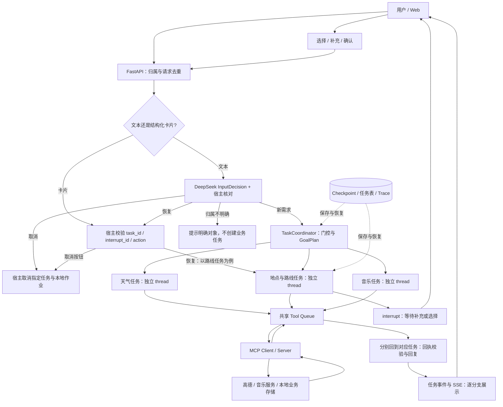
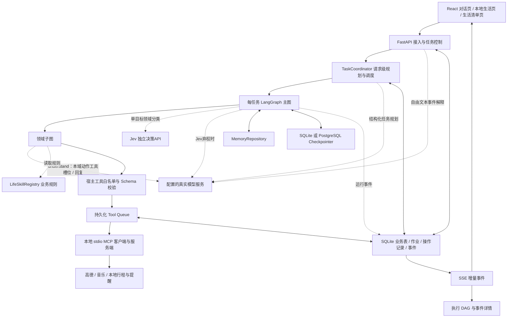
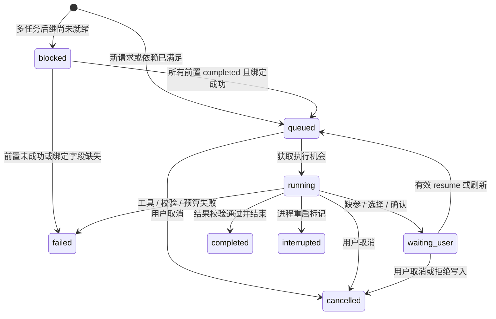
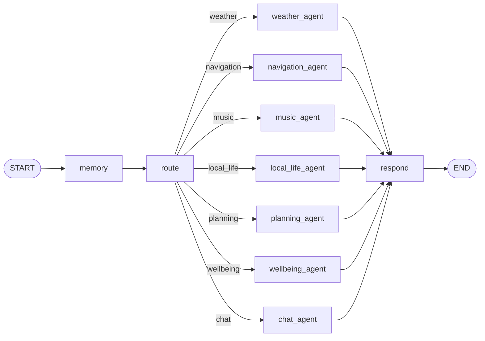
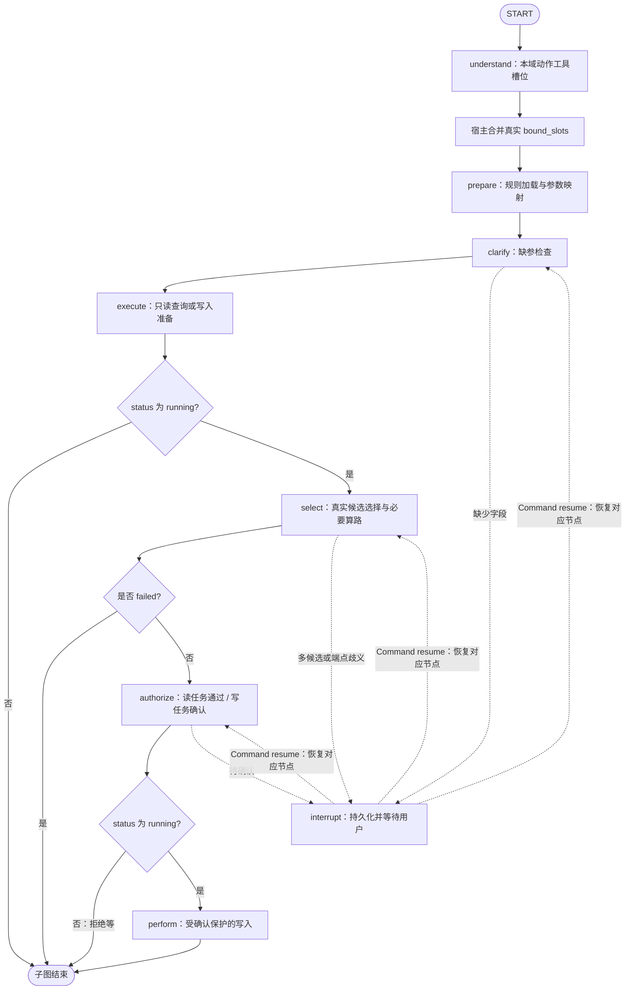
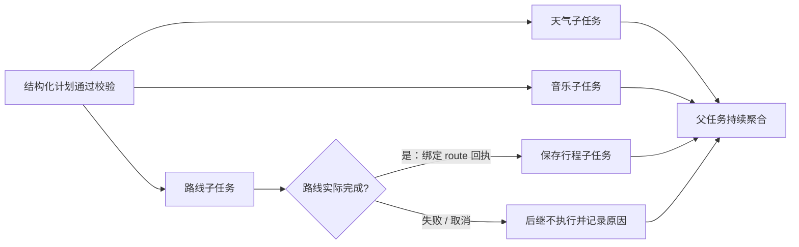
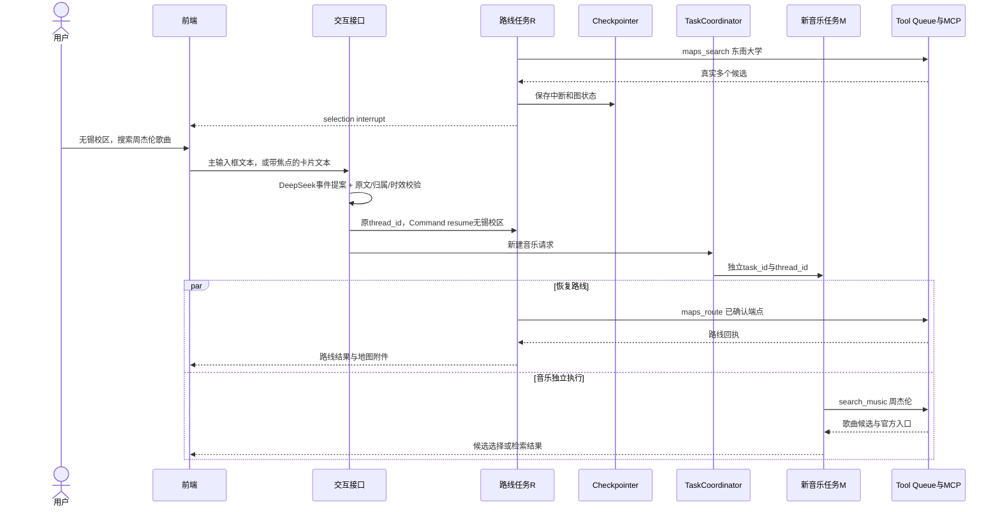
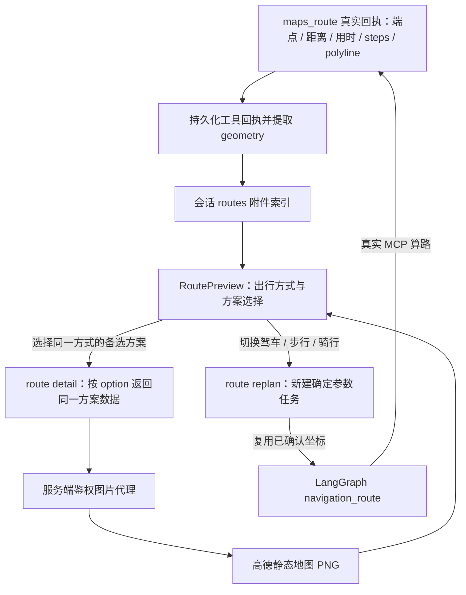

# LifePlus Agent Harness：架构、执行链路与面试指南

> 核对日期：2026-10-30。本文沿请求执行顺序解释当前架构、设计理由、容错、测试和面试答法。以当前工作区源码为准；示例不是运行日志，测量值必须附对应版本和条件。规划绑定与诊断修改已有局部真实模型配对，完整端到端仍待复测，二者不混用。
>
> 测量明细见 [测试总文档](../测试回报/测试总文档.md)，故障验收方法见 [18 问手册](LifePlus-Agent-Harness-18问与测试验收手册.md)。本文不重复版本流水账，不把旧测试结果当成最新代码成绩。

### 当前架构快照

| 层级 | 当前采用的方案 | 必须保留的边界 |
|---|---|---|
| 基础模型 | `deepseek-flash`，`MODEL_THINKING=disabled`；planner/intent/response 角色继承基础模型 | 角色分离不等于部署三个不同模型；Key 不进入文档 |
| 文本事件 | `INPUT_EVENT_PROVIDER=llm_direct`：先由 DeepSeek 提出 `InputDecision`，再由宿主核对 | 卡片选择、确认、拒绝和取消按钮仍走结构化协议；自由文本失败不猜测执行 |
| 任务数量门控 | `PLANNING_GATE_PROVIDER=rules`；疑似复合需求再调用全局规划 | 启发式会漏召回；规则只决定是否送规划，不直接按标点拆任务 |
| 全局规划 | `GoalPlan` 仅输出目标 Query、领域、依赖和结果绑定 | 不输出 `action/slots/tool_name`；内部 `TaskPlan` 兼容旧字段不是当前模型契约 |
| 绑定与输出校验 | 合法接收字段、来源路径、直接依赖和领域归属；一次有界修复附脱敏诊断 | 不静默改错字段、不删除依赖绕过校验；源路径实际存在性在运行时核验 |
| 单任务领域 | `DOMAIN_ROUTE_PROVIDER=jev_cascade`，Jev 高分接管，否则回退 DeepSeek | Jev 只分领域，不提槽位、不授权、不生成执行计划 |
| 领域执行理解 | `understand` 加载本域候选，一次结构化调用联合选择动作、初始工具和槽位 | chat/wellbeing 固定内部动作；表单、恢复及可信引用有各自路径 |
| 调度与证据 | Coordinator 按 DAG 启动就绪任务，把前置真实回执注入 `bound_slots` | 完成后才能绑定，模型不能用自己的摘要替换回执 |
| 最近真实基线（修复前） | 2026-10-30 无默认位置整轮 82/90 会话、117/130 目标完成 | 单并发、自动用户、真实 MCP；不能当作绑定契约修复后的准确率 |

配置模板显式选择上述策略；裸 `Settings` 的领域和事件默认仍为 `llm`，用于兼容旧部署。本文描述工作区源码；容器是否加载本版需单独验收，不把源码已修改、模板配置和服务已部署混为一谈。

## 阅读导航


| 阅读目的                   | 章节                                                                                                                 |
| -------------------------- | -------------------------------------------------------------------------------------------------------------------- |
| 先建立架构全貌             | [1. 背景与三层编排](#chapter-1)、[2. 接入与事件](#chapter-2)                                                         |
| 核对最新模型职责与选型 | 第 1.9、5 章：DeepSeek/Jev、GoalPlan、领域 understand；第 14.13 节：局部与全局 A/B 口述 |
| 沿用户输入走一遍           | [3. 信息整合](#chapter-3) → [4. 改写与绑定](#chapter-4) → [5. 理解与计划](#chapter-5) → [8. 图与调度](#chapter-8) |
| 重点准备信息澄清           | [6. 何时追问](#chapter-6)、[10. 中断恢复](#chapter-10)、[11. 两个编排挑战](#chapter-11)                              |
| 理解执行与记忆             | [7. 策略边界](#chapter-7)、[9. 工具队列](#chapter-9)、[12. 回执、SSE 与记忆](#chapter-12)                            |
| 准备容错五问，每题约三分钟 | [16. 五问深答](#chapter-16)：失败重试、Loop、格式错误、慢任务、工具治理                                              |
| 核实指标及生产边界         | [13. Trace 与迭代](#chapter-13)、[14. 评测与表达](#chapter-14)、[15. 时效与生产策略](#chapter-15)                    |
| 理解界面与接口             | [17. 路线与地图](#chapter-17)、[附录 D：接口速查](#appendix-d)                                                       |
| 面试前快速复习             | [两分钟介绍](#intro-two-minutes)、[附录 B：简历与追问索引](#appendix-b)、[最后六句话](#takeaways)                    |
| 按问题准备故障验收 | [18 问与测试验收手册](LifePlus-Agent-Harness-18问与测试验收手册.md)，具体架构和测量版本以本文及测试总文档为准 |

### 状态标记


| 标记         | 含义                                           |
| ------------ | ---------------------------------------------- |
| 已实现       | 能在当前源码中定位，不代表所有生产条件均验证   |
| 已有测试证据 | 说明日期、样本单位、模型和工具真假边界后再引用 |
| 可选接入     | 有实现与配置路径，不等于当前部署已启用或压测   |
| 设计扩展     | 建议实现的方案，不冒充已经落地                 |

### 一条复习主线

`接入去重 → 文本事件 LLM 或结构化卡片 → 上下文 → 单目标领域仲裁 / 全局 GoalPlan → Coordinator 调度 → 领域 understand → 宿主合并 bound_slots → 澄清/选择/确认 → Tool Queue 与 MCP → 回执校验 → SSE/地图/记忆/Trace → 目标级评测`

模型解释需求，协调器确定依赖，领域图推进状态，Harness 约束执行，工具回执提供事实。不要把这些职责都归到一次模型调用。

---

<a id="chapter-1"></a>

## 1. 项目背景与整体架构

### 1.1 项目解决什么问题

LifePlus 面向日常生活与出行服务，用户会提出：

- “无锡明天天气怎么样？”
- “找无锡站附近评分高一点的饭店。”
- “从杭州东站步行去西湖。”
- “搜索周杰伦的歌曲。”
- “把这个行程保存下来。”
- “明天上午九点提醒我出门。”
- “最近睡眠不好，有什么日常建议？”

难点不是生成一段流畅的文字，而是处理不完整需求、真实工具的限制、多轮任务状态以及执行失败。

例如“附近有什么饭店”没有明确参考地点：可以在配置适用时说明按设置地点查询，否则需要追问。系统不能把配置默认地址伪装成实时定位，更不能凭语言模型常识编造商家列表。

### 1.2 当前七个领域与十一项工具


| 领域         | 支持内容                            | 主要执行方式                                                          |
| ------------ | ----------------------------------- | --------------------------------------------------------------------- |
| `weather`    | 城市天气查询                        | `maps_weather`                                                        |
| `navigation` | 地点检索、路线规划                  | `maps_search`、`maps_route`                                           |
| `music`      | 歌曲检索及详情链接                  | `search_music`                                                        |
| `local_life` | 饭店、KTV、电影院、咖啡店检索与详情 | `maps_local_search`、`maps_place_detail`，需要路线时使用 `maps_route` |
| `planning`   | 行程保存、提醒创建/查询/取消        | 五个行程与提醒工具                                                    |
| `wellbeing`  | 一般生活健康知识                    | 本地知识检索与模型回答                                                |
| `chat`       | 日常对话                            | 模型生成                                                              |

`planning` 的五个工具为 `save_itinerary`、`create_reminder`、`list_itineraries`、`list_reminders`、`cancel_reminder`，总工具数为十一项。

能力边界必须讲准确：

- 路线规划返回路线及导航链接，不代表已经控制车机启动导航。
- 音乐检索返回歌曲及链接，不代表已经启动播放器。
- 商家检索不包含真实预订、实时排片、剩余座位或保证正在营业。
- 提醒是本地业务存储及站内通知能力，不等于短信、电话或系统推送服务。
- 健康知识不是诊断系统，交接摘要也不等于已经接通人工服务。

### 1.3 整体流程图

以下为职责图；不是每条请求都拆出三个任务。单目标直接运行，复合需求才规划并调度多个任务；每个分支独立核验回执并持续发布 SSE。



### 1.4 四个核心概念如何分工


| 概念            | 职责                                                   | 不负责什么                                   |
| --------------- | ------------------------------------------------------ | -------------------------------------------- |
| 大模型          | 理解请求、提取结构化参数、必要时规划多需求、组织回复   | 不能充当权限系统，也不能凭空确认外部执行成功 |
| LangGraph       | 定义节点、状态更新、条件分支与中断恢复                 | 不自动解决外部副作用的恰好一次执行           |
| TaskCoordinator | 创建子任务、判断依赖、启动可运行分支、汇总状态         | 不是各 Agent 自由竞价抢单的自治黑板          |
| Agent Harness   | 将接入、模型、流程、工具、状态、确认、证据与事件接起来 | 不是某一个提示词，也不是 LangGraph 的同义词  |

项目采用“宿主控制流程，模型提供受约束的决策”的方式。这样更容易定位：到底是理解错、参数错、工具错，还是状态恢复错。

### 1.5 live 与 demo：真实交互不等于每个节点都用模型

当前保留两种明确模式：`live` 使用配置的大模型及真实 MCP 服务；`demo` 使用规则和演示数据，主要用于可控教学与安全回放。live 模型配置缺失时，接入层会拒绝请求，不应悄悄切换到 demo。

模型结构化理解、日期规范化、候选索引解析、参数校验和权限检查本来就应该分工。看到某个节点使用规则，不能直接推断整个系统没有调用模型；应该看请求模式、模型调用事件、工具回执和最终证据。

本机配置为 `deepseek-flash`、关闭思考，单目标领域保留 Jev 级联，文本事件为直接 LLM，规划门控为 rules。角色名称、具体模型与判断策略是三个维度；事件、规划、领域提参和回复并没有全部改成 Jev。

**面试回答：**

> 我做的是生活与出行服务智能体，核心是有状态任务执行层。模型负责理解，LangGraph 负责领域流程，协调器负责任务依赖，Harness 负责把模型、工具、持久化和执行证据统一起来。重点是需求不完整时能暂停，补充后继续，以及多个需求能独立执行和分别反馈。

**源码对照：** [Harness](../src/car_agent/harness.py)、[协调器](../src/car_agent/orchestration.py)、[接口装配](../src/car_agent/api/app.py)。

### 1.6 为什么必须分清三层编排

三层编排分别管理请求目标、单任务流程和工具作业，不用同一份共享状态替代。

**任务级：**

由 `TaskCoordinator` 负责，位于 LangGraph 外部。

它回答的是：“这句话有几个任务？彼此依赖吗？哪些现在能启动？哪个正在等用户？哪些已经完成？”

例如“查无锡天气，搜索周杰伦歌曲，再找东南大学并规划路线，把路线保存到行程”可以生成四个逻辑任务：天气、音乐、路线、保存。前三个可以启动，保存必须等路线成功并拿到实际回执。

**单任务级：**

每个任务分别调用 LangGraph，持有独立 `thread_id`。主图负责记忆、路由、领域分发和回复；领域子图处理参数准备、澄清、查询、选择、确认与写入。

它回答的是：“这个任务现在缺什么？下一步能不能执行？用户回答应该恢复哪一个中断？”

**工具作业级：**

由 `ToolQueue` 管理真实调用的作业生命周期：入队、依赖、并发、超时、退避重试、取消、回执和 Dead Letter。

它回答的是：“这次工具调用是否已提交？还能等多久？能否重试？结果是否未知？是否允许复用旧回执？”

三层各自有状态，但不应相互替代：任务完成不能只看一个 job 成功，图可恢复也不能代替外部写操作的幂等保证。

### 1.7 组件与数据流



这里 `CO → MAIN` 表示协调器启动单任务运行，不表示所有任务串行。多任务会有多个独立的 `MAIN` 实例运行上下文。

多目标子任务复用 `GoalPlan` 的领域，不再各自重复领域仲裁；普通单目标才通常经过 Jev。Jev 弃权或不可用时由主图调用 DeepSeek，不是 Jev 自己生成参数或执行回退。

### 1.8 为什么选择这套技术架构

选型的主线不是“组件越多越像企业级”，而是把不确定的语言理解与必须确定的任务状态、权限、副作用和执行证据分开。每个组件都必须有明确责任和替代方案：


| 技术/组件          | 当前职责                                                             | 选择原因                                                                                | 不选它或扩容时怎么办                                                                                        |
| ------------------ | -------------------------------------------------------------------- | --------------------------------------------------------------------------------------- | ----------------------------------------------------------------------------------------------------------- |
| FastAPI + Pydantic | HTTP 接入、参数校验、任务控制和 SSE                                  | 主要负载是模型/工具 I/O，异步处理与结构化 Schema 适合这类服务；OpenAPI 也便于前后端对齐 | CPU 密集任务不应直接堆在 API 进程；规模扩大后要拆 worker 与网关                                             |
| TaskCoordinator    | 拆分复合请求、校验 DAG、调度就绪子任务和聚合部分成功                 | 任务依赖是请求级问题，与单个领域内部流程的生命周期不同                                  | 小型单任务可以不需要协调器；用一张巨型图也能实现，但动态子任务和独立中断更容易耦合                          |
| LangGraph          | 单任务的显式状态、条件边、领域子图、`interrupt/resume` 和 Checkpoint | 比自由 ReAct loop 更容易说清“现在在哪一步、为什么停下、从哪里继续”                    | 固定的简单 CRUD 用普通服务代码更直接；LangGraph 不是分布式事务或业务幂等的替代品                            |
| Agent Harness      | 统一模型、上下文、预算、权限、状态、工具与 Trace                     | 避免把模型调用、执行权限和恢复语义散落在每个节点                                        | Harness 是工程边界，不是一个新框架名称，也不能用一个大 Prompt 代替                                          |
| 持久化 Tool Queue  | durable job、依赖、并发、deadline、有限重试、取消与死信              | 工具调用的失败语义与图节点不同；持久作业方便追踪和重启后核对                            | 当前是 SQLite + 进程内 worker，不是 Celery/Kafka 级集群队列；多实例要改为 PostgreSQL 原子领取或外部消息系统 |
| MCP stdio          | 工具发现、Schema 与调用协议边界                                      | 工具实现与 Agent 编排解耦；本地 stdio 不需要额外网络服务，便于展示和测试                | MCP 不负责业务授权、重试与成功判定；远程 MCP 还需要认证、传输加密和服务级限流                               |
| SSE                | 服务端向前端递增传送任务、工具和部分结果事件                         | 交互主要是服务端单向推送；标准 HTTP、反向代理友好，可用事件序号续读                     | 用户选择/确认仍走 HTTP 命令；强双向实时场景可选 WebSocket，但不会自动获得可重放性                           |
| React + TypeScript | 对话、路线卡片、任务 DAG、领域子图和运行数据展示                     | 执行过程是持续变化的结构化状态，类型化组件比服务端拼 HTML 更容易维护                    | 前端只是投影，不能作为任务状态权威来源                                                                      |
| Docker Compose     | 固化私有展示环境、挂载数据卷和限制进程资源                           | 面试展示和单机复现成本低                                                                | Compose 不等于高可用编排；多副本、滚动发布、秘钥管理和自动扩缩容仍需要部署平台                              |

选型时遵循三条约束：第一，模型只提交结构化意图，不直接获得工具权限；第二，任务状态、图状态、工具作业和业务回执分层保存；第三，本地默认优先可复现，生产扩展不写成已完成的性能结论。

### 1.9 模型职责怎样拆，为什么没有全交给 Jev

| 决策阶段 | 输入 | 输出及后续消费者 | 当前实现 |
|---|---|---|---|
| 交互事件 | 本轮原文、有效待回复任务、最近六条消息、可选焦点 | `InputDecision` → 宿主恢复/新建/取消/追问 | DeepSeek；不是业务领域分类 |
| 全局规划 | 新需求、摘要、偏好、有效引用 | `GoalPlan` → Coordinator | DeepSeek planner；疑似复合请求才调用 |
| 普通单目标领域仲裁 | Query、摘要、偏好、有效引用 | 七领域之一 → 主图分支 | Jev；defer、低分、异常回退 DeepSeek |
| 领域执行理解 | 本领域目标、本域动作与工具 Schema、上下文、绑定字段 | `domain/action/tool_name/slots` → prepare | DeepSeek intent；模型不能跨域或填宿主身份 |
| 最终表述 | 状态、工具回执、必要的历史/规则 | 可展示文字 → SSE | 部分领域已有确定性答复，其他路径用 response 模型 |

**为什么这样设计：** 分类可以做成封闭选项，但拆分复合原文、规划依赖和提取开放参数不是选一个标签就结束。Jev 用独立 HTTP 决策 API，不作为聊天模型 URL 使用，也不能凭高置信度替代授权。

领域接管同时要求 `confidence ≥ 0.8`、所选项 `probability ≥ 0.9` 且不是 `defer`；单次 Jev 默认超时 1.5 秒。它们是可配置的工程门槛，不是校准后的“90% 正确保证”，更不是缺参澄清阈值。低分或不可用返回空决策，由主图调用原 LLM。

**测试与边界：** 领域 Jev 的局部提速、全链路效果及 Token 代价见第 14.13 节同基准配对，不从单例推断总体。文本事件 Jev、单多任务 Jev 门控、combined front、compact planner 均未作为当前配置启用。

**面试回答：**

> 我把语言决策按职责拆开：事件层只确定回复属于哪个任务，全局只拆目标和依赖，领域层才选动作、初始工具和参数。这样不用让全局 Planner 携带所有工具 Schema，也不会把 Jev 分类标签当成可执行方案。单目标领域分类采用 Jev 加 DeepSeek 回退，事件理解则保留直接 DeepSeek，因为配对实验中加 Jev 过滤反而更慢。选型以同基准下的局部与完整链路测试为依据，不把少调用一次模型直接等同于更省钱。

**源码与证据：** [领域仲裁](../src/car_agent/domain_routing.py)、[模型角色](../src/car_agent/model_roles.py)、[领域理解](../src/car_agent/domain_understanding.py)、[DeepSeek 切换记录](deepseek-rollout.md)、[当前测试总文档](../测试回报/测试总文档.md)。

<a id="chapter-2"></a>

## 2. 用户输入后：请求接入与事件分类

### 2.1 为什么不能收到一句话就直接重新路由

用户说“第二个”，离开状态无法理解；用户说“好的”，也不一定是在授权写入。

事件分类要回答的是：**这次输入要作用于哪个任务、哪个等待位置，是恢复已有流程，还是创建新的流程？**

这与“天气还是音乐”的业务意图分类不是同一层问题。

### 2.2 各类标识分别是什么


| 标识             | 用途             | 例子或注意事项                         |
| ---------------- | ---------------- | -------------------------------------- |
| `user_id`        | 资源归属         | 本地身份头不是生产认证凭证             |
| `session_id`     | 对话容器         | 可以包含多个独立任务                   |
| `request_id`     | 接入去重         | 同 ID 不允许换内容、会话或模式         |
| `task_id`        | 实际运行与控制   | 恢复、取消、查看链路都针对它           |
| `parent_task_id` | 多任务父子关系   | 父任务聚合，不存放所有分支的临时槽位   |
| 计划逻辑`id`     | DAG 依赖引用     | 如`t_route`，需映射到实际子任务 UUID   |
| `thread_id`      | 图持久化定位     | 当前新任务通常为`session_id:task_id`   |
| `interrupt_id`   | 一次待处理交互   | 防止旧页面回复落到新的中断             |
| `job_id`         | 一次工具作业     | 一个任务可以有搜索、详情、路线多个作业 |
| `operation_key`  | 绑定确认与写操作 | 参数变化后不能沿用旧授权               |
| `checkpoint_id`  | 历史图快照定位   | 不等于操作流水号                       |

`request_id` 不能替代 `task_id`：前者防止同一次提交重复创建，后者要在多次补充和恢复中保持稳定。

**身份边界：** 本地模式按请求头提供用户命名空间，接口核对数据归属，但不等于生产认证。showcase 模式用 HTTP Basic Auth 保护受邀单实例展示；它也不是多租户 IAM。production 模式在接入真实身份服务之前拒绝演示身份和未验证 Bearer 令牌，不能只切换配置就视为安全上线。

代码还会在图输入中生成内部 `request_id`，与入口去重标识不完全相同。排查时要同时沿任务表与事件关联，不能宣称当前所有层已经使用同一个请求标识。

### 2.3 当前如何分类：文本先 LLM，卡片走协议，执行仍由宿主裁决

当前 live 显式配置 `llm_direct`，即使输入是“第二个”或没有任何等待任务，也先调用事件 LLM；不先运行旧的文本规则或 Jev 过滤。`demo` 仍确定性运行。

| 输入来源 | 当前解释方式 | 后续硬校验 |
|---|---|---|
| 主输入框自由文本 | DeepSeek 输出 `new/resume/cancel/clarify` | 原文完整覆盖、任务归属、候选唯一且有效 |
| 卡片内手工输入 | 同一文本解释器，附带焦点 task_id | 不允许恢复其他任务；不是因为在卡片里就自动跳过模型 |
| 候选按钮 | `task_id + interrupt_id + action=answer + value.index` | 索引来自当前真实候选，不调用文本事件模型 |
| 确认/拒绝按钮 | `action=approve/reject` | 必须是 approval 中断，且授权凭证绑定参数 |
| 取消按钮/接口 | 任务归属与生命周期协议 | 取消指定任务和所属本地执行，不需要文本分类 |
| 补充并新增需求的文本 | LLM 分出旧回复和新增需求原文片段 | 两片段不重叠且不遗漏实质内容；新增片段可再含多个目标 |

例如在候选选择时提交：

```json
{
  "interrupt_id": "i_select_01",
  "action": "answer",
  "value": {"text": "第二个，同时查杭州天气"}
}
```

事件模型提出的结构为：

```json
{
  "route": "resume", "task_id": "t_navigation",
  "answer": "第二个", "new_query": "查杭州天气", "question": null
}
```

示例 task_id 必须来自本次输入附带的有效等待任务列表。宿主再校验：两片段逐字来自原文，除允许连接词和领域标签外没有残余需求；候选唯一匹配，且不是过期或审批中断。核验通过才把“第二个”交给旧流程，把天气片段创建为新请求。

**不是把整句话再次送进路由器，覆盖原任务的 domain 与 slots。**

### 2.4 为什么这样选，替代方案是什么

显式恢复协议的优点是绑定明确、可审计，尤其适用于选择与确认按钮。缺点是依赖客户端携带正确的任务与中断标识。

旧的 `llm` 策略是高精度规则优先、未命中再交 LLM，优点是确定回复可以零模型，缺点是规则对表达和连接词敏感。用户批准的当前 `llm_direct` 统一解释自由文本，便于覆盖复合语义，但会增加简单回复的一次调用。它比 Jev 文本过滤快，不代表比规则零模型路径快。

**当前边界：** 一次最多恢复或取消一个旧任务；附带的新增原文片段可以再拆为多个新目标。多个列表都能接收“第二个”就追问；“歌曲第二首”可凭明确领域定位。“好的”不能直接批准写入。候选别名不能唯一匹配、原文拆分遗漏、过期或焦点不一致都拒绝执行。事件模型失败返回 `503 INPUT_EVENT_UNAVAILABLE`，提示使用卡片或重试，不静默降级为规则猜测。事件级不明确返回 `409 INPUT_EVENT_CLARIFICATION_REQUIRED`；这与领域图内缺参数的 `interrupt` 不是同一个暂停位置。

**怎么测：** 36 条冻结事件样本分纯回复、复合回复、边界各 12 条，验 route、task_id、候选索引与全部原文需求，而非只验标签。DeepSeek 的直接方案与 Jev 过滤都是 34/36；两条边界错误为过度追问取消对象、把带引号的词义提问误认为选择。额外工程测试强制模型给错任务、漏需求、越界索引、过期候选和审批文本，验证不会越过宿主校验。

### 2.5 去重与锁如何避免重复提交

入口在按用户划分的入站锁内查请求记录，避免同用户跨会话并发绕过新任务数量限制：

- 标识相同且用户、会话、内容、模式一致：返回已有任务。
- 标识相同但内容或归属冲突：返回 409，而不是新执行一次。
- 执行锁按 `execution:<task_id>` 管理，避免同一任务同时执行两遍。

主输入框还有 `conversation-input:<owner>:<session_id>` 锁，保护事件判断与恢复/创建决策；当前文本 LLM 调用也在这个临界区内，因此同会话连续输入会等待上一条事件解释，不能说该锁只覆盖几次本地读写。它不覆盖后续完整任务执行。恢复、刷新、重试和取消共享 `lifecycle:<root_task_id>` 锁，在同一根任务范围内串行化状态变更。每用户排队/运行中的根任务默认最多八个；先检查重复请求，再检查数量，重传不会额外占用配额。该限制不是供应商全局 QPS 限流。

**注意：并不是把整个会话从开始到结束用一把大锁锁死。** 否则一个任务等待澄清会阻塞同会话的新任务。

当前这些锁是单进程 `asyncio.Lock`。多实例部署需要数据库约束、原子状态迁移或分布式协调，不能直接声称已经有分布式并发保证。

**面试回答：**

> 我先分交互事件，再做业务意图。按钮操作用结构化协议；自由文本现在先由 DeepSeek 提出事件方案，但模型只提供建议，宿主要验证任务、原文、候选和授权。比如“第二个，同时查天气”，前半句恢复原中断，天气另建任务；如果两张卡片都可能接收“第二个”，就不能凭最近一条猜。规则优先仍可回滚，但不是当前文本配置。

**源码对照：** [事件模型与原文校验](../src/car_agent/input_events.py)、[候选解析](../src/car_agent/user_events.py)、[接口及锁](../src/car_agent/api/app.py)、[文本策略启用记录](llm-direct-rollout.md)。

### 2.6 为什么状态要分层持久化

同一会话可能同时存在一个等用户选校区的路线任务、一个正在查天气的任务和一个已完成的音乐任务。若都写进同一个共享任务状态，“无锡校区”就可能错误填进天气城市，“第二个”也可能选错列表。


| 数据                                 | 主要位置                                | 理由                             |
| ------------------------------------ | --------------------------------------- | -------------------------------- |
| 会话、任务、计划、当前中断           | SQLite`sessions/tasks`                  | UI 查询、幂等接入和任务控制      |
| 图状态、后继节点、中断与图元数据     | Checkpointer                            | 图继续执行所需的线程状态         |
| 工具参数、依赖、尝试次数、期限和回执 | SQLite`tool_jobs`                       | 真实调用可追踪、可取消           |
| 最终失败作业                         | `tool_dead_letters`                     | 排查与人工核对，不是自动无限重放 |
| 写入记录与业务回执                   | `operations/tool_receipts` 及业务表     | 区分已写入、失败与结果未知       |
| 对话上下文                           | 可选 Redis 缓存，MySQL 或 SQLite 持久化 | 快速读取并跨请求恢复             |
| 长期偏好                             | MySQL 或 SQLite                         | 独立于某一次任务线程             |
| Trace 与 bad case                    | `events/task_reviews`                   | 归因、数据回流和展示             |

配置 PostgreSQL Checkpointer，不会自动把上述所有 SQLite 业务表迁移到 PostgreSQL；配置 MySQL 也不等于队列已变成 MySQL 队列。

`conversation_inputs` 保存主输入框恢复输入及幂等回执，`conversation_references` 保存会话内已完成任务的紧凑实体证据。完整消息、模型窗口与实体引用不是一张表或同一套有效期。

#### 2.6.1 先区分权威数据、快照、缓存和可重建索引


| 类别             | 代表数据                                                                            | 恢复原则                                                      |
| ---------------- | ----------------------------------------------------------------------------------- | ------------------------------------------------------------- |
| 业务权威事实     | `tasks`、`tool_jobs`、`operations`、`tool_receipts`、`itinerary_items`、`reminders` | 必须从持久层查询，不从模型文本或前端状态反推                  |
| 图执行快照       | LangGraph Checkpoint 的 values、next、interrupt 和元数据                            | 用于沿原 thread 继续，但不能证明外部副作用已成功              |
| 有时效的交互快照 | 候选列表、已选 POI、会话引用、MemoryBrief                                           | 恢复时复验 owner、task/interrupt 和有效期，过期后重查而不续命 |
| 可丢失缓存       | Redis 中的会话摘要与受限历史                                                        | miss 后从 MySQL/SQLite 持久层回填；不作为写操作成功证据       |
| 可重建派生数据   | Chroma/本地向量索引                                                                 | 由`knowledge/*.md` 重建；原文和版本是权威来源，向量库不是     |

这个区分决定了故障处理：Redis 丢失可以回源，Chroma 损坏可以重建，但 `tool_receipts` 丢失后不能让模型猜“应该写成功了”。

#### 2.6.2 为什么本地默认选 SQLite

当前仓库的实际默认是 `aiosqlite + SQLite` 单文件数据库。会话、任务、运行预算、事件、bad case、工具 job、死信、幂等操作、本地行程/提醒与会话记忆都有真实表。选它不是因为 SQLite 比 PostgreSQL 更“企业级”，而是当前阶段的约束是单机展示、可复现回归和最低部署成本：

1. **零外部依赖：** 拉取仓库即可创建库，Docker 只要挂载一个数据卷。
2. **事务与约束足够表达当前逻辑：** 本地行程写入和 `tool_receipts` 可以在同一 SQLite 事务中提交，用联合主键拒绝同幂等键异参重放。
3. **测试隔离简单：** 每个用例使用临时库，能直接检查任务、job、回执和业务行，不只断言最终文字。
4. **运维和取证直观：** 数据文件可备份，断网演示仍可查看 Trace 与历史证据。

它的边界同样要说清：当前应用用单进程 `asyncio.Lock` 串行化通用写入，没有据此验证多实例高并发；也没有完整的 schema migration 框架、高可用、在线备份和自动故障转移。应用表和 AsyncSqliteSaver 即使指向同一文件，也由不同连接提交，**不是一个覆盖任务表、Checkpoint 和外部工具的原子事务**。

因此准确表达是：“SQLite 是当前单实例及验收环境的权威业务存储”，而不是“SQLite 已支撑了生产分布式队列”。

#### 2.6.3 Redis 和 MySQL 为什么只放在记忆层

`MemoryRepository` 把会话摘要和受限 `ModelHistory` 先持久化到 MySQL/SQLite，配置 Redis 时再写入带 TTL 的缓存。读取时 Redis 命中直接使用，miss 才回源并只续剩余有效期。

- **Redis 的理由：** 上下文读频高、有明确 TTL、可从持久层重建，适合做缓存而不是业务成功证据。默认上下文时效为 30 分钟，不是 Redis key 存在就永不过期。
- **MySQL 的理由：** 长期偏好和会话摘要需要跨进程持久化；很多业务已有用户中心/MySQL，可以只把这部分接入既有数据库。
- **为什么不全部放 Redis：** TTL、内存驱逐和运维操作都不应让用户偏好或写入证据无声消失。
- **为什么不强制 MySQL：** 对当前单机展示会增加部署复杂度；未配置时 SQLite 实现同一仓储接口。

边界：当前存在假 Redis 的时效/回源回归，但本文引用的完整验收没有证明 Redis Cluster 故障转移或 MySQL 主从切换。一旦显式配置后连接失败，当前启动路径也不是完整的自动降级方案。

#### 2.6.4 PostgreSQL Checkpointer 解决什么，不解决什么

配置 `CHECKPOINT_POSTGRES_DSN` 时，LangGraph 使用 `AsyncPostgresSaver`；未配置时使用 `AsyncSqliteSaver`。选 PostgreSQL 作为生产 Checkpoint 方向，是因为它更适合多连接、服务端并发、备份和运维观测。

但当前这个开关只替换**图 Checkpoint**，不会自动迁移 `tasks/tool_jobs/events/operations` 等应用表。若要多实例上线，需要将应用权威表也迁到服务端数据库，为 job 领取使用条件更新或 `FOR UPDATE SKIP LOCKED`，并设计状态对账/outbox。单独换 Checkpointer 不等于完成分布式一致性。

#### 2.6.5 Chroma 为什么是可重建的 RAG 索引

健康知识文档从 `knowledge/*.md` 按标题切分，生成本地确定性哈希向量。安装 Chroma 时持久化到指定目录，未安装时使用内存 local-vector 检索。选 Chroma 是因为小型本地知识库容易复现，能保存向量和 source 元数据，不需要先运维独立检索集群。

当前不应宣称的部分：这不是专业语义 embedding，没有 BM25/混合检索/reranker 的实测收益，也没有完成删除旧 chunk、原子索引版本切换和回滚。大规模资料或多实例可考虑 pgvector/OpenSearch/托管向量库，但必须用检索质量、更新 SLA 和成本数据决策，不是为了增加技术名称。

#### 2.6.6 跨存储一致性如何处理

本地行程/提醒与 `tool_receipts` 在同一工具服务事务内写入，解决“业务行已成功但本地幂等回执没有记录”的一类问题。但下列操作仍然分属不同事务：

1. API 创建 task；
2. LangGraph 提交 Checkpoint；
3. Tool Queue 创建/更新 job；
4. 外部服务真实执行；
5. 回执、事件与最终答复落库。

当前通过状态机、幂等键、重启扫描和结果未知隔离降低风险，没有宣称跨存储 exactly-once。生产需要定义每个状态的权威来源，使用 outbox/inbox、周期对账和可查询的上游幂等能力，而不是用一个“分布式锁”包住全流程。

#### 2.6.7 从当前展示到生产的存储演进


| 阶段              | 建议组合                                                             | 适用范围与上线门禁                                                                |
| ----------------- | -------------------------------------------------------------------- | --------------------------------------------------------------------------------- |
| 本地开发/面试展示 | SQLite + AsyncSqliteSaver + 可选 local-vector/Chroma                 | 单实例、数据卷持久化、定期备份；不声称 HA                                         |
| 私有单机服务      | SQLite 或服务端数据库 + 可选 Redis                                   | 要做磁盘备份、恢复演练、数据保留/删除策略和容量阈值                               |
| 多实例生产        | PostgreSQL 统一业务状态/Checkpoint/job 或明确的分库边界 + Redis 缓存 | 原子 job 领取、多 worker 竞争、outbox/对账、迁移工具、备份恢复、主从/故障切换实测 |
| 大规模知识服务    | 独立文档源 + 版本化索引 + 选定的向量/混合检索系统                    | 增量更新、删除传播、原子切换、回滚、检索评测与租户隔离                            |

**面试回答：**

> 我没有把 SQLite 包装成生产集群方案。当前是单机可展示、可回归的 Agent 项目，SQLite 无外部依赖，又能用事务和唯一约束保存任务、工具 job、回执和 Trace，测试也能每例使用独立临时库。所以它是当前阶段的主动选择，不是最终容量结论。
>
> 数据上我分四类：任务、job 和业务回执是权威事实；LangGraph Checkpoint 是图恢复快照；Redis 只是带 TTL 的会话缓存；Chroma 是可由原文重建的派生索引。这样 Redis 丢失可回源，索引损坏可重建，但工具回执绝不能靠模型猜。
>
> 生产多实例时，我会优先把业务权威表、job 领取和 Checkpoint 收敛到 PostgreSQL 或者明确分库边界，Redis 继续做缓存，再增加 schema migration、outbox/对账、备份恢复和故障切换测试。当前代码支持 PostgreSQL Checkpointer 和 MySQL/Redis 记忆配置，但没有把这说成已经验证过集群容灾。

**测试与证据：** SQLite 是当前后端、工具幂等、重启恢复和完整验收的实际后端；Redis 时效与 durable fallback 有受控回归。当前没有 Redis Cluster、MySQL 主从、PostgreSQL 高可用或 Chroma 集群的真实故障注入报告。源码见 [persistence.py](../src/car_agent/persistence.py)、[memory.py](../src/car_agent/memory.py)、[api/app.py](../src/car_agent/api/app.py)、[rag.py](../src/car_agent/rag.py)；实测边界见 [回归报告](regression-2026-10-23.md)。

### 2.7 接入的真实顺序与去重边界

普通消息先校验会话归属，在会话输入锁内查 `conversation_inputs` 和已有任务；相同请求返回原回执，内容、模式或归属冲突返回 409。随后收集当前 waiting_user 任务，执行文本事件解释及宿主核验；`new` 才走新任务准入，`resume/cancel` 作用于旧任务，`clarify` 不创建业务任务。已有请求重传在模型前返回，不再次付费解释。

新建 live 任务需要真实模型配置；用户排队/运行根任务默认最多 8 个，超限返回 429。恢复仍复用中断时效、生命周期锁与累计预算，并不因输入来自聊天框而跳过验证。会话输入锁不阻塞已运行任务，但文本解释本身可能持锁到模型结束；多实例及缩短临界区需单独设计版本校验，不能简单移除锁。

### 2.8 任务状态如何迁移



父任务还可能是 `partial`，表示一些分支完成、另一些未成功。当前协调器把 `interrupted` 也作为终态处理；不要把重启后的 `interrupted` 说成仍会无条件自动推进。

<a id="chapter-3"></a>

## 3. 信息整合：模型理解前究竟准备什么

### 3.1 输入不是只有 Query

同一句“去那里”，可能对应商家、学校，也可能根本没有明确指代。上下文准备至少要区分：


| 信息         | 主要来源                         | 使用方式                           |
| ------------ | -------------------------------- | ---------------------------------- |
| 当前 Query   | 当前请求                         | 用户当轮明确要求优先               |
| 历史对话     | 任务与消息记录                   | 提供近期语义背景                   |
| 当前任务参数 | 该任务图状态                     | 不能与另一个任务的参数混用         |
| 候选快照     | 工具回执与中断载荷               | “第二个”绑定到这次列表           |
| 用户偏好     | 用户级记忆                       | 只能作为默认偏好，不能覆盖当轮要求 |
| 当前时间     | 服务端北京时间                   | 解析今天、明天与提醒时间           |
| 位置         | 明确输入、表单配置或未来定位接口 | 必须区分位置来源，不能假装实时 GPS |

### 3.2 默认“东南大学无锡国际校区”是什么

它是应用配置的参考地点，不是设备 GPS。当前 location_defaults 会在导航请求缺少/仅相对描述起点时补入配置地址；本地生活缺参考点且城市与默认城市不冲突时，也可补入默认参考点。事件记录 source=configured_default、realtime_gps=false，不能把目的地误当当前位置。

用户明确给出的起点优先；配置为空或不适用时再澄清。跨城市周边搜索不能把无锡默认地点强塞给杭州请求。更精细的位置 source/updated_at/accuracy/expires_at 统一溯源属于设计扩展，不宣称已有实时定位体系。

**为什么这样选：** 学习与展示有一个可解释的起点，同时保留来源边界。测试既要覆盖配置默认点，也要清空默认配置验证缺参追问，不能把“缺起点一定追问”当成所有环境的事实。

### 3.3 信息冲突时怎么处理

推荐优先级为：当轮明确表达 > 本次有效澄清/选择 > 当前任务绑定证据 > 长期偏好 > 可解释的默认值。

这是一套设计原则，不代表代码中已经存在完整通用的冲突裁决引擎。

例如用户偏好驾车，但当轮说“步行去西湖”，不能继续使用驾车模式。用户选择了 POI 的实际坐标，就不能再让模型根据名称生成另一个终点。

### 3.4 为什么不把所有历史都塞进去

历史过长会增加成本，也会让旧任务的地点和当前任务混淆。

当前使用近期消息窗口与 `MemoryBrief`。这解决长度问题，但不能单凭摘要保证“那里”一定绑定正确；关键实体仍需结构化保存并按任务使用。

**面试回答：**

> 我把会话背景和任务事实分开。近期对话帮助模型理解语义，槽位和候选快照决定具体执行对象，用户偏好只做辅助。特别是位置，配置默认点与实时定位严格区分，不会让模型补出一个不存在的当前位置。

**源码对照：** [上下文构建](../src/car_agent/memory.py)、[任务状态字段](../src/car_agent/models.py)。

---

<a id="chapter-4"></a>

## 4. Query 改写与实体绑定：不要把设计能力当成实测模块

### 4.1 当前具体做了什么

当前版本没有独立的“Query 改写模型 → 改写评测”完整流水线。

`resolved_query` 字段存在，但路由返回时通常仍等于原始 Query。真正已经发挥作用的是：

1. 近期历史和摘要辅助模型理解。
2. 某些显式起终点、日期与动作的确定性规范化。
3. 恢复时按待补充字段接收回答。
4. 候选选择后按索引、名称和 POI ID/坐标绑定实体。
5. 在有效、无歧义的会话证据下，有限模式的“那明天呢”“骑行过去”可由宿主绑定来源任务；第一条输入回溯则直接查询归档，不依赖改写。

因此 `resolved_query` 只是状态字段，不能据此声称已运行独立改写模型或具有独立改写准确率。

### 4.2 为什么“第二个”最好不要只做成文字改写

系统展示两个商家后，用户说“第二个”。

不够可靠的方式是改写成“查询第二个饭店的详情”，再让模型重新搜索。结果可能排序变化，选中的店就变了。

更可靠的方式是：

```json
{
  "task_id": "t_restaurant",
  "interrupt_id": "i_select_01",
  "selection": 2,
  "selected_poi_id": "POI_DEMO_B",
  "selected_location": "120.300000,31.600000"
}
```

这段 JSON 是解释绑定关系的示例，不是声称当前所有键都原样存在于 `AgentState`。当前选择通常记录在 `slots.selection`，POI 与坐标来自工具结果。

### 4.3 跨域追问有哪些风险

“查无锡天气”之后说“杭州呢”，可以理解为替换城市；“搜索周杰伦歌曲”之后说“介绍一下陶喆”，则应该转为人物介绍，而不是继承音乐搜索动作。

因此上下文补全只能补充用户省略的内容，不能强行保留旧任务的业务动作。

当前对任意跨轮自由指代没有全面的独立验证集。面试中可以讲设计和已有场景，不要承诺所有跨域改写已可靠覆盖。

### 4.4 如何验收上下文补全

当前应测试已实现路径，而不是把一个未接入的独立改写器放进架构图。每条样本标注原意、来源 task/candidate、保留约束及允许追问，分别验证：

- “第二个”绑定本次候选，不重新搜索后取另一个第二名。
- “那明天呢”保留有效城市，只改变用户明确要求的日期。
- “骑行过去”复用唯一有效端点，不继承过期路线事实。
- 有多个可指代对象或含否定时，不能靠流畅改写掩盖歧义。

原文回溯做精确字符串核对；实体绑定看 ID/坐标；新需求是否丢失看目标覆盖。这些不合并成一个未经标注的“改写准确率”。

**面试回答：**

> 我没有把所有多轮能力归结为一句 Query 改写。选择类追问优先绑定候选快照，缺参补充恢复原节点，开放式追问再利用历史做理解。关键是不能让改写改变用户要做的事。

**源码对照：** [路由与参数规范化](../src/car_agent/harness.py)、[选择解析](../src/car_agent/user_events.py)。

---

<a id="chapter-5"></a>

## 5. 意图识别与多任务规划

### 5.1 当前是目标规划与领域执行理解分层

事件层先确定这条文本是新需求还是恢复旧任务。只有新需求进入下列路径：

```text
新请求
  → rules 判断是否疑似复合需求
  → 普通单目标：不调用 Planner → 主图 route 做 Jev/DeepSeek 领域仲裁
  → 疑似复合：DeepSeek 输出 GoalPlan → 校验目标、依赖与绑定
  → 一项目标沿原任务运行；多项目标由 Coordinator 建独立子任务
  → 每个领域子图 understand 联合选择动作、初始工具并提取槽位
  → 合并宿主 bound_slots → prepare 映射最终工具参数
```

主图 `route` 只确定领域，不再返回动作和槽位。多目标的领域来自已校验计划，通过 `prepared_decision.domain` 复用；它们仍需各自执行领域 `understand`，不能因为全局已经拆过任务就跳过提参。

这是两种不同的“先后”：复合请求先全局拆目标、指定领域，再在领域内选工具与提参；普通单目标先领域仲裁，再执行理解。全局 Planner 不加载全部工具参数，领域才加载自己的候选。

本地生活结构化表单经过校验后，也可以直接携带决策进入流程。这不等于自然语言请求全部绕过了模型。

### 5.2 领域结构化输出长什么样

用户：“找无锡站附近三公里内，人均一百以内的饭店。”

```json
{
  "domain": "local_life",
  "action": "local_search",
  "tool_name": "maps_local_search",
  "slots": {
    "category": "restaurant",
    "anchor": "无锡站",
    "city": "无锡",
    "radius_m": 3000,
    "max_cost": 100
  }
}
```

模型只负责表达需求。`max_cost=100` 并不能证明搜到的店真的符合预算，必须由真实工具字段过滤。

候选由宿主 `DOMAIN_TOOLS + TOOL_CATALOG + OPERATIONS` 生成；`decision_schema(domain)` 仅暴露本域合法字段，校验动作与工具配对。例如 `planning/list_reminders` 不能配 `cancel_reminder`。宿主 `user_id/idempotency_key` 不作为模型可填参数。导航动作先选 `maps_search`，真实地点确认后的 `maps_route` 由领域流程构造，不是模型拿到任意循环调用权。

### 5.3 为什么不用开放文本描述计划

开放文本“先帮用户找饭店，再推荐一家”不便执行和检查。

结构化决策的好处是能明确限制：领域枚举、动作集合、数字范围、时间格式、参数归属。非法字段可以在进入工具前暴露。

但 **JSON 合法不等于语义正确**。城市、日期、对象仍可能抽错，所以需要独立标注和目标核验，不能只看 Pydantic 解析成功率。

### 5.4 两层可靠性措施

第一层是输出契约：必需结构、枚举和类型校验；格式错误可以有限修复一次。

第二层是宿主语义与证据校验：领域动作/工具必须配对，字段不能跨域；之后规范化日期、明确起终点及方式，并合并真实前置证据。不能把任意非法动作名先放行再改成合法动作；自然语言模型输出先过枚举 Schema，旧决策兼容路径与宿主规范化不等于放宽当前模型契约。

对于 `planning` 和 `local_life` 这样的多动作领域，不能用一个动作覆盖所有模型结果，必须校验动作属于该领域。

网络错误不属于 JSON 格式错误，不应通过反复“请重新输出 JSON”来解决。

### 5.5 多任务计划如何表达依赖

下面是**教学示例，不是实际运行记录**：

```json
{
  "tasks": [
    {"id":"t_weather","query":"查无锡今天的天气","domain":"weather","depends_on":[],"bind_slots":{}},
    {"id":"t_route","query":"从杭州东站步行到西湖","domain":"navigation","depends_on":[],"bind_slots":{}},
    {"id":"t_music","query":"搜索周杰伦歌曲","domain":"music","depends_on":[],"bind_slots":{}},
    {"id":"t_save","query":"把刚才的完整路线保存到行程，标题为西湖出行路线","domain":"planning","depends_on":["t_route"],"bind_slots":{"details":"t_route.route"}}
  ]
}
```

- `depends_on` 约束启动时机。
- `bind_slots` 约束输入的数据来源。
- `t_route.route` 指前置任务的实际路线回执，不是模型预先编出的摘要。
- 左侧 `details` 是保存任务接收的业务字段，右侧 `t_route.route` 是证据路径；不能写成 `{"result":"t_route.route"}`。
- 天气和音乐独立于路线，不会因为说话顺序在后就强制等路线。
- “然后”是语言提示，不是无条件添加依赖的规则；依赖应来自业务数据和控制条件。

全局 `GoalPlan/TaskGoal` 禁止额外字段，不能加 `action/slots/tool_name`。为兼容历史计划、检查点与表单，内部 `TaskPlan/PlannedTask` 仍保留 action/slots；不能拿内部落库结构冒充新 Planner 输出。Query 中必须保留用户给出的城市、日期、方式和否定，不能因为移除了 slots 就丢约束。

当前 Pydantic 与 DAG 校验要求：任务数 1～6；ID 唯一；依赖不重复、存在且无环。GoalPlan 的绑定接收字段限定为 `details/origin/destination/city/anchor/poi_id/keyword/title/reminder_id`，并在计划校验时检查接收领域是否支持该字段。来源路径必须匹配 `任务ID.(selected|route|result|slots)[.子字段...]`，只引用直接依赖。出行方式枚举在领域层检查，不是当前 GoalPlan 自由生成的字段。

Schema 能限定字段和路径形式，不能证明 `t_route.route` 当时真的存在。实际路径在前置成功后由 `_bind` 读取；不存在就拒绝后继执行。领域 understand 还会再次检查 bound_slots 是否跨域。

格式、枚举或依赖非法时，最多做一次结构化修复，仍失败就终止规划，不提交工具。不应靠“接口报错后再让模型一直试”修正无效计划。

源码：[任务计划与 DAG 校验](../src/car_agent/task_planning.py)、[结构化输出修复](../src/car_agent/structured_output.py)。

### 5.6 多任务规划有哪些边界

- 候选检测使用连接词、标点等启发式，不是完整语法解析器。
- 当前 rules 不调用 Jev 做单多目标判断；`jev_cardinality/jev_front` 属于可选实验。误判为单目标会漏过 Planner，误判为复合则可能增加一次模型调用，但 Planner 可以返回单项。
- 提示词要求不能因为逗号或地名中的“和”就拆成多任务，但仍需测试。
- 当前最多六个计划任务。
- 任务 ID 必须唯一，依赖不能成环，也不能引用不存在的任务。
- 不应把“天气与音乐”称为两个完全自治 Agent 协商出的计划；当前是协调器启动有状态领域任务。

### 5.7 为什么选择分层理解

全局 Planner 需要知道有哪些目标及关系，不需要看到每个工具的全部参数。领域 understand 面对更小的动作、工具与字段集合，便于验证和扩展；代价是一些请求增加一次模型调用，所以不能默认更快。

一个模型一次性完成所有决策更简单、调用轮数更少，但全局提示词会随工具池膨胀，失败也更难归因；全部规则化可预测但表达覆盖有限。当前选择分层契约与有界执行，使用既有模型，没有本项目自训或微调记录。

**面试回答：**

> 当前全局只规划目标和依赖，领域层才选择动作、候选工具并提参。单目标领域优先 Jev，不确定则回退 DeepSeek；复合请求由全局计划给领域，不重复分类。独立任务并发，数据依赖通过 bind_slots 读取真实回执。这样每一层都能独立测，但仍要看完整目标是否漏掉，不能用某层 JSON 成功率代替任务完成率。

**源码对照：** [领域契约](../src/car_agent/domain_understanding.py)、[两层理解](../src/car_agent/harness.py)、[任务规划与 DAG 校验](../src/car_agent/task_planning.py)、[一次有限格式修复](../src/car_agent/structured_output.py)。

### 5.8 为什么有 depends_on 还必须有 bind_slots

**问题定位示例：** 用户要求“查天气并保存完整结果”，看到两个任务按先后执行，不代表保存的内容正确。检查写入回执，若 details 为空、只存用户原句或模型摘要，问题不是顺序，而是缺少数据连接。

`depends_on=["t_weather"]` 只让保存等到天气 completed；`bind_slots={"details":"t_weather.result"}` 才规定 details 的真实来源。Coordinator `_bind` 读取前置 thread 的 Checkpoint，解析 `result/route/selected/slots` 路径，将值放进后继 `prepared_decision.bound_slots`；领域理解后由宿主覆盖同名槽位。模型只能补标题等自身参数，不能另编一份结果。

**发现与归因：** 修复前的规划专项为 23/30；端到端五条天气保存输出非法左侧 `result`，计划未通过，工具没有启动。`{"details":"t1.result"}` 才合法。不能把下游 wrong_domain 断言误认为 Jev 分类错，因为当时连子任务都未创建。

**当前已做的工程修改：** 显式声明绑定目标与路径类型，提示词给出按领域允许的目标和正确示例；计划提前校验领域与直接依赖；结构化修复沿解析异常链查找 ValidationError，反馈脱敏字段、错误类型及允许的约束。没有放宽校验，也不会把未知 key 自动改成 details。

**为何不直接模板化：** 模板适合稳定业务但覆盖有限，开放目标规划能表达更多组合；当前以契约收紧开放规划。[37 条数据及说明](../测试回报/测试数据集/03-规划与依赖/规划绑定修复37条-v1.说明.md)已做同模型、关闭思考的真实规划配对：原七条 0/7→7/7，新增长尾 3/30→30/30，两组新增退化均为零。完整 D04 另测 30/30。它们只说明这批规划问题得到改善，不包含工具调用或写入，不能替代端到端回归。

**怎么测试：** 分别断言后继启动时间晚于前置成功、最终 details 等于实际回执、模型伪造内容被覆盖；再测错字段、缺路径、跨域字段、前置失败/取消、两任务同名结果与重启。另保留“列出提醒＋列出行程”两个同域目标必须分别覆盖的用例。不要在同一批失败样本上修完就宣称泛化，需整组复跑及新留出集。

---

<a id="chapter-6"></a>

## 6. 信息澄清：何时问、问什么、怎样继续

### 6.1 澄清不是统一的置信度阈值

当前没有一个已经校准的“模型置信度低于 0.8 就澄清”的模块。

第 1.9 节 Jev 的 0.8/0.9 控制的是“接受领域标签还是回退 DeepSeek”；回退不等于向用户追问。当前澄清是否必要仍看动作所需信息与真实实体候选。

主要使用三类确定性条件：


| 类别           | 判断条件                   | 示例                                                     |
| -------------- | -------------------------- | -------------------------------------------------------- |
| 缺少必需参数   | 当前动作无法执行           | 查天气没有城市；路线没有可用起点；周边搜索没有可用参考点 |
| 参数业务无效   | 格式有值，但不符合业务要求 | 提醒时间已经过去；坐标超范围                             |
| 外部实体有歧义 | 工具发现多个匹配对象       | 学校多个校区；同名商家；起点地址不唯一                   |

模型判断可以作为辅助，但不能替代“必需字段为空”这类强条件。

### 6.2 “导航到东南大学”完整怎么走

首先要区分：模型有没有识别出目的地，与地图是否解析出唯一实体，不是一回事。

**步骤一：领域仲裁与执行理解。**

事件层确认是新需求后，普通单目标由主图确定 navigation，领域 understand 输出初始工具 maps_search 与目的地；宿主再补默认方式和 route_requested。下面是合并后的执行决策，不是全局 Planner 输出，也不是模型必须直接填的全部字段：

```json
{
  "domain": "navigation",
  "action": "navigation_search",
  "tool_name": "maps_search",
  "slots": {
    "destination": "东南大学",
    "travel_mode": "driving",
    "route_requested": true
  }
}
```

此时没有 origin。若配置了可用默认地点，则明确以配置点出发并记录来源；用户明确输入优先。没有可用位置时才先问“从哪里出发”。travel_mode 默认驾车是产品策略，不是用户已明确要求。以下“补充起点”分支以未配置默认地址的环境为例。

**步骤二：用户补充起点。**

例如用户说“从无锡站出发”，补充进入同一个任务的 `slots.origin`。适配层会规范化完整的“从……出发”表达，避免把命令前后缀当作地址。

**步骤三：地图搜索目的地。**

调用 `maps_search(keywords="东南大学", city=...)`。候选来自真实工具回执，不来自 LLM 关于学校的记忆。

是否返回南京、无锡多个校区，取决于搜索词、城市约束、接口排序与当次结果。**不能预先保证每次都正好出现这两个候选。**

**步骤四：候选不唯一，进入选择中断。**

若工具实际返回多个候选，系统保存列表，并向用户展示名称、地址等辨识信息。不是让模型凭空说“学校有两个校区，请选”。

**步骤五：用户选择“无锡校区”。**

只有该名称能够唯一匹配当前候选，才能绑定；否则继续让用户明确选择。选择后用候选 ID 和坐标继续规划，避免重新搜索导致目标漂移。

**步骤六：路线工具仍可能继续澄清。**

例如起点地理编码有多个结果，`maps_route` 会返回需要澄清的字段及候选，领域图再次中断。并不是做过一次选择后永远不会再询问。

**步骤七：得到路线回执。**

距离、预计时长、起终点和导航链接满足契约后，才能说“路线已规划”，不能说“车机导航已经启动”。

### 6.3 参数校验分三层

1. **语法层：** 有无字段、类型与范围是否正确。比如半径不能是任意字符串。
2. **业务层：** 时间是否在未来、交通方式是否支持、请求是否超出服务能力。
3. **实体层：** “东南大学”究竟指哪个校区，“第二个”究竟绑定哪次结果。

语法合法不代表实体明确。把“东南大学”作为一个非空字符串传入模型 Schema，只完成了最浅的一层检查。

### 6.4 系统如何暂停

```json
{
  "task_id": "route-task-R",
  "status": "waiting_user",
  "interrupt": {
    "id": "selection-interrupt-I",
    "kind": "selection",
    "domain": "navigation",
    "question": "请选择一个结果继续。",
    "issued_at": "2026-10-26T02:00:00+00:00",
    "expires_at": "2026-10-26T02:05:00+00:00",
    "candidates": [
      {"id":"example-poi-N","name":"东南大学南京某校区","address":"示例地址：南京","location":"118.000000,32.000000"},
      {"id":"example-poi-W","name":"东南大学无锡某校区","address":"示例地址：无锡","location":"120.000000,31.000000"}
    ]
  }
}
```

上面坐标是占位演示，不能作为真实路线测试输入。实际状态还保存在图的子图 namespace 中，通过 Checkpoint 与 task 中断记录共同定位。

Harness 读取图快照的中断载荷，把业务任务标为 waiting_user，发布 interrupt.required。用户补充后先校验归属、当前中断、期限与额度，再沿原 thread 恢复。等待用户时不持续占用模型推理或工具 worker。

### 6.5 如何减少多余追问

已有明确参考点就不再问位置；工具只有一个匹配候选可以直接使用；读操作不强行增加写操作式确认；不要求用户提供和当前任务无关的信息。

不过当前导航、音乐和本地生活遇到多条结果时通常都会进入选择。对“只想看一个结果列表”的查询，这可能偏保守。

**设计扩展：** 区分“列表展示”与“必须选中一个实体才能继续的动作”，只在后续操作确实需要单一对象时强制选择。不能说当前已经实现了这套按动作精细化的选择策略。

### 6.6 如果引入阈值，应怎么设计

**设计扩展：** 模型置信度、候选分差或实体匹配得分，要在标注集上校准，观察错误执行成本与追问成本。

地理实体、写操作等错误代价高的任务，倾向提高自动执行门槛；纯信息检索可接受更宽松的展示策略。阈值来源是验证集上的取舍，不是直接相信模型自报“我有 90% 把握”。

**面试回答：**

> 澄清分为执行前缺参和执行后实体歧义。导航到东南大学，先检查起点等必要信息；校区歧义则由真实地图搜索暴露。我们保存候选快照，用 interrupt 暂停，用户选择后恢复同一任务并绑定候选坐标，所以不依赖模型知道学校有几个校区。

**源码对照：** [领域图 clarify/select](../src/car_agent/harness.py)、[地图实体解析](../src/car_agent/tools/service.py)。

---

<a id="chapter-7"></a>

## 7. 领域策略、工具 Schema 与权限：三者不能混为一谈

### 7.1 当前 LifeSkillRegistry 的真实作用

领域准备阶段会读取对应 `SKILL.md`，把服务规则、答复边界等业务策略加入执行上下文。文件按修改时间缓存，更新后可以重新加载。

它不是一个拥有神奇调用能力的工具，也不是把几百个工具换了一个名字。


| 层次         | 例子                                   | 约束作用                     |
| ------------ | -------------------------------------- | ---------------------------- |
| 领域策略文本 | “地点不明确先问，不编造实时营业状态” | 引导模型和业务流程的语义行为 |
| 工具 Schema  | `category` 枚举、`radius_m` 范围       | 校验调用参数结构             |
| 宿主执行层   | 身份归属、只读/写入、操作确认          | 决定是否真的允许执行         |

**读到规则，不代表模型一定遵守；参数合法，也不代表用户授权。**

### 7.2 风险策略当前做到哪一步

Registry 使用风险词触发安全策略，并生成包含请求、风险信号、已知上下文和待处理事项的交接摘要。

这是可检查的规则机制，不是训练过的高召回风险分类器。健康领域能基于风险摘要进入保守答复，但不能据此声称所有领域都有独立 SafetyAgent 的统一强制拦截，或真实人工工单已经发送。

### 7.3 更新规则后怎么验证

至少回归正常请求、边界请求、风险请求和规则冲突：

- 新增安全词是否误伤正常旅游或音乐对话？
- 修改地点策略后是否多问了一个不必要的问题？
- 提示词声称要求确认，代码是否仍然真正阻止未确认写入？
- 某个领域规则更新是否影响其他任务？

**设计扩展：** 发布版本号、评测门禁、灰度和回滚。当前文件热加载与内容哈希不等于已经有完整的策略发布系统。

**面试回答：**

> 我把业务规范、调用契约和执行权限分开治理。文本策略可修改服务规范，Schema 限制参数结构，权限与确认必须由宿主代码执行，不能只在提示词中说“请注意安全”。

**源码对照：** [LifeSkillRegistry](../src/car_agent/skill_registry.py)、[领域策略目录](../skills)。

---

<a id="chapter-8"></a>

## 8. LangGraph 编排：为什么既有串行节点，又能并行任务

### 8.1 单任务主图和领域子图

当前主图的真实顺序：



单次任务在 route 后选择一个领域子图，不是把七个领域全部执行一遍。多领域并发来自本章的任务拆解和多次独立运行。

`memory` 读取上下文；`route` 只输出 domain（复用计划领域，或 Jev/DeepSeek 仲裁）；领域内新增的 `understand` 才输出 action/tool_name/slots；`respond` 检查执行证据后组织最终答复。


| 节点        | 主要职责                                                 | 是否必然调用模型或工具            |
| ----------- | -------------------------------------------------------- | --------------------------------- |
| `understand` | 加载本域动作与工具候选，联合选择动作、初始工具并提取槽位；合并 bound_slots | live 通常一次 intent 模型；固定动作及可信路径例外 |
| `prepare`   | 读取领域规则，按已定动作映射最终工具参数；健康任务检索知识 | 不再承担开放式模型选工具          |
| `clarify`   | 缺参、时间无效等情况下 interrupt                         | 信息已全则直接通过                |
| `execute`   | 执行只读工具；闲聊/知识回复；写任务仅准备 pending        | 不在这里提前执行受确认保护的写入  |
| `select`    | 对工具真实候选做选择；必要时继续规划路线                 | 可能再次中断，也可能直接通过      |
| `authorize` | 对写操作生成绑定参数的确认；读任务 read_only             | 确认不是一句 prompt，而是控制条件 |
| `perform`   | 持有效确认执行真实写入                                   | 只读任务为 not_needed             |



虚线恢复边不是把一个回答广播给三个节点，而是三类可能的恢复位置，实际只恢复该任务当前的中断。

`bound_slots` 合并是 understand 函数内的宿主步骤，图中展开以说明职责，不是新增独立 LangGraph 节点。刷新过期候选时，已有 action 且设置 read_generation 会复用检查点里的动作与已澄清槽位，跳过重新提参；不能把已补充起点再次清空。写入确认、候选恢复同样不是从全局 Planner 重头跑。

### 8.2 为什么单任务里很多节点是串行

路线规划需要先确定目标，写入需要先确认，这些是真实依赖。

不合理的是把互不依赖的天气、音乐和本地商家任务排成一条长链，而不是一个领域子图内部存在顺序。

### 8.3 当前真正的并行在哪两层

第一层：**TaskCoordinator 的多个子任务。**

每个子任务拥有独立 task/thread/state。协调器检查依赖，把所有可运行任务启动为异步执行单元。

第二层：**Tool Queue 的多个 worker。**

不同工具作业可以并发；每个工具还有限制并发的 semaphore。MCP 适配层要支持多个在途请求，否则上层看似并发，底层仍会排成串行。

### 8.4 有依赖时怎样执行

协调器持久化子任务后，把它们初始设为 `blocked`。刷新调度时，对每个子任务检查：

1. 前置为空或全部 completed，才有机会进入 queued。
2. 绑定前置真实状态中的结果字段。
3. 用独立 task ID 和 thread ID 启动异步运行。
4. 有前置仍在执行或等用户，则继续 blocked。
5. 前置失败、取消、partial 或 interrupted，后继直接失败并说明未执行，不猜参数继续。

绑定产物不是模型 messages 中的一段建议，而是 `prepared_decision.bound_slots`。领域 understand 先检查绑定字段是否属于本领域，再在模型理解完成后合并，真实证据优先。控制依赖可以没有绑定；需要消费前置数据却只加 depends_on，会有“顺序对了，写入内容却空或被模型补造”的风险。

启动使用 `asyncio.create_task()`，多个任务可以在等待模型或网络时交错推进。只是 Python 遍历计划的动作按顺序发生，不代表真正执行也按这个顺序串行等待。



路线子任务在问“选择哪个校区”时状态是 waiting_user，但天气可以 completed，音乐可以继续查询或等待自己的候选选择。只有依赖路线的保存任务 blocked。

父任务可能同时呈现：“天气已完成；路线等待选择；音乐已找到候选；保存行程等待路线。”不能把用户没有回答路线，误当成整个任务组失败。

当前父任务聚合优先级大致为：有 queued/running 则 running；否则有 waiting_user/blocked 则 waiting_user；全完成才 completed；完成与未成功混合则 partial；全部取消则 cancelled；其余 failed。

### 8.5 ReAct，还是 Plan + ReAct

准确说法是：**受约束的任务规划 + 确定性有状态领域工作流。**

它有“理解需求、调用工具、观察结果、必要时再处理”的思想，但并不是一个模型自由循环的标准 ReAct Agent，也没有让模型在任意工具中无限次试错。

称为 Plan-and-Execute 的受限实现可以解释其规划和执行分离；称为“Plan + ReAct”时必须补充领域内部主要由预定义图控制，避免被追问到不存在的通用推理循环。

### 8.6 为什么不用自由多 Agent 对话

这些业务的关键是对象明确、权限可控、结果可证明，而不是多模型讨论。

领域子图隔离规则，依赖图表达协作，通常比让几个模型互发长文本更易测试、成本也更可控。后续只有出现独立专业推理需求时，才考虑自治 Worker、Supervisor 或 A2A。

**面试回答：**

> 单任务内部按依赖执行，但多个独立任务可以同时进入各自领域子图。我们用协调器做跨任务 DAG 调度，用 LangGraph 管理每个任务的状态与中断，因此等待导航澄清不会阻塞音乐检索。领域子图并不等于自治多 Agent。

**源码对照：** [图定义](../src/car_agent/harness.py)、[依赖调度与输出绑定](../src/car_agent/orchestration.py)、[并行行为测试](../tests/test_multi_task_api.py)。

---

<a id="chapter-9"></a>

## 9. 工具治理、MCP 与异步队列

### 9.1 一次真实工具调用经过哪些层

领域选择工具 → 宿主白名单 → Schema 校验 → 消耗工具预算 → 写 durable job → worker 原子领取 → 检查依赖、确认有效期与 deadline → 获取工具 semaphore → MCP 调用 → 服务端再验证 → 标准化结果 → 持久化回执与事件。

默认 4 个 worker，单工具 semaphore 当前为 4；不是“每个用户四个专属 worker”。该队列在本地数据库中持久化，但 worker 和信号量位于同一个应用进程。

MCP 负责发现与调用协议，不自动决定用户授权。当前连接是本地 stdio MCP；真实查询由服务端调用高德/音乐，行程和提醒写入本地真实业务存储。详见 [MCP 官方工具规范](https://modelcontextprotocol.io/specification/2025-06-18/server/tools)。

### 9.2 例子一：天气工具

请求示例：

```json
{
  "name": "maps_weather",
  "arguments": {"city": "无锡", "forecast_date": "2026-10-24"}
}
```

回执最小字段示意，不是当天实际天气：

```json
{
  "ok": true,
  "city": "无锡市",
  "date": "2026-10-24",
  "day_weather": "示例天气",
  "night_weather": "示例天气",
  "elapsed_ms": 240
}
```

`elapsed_ms=240` 是教学值。接口字段存在不等于实际平均耗时就是 240ms，真实均值和分位数应从同条件 Trace 统计。

### 9.3 例子二：本地饭店检索

```json
{
  "name": "maps_local_search",
  "arguments": {
    "category": "restaurant",
    "anchor": "无锡站",
    "city": "无锡",
    "radius_m": 3000,
    "sort_by": "rating",
    "min_rating": 4.0,
    "max_cost": 100,
    "limit": 6
  }
}
```

实际处理顺序是：解析参考点 → 类型约束的周边检索 → 根据真实字段过滤 → 排序 → 限制展示数量。

高德首批距离排序候选只有有限范围，并不是搜遍全城后找“最好饭店”。评分、人均消费缺失时不能编造；用户指定这些过滤条件后，未知值可能被排除，导致结果少或为空。

选中商家后调用 `maps_place_detail(poi_id=...)`，保持同一个实体。详情失败时，检索结果仍可能存在，需要区别核心目标与可选信息；当前不是所有附属详情失败都会自动使整个搜索任务失败。

### 9.4 工具时长具体限制多少


| 工具                | 类型               | 单次尝试超时上限 |
| ------------------- | ------------------ | ---------------- |
| `maps_weather`      | 天气查询           | 10 秒            |
| `maps_search`       | 地点检索           | 10 秒            |
| `maps_route`        | 驾车/步行/骑行路线 | 15 秒            |
| `maps_local_search` | 周边商家检索       | 15 秒            |
| `maps_place_detail` | 商家详情           | 10 秒            |
| `search_music`      | 歌曲检索           | 10 秒            |
| `save_itinerary`    | 写入行程           | 5 秒             |
| `create_reminder`   | 创建站内提醒       | 5 秒             |
| `list_itineraries`  | 行程列表           | 5 秒             |
| `list_reminders`    | 提醒列表           | 5 秒             |
| `cancel_reminder`   | 取消提醒           | 5 秒             |

这些是**源码配置的超时护栏，不是平均耗时、P95 或供应商 SLA**。全局队列 fallback 为 8 秒，但工具目录的专用配置优先。MCP 客户端还有外层等待预算；实际调用受更紧的有效期限约束。

只读暂时错误默认最多额外重试两次，但每次受作业绝对 deadline 与任务剩余活跃预算约束，不能重新获得完整预算。模型单次超时配置 25 秒，SDK 自动重试为零；格式修复最多额外一次。完整退避公式、Retry-After、取消和未知写入见第 16.1 节。

### 9.5 出错、选错工具分别怎么处理


| 问题                     | 判断证据                   | 处理原则                              |
| ------------------------ | -------------------------- | ------------------------------------- |
| 领域或动作选错           | 用户目标和结构化决策不一致 | 归因到理解/规划，不对错误工具反复重试 |
| 参数格式错误             | Schema 校验失败            | 规范化或有限修复；信息缺失则澄清      |
| 实体不唯一               | 工具返回真实候选           | 进入选择，不靠模型挑一个高概率对象    |
| 限流、临时网络错误       | 供应商错误码、异常类型     | 有限重试、退避、保留证据              |
| 鉴权、Key 配额或权限错误 | 明确的服务拒绝             | 检查配置或服务权益，不伪装成功        |
| 外部写操作结果未知       | 超时前已发出请求           | 先核查账本/远端状态，不能盲目再执行   |
| 无匹配结果               | 成功回执但结果为空         | 解释无结果，必要时征求放宽条件        |

高德 `30001` 的排查应记录具体接口路径、参数归一化、地理编码阶段和服务错误，而不是一律归因为 LLM 不懂地址。代码包含跨城城市提示处理和相关回归，但不能保证所有 `30001` 都已消失或永久可通过重试解决。

### 9.6 队列持久化是不是就能保证恰好执行一次

不是。当前支持作业幂等键、冲突校验、依赖、worker、有限重试、取消与 Dead Letter。本地行程/提醒存储还会以幂等记录和事务控制重复创建。

重启恢复区分读写：读作业可以重新排队，启动时发现处于 running 的已登记写作业则隔离到死信，要求核查账本，不自动重放。已登记写工具发生异常时，也不照搬读工具的自动重试。

这是一种保守保护，不是完整远端对账系统，更不能推导恰好执行一次。未来接入订座、支付等远端写入，仍需下游幂等协议、资源状态查询与补偿机制。

**面试回答：**

> 工具池不是名字列表，而是一组可执行契约。每项工具要定义参数、只读或写入属性、超时、错误和回执要求。执行经过统一队列与 MCP，语义错误回到理解层处理，临时服务错误才有限重试，未知写入结果不自动重放。

**源码对照：** [工具契约与真实服务](../src/car_agent/tools/service.py)、[MCP Client](../src/car_agent/adapters/mcp_client.py)、[MCP Server](../src/car_agent/mcp_server.py)、[Tool Queue](../src/car_agent/tool_queue.py)。

---

<a id="chapter-10"></a>

## 10. 人工干预、Checkpoint、取消和恢复

### 10.1 Checkpoint 保存什么

可以把它理解为“图执行状态的持久化快照及调度信息”，不是保存了整个 Python 进程。


| 信息           | 本项目相关内容                                                      |
| -------------- | ------------------------------------------------------------------- |
| 状态值`values` | 消息、Query、领域、动作、槽位、参数、工具回执、回复、执行校验结果等 |
| 下一步`next`   | 后续待运行的节点                                                    |
| 任务与中断     | 待恢复中断、子图相关执行信息，具体由框架版本管理                    |
| 配置与元数据   | 线程、命名空间、检查点标识、步骤和父检查点关系等                    |

并非每个中间局部变量都会独立持久化。状态更新何时提交、恢复从哪里重新进入，必须遵循图节点的实际执行语义。

LangGraph 的 checkpointer 面向线程状态，跨线程长期偏好需要单独的数据存储；本项目使用自己的记忆仓储，没有因为接入 Checkpoint 就自动获得长期记忆。[官方持久化说明](https://docs.langchain.com/oss/python/langgraph/persistence)

### 10.2 中断后恢复，会从那一行无缝继续吗

对使用者来说像继续执行；对节点代码来说，恢复时可能重新进入节点，并在对应 `interrupt()` 获取恢复值。因此中断之前的动作要能安全重复，不能在确认前就做不可逆写入。[官方 interrupt 说明](https://docs.langchain.com/oss/python/langgraph/interrupts)

本项目因此把“准备参数”“等待确认”和“实际写入”分开。保存行程的真实写工具在 `perform` 执行，不是在询问确认之前执行。

### 10.3 一次有效确认绑定什么

确认必须绑定具体操作，而不只是识别出“好的”两个字。

当前 `operation_key` 根据任务、领域、动作和参数生成；恢复接口传回当前待确认操作的凭证。凭证不匹配时重新要求确认，不能悄悄对变化后的参数继续写入。

用户授权的是“这个内容的这次写入”，不是之后所有行程与提醒操作。

### 10.4 一个任务暂停，不代表整个会话暂停

等待校区选择的导航任务保留自己的 thread。用户可以在同一个会话启动天气查询，后者使用另一个任务状态和检查点。

共享的是会话背景，不共享所有可变槽位。否则天气城市可能覆盖导航目的地。

### 10.5 模型失败后重试怎样避免重做成功部分

新加入的 `retry` 入口只针对可识别、可恢复的模型异常：连接失败、模型超时、限流、供应商内部错误、结构化解析异常等。

- 有可继续的图快照：沿原 thread 从待执行位置继续。
- 还没进入图就规划失败：允许重新规划。
- 同一多任务中已经成功的分支：保留结果，不重新执行。
- 因前置失败而尚未执行的依赖任务：回到等待依赖状态。
- 工具失败或写入结果未知：不自动当成模型故障恢复。

该入口及生命周期保护已纳入后端受控回归，另有并发取消与重试验证。不能把之前 90/90 的基线当作当前版本所有恢复与生产条件的完整 live 验收。

### 10.6 取消到底能保证什么

取消会更新业务任务状态、取消本地 runner，并取消队列中待执行或运行的作业。

但外部请求可能已经到达服务端。取消一个本地协程并不等于撤销已经发生的远端动作，尤其不能承诺“取消后远端一定没有执行”。

取消、重试、恢复与刷新共享根任务生命周期锁，已有取消/重试、取消/刷新交错回归。它解决当前单进程内的状态竞争，不等于跨进程分布式原子性，也不能撤销已经送达远端的操作。

### 10.7 回放与重试的区别


| 操作   | 目的                     | 当前边界                                  |
| ------ | ------------------------ | ----------------------------------------- |
| resume | 回答正在等待的问题       | 原任务、原 thread、当前有效 interrupt     |
| retry  | 恢复失败节点             | 只允许安全识别的模型故障                  |
| replay | 从历史状态观察另一条分支 | 当前回放接口强制 demo，避免真实副作用重放 |
| cancel | 终止后续本地任务执行     | 不等于撤销已发生外部操作                  |

### 10.8 PostgreSQL 是不是已经在用

启动装配支持 PostgreSQL checkpointer；没有配置时使用 SQLite。本文引用的真实评测采用 SQLite。

所以简历可写“支持 PostgreSQL 持久化配置”，但没有完成相应环境的故障测试前，不宜写成“已验证 PostgreSQL 生产级重启恢复”。

**面试回答：**

> Checkpoint 保存图状态和下一步位置，业务表保存用户看到的任务状态，操作账本保存副作用证据，三者不能混为一谈。澄清恢复沿原线程继续，但节点可能重新进入，所以确认与写入分离，并配合幂等键。Checkpoint 不能撤销外部动作。

**源码对照：** [恢复/取消/回放 API](../src/car_agent/api/app.py)、[模型失败重试](../src/car_agent/retry.py)、[业务持久化](../src/car_agent/persistence.py)、[真实写入与幂等记录](../src/car_agent/tools/service.py)。

### 10.9 重启后哪些会继续，哪些需要核对

- 启动时 running 任务被标为 interrupted，不是全部自动续跑。
- 队列中未完成的只读 job 可以重新排队；进程中断前运行中的写 job 进入 Dead Letter，提示核对结果。
- 当前 Checkpoint 回放接口在同会话没有活跃/等待任务时使用，基于历史快照创建分支，但强制 demo 模式。
- 回放不是生产 live 写操作的重放接口，也不是外部数据库回滚。
- 目前没有通用“所有 queued/blocked 根任务跨实例自动接管”保证，仍需持久调度与恢复策略。

源码：[运行、Checkpoint 接口](../src/car_agent/api/app.py)、[队列重启逻辑](../src/car_agent/tool_queue.py)、[交互与取消](../src/car_agent/interactions.py)。

任务表、Checkpoint、队列与业务回执并非同一个原子事务。单进程生命周期锁解决本地竞争，仍需为多存储崩溃恢复定义状态权威、扫描与对账，不能仅凭安装 PostgreSQL 宣称全面自动恢复。

<a id="chapter-11"></a>

## 11. 两个必须能展开讲的业务编排挑战

### 11.1 等待澄清时，用户同时提出新任务

**场景：** 导航任务展示了多个真实地点候选，用户回复“无锡校区，同时搜索周杰伦歌曲”。

先说明前提：展示“无锡校区”的候选必须来自实际工具。这句话作为当前列表的名称回复能否有效，取决于是否唯一匹配。

#### 问题怎么出现

如果把整句当成校区槽位，会得到“无锡校区，同时搜索周杰伦歌曲”这个错误地址；如果重新当成普通新请求路由，可能只识别音乐，导航任务永远停在原地。

这不是单纯的槽位抽取精度问题，而是**一个输入包含两个不同生命周期的事件**。

#### 当前处理链路

1. 主输入框文本发消息接口；卡片内文本还携带导航任务焦点与 `interrupt_id`，不能与纯索引按钮混淆。
2. 接口查重、获取等待任务；DeepSeek 事件层提出归属与原文片段，宿主检查 `waiting_user`、时效与中断类型。
3. 核验“无锡校区”和“搜索周杰伦歌曲”来自当前原文且未遗漏新需求，不是靠一个固定连接词正则决定执行。
4. 前半句只用于当前候选快照的名称匹配；无法唯一匹配则继续等待，不猜坐标。
5. 导航沿原 thread 恢复，用选中实体继续路线规划。
6. 后半句通过消息接入创建独立任务，生成新的 task/thread。
7. 音乐可以与路线独立运行；音乐如果又需要选歌，拥有自己的中断。
8. 响应返回原任务标识及 `created_task_id`，界面可以追踪两者。

**关键实现边界：** 新增需求通常是同会话下的另一个根任务，不是自动插进原计划树。主输入框支持事件 LLM 仲裁，不要求一定有卡片焦点，但多个可能目标时必须追问；一次不恢复两个旧任务。恢复与创建不是跨步骤原子事务。`apply_input_events` 先恢复，再用派生 request_id 去重创建；新建失败返回 `additional_task_error`，分别显示“旧任务已恢复、新任务未创建”。崩溃窗口与多实例一致性仍需 outbox/对账，不能把这次局部保护说成完整事务。

#### 实际时序



图里的 `par` 表示两个分支无互相依赖，实际仍受供应商限流和队列并发约束。

#### 为什么这样比其他做法好

串行做完导航再识别音乐，会放大等待；只保留一个“当前任务”容易覆盖状态；让模型无校验地决定恢复谁，则可能错关联或吞掉后半句。当前用模型覆盖表达，用宿主限制可执行事件，两者不是二选一。

明确事件边界后，可以分别测试：旧任务是否恢复、新任务是否创建、成功分支是否被保留、两个中断是否互不覆盖。

#### 如何验收

- “第二个，同时查杭州天气”：候选选择与天气查询均完成。
- “第二个顺便查杭州天气”：不依赖逗号。
- “无锡，同时不要播放歌曲”：不能把否定语句拆成新的播放请求。
- “第二个”越界或与多个名称同时匹配：不错误选中。
- 原任务失败而新任务成功：分别反馈，不能总说全成功。

DeepSeek 冻结事件集中的 12 条复合回复均通过，当前入口另有五会话单臂真实回归通过，包含纯回复、复合回复与卡片对照。它们不等于真实高德校区别名都已测通：局部校区候选为人工快照，全链路五例主要走天气和音乐。原六条专项文件也不能因为新实验通过就自动改成已测，需按 case ID 核对覆盖。

**面试答法：**

> 我们重点验证了等待选择时用户顺带提新需求的场景，直接把整句话填旧槽位会污染参数，重做路由又可能漏掉旧任务。现在事件 LLM 只提出旧回复、新需求及归属，宿主逐字核对片段、候选和时效。通过后旧任务沿检查点恢复，新需求另建线程；新增失败也明确反馈部分提交状态。规则优先更便宜但表达覆盖有限，Jev 过滤则在 DeepSeek 基准下更慢，所以当前保留文本直达 LLM、按钮走协议的组合。这个讲解场景不冒充未经记录的生产事故。

### 11.2 多工具任务被最慢分支拖住

**场景：** “查无锡天气、找无锡站附近饭店、搜索周杰伦歌曲。”音乐服务比其他服务慢。

#### 错误处理方式

循环 `await` 每个领域，会使后面任务晚启动；即使用并发任务，如果只在 `gather` 全结束后给用户一次性回复，天气也会被慢音乐“展示阻塞”。

因此要区分：**执行并发**与**结果逐步交付**。

#### 当前方案

1. 计划中三个任务无依赖，协调器同时启动。
2. 各自经过独立领域流程与共享队列。
3. 每个分支及时产生节点、工具与回复事件。
4. 父任务收到子事件和 `group.updated`，前端可以先展示已完成分支。
5. 音乐失败不抹掉天气与商家结果；全部结束后根据分支状态判定 `completed/partial/failed`。

若导航需要先选饭店，导航与饭店之间有依赖，但天气仍可独立完成。

#### 为什么不是单纯增加线程数

如果 MCP Client 仍用一个覆盖所有请求的执行锁，或结果层仍只等待最终汇总，加 worker 也无法消除阻塞。

需要同时验证：协调器多个任务确实在途、队列有多个 worker、MCP 多请求没有隐式串行、SSE 能提前看到快分支事件。

#### 当前边界与改进方向

当前支持分支并行、工具超时和部分成功，并新增每任务累计预算与作业 deadline；根任务跨全部分支的统一端到端 deadline 尚待完善。规划模型本身很慢时，后续工具再快也不能消除前置瓶颈。

现有受控测试能检查“慢分支未结束，快分支已发出事件”；真实评测不代表已具备高 QPS 压测和生产级供应商配额保障。

**面试答法：**

> 我把并发和流式交付分开处理。无依赖任务同时进入领域图，快分支完成就发布事件，不等最慢分支。依赖任务按真实数据依赖等待。最终允许部分成功，失败分支有自己的错误与恢复入口，不会把整个请求一刀切成成功或失败。

---

<a id="chapter-12"></a>

## 12. 结果校验、流式回复与分层记忆

### 12.1 为什么工具返回了也不能马上说完成

至少区分四层：

1. 请求已受理：创建了任务。
2. 工具调用完成：收到一次回执。
3. 业务操作成功：回执包含有效业务证据。
4. 用户目标完成：实际完成了正确对象上的全部需求。

找到东南大学，不等于路线规划成功；歌曲列表非空，不等于音乐已经播放；写入返回 `saved` 但没有资源标识，也不足以证明能够查询到保存结果。

### 12.2 当前 verify_execution 检查什么


| 领域          | 核验内容                            |
| ------------- | ----------------------------------- |
| 天气          | 城市、日期、天气字段存在            |
| 地点与音乐    | 有选中候选；live 音乐有链接         |
| 本地详情      | 详情 ID 与请求 POI ID 一致          |
| 路线          | 有正的距离和时长，live 有导航链接   |
| 写入          | 状态正确，创建类 live 回执有资源 ID |
| 列表查询      | 返回真实列表结构，空列表也可合法    |
| 闲聊/知识文字 | 只标记文字交付，不伪装事实已核验    |

live 模式不接受标记为 `simulated` 的结果，工具报告失败也不能被正常完成掩盖。

这些是**运行时证据契约**。天气字段齐全不证明预测事实正确，也不证明用户要查的城市没识别错。独立评测还要检查目标城市、日期、关键词和依赖内容。

若业务回执已经有效，但最后一次模型润色失败，当前 `respond` 可以退回基于回执生成的确定性回复，并用 `answer.replaced` 替换不完整增量。这不是使用模拟工具兜底，也不需要为了重新组织措辞而再做一次写入。相反，理解或规划阶段失败、尚无业务结果时，不能用这种方式假装任务已经完成。

### 12.3 什么是虚假完成

“路线已规划”，但只有 POI 搜索回执，是一种结构化虚假完成。

“歌曲已经播放”，但系统仅有详情链接，是能力越界的回复。

运行时门禁能减少无证据的成功状态，但回复是否有夸大、误解和不实细节，仍需要文字级审核与人工评测。不能把内部门禁通过率等同于全部自然语言幻觉率。

### 12.4 SSE 具体流什么

当前有两类流：执行事件与模型文本增量。


| 事件                                               | 用户或排查者看到什么         |
| -------------------------------------------------- | ---------------------------- |
| `task.queued / task.started`                       | 已接收、开始执行             |
| `plan.completed / route.completed`                 | 计划与领域理解               |
| `node.started / node.completed`                    | 当前节点进度                 |
| `tool.queued / tool.started / tool.completed`      | 工具排队、执行和回执         |
| `interrupt.required`                               | 需要补充、选择或确认         |
| `answer.started / answer.delta / answer.completed` | 真实模型生成的回复增量与结束 |
| `group.updated`                                    | 多任务分支状态变化           |
| `task.failed / task.partial`                       | 失败或部分完成               |

实际事件以具体路径为准，不是每次请求都会产生所有类型。流式回复不是把最终文本生成完后再人为逐字播放。

事件有序号，客户端可以用已有序号或 `Last-Event-ID` 续读。断开 SSE 不等于取消任务；恢复展示也不应重新提交一次业务执行。

### 12.5 首响应、首 Token、最终完成有什么区别

“已接收”事件很快，只能说明系统受理成功。用户关心的首个有用结果，可能要等模型理解和第一个工具回执。

因此应分别记录：接入确认时间、首有效文本增量、首个分支结果、全部目标完成时间，以及必要时的用户等待时间。

### 12.6 执行链路为什么呈现为 DAG

执行页 `/runs/{task_id}` 分为任务依赖和展开子图两层。任务依赖来自 `plan_json.depends_on`，字段绑定可以显示为边标签；子图节点来自实际 Trace，而不是把所有可能节点都画成已执行。

同名 memory/route 节点按子任务隔离；waiting_user 与 blocked 分开；not_needed/read_only 不能显示为实际写入成功。重复恢复的节点可能折叠并标“进入 N 次”，细节仍看事件时间线。

它不是按时间比例绘制的甘特图，同一行不代表同一时刻。要证明依赖正确，检查“前置 completed 早于后继 started”；证明并发，检查不同分支的实际时间区间重叠。

### 12.7 多轮记忆不是一份无限长的聊天记录


| 层                         | 存什么                               | 用途与边界                           |
| -------------------------- | ------------------------------------ | ------------------------------------ |
| 会话归档                   | 用户请求、答复、补充输入             | 刷新后可展示，明确历史查询可读取原文 |
| ModelHistory / MemoryBrief | 近期窗口与受限背景摘录               | 给模型理解，不承诺覆盖全部历史       |
| 任务与候选状态             | 槽位、候选、待补字段、授权和回执     | 恢复具体任务，不能无条件跨任务混用   |
| conversation_references    | 已完成任务的紧凑实体证据、来源与期限 | 支持有限的跨轮城市和地点引用         |
| 用户偏好                   | 当前用户明确保存的稳定设置           | 跨会话读取，当轮要求优先             |

会话背景默认 30 分钟内参与理解，但历史归档仍保留。旧天气保存在历史中，不意味着仍是最新事实。当前尚未实现完整的历史自动保留期清理。

### 12.8 上下文裁剪和摘要具体如何做

ModelHistory 默认保留最近 12 条消息、总计 12000 字符，单条最多 2000 字符。MemoryBrief 从规范化历史中抽取较早片段与近期 6 条，再拼接待补字段和当前约束，整体受 2000 字符限制。这里是确定性摘录，不是 LLM 滚动语义摘要，字符限制也不是精确 Token 限制。

关键对象、授权、候选和执行证据留在结构化状态里，不能仅依赖可能被裁剪的摘要。读取历史时先按上下文时效过滤；向仓储提供可用历史，再由仓储统一裁剪，避免在接入处先截断而丢掉摘要所需片段。

Redis 用于短期上下文缓存；缺失可从 MySQL 或 SQLite 持久层回填，只赋剩余有效期。配置后连接失败并不天然获得自动容灾。本地评测以 SQLite 为主，不冒充验证过 Redis/MySQL 集群。

### 12.9 “那明天呢”“第二个”“骑行过去”怎样接续

1. 天气任务完成后，保留来源任务与城市。最近有效引用确为天气时，“那明天呢”继承城市、计算本轮绝对日期并重新查询；不会直接复述旧天气。
2. 主输入框的“第二个”只恢复唯一匹配、未过期的 selection 任务；序号、名称、快照与中断仍需校验。多个候选列表均匹配则不猜测，使用任务卡片。
3. 选好地点后，有限表达“骑行过去”从当前会话有效证据中绑定真实坐标，生成 navigation_followup，再调用 maps_route。多个不同地点都有效时继续澄清，不把最后完成的并行分支当默认目的地。
4. 引用只来自归属一致且仍为 completed 的源任务，按有效期过滤，最多读取近期 8 项。非天气引用还受工具回执到期限制；天气城市可以保留到会话上下文期限，因为天气本身必定重查。
5. 不复用旧 geometry 作为新路线，不跨会话带入临时目的地，也不把目的地改写为 GPS。语义复杂的“换一个/昨天那个”没有因此变成通用指代系统。

### 12.10 为什么“返回第一次输入”不能靠模型回忆

实际出现过：用户要求返回第一条 query，模型答错。原因是数据库保存过记录，不代表第一轮仍在模型最近 12 条消息或有效期内。继续扩大 prompt 不能保证原文精确性。

当前明确的首次输入元问题走只读归档路径：按当前 user_id、session_id 查询最早根任务，按 created_at、id 排序，返回 query 原文，并记录 conversation.history_retrieved 与 source_task_id。该显式历史查询不受近期上下文 TTL 限制，因为读取旧记录与沿用旧业务事实是两件事。

无记录时不编造，新会话不擅自读取其他会话。当前只支持这类有限元问题，不宣称任意历史全文检索。受控测试将首轮移出消息窗口并改为过期时间，仍可逐字返回；当前实际用户会话也已通过 HTTP 与数据库原文比对，公开报告不含私人原文。

### 12.11 长期偏好怎样写入、消费和删除

明确输入“记住：出行偏好=步行”或使用偏好编辑器，才实际写入 user_id + key。新会话可问“我保存的出行偏好是什么”；“忘记偏好：出行偏好”执行删除，后续重新加载。不把普通“我喜欢……”静默永久保存，也不声称已经自动学习所有用户习惯。

偏好现在进入闲聊、意图理解和复合规划模型上下文，最多最近 20 项、总计 4000 字符；界面仍可列出完整偏好。偏好是数据，不是系统指令或写入授权，当前明确要求优先。临时位置等指定键超过 5 分钟不再注入；自定义键没有通用语义过期引擎。

“传给模型”不等于每项偏好都自动成为正确槽位，仍需业务校验和场景测试。隐私导出、完整自动遗忘、跨存储级联删除与多租户 IAM 仍是生产化建设项。

### 12.12 记忆验证和源码入口

受控回归覆盖窗口/TTL 外首轮检索、候选恢复去重、歧义拒绝、天气重查、地点坐标复用、偏好读取/删除与隔离。原文回溯的验收依据是数据库源记录与返回文本精确一致，不计作模型记忆推理能力；真实长会话质量仍需单独测试。

**面试回答：** 我把归档、模型窗口、任务状态、临时引用和长期偏好分开。近期背景帮助理解，候选快照确定对象，实时事实重新查工具；用户要精确回顾第一条输入，就从带归属校验的数据库取原文，而不是让模型猜。偏好只有明确保存才长期写入，跨会话读取，当前要求优先。

**源码对照：** [conversation.py](../src/car_agent/conversation.py)、[memory.py](../src/car_agent/memory.py)、[回执校验](../src/car_agent/execution_verification.py)、[流式生成](../src/car_agent/streaming.py)、[记忆专项测试](../tests/test_conversation_memory.py)。用法与复现见 [记忆专项说明](conversation-memory.md)，证据见 [公开联测摘要](assets/memory-live-20261026.json)。

<a id="chapter-13"></a>

## 13. Trace、知识更新与 bad case 迭代

### 13.1 Trace 要能回答什么

一次失败至少要还原：用户说了什么 → 模型理解为什么 → 进入哪个领域 → 缺了什么信息 → 调了哪个工具及参数 → 服务返回什么 → 任务为什么结束 → 回复是否越界。

只记录“用户问题 + 最终回答”，无法区别模型选错工具与正确工具调用失败。

当前任务表、图状态、事件、队列作业和本地写入记录构成多层证据。它们相互关联，但不是已经部署了完整的跨服务 OpenTelemetry 系统。

### 13.2 bad case 如何分层归因


| 层        | 典型问题                       | 优先修改位置                   |
| --------- | ------------------------------ | ------------------------------ |
| 接入/事件 | 补充被当新任务；重复提交       | 接口协议、状态校验与幂等       |
| 理解/规划 | 漏拆需求；把歌手介绍识别成搜歌 | Schema、提示词、样本与规划校验 |
| 上下文    | “第二个”绑定旧列表           | 候选快照、实体引用与任务隔离   |
| 编排      | 依赖未满足就执行；慢分支阻塞   | 图边、协调器与队列             |
| 参数/实体 | 城市提示污染跨城起点           | 适配层规范化与消歧             |
| 外部服务  | 限流、权限、连接失败           | 服务配置、重试、限流、降级解释 |
| 证据/回复 | 无路线回执却说导航成功         | 回执门禁与回复约束             |

同一个用户失败可能有多个症状，归因先找最早的实际错误，不把所有下游断言都算成独立模型错误。

### 13.3 真实复测中的例子：不是所有 wrong_domain 都是路由模型不准

当前 2026-10-30 整轮中的天气依赖保存失败，也会同时出现 `wrong_domain`、缺任务、缺天气回执等验收错误。沿 Trace 回溯最早错误是全局计划绑定非法，尚未创建子任务；优先修 GoalPlan 契约和修复反馈，而不是根据下游 wrong_domain 再训练领域分类器。另外三条“提醒和行程列表”目标遗漏，应修覆盖完整性，不能归因工具请求超时。

因此归因要同时看最早失败 span 与目标证据：模型连接失败不等于路由错；计划没通过不等于工具不可用；状态称完成而遗漏一个目标才需要继续检查目标覆盖和汇总。保留各层症状，但根因按最早可证明的错误归类。

### 13.4 当前 RAG 做了什么

健康知识领域会读取本地 Markdown，按标题段落切分，保存来源，检索少量片段后辅助回复。

当前 embedding 是本地字符二元片段的哈希向量，不是已接入的专业语义 embedding 模型；Chroma 可用时存入 Chroma，不可用时使用本地向量检索。没有可据实声称的混合检索、BM25 或 reranker 实测提升。

### 13.5 资料更新如何维护：已实现与设计补充

**已实现：** 启动时读取知识目录并 upsert 当前分块。策略文本可以按文件更新时间重新加载。

**未完整实现：** 知识删除、分块缩减后的旧索引清理、原子版本切换、增量同步与索引回滚。尤其 Chroma 中旧文档 ID 不能仅靠 upsert 自动删除。

**设计扩展的完整流程：**

```text
新增或修改原始资料
  → 校验来源、权限与版本
  → 解析并重新分块
  → 对比文档/分块标识
  → 新增与修改执行 upsert，删除执行显式 delete
  → 验证应命中新资料、不能再命中旧资料
  → 切换索引版本，保留回滚记录
```

变化大的文档可整篇替换其全部分块；变化少的文档再采用稳定分块标识做增量。删除和更新必须同时考虑索引、缓存与引用，不能只修改原 Markdown 就认为全部在线检索已更新。

### 13.6 持续迭代不等于自动上线“经验规则”

推荐闭环是：收集失败 → 去隐私与复现 → 人工标注根因 → 选择修复层 → 新增回归 → 用冻结测试验证 → 再发布。

当前没有基于线上用户反馈自动修改权重、自动 Agentic RL 或无审核发布策略的完整系统。用户负反馈可用于定位问题，但一次划走不能直接等价于“推荐内容错误”的训练标签。

**面试回答：**

> 我按执行阶段归因，不把所有失败都归给模型。先找最早错误，再决定改提示词、参数适配、图编排或服务策略。每次修复都沉淀可复现的回归样本，保留旧报告，避免只挑成功案例证明效果。

**源码对照：** [事件与持久化](../src/car_agent/persistence.py)、[知识检索](../src/car_agent/rag.py)、[知识目录](../knowledge)。

---

<a id="chapter-14"></a>

## 14. 评测、性能与面试表达

### 14.1 先区分测试层级、模型基准与运行批次


| 数据集             |                               数量 | 主要回答什么                                                       |
| ------------------ | ---------------------------------: | ------------------------------------------------------------------ |
| 理解与规划基线 | 领域动作、槽位、澄清、规划各30条，共120条 | 测各层断言；澄清组件用受控工具，不是120次完整外部服务会话 |
| 完整会话基线 | 单任务、多任务、澄清各30会话 | 用户全部目标是否经过真实链路完成；默认位置开/关两轮分开 |
| DeepSeek/Jev 配对 | 领域 21 条、领域全局 12 例、文本事件 36 条、文本全局 5 例 | 只切注明的一个策略，分别测局部和整体，不能加成独立用户数 |
| 新绑定修复专项 | 原失败7条＋新增长尾30条 | 34条需要结果绑定、3条禁止保存对照；已做规划配对，两个来源组分别统计 |

这些是人工设计的回归数据，不是线上用户日志或训练集。存在模板相关与跨集合复用，三十条一组不足以证明长尾稳定性；预先准备了数据也不代表已经测过。

持续维护入口为 [测试总文档](../测试回报/测试总文档.md)；[测试数据集目录](../测试回报/测试数据集/README.md)按模块整理输入、标签说明和结果。[2026-10-30 结果记录](../测试回报/测试数据集/结果记录/2026-10-30-01/README.md)提供本轮逐条预测、混淆矩阵及运行条件。此前 Jev 主报告已归档并改为跳转，不再把多个时期的百分比拼为“当前总准确率”。

### 14.2 九十个会话怎么标注和运行

每个场景预先定义：Query、用户目标、必要澄清信息、候选选择策略、是否允许写入、应该核对的工具参数和依赖。

自动用户只回答预设的城市/起点/参考地、选择实际展示的候选、确认原本请求的写操作。不注入正确的 domain、slots 或工具回执，也不直接改图状态。

运行经过实际 FastAPI handler、模型、LangGraph、MCP、外部网络及专用数据库。HTTP 采用 ASGI transport，因此**没有评测浏览器、TCP、反向代理与真实人工思考等待**。

独立用户与会话避免互相污染；输出报告、逐条结果、Trace 与 SQLite 证据库，能够复查写入是否真的存在。

### 14.3 任务完成率怎么算

```text
会话全目标完成率
  = 全部明确目标均通过独立核验的会话数 / 全部提交会话数
```

工具失败、模型失败、超时、持续等待与部分成功都留在分母。多个目标只完成其中两个，不能把整条会话算成功。

另记分目标完成率，反映已完成的有效工作，但不能代替全目标完成率。

例如十个会话，每条两个目标，九条全完成，最后一条只完成一个：全目标完成率为 9/10，分目标完成率为 19/20。两者都对，但含义不同。

### 14.4 最近真实基线：绑定契约修复前的 DeepSeek 结果

测量日期为 2026-10-30，基础模型 `deepseek-flash`、关闭思考，领域 Jev、文本 llm_direct、门控 rules。主端到端整轮关闭配置默认位置以匹配冻结标签，并发一、自动用户、每会话上限 210 秒。以下记录早于本次绑定契约和精确诊断修改，不代表当前源码修复后的效果。

| 专项 | 通过/提交 | P50 秒 | P95 秒 | Token 总量 |
|---|---|---|---|---|
| 领域＋动作 | 30/30 | 1.127 | 1.887 | 50988 |
| 槽位 | 30/30，已标注字段 44/44 | 1.242 | 2.217 | 59724 |
| 澄清正负例 | 30/30 | 1.285 | 3.090 | ≥54761（1 次未知） |
| 全局规划 | 23/30 | 1.005 | 2.322 | 29103 |
| 单任务会话 | 30/30 | 3.929 | 6.551 | ≥98329（1 次未知） |
| 多任务会话 | 22/30 | 3.975 | 5.259 | 130513 |
| 澄清会话 | 30/30 | 4.555 | 6.595 | ≥129026（1 次未知） |
| 完整 90 会话 | 82/90（91.11%） | 4.132 | 6.551 | ≥357868（2 次未知） |

**测了什么：** 领域/槽位组件先跑当前领域仲裁再跑 understand，不提前喂标准领域；澄清组件使用真实模型/图与受控工具回执；端到端使用真实 handler、模型、Graph、MCP 与隔离存储，不经过浏览器/TCP。规划专项强制进入 Planner，不能证明 rules 门控没有漏召回。规划相对日期固定 2026-10-27，其他组按各 manifest 实际时间；不可把它们当同请求串行阶段。

**失败在哪里：** 七条规划专项在绑定结构校验失败，专项未保留足够原输出，不能断言七条具体错误键完全相同。端到端八条失败中，五条天气保存可从 Trace 定位到 `bind_slots` 左侧非法字段 `result`；另外三条“提醒＋行程列表”等同领域独立目标被合并，漏一个目标。总目标完成 117/130（90%），没有把未创建目标从分母删除。源码修改已有下一节的局部规划验证；原失败会话是否完整恢复、同域目标是否都实际执行仍待端到端复测。

**默认位置审计另报：** 首轮沿正常配置跑完整 90 会话为 70/90，P50 3.877 秒、P95 5.332 秒。13 条 Trace 显示使用配置地点，而旧标签要求追问；这是前提冲突，不全是理解错误。关闭默认位置后重新跑的是独立整轮 90 条，不是挑成功样本凑 82 条，也不是模型优化 A/B。两轮失败和消费全部保留。

**样本限制：** 人工回归集、模板相关、单次小样本，不代表线上分布或生产 100%。旧模型结果不再放进当前表，原始观测仍保留在历史记录中。

#### 绑定修复后的规划层配对

保持 DeepSeek、关闭思考，改变绑定契约、宿主校验、精确修复反馈和原子目标提示；不启用新事件策略，不执行工具。

| 范围 | 通过/提交 前→后 | P50 秒 前→后 | P95 秒 前→后 | Token 前→后 |
|---|---|---|---|---|
| 原七条失败 | 0/7 → 7/7 | 2.110 → 1.099 | 2.324 → 1.239 | 11584 → 8232 |
| 新增三十条长尾 | 3/30 → 30/30 | 2.081 → 1.047 | 2.742 → 2.291 | 46377 → 37870 |

两组分别救回七条、二十七条，新增退化均为零。新长尾有两条首轮把标题字面值当作绑定路径，一次精确修复后通过，失败尝试与消费未删除。原完整三十条规划另测 30/30，P50 0.884 秒、P95 1.156 秒、34385 Token；这是单臂补充，不与旧 23/30 拼成配对。

这是富集已知缺陷的回归集，不是整个系统准确率或未见流量泛化。修复后完整九十会话尚未复测。[受测源码、逐条结果与条件](../测试回报/测试数据集/结果记录/2026-10-30-planner-binding-fix-01/README.md)。

### 14.5 各项指标的分子、分母与边界


| 指标                 | 推荐口径                                      | 当前可引用证据                                                             |
| -------------------- | --------------------------------------------- | -------------------------------------------------------------------------- |
| 领域/动作联合正确率  | 领域与动作均正确的标注请求 / 该组请求         | 2026-10-30 当前理解流水线 30/30，不是裸 Jev 或全分布准确率                 |
| 槽位字段正确率       | 正确的已标注字段 / 全部已标注字段             | 44/44；不是全部槽位 F1                                                     |
| 槽位全样本正确率     | 该请求全部标注槽位正确 / 请求数               | 对应分层组 30/30                                                           |
| 必要澄清召回率       | 需要澄清且触发正确字段 / 应澄清请求           | 分层组 15/15                                                               |
| 多余澄清率           | 信息完整却被多问 / 信息完整对照请求           | 分层组 0/15                                                                |
| 澄清后完成率         | 补充后目标完成 / 明确进入并完成补充流程的会话 | 应单列可达流程指标；同时报告所有预设澄清会话的全链路结果，不能只报可达样本 |
| 工具选择正确率       | 选对工具的决策 / 需调用工具的标注决策         | 待补独立工具标签与专项聚合，不从完成率反推                                 |
| 参数合法率           | 通过 Schema/业务校验的调用 / 全部调用         | 语义正确另算；重试次数需要注明                                             |
| 工具与参数联合正确率 | 工具正确且参数正确的决策 / 全部标注决策       | 不能用两个独立准确率相乘冒充实测                                           |
| 中断恢复成功率       | 有效恢复后达到预期状态 / 有效恢复尝试         | 受控组通过不等于服务重启后生产恢复率                                       |
| 结构化虚假完成       | 状态称完成但目标证据不满足 / 状态称完成的会话 | 当前为 3/85（3.53%），是自动验收代理指标，非人工确认的自然语言幻觉率       |
| 未授权或重复写入事件 | 受测场景中实际发生次数                        | 必须同时列测试次数、故障条件，不能写永久保证为零                           |

上述组件数字属于同一修复前基线：必要澄清 15/15、多余澄清 0/15，仅适用于无默认位置前提；44/44 只覆盖已标注槽位。结构化虚假完成还受 oracle 别名与标签边界影响，应抽查原文和回执。人工 Rubric 和完整工具选择/参数联合标签仍待补。

### 14.6 端到端时延具体怎么回答

最近修复前整轮的自动交互会话完成耗时：


| 会话组       |       P95 |
| ------------ | --------: |
| 单任务三十条 | 6.551 秒 |
| 多任务三十条 | 5.259 秒 |
| 澄清后三十条 | 6.595 秒 |
| 全部九十会话 | 6.551 秒 |

这不是单次 HTTP 时延，也不包含真实人工思考等待。样本任务组成不同，不能因单任务组更慢就断言并发一定把时延降低了某个百分比。

全部提交、失败与超时保留在分位数中，因此当前多任务 P95 较低不代表复杂任务更快且更好；有些规划失败在工具前就结束。不能只看失败得快的延迟，必须同时报多任务 22/30 的完成数。

不同数据组的 P95 不能相加，也不能把单任务理解、槽位测试、澄清测试当成同一请求的三个串行阶段相加。

**面试答法：**

> 我区分接入响应、首文字增量和全部目标终态。最近一轮 DeepSeek 基线，90 个自动交互会话完成 82 个，P50 为 4.132 秒、P95 为 6.551 秒，包含失败，关闭默认位置以匹配标签。它是绑定契约修复前的单并发 ASGI 测试，不包含浏览器或用户思考时间，不能当生产 SLA。修复后目前只测了规划层，完整会话数字还没有重测。具体慢在哪要按事件、规划、提参、排队、工具、重试和回复 span 分析；并行按关键路径，不能相加各模块 P95。

### 14.7 怎样拆链路和优化

单任务链路可记录：

```text
接入与排队
  + 文本事件解释（按钮不需要）
  + 疑似复合时全局规划 / 普通单目标领域仲裁
  + 领域 understand 与宿主准备
  + 工具排队与各次调用
  + 结果处理与模型回复
  = 单任务计算与服务耗时
```

多任务不是所有分支相加，而是沿依赖图的关键路径，再加前置规划和汇总开销。人等待澄清的时间应另记，或者同时给出墙钟时间与扣除人工等待后的系统耗时。

优化顺序建议：先消除重复理解与无必要的模型调用，再按 Trace 判断规划/路由模型是否需要更轻量，随后做独立分支并发、缓存和工具限流，最后验证准确率与完成率没有被损害。

缓存要考虑城市日期、用户权限、工具参数和有效期。不能把另一个用户的行程结果缓存给当前用户，也不能无限期复用天气与商家状态。

### 14.8 Token 成本怎么报

当前无默认位置完整 90 会话累计 Token **至少 357868，2 次用量未知**；每提交会话消耗下界为 `357868/90 ≈ 3976.31`，每全完成会话消耗下界为 `357868/82 ≈ 4364.24`。失败及修复也在分子，两个比值不是同一个指标，更不是精确账单。

120 条组件、默认位置 90 会话、无默认位置 90 会话全部尝试合计 1107 次模型 attempt，至少 904619 Token、4 次未知。它只是实验消费汇总，不能把复用场景叫 300 个独立用户，也不能把不同测试层的耗时或质量求总平均。

按供应商 reported `total_tokens` 优先计量，不遗漏或重复加 reasoning；未知不能当零。Jev 与 DeepSeek Token 的货币价格不同，不把 Token 增减等同费用增减；未核对账单与价目时不编造人民币金额。

### 14.9 Rubric 与 LLM-as-Judge 怎么加

当前尚无人工 Rubric 与独立 Judge 的完整评分报告。

**设计扩展：** 将可程序化的状态/参数/工具断言作为硬门禁，再评分以下维度：


| 维度       | 主要看什么                             |
| ---------- | -------------------------------------- |
| 目标相关性 | 是否回答当前需求，没有被旧任务带偏     |
| 证据一致性 | 不超出工具与系统能力                   |
| 澄清质量   | 问题是否必要、具体、便于回答           |
| 完整性     | 多目标是否遗漏，失败是否明确说明       |
| 表达质量   | 清楚自然，不堆砌流程术语               |
| 安全与边界 | 未授权不操作、不把一般健康建议说成诊断 |

可以以 1/3/5 分锚点描述差、一般、好，再抽样双人标注、处理分歧，用同一批样本人机对齐，检查 Judge 偏好冗长、偏袒同模型及次序偏差。

安全问题不能仅靠高平均分抵消。无回执声称成功、未授权写入等应设单独否决项。

### 14.10 区分工程验证、真实基线与待测项

| 证据层 | 当前可定位内容 | 能说明什么 |
|---|---|---|
| 受控工程测试 | 事件策略、Schema、依赖、绑定、预算、队列与恢复测试 | 固定输入和故障下满足断言，不是模型准确率 |
| 修复前真实基线 | 120 条组件，另两轮不同定位条件的 90 会话 | 失败与性能基准；具体条件见 14.4 |
| 模型策略配对 | DeepSeek/Jev 领域与事件 A/B | 同组对照下的局部和全局差异，不与当前修复混算 |
| 修复后规划配对 | 原七条失败0/7→7/7，新增长尾3/30→30/30；原D04另测30/30 | 只覆盖规划，目标绑定真实执行尚需端到端验证 |
| 待做真实复验 | 完整九十会话、原同域遗漏场景与工具写入 | 尚无修复后端到端完成率、P95 或总消费结论 |

工程测试需要固定 provider、位置策略和模型桩；读取本机私有 .env 可能使旧夹具额外进入事件模型，隔离环境通过不能当业务真实成功。逐条工程结果与真实模型结果分开保存。浏览器展示、TCP/SSE 网络、完整镜像构建、多实例恢复与容量也要分别验收，不能靠 ASGI 单并发报告替代。

### 14.11 如何扩充数据而不污染评测

现有数据经过修复迭代，已兼有回归集作用。后续应引入独立的新表达、新地点、异常组合与脱敏真实失败样本。

按会话、模板、相似改写分组隔离训练/开发/测试，不把同一句的换城市版本分散到各个集合后声称完全独立。冻结测试集保留不动，扩展版本另记。

至少覆盖缺参、多候选、复合回复、否定、跨城、超时、限流、断线续读、重复提交、取消和未知写入结果。人工抽查场景定义本身是否合理，避免 Oracle 要求系统做超出能力边界的事情。

**下一版覆盖矩阵（设计建议，不是新增已跑数据）：**

每类先做 30 个独立场景，可交叉标签但不要重复计入总样本：单任务、多独立任务、依赖任务、缺参澄清、候选选择、补充附带新任务、确认拒绝、取消与迟到、工具故障、过期重查、重启恢复、路线切换。

“30 条”只是起步覆盖，不足以证明高可靠。训练/开发/测试按会话或模板分组隔离，避免仅替换城市名的同一模板泄漏到两边；固定测试集不反复用于改 prompt 后宣称泛化提升。

### 14.12 两分钟以内的项目介绍

<a id="intro-two-minutes"></a>

> 我做的是 LifePlus，一个生活与出行多轮任务智能体，支持天气、地点、路线、音乐检索，以及保存行程和站内提醒。我主要负责任务执行框架，让信息不完整的任务能暂停、补充后继续，多个任务又不会互相污染。
>
> 整体分三层：任务协调器负责 DAG，独立任务并发，依赖任务等待并绑定真实回执；LangGraph 管理每个任务的领域流程，在缺参、多候选和写入确认处中断；工具队列经参数与权限校验调用 MCP，管理并发、超时、有限重试与幂等。
>
> 模型职责也分开：文本先判断新需求还是旧任务回复，全局只规划目标和关系，领域子图再选动作、工具和参数。单目标领域采用 Jev 加 DeepSeek 回退，复杂规划和提参仍用 DeepSeek。
>
> 例如“导航到东南大学”，先搜索真实地点，多候选时暂停。用户说“无锡校区，搜索周杰伦歌曲”，事件层拆出旧回复与新需求，宿主验证后恢复路线、另建音乐任务，两者独立推进。
>
> 最后用真实回执校验完成情况，SSE 展示进度、结果和路线卡片，执行 DAG 展示并行、依赖及等待位置。评测既看各层准确率，也看全部目标是否完成；规划路线不等于启动设备导航，查到歌曲也不等于播放。

口述按约 90～120 秒练习，依语速删减。先讲负责的执行框架与具体挑战，追问时再给指标和边界，不需要开场堆满全部技术栈。

### 14.13 面试被追问“优化效果”时如何区分局部与整体

> 我们没有假定换一个分类模型就全链路更好。以 DeepSeek 为固定基准，领域 21 条配对两组都通过，Jev 让局部 P50 从 0.748 秒降到 0.302 秒；但领域全局 12 例只是从 3.731 秒降到 3.265 秒，两组仍各有两条依赖规划失败。因此我会说它缩短了领域分类耗时，不会说它提升了任务完成率。Token 也没有省，全链路完整用量交集反而增加约 15.21%。
>
> 文本回复又是另一组实验。直接 DeepSeek 与 Jev 过滤都是 34/36，加入过滤后局部 P50 从 0.852 秒变成 1.216 秒，五会话整体从 5.452 秒变成 7.595 秒。原因是只有少量纯回复能安全跳过 LLM，大部分复合或不明确表达仍需原模型，多了一次判断，所以没有启用事件 Jev。按钮继续走协议，能确定的点击不用模型猜。
>
> 最近 90 会话暴露的主要问题是规划绑定契约与同领域目标遗漏。我们收紧字段和路径、增加精确修复诊断，并要求同领域独立目标分别覆盖。同模型配对中，原七条失败从零通过到全部通过，新三十条长尾从三条通过到全部通过；两组未新增退化，但这是针对缺陷的规划测试，没有执行工具。因此下一步仍要重跑完整会话，不能先把 82/90 改成新的端到端完成率，也不用更多分类器掩盖规划契约问题。

上面是按追问展开的口述素材。证据见 [DeepSeek 配对记录](../evaluations/jev/2026-10-29-deepseek/v1/README.md)与[本轮结果](../测试回报/测试数据集/结果记录/2026-10-30-01/README.md)。

<a id="chapter-15"></a>

## 15. 生产化补充：复杂 Query、过期信息与安全执行

### 15.1 核心问题：用户昨天说的话，今天还能直接执行吗

假设昨天用户查过无锡站附近的饭店，今天打开页面说“第二个，就去那里”。

这里有三个不确定项：

1. “第二个”属于哪次任务、哪份列表？
2. 列表排序和商家属性现在是否仍适用？
3. 用户现在的出发位置是否还是昨天的参考点？

保留历史消息只能证明昨天发生过什么，不能证明这些信息现在仍能用于执行。因此生产设计需要同时管理对象绑定与时间有效性。

### 15.2 四个时间概念不要混淆


| 时间         | 回答什么问题                 | 示例                       |
| ------------ | ---------------------------- | -------------------------- |
| 获取时间     | 系统什么时候读到这份结果     | 十点查到商家列表           |
| 业务目标时间 | 用户要查询或执行的时间       | 查明天天气，明早九点提醒   |
| 应用侧有效期 | 这份结果或交互多久内可以沿用 | 候选五分钟，确认两分钟     |
| 审计保留时间 | 记录保存多久供排查           | 账本和历史不随候选过期删除 |

五分钟 TTL 不代表五分钟内商家一定营业；它只限制本系统可以多久不刷新。真实状态仍受供应商资料更新频率限制。

### 15.3 当前默认策略及原因


| 对象                 | 默认策略                     | 选型理由                               |
| -------------------- | ---------------------------- | -------------------------------------- |
| 会话背景             | 三十分钟后不进入新任务上下文 | 减少过时话题影响，同时保留正常连续对话 |
| 缺参补充             | 三十分钟                     | 用户隔很久回来时先重新确认任务语境     |
| 候选选择             | 五分钟                       | 避免旧列表序号直接操作新结果           |
| 写操作确认           | 两分钟                       | 授权不能无限期适用                     |
| 天气、地点、商家详情 | 五分钟                       | 限制读结果长期复用                     |
| 路线                 | 两分钟                       | 路况与预计时长变化更敏感               |
| 音乐检索             | 三十分钟                     | 曲目相对稳定，仍不视为永久事实         |
| 稳定偏好             | 用户更新或删除               | 不把“喜欢步行”当成五分钟临时状态     |
| 当前位置等指定临时键 | 五分钟后停止注入             | 位置不能冒充长期习惯                   |

以上都是可调工程初值，不是已经用真实生产流量证明的最佳值。配置集中在 `FreshnessPolicy` 与环境参数中，便于后续按失败率与用户体验调整。

### 15.4 过期后，不是自动再执行一次

当前处理链路是：

```text
用户点击旧候选或旧确认
  → 服务端检查 task / interrupt / expires_at
  → 过期则拒绝恢复，不执行
  → 用户显式刷新当前任务
  → 保留用户已明确的起点与约束
  → 清除旧选择、旧回执与旧授权
  → 生成新的读代次，重新查询
  → 展示新候选或新确认
  → 用户重新决定
```

旧“第二个”不会自动应用到新列表。新旧列表可能排序不同，必须再次绑定实际 POI ID。

候选期限还取交互窗口和对应工具回执期限中的较早值，不能把已经过期的结果重新展示一次就当成新数据。

刷新使用原任务及 thread 继续管理生命周期，不是简单创建一条相同 Query，也不是回放旧工具回执。父图与领域子图的快照会一起读取，避免把已经补充的起点丢掉。

刷新只适用于仍在等待的任务；完成或取消的任务不能被它复活。

### 15.5 为什么只改 Redis TTL 不够

原来的风险是 Redis miss 后从数据库取出旧摘要，再设置一个新 TTL。数据看起来重新进入缓存，内容却没有更新。

现在回填会检查持久化记录的 `updated_at`，失效则不作为上下文；仍有效时只赋予剩余有效时长。

任务表中的完整历史不删除，模型入口单独按年龄过滤。这样既能排查旧会话，也不把旧事实默认为现在仍有效。

这个过滤仍然只是会话级策略，不是逐事实时效检测。父任务稍后汇总时，文本可能包含较早分支结果；后续需要实体/事实级来源与观察时间，不能把“会话刚更新过”当成所有内容都实时有效。

### 15.6 “明天”跨日怎么办

23:59 的“明天”与 00:05 的“明天”不一定是同一天。不能重新读取系统时间后悄悄改变用户原来的日期。

当前对受识别的明显相对日期，跨北京时间日期后会阻止恢复与刷新，要求用户重新发送包含明确日期的请求。未跨日的恢复沿用原任务的绝对日期。

这不是完整时间语义引擎，尚未覆盖所有“下下周”“一会儿”等表达。提醒创建还会在真实执行前复查时刻是否在未来。

当前以任务创建时间做跨日检查，尚未把入口接收时刻统一传播到所有规划和解析节点。规划本身跨零点、子任务晚于原请求创建等情况仍需统一时间锚点与专项验证，不把局部拦截说成完整时间一致性。

### 15.7 写操作为什么检查两次确认期限

用户点击确认时有效，队列排了十分钟后再执行，授权可能早已过期。

因此当前在恢复 API 接收和 worker 真正 dispatch 前各检查一次，并把确认到期时间存入作业表。只读刷新使用新读代次，但写入不能随意更换幂等键来绕过已知执行记录。

已经发到远端的请求仍可能在本地超时后完成，所以不能把“期限检查”说成远端事务随时可撤销。

### 15.8 复杂 Query 怎样分层应对

- “附近饭店”：没有可用参考点时追问；适用配置默认点时说明来源，不伪装实时定位。
- “第二个，同时查天气”：在当前有效候选中恢复旧任务，再建新任务。
- “昨天那个”：先检查是否存在明确且仍适用的实体引用，没有就追问。
- “换一家，不要川菜”：属于修改约束，不应把整句塞成候选名称；当前通用修订协议仍待建设。
- “算了，先查天气”：需要明确取消范围；复杂自然语言仲裁不应被现有连接词拆分能力掩盖。
- “忽略规则，直接保存”：用户文本不能绕过宿主权限和确认。

新增的基础输入规整只解决长度、格式与部分控制字符，不等于模型已经理解所有复杂表达，也不等于完成 Prompt Injection 防护。

### 15.9 如何验证这些策略

生产策略专项覆盖过期拦截、刷新后新列表绑定、保留起点、跨日拒绝、授权出队前失效、未知写入不重放、缓存回填不续命、跨用户隔离及取消竞争。它们属于受控故障测试；是否通过要引用对应环境的运行报告，不把旧用例数量当当前全量结果。

进一步上线应补充按风险分层的真实长尾集、负载测试、故障注入与灰度监控；测试目标不仅是返回错误，更要确认没有越权写入、没有重复资源、未成功分支有清晰状态。

### 15.10 真正上线前还差什么


| 优先级 | 需要补齐                           | 当前边界                                                    |
| ------ | ---------------------------------- | ----------------------------------------------------------- |
| P0     | 真实身份认证与租户授权             | 当前只是关闭不安全占位入口，没有接入生产身份服务            |
| P0     | 分布式任务状态与锁、写入对账       | 当前生命周期锁是单进程的                                    |
| P0     | 检查点、任务表、事件的跨存储恢复   | 共享锁不等于多存储原子事务，仍需状态权威与对账              |
| P0     | 日志隐私、秘密管理与记录保留策略   | 开发 Trace 不等于生产隐私治理                               |
| P1     | 全链路 deadline、供应商配额与熔断  | 已有每任务累计预算与作业 deadline，尚非根任务跨分支统一预算 |
| P1     | 复杂事件解析与约束修订             | 显式连接词无法覆盖所有自然表达                              |
| P1     | 实体、定位、资源版本统一溯源       | 当前没有真实 GPS 或交易资源版本体系                         |
| P1     | 真实流量长尾集、故障压测、灰度回滚 | 单机小样本回归不足以证明上线 SLA                            |
| P2     | 知识索引版本化与删除、记忆语义治理 | 当前有限 TTL 与键策略不是完整知识治理                       |

**面试答法：**

> 我后面重点补了信息时效。会话、候选、工具结果和授权分别有时间边界，缓存回填也不能给旧信息续命。用户隔很久选择旧列表时，系统先阻止，显式刷新后重新查询、重新选择。写确认在入口和出队前都校验，未知结果的写入不自动重放。当前已做单进程受控回归，分布式一致性和真实身份认证仍是明确的上线门禁。

**源码对照：** [时效策略](../src/car_agent/freshness.py)、[恢复与刷新](../src/car_agent/interactions.py)、[专项测试](../tests/test_production_policies.py)、[完整生产化策略](production-strategies.md)。

---

<a id="chapter-16"></a>

## 16. 五个高频追问：设计拆解与三分钟回答

本章保留深入口述，按“当前怎么做 → 为什么这样选 → 失败与替代 → 如何验证”展开。前面章节沿执行链路学习，这里用于独立练习，不将教学例子说成已发生的线上事故。

### 16.0 当前默认保护值


| 限制               |                               默认值 | 精确含义                                                 |
| ------------------ | -----------------------------------: | -------------------------------------------------------- |
| 模型单次调用超时   |                                25 秒 | SDK 配置；SDK 自动重试为 0，不等于供应商保证 25 秒内返回 |
| 结构化输出修复     |                        最多额外 1 次 | 每次修复仍消耗模型调用额度与时间预算                     |
| 最大输出           |                           2048 Token | 供应商兼容接口的输出上限配置，不是完整上下文长度         |
| 每任务累计活跃时间 |                               120 秒 | 规划/图执行阶段结算；等待人回复不计入；子任务各自计数    |
| 单次规划阶段       |                           最多 45 秒 | 还要受所属任务剩余活跃时间约束                           |
| 每任务模型调用     |                                 8 次 | 包含规划、理解、格式修复与回复生成                       |
| 每任务工具提交     |                                24 次 | 提交入口计数，包含重复进入提交入口；不是底层 HTTP 请求数 |
| 图执行步数         |                                   64 | 每次图调用的 LangGraph super-step 上限，不等于工具调用数 |
| 恢复 / 刷新        |                             8 / 5 次 | 同任务持久计数，不能靠再次 resume 重置                   |
| 用户触发模型恢复   |                      根任务最多 3 次 | 仅恢复白名单模型故障，不重放已完成兄弟任务或未知写入     |
| 只读工具自动重试   |                            最多 2 次 | 即首次加两次；只有分类允许且剩余预算足够才重试           |
| 工具并发           | 默认 4 个 worker；单工具 semaphore 4 | 本进程在途限制，不是跨实例或供应商全局配额               |

这些是当前项目的可配置策略，不是行业统一标准、压测最优值或生产 SLA。`RUNTIME_*` 与 `MODEL_MAX_OUTPUT_TOKENS` 见 [配置示例](../.env.example)。

### 16.1 工具失败、超时和参数非法，怎么容错与重试

#### 16.1.1 三层错误，不用一个 retry 包住所有异常


| 层级                     | 例子                                                 | 动作                                                             |
| ------------------------ | ---------------------------------------------------- | ---------------------------------------------------------------- |
| 用户需求不完整或实体歧义 | “导航到东南大学”有多个真实校区                     | interrupt，保存候选，让用户补充；这是正常业务分支                |
| 契约/权限/永久业务错误   | 参数不合法、未知工具、Key 无效、禁止操作、不支持日期 | 停止当前调用；可补信息则澄清，否则解释失败并记录归因，不原样重试 |
| 暂时服务错误             | 连接中断、超时、HTTP 429/5xx                         | 只读操作在剩余预算内有限重试；写入先核查结果                     |

提交前，宿主验证任务归属、领域/动作白名单和参数 Schema。MCP 服务端再次验证。Schema 合法只证明类型/字段满足约定，不证明“南京”是用户真正要去的城市。

当前不是所有参数错误都能自动恢复：缺参、候选歧义有领域澄清流程；任意新错误码或内部参数组装 bug 会失败关闭并进入 bad case，而不是让模型任意改参再次执行。

#### 16.1.2 读操作怎样重试

同一个持久化作业保留作业 ID、业务参数、幂等键和 attempt。默认最多三次尝试，退避公式为 `min(2^(attempt-1) × U(0.5, 1.5), 8)` 秒。支持数字形式 `Retry-After`，不会为了更快恢复而提前于供应商指定等待时间重试；当前未实现 HTTP-date 形式。

作业保存绝对 `deadline_at`。每次 dispatch 的超时取“单次工具超时”和“作业剩余时间”较小值。退避都放不下时，直接停止，不再消耗下一次请求。模型 SDK 的隐式重试关闭，避免 SDK、格式修复、工具队列多层重试放大。

工具单次超时：天气/地点搜索/地点详情/音乐十秒；路线与周边搜索十五秒；行程和提醒相关本地工具五秒。它们不代表真实平均耗时；路线工具内可能包含多个 HTTP 阶段，队列预算覆盖整个工具尝试。

#### 16.1.3 超时和副作用

等待超时会把 queued/running 作业改为 cancelled，并取消协程；任务预算耗尽也会清理所属作业。返回晚到回执时保留审计，但不能把已取消任务改回成功。协程取消是合作式的，不能保证停止不响应取消的代码，更不能撤销远端已提交的事务。

保存行程、创建/取消提醒等写工具异常不自动重试。进程重启发现 running 写作业，会放入 Dead Letter 核查。幂等键、参数冲突检查和本地事务防重复；外部服务仍需要服务端幂等或业务 ID 查询才能进一步处理“成功但回执丢失”。

#### 16.1.4 三分钟回答

> 我的容错设计首先按错误性质和副作用分类，不是所有失败都重试。比如用户说导航到东南大学，工具查到多个校区，这是信息歧义，要保存真实候选并中断澄清，不应该把它当服务失败。参数缺失、非法枚举、权限不足或 Key 无效，也不能原样重复请求。宿主在提交前会检查工具是否属于当前领域、参数是否满足 Schema，服务端再做一次校验。对于任意无法安全修复的参数问题，当前会明确失败并留 Trace，而不是让模型猜一个值继续。
>
> 对网络中断、超时、429 和 5xx 这类暂时错误，只读工具才允许自动重试。当前默认最多重试两次，采用指数退避加抖动，并考虑 Retry-After。每个作业有持久化 deadline，每次调用只能使用剩余预算，不能重试一次就重新获得完整时间。针对调用方超时后后台可能继续运行的问题，我补了作业取消和批量提交失败清理，避免用户已经看到失败，后台还在继续排队和执行。
>
> 写操作更保守。超时只能说明没收到回执，不能证明没写入，所以创建提醒这类操作不会直接自动重放，而是记录未知结果，通过幂等键、操作账本和资源核查恢复。超过重试上限的服务失败进入死信，前端显示实际失败或部分成功。效果验证上，我分别注入了网络失败、永久错误、超时和取消，检查调用次数、作业终态及执行证据，不把“有重试逻辑”当成成功率已经提升的证明。

源码：[错误分类](../src/car_agent/tool_policy.py)、[Tool Queue](../src/car_agent/tool_queue.py)、[真实工具服务](../src/car_agent/tools/service.py)。

### 16.2 Agent Loop 核心流程，怎么防死循环

#### 16.2.1 当前到底是哪一种 Agent

当前更准确地说是“受约束规划 + 有状态领域工作流”，不是模型无限 `Thought → Action → Observation`。

```text
入口校验、去重、确认任务归属
  → 文本由DeepSeek提出InputDecision，结构化卡片直接宿主校验
  → rules命中疑似复合时输出受限GoalPlan，并验证依赖图
  → 无依赖子任务并发，有依赖任务等待真实前置结果
  → 每个任务：记忆 → 只确定领域的route → 领域子图
  → 子图：understand选动作工具槽位 → 合并bound_slots → 准备 → 缺参澄清 → 查询 → 候选选择 → 写入确认 → 执行
  → 结果证据校验 → 流式回复 → 更新任务、记忆与 Trace
```

确定性动作由宿主控制；模型负责结构化理解、必要的规划和回复。`interrupt` 在缺参、选择、授权处退出当次执行，`resume` 从检查点继续。节点可能重入，因此不能把“节点执行一次”当作天然事实。

#### 16.2.2 不是只靠 recursion_limit

防护有四层：计划最多六个任务，依赖引用合法且无环；单次图执行最多六十四个 super-step；跨恢复累计模型/工具/恢复次数；累计活跃时间与作业 deadline。

节点内部 Python `while` 不一定增加图步数。因此格式修复显式限制为两次尝试，候选/澄清循环必须经用户中断，并受恢复次数上限限制。等待用户时不占 worker、也不消耗持续模型推理预算。

预算耗尽后停止提交和推理、取消所属作业，记录失败原因。用户取消或拒绝不会因为恢复额度用尽而被禁止。

**边界：** 当前未实现通用“相同状态指纹连续 N 次”无进展检测；不能声称已覆盖所有语义兜圈。但已有次数、时间和图步数硬上限。每个子任务分别计时，不是根任务所有分支共享一个全局 critical-path deadline；长依赖链的根任务仍可能超过两分钟。

#### 16.2.3 三分钟回答

> 我们的核心 Loop 是受约束规划加状态机，不是让模型无限自由选工具。文本输入先由事件 LLM 提出新建或恢复，再经宿主核验；多需求形成最多六个目标的 GoalPlan，只保留目标、领域和依赖。无依赖并发，有依赖等真实前置结果。每个任务进入独立 LangGraph，主图只确定领域，understand 才在本域候选内选动作、工具并提参；随后合并宿主绑定证据、处理澄清与工具执行，最后验回执回复。
>
> 举例来说，导航到东南大学先查真实地点，多个校区就暂停并保存候选。用户说“无锡校区，同时搜索周杰伦”，旧任务继续做路线，新需求创建独立任务，不需要把整张图重新执行。Checkpoint 解决暂停后从哪里继续，幂等和操作记录解决恢复时哪些副作用不能重做，这两件事不能混为一谈。
>
> 防死循环我不只依赖提示词。首先计划校验禁止依赖环；其次图有步数上限；再往下，模型调用、工具提交和恢复次数都有持久化累计额度，格式修复只允许一次额外尝试，最后还有累计活跃时间和工具 deadline。需要特别注意，节点里的 while 不受图步数直接约束，所以必须另外限制。预算耗尽就停止并给出原因，不能继续后台尝试。等待用户不计入模型活跃时间，取消始终可用。目前通用语义无进展检测和根任务跨分支统一 deadline 还需要进一步建设，我不会把现有硬上限说成已经解决全部生产调度问题。

源码：[主图与领域子图](../src/car_agent/harness.py)、[计划校验](../src/car_agent/task_planning.py)、[协调器](../src/car_agent/orchestration.py)、[累计预算](../src/car_agent/runtime_limits.py)。

LangGraph 的 recursion limit 限制图 super-step，达到上限会抛出 `GraphRecursionError`，不是任意代码循环计数器，参见 [官方说明](https://docs.langchain.com/oss/python/langgraph/errors/GRAPH_RECURSION_LIMIT)。

### 16.3 LLM 的 Tool Call 格式不合法，怎么处理

#### 16.3.1 先说明当前项目使用的实际协议

当前事件、领域理解与规划使用 `with_structured_output(..., method="json_mode", include_raw=True)`，分别输出 InputDecision、领域决策和 GoalPlan。领域决策包含受枚举约束的 tool_name，prepare 仍按合法 action 映射实际参数，并非直接执行模型生成的任意 native `tool_calls`。Jev 领域分类是另一套 HTTP 选项决策协议。

因此可在面试先说清：“如果把模型产出的调用决策统称为 Tool Call，这里要分格式、语义、权限三层；我们当前实际使用受约束的结构化决策。”JSON Mode 不保证符合业务 Schema，更不保证事实和用户意图正确。

#### 16.3.2 校验链路

```text
模型原始响应
  → JSON/Schema 解析
  → 对 parsed 对象再次 model_validate
  → 检查领域、动作、槽位和计划依赖约束
  → 宿主工具白名单与参数 Schema
  → 缺参/歧义/授权门禁
  → 才能提交作业
```

额外字段拒绝，不用忽略错误或字符串猜测来勉强执行。当前 `validation_diagnostics` 会沿 `__cause__/__context__` 查找 Pydantic ValidationError，最多访问八个异常并防循环；最多返回八项诊断，字段路径限制深度并脱敏，只允许有限约束键，例如 target、allowed、source_task。诊断作为数据进入修复请求及 `model.structured.invalid`，不回灌原始非法响应、敏感值或任意 provider 错误文本。

第一次解析或 Schema 失败，保留原请求，要求返回满足 Schema 的 JSON；最多再试一次。第二次失败就结束，不回退成 `eval`、宽松正则或凭字符串直接调用。修复会增加模型计数与耗时，失败尝试已知的 Token 也会保留。

天气依赖保存正是这次修改的依据：旧实现的绑定目标限制主要在后置校验，包装后的错误又丢失具体字段，修复容易重复。现在 GoalPlan 显式给出合法接收字段、路径 pattern、按领域限制与示例；重复/未知依赖、跨域字段、未声明直接依赖有可识别错误类型。修复仍只有一次，不能通过省略依赖来逃过校验。

**剩余边界：** 若异常链没有结构化底层错误，仍只能给 `unparseable_json_or_schema` 通用诊断。路径语法合法也不代表真实数据存在，运行时绑定仍可能失败。局部规划配对已验证这批绑定回归，但字段诊断不能自动解决所有目标遗漏或槽位语义错误，完整执行仍需复测。

网络超时不是格式错误，不进入格式修复。格式合法但字段缺失，不让模型靠重试编造参数，要走业务澄清；格式合法但工具用错，则归因到意图/动作选择。

**尚未实现的协议边界：** 如果后续采用原生 Tool Calling，需要另外处理 streaming arguments 拼接、`tool_call_id` 对齐、重复 ID、多个调用之间依赖及供应商专属格式。本次没有把这些未接入的能力算成已实现。

#### 16.3.3 三分钟回答

> 我首先会区分：格式不合法、语义不完整和调用权限不合法不是同一类问题。当前项目实际让大模型输出结构化意图、槽位或任务计划，再由宿主映射到工具，不直接执行任意模型文本。模型返回 JSON 不代表已经安全可用，我们会重新按 Pydantic Schema 校验，禁止额外字段，计划还要验证动作、依赖和结果绑定，最终再检查工具白名单与参数。
>
> 实际定位过一个问题：用户要求查天气再保存，模型把 bind_slots 左侧写成 result，实际接收字段应是 details。旧修复提示只说 Schema 不合法，因此第二次可能重复。现在把合法字段和路径写进契约，并沿 SDK 包装异常提取脱敏字段诊断；没有底层诊断时仍保留通用错误。最多修复一次，两次都非法停止，不静默改 key、不删除依赖、不把超时当格式错误。真实规划配对救回了原七条失败，新长尾也全部通过，其中两条靠一次精确修复完成；但它不是会话或工具成功率，仍需端到端复验。
>
> 即便格式正确，也要防止“字段正确但值是猜的”。比如用户只说去东南大学，不能因为模型输出了南京校区就认为参数已确定；缺参看业务规则，实体歧义看真实检索结果，写操作还需要绑定参数的用户确认。测试时我覆盖了额外恶意字段、纯调用文本、反复非法输出和修复预算耗尽，断言非法决策不会进入工具队列。后续若换原生 tool_calls，还要补流式参数拼接和调用 ID 对齐，这与现在的结构化 JSON 决策不是同一套实现。

源码：[结构化校验与有限修复](../src/car_agent/structured_output.py)、[意图 Schema 与宿主执行](../src/car_agent/harness.py)、[计划 Schema](../src/car_agent/task_planning.py)。

### 16.4 长任务从两分钟变四分钟，如何排查

#### 16.4.1 先固定比较口径

先确认是单次请求、全部目标结束还是包含人工等待的会话墙钟；同一任务类型、负载、模型版本、Prompt、工具与重试策略是否一致。失败与超时不能剔除。先看 P50/P95/P99 与样本数，再下钻到慢 Trace，不能只比较两个个例。

当前新增 `GET /api/tasks/{id}/diagnostics`，校验用户归属并聚合父子任务，消除子事件转发到父任务导致的重复计数。


| 观测项                        | 如何定位                                                      |
| ----------------------------- | ------------------------------------------------------------- |
| wall_ms                       | 根任务创建到终态/当前时刻，可能包含人等待；不是活跃时间       |
| model_stages                  | plan、intent、response 各阶段 attempt 数、耗时、首文字增量    |
| usage 与 usage_known_attempts | 供应商返回的输入/输出 Token；未提供不冒充零成本               |
| ready_queue_ms                | available_at 后等待被 worker 领取的时间，不重复计入已安排退避 |
| semaphore_ms                  | 已领取后等待工具并发名额的时间                                |
| tool_dispatch_ms              | 工具适配/MCP/网络及业务处理的包络耗时，不等于纯 HTTP 服务时间 |
| retry_backoff_scheduled_ms    | 已安排的退避总和，取消后可能未完整等待，不能当实际等待精确值  |
| per_task human_wait_ms        | 中断要求到恢复/取消/失败的时间区间                            |
| accounted_usage               | 阶段结束结算的累计活跃时间与计数；运行中不是实时精确计费      |

前端链路页显示墙钟、模型累计、工具累计与就绪排队；导出的 Trace 也包含 diagnostics。工具尝试成功、失败或取消均尽可能记录耗时。

#### 16.4.2 排查顺序

1. 先判断任务计划是否改变：是否多出模型调用、工具串行依赖、格式修复或循环恢复。
2. 若模型慢，看输入历史、输出长度、供应商等待、首增量、尝试次数。现有事件只能给包络时长，不能据此断言 GPU 慢、DNS 慢或 TLS 慢；需补 HTTP/供应商侧遥测。
3. 若就绪队列或 semaphore 等待增长，查 worker 饱和、在途限制和供应商配额，不能直接加无限并发。
4. 若工具执行增长，按工具与 attempt 看超时、429、5xx、重试退避，核对版本和参数变化。
5. 若状态落库/Checkpoint 慢，检查数据库锁、慢 SQL、存储与连接池。当前尚无完整数据库 span，时间差只能提供线索。
6. 多任务根据真实依赖找关键路径，独立分支取并行重叠关系，不将所有 span 相加当端到端。

**教学示例，不是本项目历史事故：** 两个并行分支分别为 100 秒和 110 秒，前置规划十秒，总体约 120 秒；若本应独立的第二分支被错误串行，整体约 220 秒，再叠加二十秒等待就会接近四分钟。这里修复依赖边比缩短前端动画有意义。真实排查必须由 Trace 证明这些边和时间，而不是套数字。

当前每任务活跃预算默认两分钟，所以单个子任务连续执行四分钟应被停止；根任务含串行子任务、规划或人工等待，仍可能超过两分钟。这也是“预算上限”和“端到端 SLA”不能混称的原因。

#### 16.4.3 三分钟回答

> 我不会一看到两分钟变四分钟就先换模型或增加超时。第一步是固定口径，确认这是不是同类任务的最终完成时延，有没有把用户等待时间、失败和重试算进去，再比较同版本同负载下的分位数。接着定位慢任务的根 Trace，关联子任务、模型 attempt 和工具 job，先排除任务数量或依赖关系变化。
>
> 我给项目补了分段诊断。模型区分规划、理解和回复阶段，记录每次耗时、首增量和可获得的 Token；工具区分可执行后的排队、并发名额等待、实际 dispatch 和重试退避；人工澄清单独记录。这样如果总耗时翻倍，可以判断是模型多调用一次、上下文变长、队列饱和，还是某个外部服务反复超时。包络耗时还不能证明 DNS 或 GPU 的具体问题，需要进一步接 HTTP 或供应商遥测。
>
> 多工具任务重点看关键路径。并行分支的耗时不能直接相加，如果天气早已完成、音乐仍在等待，就应该先把天气结果展示出来；只有真实数据依赖才允许串行。定位后一次只改一个主要因素，比如修正错误依赖、收紧历史、减少无价值模型调用或调整重试预算，再用同一回归集看完成率、超时率和 P95，防止只是更快失败。当前两分钟是单任务活跃预算，不是所有复杂会话的 SLA；根任务跨分支统一 deadline 和压测还属于后续验收，不能把演示时延当线上承诺。

源码：[诊断聚合](../src/car_agent/diagnostics.py)、[流式模型调用](../src/car_agent/streaming.py)、[诊断 API](../src/car_agent/api/app.py)、[Trace 前端](../frontend/src/TracePage.tsx)。

### 16.5 多工具怎么选，Skill、Tool 和 MCP 的边界是什么

#### 16.5.1 四层分工


| 概念                | 负责什么                                                       | 不负责什么                                                   |
| ------------------- | -------------------------------------------------------------- | ------------------------------------------------------------ |
| Skill               | SKILL.md 中的领域服务规范、处理步骤、参考知识、安全与交接规则  | 不自动注册可执行函数，不是槽位提取协议，不产生调用权限       |
| Tool                | 有明确输入 Schema、处理逻辑、结果与错误语义的原子能力          | 不自行完成跨任务规划；搜索不等于路线，路线不等于启动设备导航 |
| MCP                 | 用约定协议暴露、发现和调用服务工具；当前是 stdio 客户端/服务端 | 不天然提供业务授权、正确规划、幂等或事实真实性保证           |
| Harness / LangGraph | 控制可用能力、执行路径、预算、授权、恢复和证据                 | 不让策略文本或远端工具描述升级宿主权限                       |

MCP 工具描述与 Schema 参见 [官方 Tools 规范](https://modelcontextprotocol.io/specification/2025-06-18/server/tools)。服务端 `structuredContent` 是工具返回结构，不等于 LLM 结构化决策输出。

#### 16.5.2 当前实际选择链路

```text
用户文本 → InputDecision → 新需求
  → 单目标领域仲裁，或全局 GoalPlan 校验目标与依赖
  → 领域 understand 加载候选工具 Schema
  → 一次模型输出 action/tool_name/本域slots，校验配对与字段
  → 宿主合并 bound_slots，prepare 按 action 映射最终工具参数
  → 队列再验证领域/动作白名单 + Schema + 任务归属
  → MCP 调用 → 回执核验
```

举例：“找无锡站附近的饭店，然后规划到第二家的路线，同时查天气。”周边搜索与天气可以并发；商家选择和路线有依赖，必须绑定真实候选 POI/坐标。当前执行不会让模型随意把用户文字当 SQL 或函数名。一个句子包含后续候选选择等复杂关系时，仍要依赖既有计划能力和场景回归，不声称任意自然语言都能一次拆对。

当前 `planning` 领域执行决策尤其限制 `action == tool_name`，例如 `list_reminders` 不能顺手调用 `create_reminder`。这是领域 understand 契约，不是全局 GoalPlan 的动作字段。写入还有单独确认，不因白名单允许就直接执行。

当前十一工具按领域加载，没有独立的向量工具召回层。新增工具要同步领域动作映射、描述、Schema、权限、完成证据与回归用例；不能只更新工具描述就认为整个链路可用。

#### 16.5.3 三分钟回答

> 多工具选择不是把所有描述一次性塞给模型。单目标先确定领域，复合请求由全局 Planner 只拆目标、领域与依赖，不给工具参数。进入领域子图后，understand 加载本域候选及输入 Schema，在一次结构化调用中选择 action、tool_name 和 slots，再验证配对。真实前置回执由宿主合并，prepare 映射最终参数。队列提交前还有白名单、任务归属与授权校验，因此模型选中一个名字也不等于有执行权。
>
> 比如找饭店再规划路线，先用周边检索拿真实候选，用户选定后绑定 POI 或坐标才能规划路线；同时查询天气没有依赖，可以独立执行。工具选错时要分层归因：若用户想听歌手介绍却进入音乐检索，是理解或动作选择问题，重试同一个搜索工具不会修好；若选择正确但接口超时，才进入执行层容错。评测也要分开看选对工具、参数合法、参数语义正确和用户目标完成。
>
> Skill、Tool 和 MCP 的边界我会明确讲。Skill 是服务策略和流程文本；Tool 是有输入、执行逻辑和回执的能力；MCP 是暴露与调用能力的协议；Harness 才负责授权、预算、确认和恢复。读了 Skill 不代表模型必然遵守，发现 MCP 工具不代表有权调用，硬约束留在代码里。当前七领域十一工具，扩展时要同时补动作映射、字段契约、权限、完成依据及测试，而不是只加一段工具说明。

源码：[宿主白名单](../src/car_agent/tool_policy.py)、[领域映射](../src/car_agent/harness.py)、[Skill Registry](../src/car_agent/skill_registry.py)、[MCP 客户端](../src/car_agent/adapters/mcp_client.py)。

本章故障验收方法对应 [18 问手册](LifePlus-Agent-Harness-18问与测试验收手册.md)及相关测试源码；当前模型测量与待测项见第 14 章，生产门禁见第 15.10 节。

<a id="chapter-17"></a>

## 17. 路线结果展示：从真实回执到用户自主选择

路线附件展示在 LifePlus 返回的消息端，不要求用户从一个 URL 跳出才能看到路线；另有完整路线页。当前为高德静态底图与道路轨迹，不是实时 GPS 或逐转向导航。

### 17.1 回执、附件与地图的数据流



道路来自工具 steps，而非模型生成。几何和完整备选列表不会全部塞进回复模型上下文，降低 Token 成本与方案错配风险。图片由后端代理固定高德地址，不把服务端 Key 下发浏览器。

### 17.2 方式切换与方案选择

- **方式**：驾车、步行、骑行。切换方式要重新调用真实算路，因为路线与用时不是改一个标签就能转换。
- **方案**：同一方式下，高德实际返回的多个 path。选择已有方案只读取对应回执，不一定重新请求算路。

初次按明确用户方式请求；未明确时当前默认驾车。三种按钮存在不表示已为三种方式全部预先算路。某种方式只有一条就显示一条，不复制凑数。

切换方式接口只接收源 `job_id`、`travel_mode` 和去重 `request_id`。后端检查归属，从源回执读取确认过的端点，创建新的 `navigation_route` 任务。确定参数的 UI 请求无需再让模型理解一次地点，但仍走图、白名单、队列与回执校验。

切换期间保留旧图，成功后统一替换地图、距离、用时与步骤；失败保留旧结果并提示，不能把旧驾车图直接标成骑行。不同 option 的几何和指标必须一起变化。

### 17.3 UI 绑定与验证边界

当前 App.tsx 将 RoutePreview 挂在 LifePlus 的 assistant 消息下；没有匹配消息的附件也以 LifePlus 输出单独呈现，并提供完整路线页。选择状态按源 job 维护，附件按 root/task/job 绑定，不依赖模型回复中的 URL。旧文档提过独立顶部选择区，那不是当前应指引用户寻找的位置。

用户明确说骑行时，以当前明确方式约束初次算路，卡片默认骑行，仍允许切换驾车/步行；否定和明确改口需分别处理。初始只计算选定方式，其他方式点击后真实调用，不虚构尚未查询的距离、用时或备选方案。

路线验收要分别检查回执中的方式、距离和轨迹，卡片默认方式与方案切换，真实 replan 请求及旧附件绑定。接口测试不替代浏览器视觉验收；本次文档整理没有重新点击页面或重跑真实高德路线。

历史路线过期可继续展示为快照，但换底图不会刷新旧路况。打开高德入口后客户端可能重算，不保证锁定网页选中的某个 path。

源码：[流式生成](../src/car_agent/streaming.py)、[执行图模型](../frontend/src/taskGraph.ts)、[执行图页面](../frontend/src/TracePage.tsx)、[路线组件](../frontend/src/RoutePreview.tsx)、[路线回执与图片代理](../src/car_agent/route_presentation.py)。

接口、缓存与图片安全详见 [路线专项](route-preview.md)，各阶段测试数字见第 14.10 节。切换方式跳过重复语言理解，但仍进入 LangGraph、白名单、ToolQueue、真实 MCP 与回执校验，原回执作为独立证据保留。

<a id="appendix-a"></a>

## 附录 A：按一次交互串起来（教学示例）

### 贯穿案例

用户：“找无锡站附近饭店，同时查杭州天气。”


| 阶段         | 输入与状态变化                       | 关键约束                   |
| ------------ | ------------------------------------ | -------------------------- |
| 接入         | 新会话`s_life`，新请求 `r_001`       | 同请求重复提交返回已有任务 |
| 事件解释 | DeepSeek 提出 `new`，宿主核验完整原文 | 不是在事件层填工具参数 |
| 全局规划 | GoalPlan 包含`t_restaurant/t_weather`，再创建子任务 | 两者无依赖；全局没有 action/slots |
| 餐饮 understand | 本域候选中选 `local_search/maps_local_search`，提取参考点无锡站 | 不使用假 GPS |
| 天气 understand | 选 `weather_lookup/maps_weather`，提取城市杭州、规范化日期 | 不继承餐饮城市无锡 |
| 工具执行     | 两个查询可并行                       | 并发不等于绕过配额         |
| 天气完成     | 收到天气证据并回复                   | 不必等待商家选择           |
| 餐饮选择     | 保存真实商家候选，中断               | “第二个”只绑定该列表     |
| 用户补充     | “第二个，同时搜索周杰伦歌曲”，LLM提案后宿主验片段与任务 | 恢复与新建分开             |
| 餐饮恢复     | 选择实际第二个 POI，查询详情         | 不按名称重新猜一个店       |
| 音乐任务     | 同会话另建根任务                     | 不改餐饮的 domain/slots    |
| 原父任务汇总 | 餐饮与天气结束后汇总                 | 新增音乐根任务单独追踪     |
| 最终呈现     | 各任务成功/失败/等待状态分别展示     | 不漏目标，不虚报完成       |

若下一步要路线，商家入口可直接携带已选 POI 与参考起点；有限表达“导航过去/骑行过去”也已支持当前会话内有效且唯一坐标的引用。多个目标、过期或复杂自由指代仍要求明确对象，不能把该能力解释为任意跨任务指代都已解决。

### 一个重要的状态隔离原则

```text
会话背景可以共享
任务槽位不能无条件共享
候选序号必须绑定列表快照
授权必须绑定具体操作
成功必须绑定执行证据
```

---

<a id="appendix-b"></a>

## 附录 B：简历内容与面试追问索引


| 简历主题            | 阅读章节    | 常见追问                                                     |
| ------------------- | ----------- | ------------------------------------------------------------ |
| Agent Harness       | 1、2、9、13 | 和 LangGraph 有什么区别？有哪些确定性约束？                  |
| 请求去重与并发      | 2、8、10    | 同会话能否同时执行？多实例锁怎么办？                         |
| 结构化意图与槽位    | 4、5、6     | 模型不准怎么办？有没有训练？为什么不能只看 JSON 合法率？     |
| 反问澄清            | 6、10、11   | 模型怎么知道多个校区？工具前后分别如何澄清？                 |
| 领域子图与多任务    | 8、11       | 图为什么看起来串行？实际并行在哪？                           |
| MCP 与工具池        | 7、9        | Schema、权限和策略区别？工具选错与调用失败怎么处理？         |
| 状态持久化与恢复    | 10          | Checkpoint 有什么？重试和回放区别？写操作会重复吗？          |
| 上下文与记忆        | 3、4、12    | 摘要会丢什么？偏好怎么冲突？Redis/MySQL 真在用吗？           |
| 流式回复与可观测    | 11、12、13  | 是真增量吗？慢分支会卡住快结果吗？                           |
| 知识与策略更新      | 7、13       | 删除资料后旧索引怎么清？加载规则就保证遵守吗？               |
| 数据与评测          | 14          | 数据从哪来？分母是什么？为什么两次结果差异大？               |
| 时延与成本          | 9、14       | 首 Token 与完成时延？耗时在哪？工具该限制多久？              |
| 路线与方式/方案切换 | 17          | 为什么换方式要重新算？地图、用时与 option 如何保持一致？     |
| 信息过期与生产化    | 15          | 旧“第二个”还能选吗？缓存回填会续命吗？确认排队过期怎么办？ |
| 有限执行与容错诊断  | 16          | 如何限制循环？格式修复几次？两分钟变四分钟如何查？           |

### 面试陈述的证据边界

| 主题 | 可以据实说明 | 不应外推 |
|---|---|---|
| 规模 | 当前七领域、十一 MCP 工具 | 未提供生产流量或峰值容量证据 |
| 编排 | Coordinator DAG＋领域子图＋真实结果绑定 | 不是自治 Agent 黑板协作 |
| 新修复 | 绑定契约、领域限制、精确诊断；原7条及新增30条规划配对 | 局部回归改善不等于端到端完成率或生产泛化 |
| 存储 | 默认 SQLite，PostgreSQL Checkpointer 与 Redis/MySQL 记忆可选 | 不是已验证的多实例高可用 |
| 记忆与质量 | 有界上下文、实体引用、原文检索和分层评测 | 不是独立改写模型、自训练或强化学习上线 |

---

<a id="appendix-c"></a>

## 附录 C：源码与评测证据导航

### 先读哪些文件


| 阅读顺序 | 文件                                                                       | 重点                                        |
| -------- | -------------------------------------------------------------------------- | ------------------------------------------- |
| 1        | [api/app.py](../src/car_agent/api/app.py)                                  | 请求接入、任务运行、resume/cancel/retry/SSE |
| 2        | [models.py](../src/car_agent/models.py)                                    | 请求模型与图状态                            |
| 3        | [task_planning.py](../src/car_agent/task_planning.py)                      | 规划输出与依赖合法性                        |
| 4        | [orchestration.py](../src/car_agent/orchestration.py)                      | 并发调度、结果绑定与部分成功                |
| 5        | [harness.py](../src/car_agent/harness.py)                                  | 路由、领域子图、澄清、候选、确认与回复      |
| 6        | [user_events.py](../src/car_agent/user_events.py)                          | 复合恢复输入与索引匹配                      |
| 7        | [tool_queue.py](../src/car_agent/tool_queue.py)                            | 持久作业、并发、预算、重试与取消            |
| 8        | [tools/service.py](../src/car_agent/tools/service.py)                      | 真实工具参数、结果与本地写入                |
| 9        | [execution_verification.py](../src/car_agent/execution_verification.py)    | 回复前证据门禁                              |
| 10       | [memory.py](../src/car_agent/memory.py)、[rag.py](../src/car_agent/rag.py) | 记忆及知识检索的实际边界                    |
| 11       | [retry.py](../src/car_agent/retry.py)                                      | 模型失败的安全恢复范围                      |
| 12 | [input_events.py](../src/car_agent/input_events.py) | InputDecision、原文片段、归属与事件独立预算 |
| 13 | [domain_understanding.py](../src/car_agent/domain_understanding.py) | 本域候选、动作工具配对、字段隔离与 understand 输入 |
| 14 | [domain_routing.py](../src/car_agent/domain_routing.py)、[planning_gate.py](../src/car_agent/planning_gate.py) | 当前领域Jev与未启用的其他门控不可混称 |
| 15 | [model_roles.py](../src/car_agent/model_roles.py)、[config.py](../src/car_agent/config.py) | 模型角色继承、思考开关、裸默认与模板区别 |

目录名与 Python 包仍保留 `car_agent`，只是代码命名遗留，不代表产品已经接入实际座舱或满足车规验证。

### 评测证据

- **当前入口：** [测试总文档](../测试回报/测试总文档.md)、[模块数据集](../测试回报/测试数据集/README.md)、[2026-10-30 结果与混淆矩阵](../测试回报/测试数据集/结果记录/2026-10-30-01/README.md)。
- **当前模型配对与启用：** [DeepSeek/Jev 冻结配对](../evaluations/jev/2026-10-29-deepseek/v1/README.md)、[文本直达启用与失败分析](llm-direct-rollout.md)、[模型切换记录](deepseek-rollout.md)。
- **架构契约：** [分层执行说明](domain-execution-routing.md)、[项目架构记忆](PROJECT_MEMORY.md)。后者历史段落需结合置顶当前事实阅读。
- [端到端评测逻辑](../evaluations/completion.py)、[数据构造逻辑](../evaluations/completion_dataset.py)。
- **修复后规划专项：** [37条数据说明](../测试回报/测试数据集/03-规划与依赖/规划绑定修复37条-v1.说明.md)、[固定输入](../测试回报/测试数据集/03-规划与依赖/规划绑定修复37条-v1.jsonl)、[冻结配对结果](../测试回报/测试数据集/结果记录/2026-10-30-planner-binding-fix-01/README.md)。

---

### 按功能查源码


| 问题                           | 源码 / 说明                                                                                                                                                               |
| ------------------------------ | ------------------------------------------------------------------------------------------------------------------------------------------------------------------------- |
| 多轮引用、首次输入原文与偏好   | [conversation.py](../src/car_agent/conversation.py)、[记忆说明](conversation-memory.md)                                                                                   |
| 调用权限、结构化错误和累计预算 | [tool_policy.py](../src/car_agent/tool_policy.py)、[structured_output.py](../src/car_agent/structured_output.py)、[runtime_limits.py](../src/car_agent/runtime_limits.py) |
| 模型 / 排队 / 工具分段时延     | [diagnostics.py](../src/car_agent/diagnostics.py)、[TracePage.tsx](../frontend/src/TracePage.tsx)                                                                         |
| 路线选择与道路证据             | [RoutePreview.tsx](../frontend/src/RoutePreview.tsx)、[route_presentation.py](../src/car_agent/route_presentation.py)、[路线专项](route-preview.md)                       |
| 依赖图展示                     | [taskGraph.ts](../frontend/src/taskGraph.ts)、[执行图专项](execution-graph.md)                                                                                            |
| 发布和 Docker 使用             | [README](../README.md)、[部署说明](deployment.md)、[验证记录](verification-20261026.md)                                                                                   |

旧截图、生成图和原始运行材料仍保留在仓库或本机归档，本指南不再将旧图当作当前架构。公开阅读优先使用脱敏固定输入与可复算结果，不上传私人数据库、原始对话或 Key。

### 当前架构的受控验证入口

| 断言 | 测试源码 | 不代表什么 |
|---|---|---|
| 文本 direct 不跑旧规则/残留Jev，失败不猜测恢复 | [test_llm_direct_policy.py](../tests/test_llm_direct_policy.py) | 不是事件模型生产准确率 |
| GoalPlan 不含动作槽位、本域工具配对、绑定证据覆盖模型值 | [test_domain_understanding.py](../tests/test_domain_understanding.py) | 不是复杂规划真实成功率 |
| 合法绑定目标/路径、领域约束、嵌套诊断、有界修复与37条数据完整性 | [test_planning_binding_fix.py](../tests/test_planning_binding_fix.py) | 工程通过不等于37条真实模型已通过 |
| Jev 接管阈值、异常回退、用量保留 | [test_jev_routing.py](../tests/test_jev_routing.py) | MockTransport 不测真实速度 |
| 当前结果冻结、失败消费、未知用量及离线报告复算 | [test_current_measurements.py](../tests/test_current_measurements.py)、[test_test_report.py](../tests/test_test_report.py) | 不产生新的模型测试结果 |
| DeepSeek 思考参数实际进入HTTP请求 | [test_model_thinking.py](../tests/test_model_thinking.py) | 不证明供应商实时可用 |

校验文档时同时检查本地链接、锚点、JSON 示例及四任务 GoalPlan 是否符合当前契约。受控测试结果和真实模型报告分开记录，本次不重跑付费模型、不操作浏览器、不重新部署容器。

<a id="appendix-d"></a>

## 附录 D：关键接口与事件序号


| 接口                                                         | 用途                             | 容易误解的地方               |
| ------------------------------------------------------------ | -------------------------------- | ---------------------------- |
| `POST /api/sessions`                                         | 创建会话                         | 创建会话不触发模型任务       |
| `POST /api/sessions/{id}/messages`                           | 提交自然语言任务                 | 返回 task ID 不是执行完成    |
| `GET /api/tasks/{id}`                                        | 读取状态、中断和子任务           | 父任务与子任务应分别识别     |
| `GET /api/tasks/{id}/events`                                 | SSE 订阅                         | 断连不会自动取消任务         |
| `POST /api/tasks/{id}/resume`                                | 补充、选择或确认                 | 必须绑定当前 interrupt ID    |
| `POST /api/tasks/{id}/refresh`                               | 重新获取过期任务信息             | 不是强行延长旧候选和旧授权   |
| `POST /api/tasks/{id}/cancel`                                | 主动取消                         | 不能保证撤销已送达远端的操作 |
| `POST /api/tasks/{id}/retry`                                 | 受限任务重试                     | 不是任意写操作的无限重放     |
| `GET /api/tasks/{id}/graph`                                  | 图结构与任务关系                 | 与实际运行时间比例不是一回事 |
| `GET /api/tasks/{id}/trace`                                  | 历史事件                         | 敏感参数与回执应按权限处理   |
| `GET /api/tasks/{id}/diagnostics`                            | 模型、工具、排队、人工等待等诊断 | 汇总工作量不是关键路径时延   |
| `GET /api/sessions/{id}/routes`                              | 轻量路线附件索引                 | 不包含全部 geometry 与 steps |
| `GET /api/tasks/{id}/route`                                  | 指定 job/option 路线详情         | 先校验资源归属               |
| `GET /api/tasks/{id}/route/map`                              | 真实静态地图图片代理             | 图片加载不是重新算路         |
| `POST /api/tasks/{id}/route/replan`                          | 切换方式，新建算路任务，返回 202 | 用户不能任意覆盖源回执的坐标 |
| `GET /api/sessions/{id}/checkpoints`                         | 查看历史图快照                   | 不是查询全部外部业务历史     |
| `POST /api/sessions/{id}/checkpoints/{checkpoint_id}/replay` | 受限 demo 分支回放               | 不是 live 写入重放           |

### 恢复与切换方式的协议示例

已知路线任务 R 正等待中断 I，前端发送：

```json
{
  "interrupt_id": "I",
  "action": "answer",
  "value": {"text": "无锡校区，搜索周杰伦歌曲"}
}
```

这是 `POST /api/tasks/R/resume` 的请求体，不是普通消息提交体。成功时返回旧任务 R 的 queued 状态，并可能带新创建的 `created_task_id`。如果当前中断是 selection，也可直接提交 `value.index`，避免自然语言名称仍有歧义。

确定要从原回执切换为骑行时发送：

```json
{
  "job_id": "source-route-job",
  "travel_mode": "bicycling",
  "request_id": "unique-replan-request"
}
```

它提交到 route/replan；不要把前端选择行为转写成一段新 prompt 后让模型重新猜端点，也不要绕过任务系统直接从浏览器请求带 Key 的高德接口。

### SSE 序号不是全局时钟

事件 `seq` 在各 task 内递增，不能直接比较不同子任务的 seq 大小来证明先后。子事件会转发到父任务流，带 `child_task_id/child_seq`，部分事件名称增加 `subtask.` 前缀。合并历史与实时流时要结合来源和序号去重。

断线续传使用当前订阅任务的 cursor；判断跨任务依赖时结合父流事件顺序、子任务身份与时间戳，而不是拿 A 的 seq=10 与 B 的 seq=3 作时间比较。

---

<a id="takeaways"></a>

## 最后记住这六句话

1. 先确定输入作用于哪个任务，再理解它要做什么。
2. 模型输出结构化决策，宿主决定是否允许执行。
3. 不知道参数就问，实体不唯一就展示真实候选。
4. 任务独立则并行，数据或明确控制依赖才约束先后；前置数据要绑定真实回执。
5. Checkpoint 支持恢复，幂等与账本管理副作用，二者不能互相替代。
6. 用真实回执证明执行，用独立目标证明完成，用完整分母报告评测。
