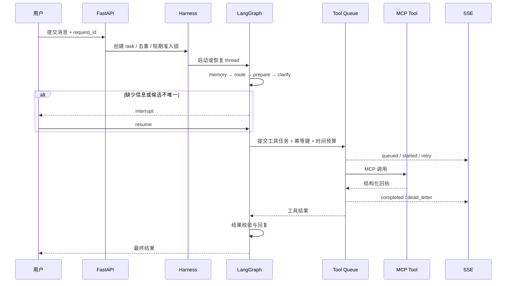
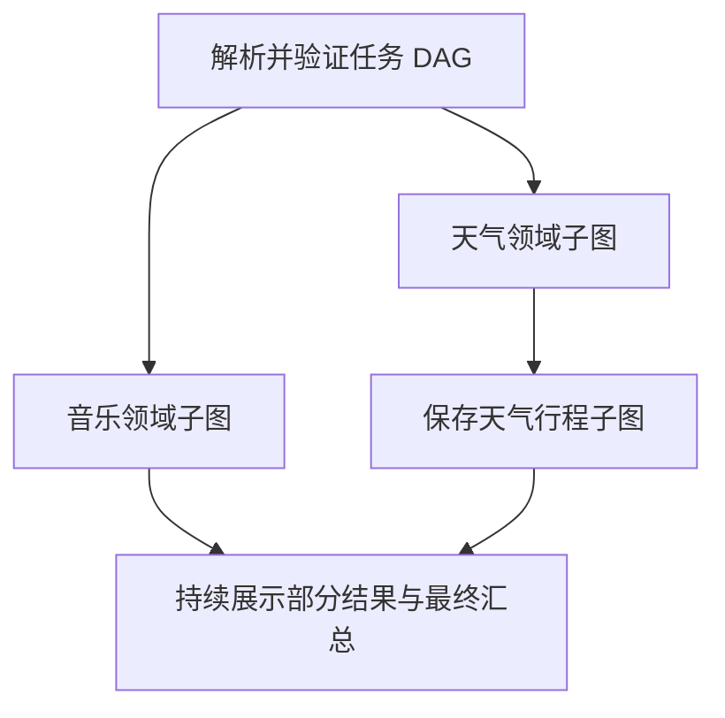

# LifePlus Agent Harness 架构

## 运行边界

LifePlus 将模型推理和业务执行分开管理。模型识别意图、抽取用户明确给出的字段并组织自然语言；LangGraph 决定流程位置；Harness 校验状态、权限、工具参数和回执。MCP 提供工具协议，不负责授权或任务完成判断。

当前领域包括：

| 领域 | 主要动作 | 执行方式 |
|---|---|---|
| `weather` | 城市天气查询 | MCP 只读工具 |
| `navigation` | 地点搜索、候选选择、路线规划 | MCP 只读工具链 |
| `music` | 歌曲与歌手检索 | MCP 只读工具 |
| `wellbeing` | 一般生活健康知识 | Chroma RAG + 模型 |
| `planning` | 保存行程、创建提醒 | 确认后执行 MCP 写工具 |
| `local_life` | 饭店/KTV/影院/咖啡店筛选、详情、路线 | MCP 周边搜索、POI 详情及路线工具 |
| `chat` | 日常对话 | 模型回答 |

## Harness 请求链路

API 请求处理使用后台任务推进 Graph，SSE 从事件表持续读取。因此 Worker 等待外部 MCP 时不会占住客户端响应连接，工具状态也能独立展示。

本地生活表单使用 `POST /api/local-life/tasks`，按动作分别校验参数 Schema，并在准入阶段原子保存结构化意图；不要求 LLM 重新解释已明确的分类、半径、预算或 POI ID。该入口复用普通消息的请求去重、任务表、执行锁与 Coordinator，仍经过 Memory、领域子图、结果校验、Checkpoint 和 Trace。自然语言消息继续走 LLM 路由。两种入口在本地生活子图中收敛，形成“地点澄清 → 周边检索 → 用户选取 → ID 绑定详情 → 可选路线”的流程，参见 [详细设计](local-life.md)。

## 多任务与依赖调度

`task_planning.py` 为带复合表达的 live 请求调用模型，生成最多六个任务的 `TaskPlan`：每项包含领域、动作、槽位、`depends_on` 和 `bind_slots`。Harness 拒绝不存在的依赖、自依赖和环，并按拓扑顺序保存计划。模型负责提出计划，宿主负责验证与执行；并发不是靠提示词约定。

`TaskCoordinator` 维护父任务及独立子任务行。每个子任务有单独的任务 ID、LangGraph thread、槽位、工具结果和 interrupt。准入锁只覆盖请求去重与任务创建，执行锁按任务隔离，不对整个会话加长时间锁。无依赖分支使用异步任务并发推进；工具队列仍按 Worker 数和工具并发限额限制实际外部请求数量。

上图的天气和音乐没有依赖，同层启动；保存行程必须等待天气任务成功，读取其 Checkpoint 结果后将 `weather.result` 绑定到 `details`，随后独立等待写操作确认。前置失败或取消时，下游不执行，并标明依赖失败。子任务成功、失败或等待输入都会更新父任务：仍有可运行分支时为 `running`，只剩待输入分支时为 `waiting_user`，有成功也有失败时最终为 `partial`。父任务不是必须等全部成功才向用户展示内容。

用户等待旧任务选择时可提交新任务；在中断输入框输入“第二个，同时查杭州天气”，显式命令按分隔符拆成旧任务恢复和新任务创建，两者不会共用 interrupt。当前复合恢复支持逗号/分号后的显式查询、搜索、提醒、行程或导航命令，不宣称覆盖任意含蓄表达。接口恢复须带目标子任务 ID 和当前 `interrupt_id`，重复恢复返回 409。

父任务事件流转发子任务事件时附 `child_task_id`；子任务终止事件带 `subtask.` 前缀，防止客户端误把某个分支完成当成整个请求完成。节点运行图直接使用持久化依赖数据绘制分叉、依赖边与汇总节点；领域内部流程单独显示，不能把父级各领域串成一列。

取消会停止本地运行任务和队列中的调用，已完成兄弟分支结果保留。已发到远端的操作可能结果未知，取消不代表远端回滚。已进入用户中断状态的任务可在服务重启后用原 thread 和 interrupt 恢复；进程退出时仍在执行的任务会被标记中断，当前不自动重放全部进行中的请求。执行锁属于单进程；多实例部署还需分布式调度或数据库租约，不能仅增加 Web Worker 数。

## Tool Queue

`tool_jobs` 保存工具名、参数、依赖、幂等键、尝试次数、超时预算和状态。Worker 原子领取任务，并按工具名限制并发。失败后按退避时间重新入队，超过最大重试次数进入 `tool_dead_letters`。

查询任务和写任务使用相同队列。写任务还需要满足两个条件：Graph 已取得本轮确认；工具参数携带稳定幂等键。Checkpoint 恢复导致节点重新执行时，相同幂等键会复用已有队列任务，MCP 写工具也使用该键避免重复创建。

队列支持 `dependencies`，只有所有前置任务成功后才领取。`execute_many` 会将同一复合任务中的独立工具分支并发提交，将有依赖的分支连接为 DAG。当前路线链路由地点搜索完成并确定候选后再提交路线规划。

本地 MCP 通过 stdio 子进程运行。适配器用一个常驻 owner task 创建和关闭 MCP 会话，并将独立调用并发派发到调用任务；Tool Queue worker 通过 Future 投递请求，取消 Future 时取消对应调用。AnyIO 上下文始终在同一 owner task 内创建和关闭。

## 分层记忆

记忆分为三类：

- LangGraph State 保存当前任务槽位、候选快照、工具回执和中断状态。
- Redis 保存当前会话的 `MemoryBrief` 和 `ModelHistory`，TTL 为一天。
- MySQL 保存跨进程的会话摘要和用户长期偏好。未配置时写入 SQLite。

每次进入任务时先读 Redis；缓存缺失后读取 MySQL/SQLite并回填。ModelHistory 按消息数和字符数双重裁剪，单条消息也有限长。MemoryBrief只包含近期对话、当前约束和待补充字段。长期偏好只能作为上下文，不能替代当前位置、用户确认或当前任务参数。

## Skill 与风险处置

`LifeSkillRegistry` 按领域加载 `skills/<domain>/SKILL.md`，通过文件修改时间刷新缓存。Skill 保存服务规范、结果声明边界、风险规则和人工交接要求，Graph 节点仍负责强制执行确认和权限。

检测到高风险词时，Registry 在领域 Skill 上叠加 `safety`，生成包含原始诉求、风险信号、已知上下文、已完成动作和待处理事项的交接摘要，并发布 `human.handoff.required` 事件。这个事件表示需要人工处理；它不代表外部客服已经接单。

## Checkpoint 与恢复

生产配置使用 PostgreSQL Checkpointer，本地使用 SQLite。Checkpoint 保存每个 super-step 的图状态、下一节点、任务和 interrupt。恢复时使用同一 thread ID 和 interrupt ID。中断节点会从节点开头重新执行，因此写操作位于确认节点之后，并用幂等键约束。

Checkpoint 用于图状态恢复；外部写入事实由工具回执和队列记录管理。分支回放从历史 Checkpoint 创建新的 namespace，只在 demo 模式执行，避免回放触发真实副作用。

## Trace 与归因

事件表按 task 保存严格递增序号，覆盖：

- `memory.loaded`、`route.completed`、`skill.loaded`、`rag.retrieved`
- `node.started/completed`、`interrupt.waiting/required`
- `tool.queued/started/retry_scheduled/completed/dead_letter`
- `human.handoff.required`、`answer.started/delta/replaced/completed`、`task.*`
- `plan.started/completed`、`group.updated`、`subtask.task.*`

前端通过 SSE 增量消费事件。执行数据页可以按状态、领域和 bad case 筛选，记录问题类别、根因、预期答案与备注。检查点回放用于复现状态相关问题，Trace 用于区分路由、参数、队列、工具和回复阶段的错误。

自然语言回复使用模型 `astream` 的实际文本增量，非文本推理块不向用户展示。每段带 `stream_id`，多个子任务的增量分别展示；事件落库后按序推送，重连使用 `Last-Event-ID`。生成中途失败时发布 `answer.replaced` 替换未完成文本，并基于工具事实给出最终回复。首文本增量耗时与最终完成耗时分开统计，用户选择或确认等待不视为外部工具耗时。
