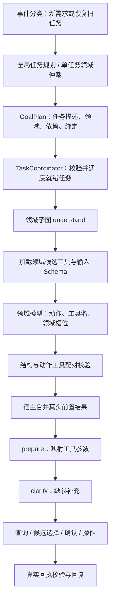

# 领域工具选择与参数提取

2026-10-29 实现。全局规划负责目标和关系，领域子图负责执行理解。效果记录见 [分层评测报告](domain-execution-evaluation.md)。

## 请求经过哪些节点



普通单任务无需全局规划，主图 `route` 只返回领域，然后进入领域子图。多任务由全局模型输出 `GoalPlan`，主图复用已知领域，每个子任务在自己的 `understand` 节点提取参数。聊天、健康知识只有一个固定的内部处理动作且没有工具参数，不增加一次无意义的提参模型调用。

## 全局计划只表达目标与关系

```json
{"tasks":[
  {"id":"w","domain":"weather","query":"查杭州今天天气","depends_on":[],"bind_slots":{}},
  {"id":"s","domain":"planning","query":"把杭州天气查询结果保存为行程","depends_on":["w"],"bind_slots":{"details":"w.result"}}
]}
```

`GoalPlan` 禁止额外字段，因此规划模型输出 `action`、`slots` 或任意工具参数都会触发一次有界格式修复；再次非法则失败，工具不会执行。每个 Query 必须保留地点、时间、方式、否定和筛选条件，共享条件通过任务描述传递。不能只写“查天气”而把用户的杭州和明天丢掉。

`depends_on` 表示先后约束，`bind_slots` 表示结果传递。只有明确的数据依赖或用户明确要求等待成功时加边；“然后查天气、搜索歌曲”不自动产生边。ID 唯一、重复依赖、未知引用、环、最多六任务及允许的绑定路径仍由宿主检查。

为兼容已有计划、表单和检查点，内部 `TaskPlan/PlannedTask` 仍可读取旧的动作和槽位。它们不是新全局模型的输出契约。真实规划先经过 `GoalPlan` 校验，转换成内部结构时可能看到空 `action` 和空 `slots`；这不表示全局已经提取了参数。

## 领域内如何选择工具

`domain_understanding.py` 从宿主 `DOMAIN_TOOLS` 和 `TOOL_CATALOG` 构造候选。目前每域最多五个工具，无向量检索或数百工具 Top-K 召回实现。候选包含动作、初始工具、工具描述、读写属性和业务输入 Schema；模型看不到作为可填字段的 `user_id/idempotency_key`。

模型只接收当前领域的候选和槽位 Schema。例如天气只有 city/forecast_date；不能提交音乐 keyword。行程领域可选创建提醒、保存行程、列出提醒、列出行程、取消提醒；动作与工具必须配对，`list_reminders + cancel_reminder` 会被拒绝。

领域模型返回示例：

```json
{"domain":"planning","action":"save_itinerary","tool_name":"save_itinerary","slots":{"title":"杭州天气记录"}}
```

目前使用结构化 JSON，不是原生 tool_calls。候选选择与参数提取合并为一次模型调用，格式修复最多一次，计入原有模型次数和时间预算。语法正确仍可能语义选错，必须用对照 Query 和目标级评测识别。

对于导航和商家路线，模型选择的是具有固定后续步骤的领域动作及初始工具：一般导航先 maps_search，商家 ID 路线先 maps_place_detail；地图返回实体并完成候选选择后，宿主再构造 maps_route 参数。这些流程不是允许模型自由循环调用任意工具。

## 参数来源与恢复边界

用户原文提供城市、方式和关键词；领域代码规范化日期和显式方式；工具提供真实坐标、商家 ID；用户选择绑定候选快照；宿主提供用户身份、幂等键和授权。缺参进入 interrupt，不允许模型猜缺失地点或 ID。

Coordinator 只在前置成功后读取实际 Checkpoint/工具结果，传入 `bound_slots`。领域理解完成后宿主覆盖对应字段，模型生成的替代内容不能覆盖执行证据；绑定到其他领域字段会被拒绝。已有统一队列、服务端参数验证、用户确认和幂等策略继续约束最终执行。

中断恢复直接继续原图，不重新规划。刷新过期候选时保留已澄清参数，`understand` 检查 `read_generation` 复用检查点中的动作和槽位，重新查询候选；测试覆盖已补充起点不能被清空。表单、路线方式按钮和已有可信上下文引用可直接使用已验证参数。

## 测试与实际限制

`tests/test_domain_understanding.py` 覆盖全局无参数契约、工具配对、领域字段隔离、宿主字段隐藏、前置证据优先及有界修复；`tests/test_multi_task_api.py` 验证真实图、队列和中断链路中的领域提参、实际回执绑定，以及非法工具零 job。

新增 understand 节点在执行 DAG 中显示为“工具选择与参数提取”，主图 route 显示为“领域仲裁”。Trace 中 `tools.candidates`、`domain.understood` 和 model attempt 的 stage 可区分规划、仲裁和提参耗时。

多任务入口已补充换行、句号、顿号，以及重复命令检测；只是扩大进入规划的覆盖，不直接按标点切分，单任务仍可由模型返回一个目标。开放表达、超过六个目标、语义重复和任意条件分支仍有边界。没有声明新版已经达到某个生产准确率或更低 P95。

## 面试回答

我们把理解职责分成全局和领域两层。最初全局 Planner 同时拆任务、选动作、提槽位，随着每域工具增加，规划提示词需要携带越来越多执行细节，因此调整为全局只输出完整任务目标、领域和依赖。领域子图拿到自己的任务后，再加载宿主允许的候选工具与 Schema，在一次模型调用中选择动作、工具并提取参数。

例如查天气并保存结果，规划只表达两个目标以及保存依赖天气。天气领域提取城市和日期，执行完成后，Coordinator 把真实回执绑定到保存任务；保存领域只需要准备标题等自身参数。前置结果由宿主合并，模型不能重新编一份天气。需要查询地点和候选选择才能得到的坐标，也在领域流程中逐步获得。

选择这种方案是为了缩小模型每步面对的工具和参数范围，便于独立测试、扩展及归因。代价是多一次或多次模型调用，因此不能默认更快；领域调用可以并行，但单任务可能增加模型轮次。我们分别测试目标拆分、依赖、工具选择、参数和端到端完成，再测全链路延迟。本次真实模型供应商持续超时和限流，已有失败保留，没有把受控测试通过包装成准确率提升。
