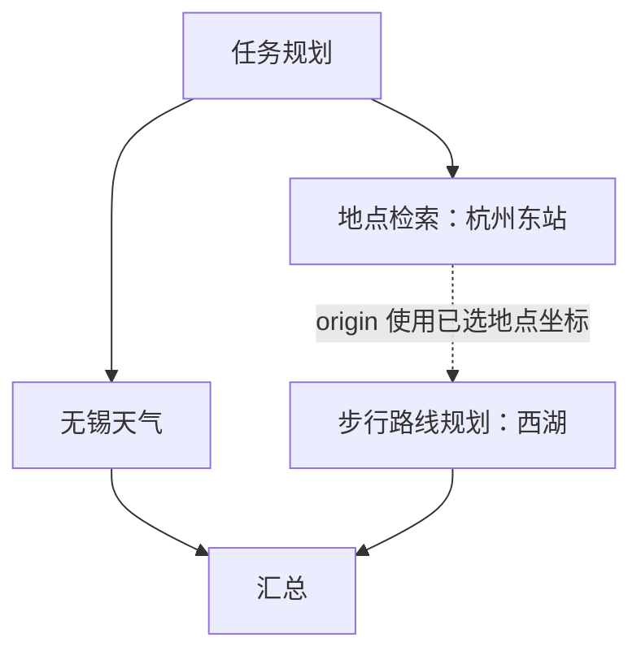

# 执行链路图：任务依赖与领域子图

入口：对话中的“查看链路”或执行数据页，地址为 `/runs/{task_id}`。图使用现有 React Flow 组件，不引入新的图服务，也不修改调度器的并发语义。

## 两层视图

- **任务依赖**：展示规划节点、各子任务与结果汇总。没有前置依赖的任务从规划节点分叉；需要前置结果的任务放到后续层级，用蓝色虚线连接，存在槽位绑定时显示目标字段，例如 `结果依赖 · origin`。
- **展开子图**：保留任务依赖，在每个任务分支内展示实际出现过的记忆、路由、规则加载、参数澄清、查询、选择、确认、执行和回复节点。每个任务有独立容器，节点按任务 ID 隔离，不能把两个任务的 `memory` 节点合并。

例如“找杭州东站，同时查无锡天气，再从刚找到的车站步行到西湖”：



同一层没有依赖不等于运行时一定同时执行；实际是否运行看节点状态和 Trace。图中“执行中”数量按各子任务状态计算，而非用横向排布推断。等待前置结果与等待用户澄清分别显示。

## 真实数据如何映射

1. `GET /api/tasks/{id}` 提供子任务、状态及持久化的 `plan_json`；`depends_on` 使用计划中的逻辑 ID，图将它映射到真实子任务 UUID。
2. `GET /api/tasks/{id}/trace` 提供已有事件，SSE 补充后续事件。父任务事件流中包含 `child_task_id`，能在一张图里更新多个分支。
3. 多任务图按依赖做有界拓扑分层。无依赖分支并列；后继放在该层最高任务容器下方，容器内部节点不会与相邻分支重叠。
4. 子图内部只画 Trace 中出现的 `node.started` / `node.completed` 节点，不补造未来路径。没有任何节点事件时显示接入/规划状态。
5. 工具、模型事件可能没有 `node` 字段，按同一子任务中当前打开的步骤归属。其他分支的事件不能进入该步骤详情。
6. 澄清恢复会重新进入节点；同一个节点折叠显示，并标记“进入 N 次”。节点耗时是最近一次进入到结束的间隔，不是所有轮次累计，也不是纯模型耗时；该间隔可能包含人工等待。完整历史仍在事件时间线中。
7. `not_needed`、`skipped`、`read_only` 回执显示“无需执行”，不能把跳过的写操作显示成已经执行。

历史计划无法解析、依赖缺失或成环时，页面给出警告，并隔离无法拓扑排序的分支，不递归崩溃，也不将它们伪装为无依赖入口。

## 交互与排障

- 图区域默认占满可用宽度；切换“任务依赖 / 展开子图”查看不同粒度。
- 工具栏列表图标展开事件时间线；事件筛选支持“当前节点”。
- 点击节点查看该步骤的事件、工具参数与回执；点击子图链接进入独立任务。
- 支持缩放、平移、适应全图与小地图；移动端隐藏小地图，时间线在图下方展示。
- 实时增加步骤后不强制重置用户视角；新步骤超出视野时可使用适应全图按钮。
- 图以事件证据为准，不是全部 LangGraph 条件边的静态拓扑，也不是时间比例甘特图。不同分支里的同一行不代表同一时刻。

## 验证

```sh
# 前端：独立分支、依赖汇合、六任务布局、事件归属、重复进入、非法历史计划
cd frontend
npm test
npm run build
```

运行真实模型与 MCP 的复现脚本（仅查询与候选选择，不授权写操作）：

```sh
.venv/bin/python -m evaluations.trace_graph_smoke \
  --base-url http://127.0.0.1:8012 \
  --output evaluations/runs/trace-graph-new-run/report.json
```

脚本创建独立会话，记录任务状态快照、真实事件、依赖执行顺序和候选选择。非预期澄清或业务失败会报告未通过，不伪造槽位推进任务；已有输出文件不会覆盖。检查真实依赖边时，应确认前置任务的完成事件先于后继的开始事件，而非只观察图形位置。

本轮联测发现模型把 `travel_mode` 写成 `walk` 的情况，已在 `PlannedTask` 中增加枚举校验，并在规划提示中明确 `driving/walking/bicycling`。非法值在执行前被拒绝，走现有最多一次的结构化修复，而不是在 MCP 调用时才暴露。此修复不改写历史失败记录。

本轮前端单元测试与生产构建已验证；浏览器可视化截图及真实点击未完成，不能把布局单元测试或 HTTP 访问成功当作浏览器视觉验收。

### 2026-10-26 联测记录

- 后端全量回归：**313 passed, 1 skipped**。跳过项是原有需主动开启的 Live 测试，不计为通过。
- 前端默认回归：**33 passed**；增加下述真实 Trace 作为输入时为 **34 passed**；生产构建通过。
- [真实三任务通过记录](../evaluations/runs/trace-graph-final-20261026/report.json)：两个无依赖入口、一个依赖后继，三个任务全部完成。快照观察到两项同时为 `running`；事件序号确认前置完成早于后继启动。实际来源为高德天气与高德地图，单次样本共 38.889 秒，含模型规划、候选选择和工具执行，不能当作 P95 指标。
- 演示入口：`/runs/6afdced7-f444-4c97-8133-c18cfae796df`。
- [第一次未通过记录](../evaluations/runs/trace-graph-live-20261026/report.json)保留了 `walk` 参数错误；[第二次未通过记录](../evaluations/runs/trace-graph-verified-20261026/report.json)保留了普通地点被规划为商家检索、触发非预期澄清的案例，等待测试结束后已取消该测试任务。后者是待优化的路由 Bad Case，本轮图展示升级未将其算为通过，也未覆盖原记录。

将真实记录接入图单元测试（在 `frontend/` 中执行）：

```sh
TRACE_GRAPH_REPORT=../evaluations/runs/trace-graph-final-20261026/report.json npm test
```

## 源码

- [图模型、拓扑分层、节点事件归属](../frontend/src/taskGraph.ts)
- [图页面与 SSE 更新](../frontend/src/TracePage.tsx)
- [图样式及响应式布局](../frontend/src/taskGraph.css)
- [图测试](../frontend/tests/taskGraph.test.cjs)
- [实际并发及依赖调度](../src/car_agent/orchestration.py)
- [任务规划参数校验](../src/car_agent/task_planning.py)
