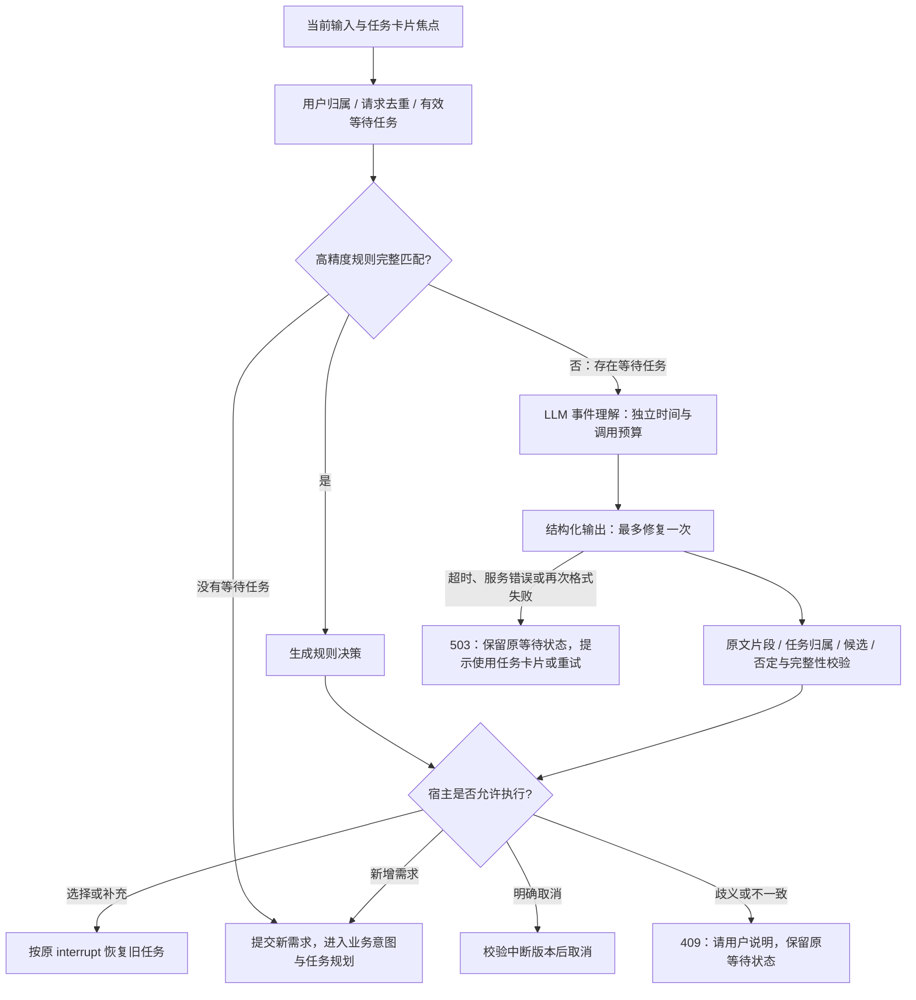

# 会话事件理解：规则优先与 LLM 兜底

## 处理范围

本模块判断一条输入是在回复哪个等待任务，还是提出新需求。业务领域、动作和槽位仍由后续意图理解负责。普通聊天入口和任务卡片的自然语言回复共用解析与校验；确认/拒绝按钮、结构化候选索引继续使用原有接口门禁。



## 规则处理哪些输入

- 唯一有效选择任务下的“第二个”“第二首”或唯一候选名称。
- 唯一缺城市任务下的明确城市补充。
- “第二个，同时查杭州天气”等能完整匹配的答案加新命令。
- 只有一个明确目标的“取消任务”。
- 没有等待任务的新输入，以及无其他回复线索的明确新命令。

规则未匹配不会等同于没有新增需求。存在等待任务时，复杂或剩余文本无法解释的 live 输入触发模型。两个列表都能接收“第二个”时，宿主已经知道缺少归属，直接要求用户选择任务卡片，不浪费一次模型调用来猜最近列表。demo 模式保持确定性，不调用真实供应商。

## LLM 看见什么、输出什么

输入为当前原文、有效任务的 ID/Query/领域/中断类别/待补字段/候选名称与地址，以及最近六条有限长度历史。候选是数据，不是模型指令。来自具体任务卡片的回复绑定该任务焦点。

例如原音乐任务等待选择时，用户说：

> 第二个吧，杭州那边的天气也帮我看看。

模型输出以下决策；`answer` 和 `new_query` 必须是用户原文片段，不能让模型改写出不存在的需求：

```json
{
  "route": "resume",
  "task_id": "music_01",
  "answer": "第二个吧",
  "new_query": "杭州那边的天气也帮我看看",
  "question": null
}
```

允许的 route 为 `new/resume/cancel/clarify`，没有 `approve`、工具名或工具参数字段。一次至多操作一个旧任务，并可附带一个新需求片段；该片段后续可以再进入业务任务拆分。涉及两个旧任务的回复需要分别处理或进一步澄清。

## 宿主执行前的检查

1. 决策目标必须在当前用户、当前会话的等待任务中；焦点存在时必须匹配。
2. 候选快照和中断仍有效；执行时在生命周期锁内再次检查状态/中断，防止模型思考期间任务已取消或被别人恢复。
3. 答案和新需求必须来自原文，片段不能重叠；除受控话语标记外不得遗漏残余需求。
4. 选择必须能唯一映射到真实候选；无效索引、错误领域标签和模型编造名称不执行。
5. 写入授权只能由既有确认接口提供。“好的”不能经模型变成批准。
6. 含否定但无法明确拆解的输入保留等待并追问，不为负向要求创建新的业务操作。

LLM 自报的置信分不作为授权依据。格式错误最多修复一次，两次 attempt 共用 `INPUT_EVENT_TIMEOUT_SECONDS`，默认 25 秒；供应商网络错误不会伪装成格式错误重试。事件模型复用已配置的 intent 模型角色，未配置独立角色时使用默认模型。

## 旧任务恢复与新任务创建

原答案经 `Command(resume=...)` 交给原 thread，新片段通过新任务入口提交。新任务拥有独立 ID、Checkpoint 和执行状态，恢复与新增任务可独立推进。

会话输入持有短期接入锁，相同 request_id 重传会复用已保存结果；附带新任务使用稳定派生的请求 ID。模型等待期间不占用所有任务的执行锁，取消仍可进行。

这两步并非一个分布式事务。旧任务已恢复但新增准入失败时，接口返回 `additional_task_error`，包含未提交 Query；前端显示明确提示，用户可单独重发新需求。重复同一会话 request_id 不会再次恢复旧任务。任务卡片仍以中断 ID 的单次消费控制重复恢复。

## Trace 与审计

`input_event_decisions` 保存模型解析状态和最终决策，`input_event_spans` 保存独立预算、模型 attempt、耗时、用量及错误类型。解析阶段不伪造一个业务任务，完成后通过 `input.events.resolved` 关联回真实任务 Trace。

`GET /api/sessions/{session_id}/input-events` 提供该用户会话的最近解析记录；接口先验证会话归属。原文中的地点或偏好可能出现在决策片段中，保持与原会话相同的访问权限，原始审计数据库不上传到 GitHub。

## 验证与复跑

本轮[公开验收摘要](assets/input-events-20261028.json)记录以下结果，原始审计数据库和逐条失败记录保留在本地 `data/input-events-20261028/`：

| 测试层 | 结果 | 解释 |
|---|---:|---|
| 受控契约与 handler 集成 | 39/39 | 包含双入口、权限、状态竞争、格式、超时、去重和部分提交失败 |
| 待发布快照完整后端回归 | 601 通过、1 跳过 | 从 Git 暂存区独立导出，不混入其他工作区修改 |
| 待发布快照前端 | 43 通过、1 跳过；构建通过 | 跳过项需运行中的 Vite；没有浏览器效果验收 |
| 30 条开发案例的最终复测 | 30/30 | 13 条规则，17 条真实模型解释；不是 30 次模型调用 |
| 后续留出的独立场景 | 6/6 | 六条均走真实模型；观察结果后未继续调这些场景 |
| 真实模型＋MCP 复合恢复 | 2/2 会话、4/4 子目标 | 从音乐选择追加杭州天气，从城市补充追加陶喆歌曲；实际回执核验 |

开发阶段完整记录为 25/30 →28/30 →29/30 →30/30。修复涉及绑定领域下的选择标签、原文中的礼貌修饰、卡片焦点，以及将无须模型解释的简短写入应答交回协议确认；事件时间预算从 15 秒调整为 25 秒。四轮使用相同开发标签，但提示词、解析和预算发生变化，不是只变一个因素的 A/B，也不能据此声称生产准确率提升固定比例。最终源码之外的底层模型与配置没有切换。

两条真实会话分别耗时 29.015 秒和 25.972 秒，仅记录这两次执行，不据此声称 P95 或生产 SLA。

- [受控契约和真实 handler 集成测试](../tests/test_input_events.py)：覆盖规则、LLM 决策、双入口、歧义、错误目标、遗漏片段、否定、写授权、超时、格式错误、取消竞争、去重和部分提交失败。
- [30 条事件评测场景](../evaluations/input_event_cases.py)：人工设计，预先标注 route、任务归属、选择索引、是否存在新增需求及关键原文内容。
- [真实模型执行器](../evaluations/input_events.py)：调用生产解析函数、生产模型工厂和隔离数据库，不执行业务工具；与完整会话完成率分开报告。
- 同一数据文件另包含两个真实模型/MCP 复合恢复会话，复用已有目标 Oracle 检查两项需求均完成。

```bash
.venv/bin/python -m pytest tests/test_input_events.py -q
.venv/bin/python -m evaluations.input_events --output data/input-events-new/interpretation
.venv/bin/python -m evaluations.input_events --holdout --output data/input-events-new/holdout
.venv/bin/python -m evaluations.input_events --write-completion-dataset data/input-events-new/completion-cases.jsonl
.venv/bin/python -m evaluations.completion --dataset data/input-events-new/completion-cases.jsonl --output data/input-events-new/completion --concurrency 1 --case-budget 150
```

每次使用新输出目录；失败样本与超时保留在分母。规则样本和真实模型样本单独列数，不把 30 条都称为 30 次真实模型调用。样本数量少且来自人工模板，不能用于生产 SLA 承诺。

## 与此前测试报告的关系

[18 问手册](LifePlus-Agent-Harness-18问与测试验收手册.md)的附录 G 保留事件模块改造前的审计结果。此功能完善有等待任务时的事件解释，没有替换无等待任务的 `may_have_multiple_tasks()` 门槛；此前四类无连接词双目标漏任务、在途重启恢复和 Chroma 删除同步仍是独立问题，不能因本模块更新就标成已修复。
