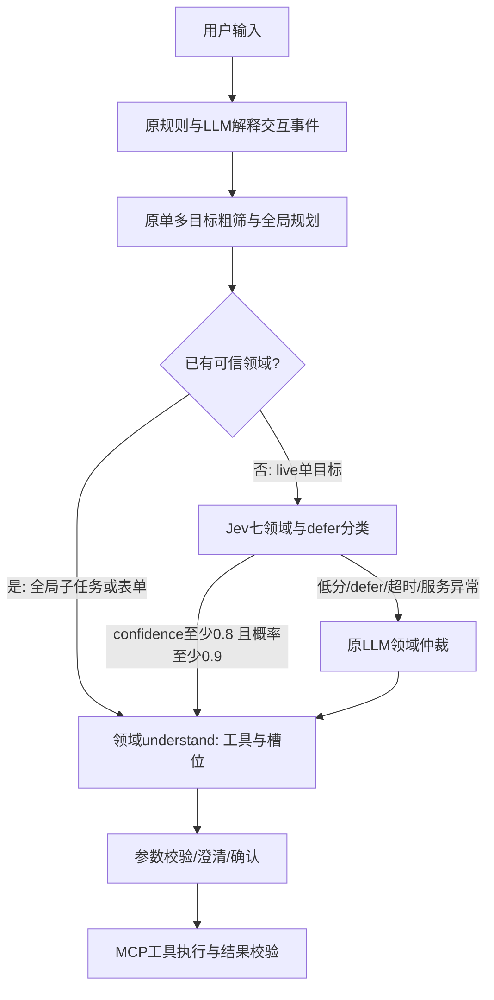

# Jev 单任务领域仲裁优化

2026-10-29，经用户确认，只启用已经完成配对测试的单目标领域仲裁。不启用事件审核或单/多目标门控。

## 执行范围



- Jev不生成工具参数，不替代全局规划，也不授予写操作权限。
- 原请求与有效上下文参与分类；没有因这次启用调整已测试的提示词或门槛。
- Jev请求最多1.5秒，且受剩余任务deadline限制；取消和预算耗尽不通过回退绕开。
- demo、特殊历史原文查询、用户偏好命令和已有可信领域的子任务不重复调用Jev。

## 配置

```dotenv
DOMAIN_ROUTE_PROVIDER=jev_cascade
INPUT_EVENT_PROVIDER=llm
PLANNING_GATE_PROVIDER=rules
JEV_API_KEY=<private-key>
JEV_MODEL_NAME=jev-1.14.0
JEV_TIMEOUT_SECONDS=1.5
JEV_MIN_CONFIDENCE=0.8
JEV_MIN_PROBABILITY=0.9
```

仓库只发布占位符；私有Key存本机`.env`或部署平台密钥配置。复制`.env.example`后必须填写Key；不接入Jev时将`DOMAIN_ROUTE_PROVIDER`改为`llm`。Settings类在完全不设置该变量时仍保留llm兼容行为。显式选择Jev却缺Key会在启动时报错，不静默假装启用。

Compose使用env_file传入配置。修改`.env`后须重建/重建容器，单纯`docker compose restart`不会更新已有容器的环境变量：

```bash
docker compose up -d --build app
```

不要删除数据库卷。更新时应等待正在执行的任务结束；用户等待状态及历史保存在原卷中。

## 已有证据与边界

21条领域样本两组均21/21正确，领域阶段P50为3.551→0.548秒，下降84.6%；总Token为15161→16575，增加9.3%。这不是全系统速度提高84.6%，也不是准确率提高或成本降低的证明。小样本单次复测不能代表生产SLA。[完整实测报告](jev-front-ab-2026-10-29.md)。

启用后检查`/api/health`显示`domain_route_provider=jev_cascade`且`jev_configured=true`。对真实live单目标查看Trace，应包含`domain_route_precheck`的model attempt、`domain.precheck.completed`；接受时`route.completed.source=jev_cascade`。回退时还会出现原`domain_route`模型调用。配置名不能替代实际调用证据。

后续监控接受率、回退率、已接受样本人工正确率、领域阶段及端到端P50/P95、全部模型Token与错误类型。事件和多任务分类试验仍仅用于离线对比。

## 回滚

将`DOMAIN_ROUTE_PROVIDER=llm`，保持其余两个provider不变，再运行`docker compose up -d app`重建容器环境。代码、会话、数据库和检查点无需回退；不能回滚已经发生的外部操作。
