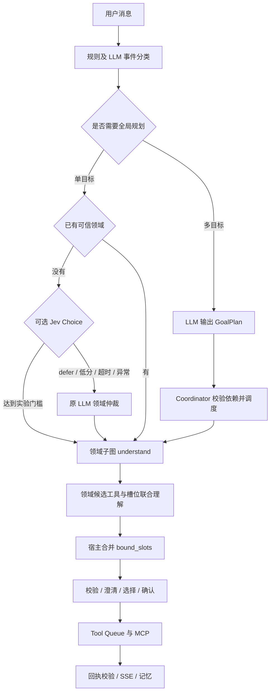

# Jev 前序决策接入与局部、全局 A/B

**当前启用状态：** 2026-10-29用户已批准单目标领域优化，本地和配置模板为`DOMAIN_ROUTE_PROVIDER=jev_cascade`；事件仍为`llm`、规划粗筛仍为`rules`。下方试验记录中的“未切换”描述对应试验当时的状态。Jev Key必须自行填写且不进入Git；无Key应显式使用`DOMAIN_ROUTE_PROVIDER=llm`。[启用与回滚](jev-domain-rollout.md)。

## 三模块新试验

除下述初版候选选择方案外，新增事件明确性审核（`INPUT_EVENT_PROVIDER=jev_gate`）以及数量/领域合并判定（`PLANNING_GATE_PROVIDER=jev_front`，默认`rules`）。官方支持同一state提交多个问题，见[Quickstart](https://docs.typesafe.ai/introduction/quickstart)。模型不输出任意事件片段或全局计划。

本轮实际测试及退化样本见[三模块局部/全局报告](jev-front-ab-2026-10-29.md)。领域路由有明显局部速度收益，但Token略升；事件审核回退过多；合并后的普通12例尚未显示全局提速。保持原默认，不根据试验结果自动切换。

2026-10-29。状态：已验证官方真实接口，并开展局部与端到端配对试验；默认仍使用原模型。密钥仅保存在本机私有配置，模型能力与项目实测分别表述。

## Jev 的能力与边界

Jev 接收 `state` 与带类型的 `questions`，适合已有有限候选的分类、选择和打分。Choice 返回 `choice/probabilities/confidence`，Score 返回等级评分，Noul 返回是/否概率。它不自由生成文本，不能直接把复杂请求变成任意任务列表或字符串槽位。[官方介绍](https://docs.typesafe.ai/introduction)、[Choice](https://docs.typesafe.ai/primitives/choice)。

官方当前列出 `jev-1.14.0`，另有 `jev-latest` 别名。实验固定版本并记录返回的实际模型 ID，避免别名变化污染对比。官方价格为每百万输入 Token 0.042 美元、输出免费；仍记录 output_tokens，免费不表示输出 Token 为零，也不表示本项目总成本为零。[模型与价格](https://docs.typesafe.ai/models)。

`confidence` 是分布集中程度的统计量，与选中项的概率含义不同，都不能直接解释为本项目正确率。中文、跨轮指代和类别边界要单独验证。当前两个门槛仅为实验初始配置，不是已校准的生产阈值。[置信度定义](https://docs.typesafe.ai/confidence)。

## 对应最新架构的替代位置

| 环节 | 本次判断 | 接法与边界 |
|---|---|---|
| 单目标领域仲裁 `domain_route` | 首选，已留入口 | 在七个领域与 defer 中选择；不输出动作、工具或槽位 |
| 会话事件类型、目标任务选择 | 已增加可选候选选择器 | 宿主枚举基于原文的完整事件方案；Jev选择方案，原文拆分和状态校验仍由宿主负责，不完整则回退LLM |
| 是否需要全局规划 | 后续可评测 | 可尝试判断单/多目标；漏判会丢任务，需测多任务召回与否定、修饰语对照，当前触发器保留 |
| 领域内候选工具选择 | 可做消融 | 当前已将工具选择和槽位提取合成一次 LLM；额外 Jev 调用可能更慢，应比较总链路 |
| RAG 相关性、回复质量等级 | 后续独立试验 | 对固定候选打分，比较召回损失、上下文用量及最终回答质量，本次未改检索 |
| 记忆保留与上下文相关性 | 后续独立试验 | 不能丢弃待澄清信息、用户约束及执行证据；当前未替换摘要流程 |
| 全局任务列表、依赖与 bind_slots 生成 | 不直接替换 | 需要生成开放任务文本和计划结构，保留 GoalPlan 与 LLM |
| 自由文本槽位、回复、Query 改写 | 不直接替换 | 地名、歌名、回复文本不是固定选项；可先产出候选再选，但候选漏召回需另测 |
| 权限、确认、幂等、过期、完成判定 | 宿主继续执行 | 高分不会跳过用户确认或 Schema/业务校验 |

事件类型准确率不能当作复合事件解析成功率。还需核对任务 ID、原文片段、否定约束和实际任务变化。[官方路由模式](https://docs.typesafe.ai/patterns/intent-routing)。

## 实际链路与失败处理



仅 live 且没有可信 prepared domain 时尝试 Jev。全局已指定领域的子任务、demo、特殊历史原文命令复用现有路径。因此多任务主要耗时可能不受这项替换影响，不能预计所有场景都显著提速。

Jev 每次只请求一次，不在前置阶段持续重试429。总耗时受 Jev timeout 和任务剩余 deadline 共同限制。Jev 与回退调用都计入现有 model_calls；预算耗尽或用户取消时终止，不用 fallback 绕过预算。

回执核对问题 ID、选项集合、概率范围、归一化、最大概率选项和模型 ID。网络、限流、鉴权、结构异常回退原 LLM；Trace 保留失败类别，不记录 Key 或响应头。若原 LLM 也失败，沿用任务失败流程。

## 配置接口

在本机未提交版本控制的 `.env` 填写：

```dotenv
DOMAIN_ROUTE_PROVIDER=llm
INPUT_EVENT_PROVIDER=llm
JEV_API_KEY=
JEV_BASE_URL=https://api.typesafe.ai/v1
JEV_MODEL_NAME=jev-1.14.0
JEV_TIMEOUT_SECONDS=1.5
JEV_MIN_CONFIDENCE=0.8
JEV_MIN_PROBABILITY=0.9
```

Key 从 [TypeSafe Console](https://console.typesafe.ai)创建。Jev 使用独立鉴权和传输，不填入 MODEL_BASE_URL。现有 MODEL_* 仍用于回退、规划、领域提参和回复。[System One API](https://docs.typesafe.ai/api/system-one)。

`llm` 不创建 Jev 客户端、不发送 Jev 请求；`jev_cascade` 才启用。显式启用却缺 Key 时在启动报配置错误。现有 Compose 的 env_file 支持这些变量，无需增加依赖或公开鉴权接口。`/api/health` 可查看 provider 和是否配置 Key，不返回 Key。

事件解释仍先运行相同规则。规则不能判断时，`event_routing.py` 在有效任务与焦点约束下枚举基于原文的回答、新需求片段，先通过 `grounded_decision` 再提供给 Jev。最多32个完整方案，另有 defer；候选超限、低分、异常或无完整方案时调用原模型。选择类回答必须绑定实际候选；approval 不提供恢复候选。模型接受后仍重复状态与原文校验。事件模型预算最多为一次Jev加两次LLM（含一次格式修复），共享原25秒时间上限。

## 局部配对 A/B

A 为现有 LLM domain_route；B 为 Jev 高分接受、其余回退同一 LLM。两组使用相同 Query、上下文、后续模型、预算与代码版本。随机样本顺序，交替 AB/BA，每条默认重复三次。局部只运行领域仲裁，不调用业务工具。

只查看准备状态，不请求真实服务：

```bash
.venv/bin/python -m evaluations.jev_ab
```

提供35条人工设计路由试验：14条 development、21条 holdout，覆盖七领域及上下文。不是历史流量；重复运行不是新增独立样本。后续需补真实脱敏 bad case、长尾、领域边界和选项顺序扰动，按会话/模板组隔离门槛开发与测试。

填写 Key 后显式跑开发集，固定配置后再跑留出集：

```bash
.venv/bin/python -m evaluations.jev_ab --run-live --split development --repeats 3 --output evaluations/runs/jev-dev-01
.venv/bin/python -m evaluations.jev_ab --run-live --split holdout --repeats 3 --output evaluations/runs/jev-holdout-01
```

事件模块的局部试验通过真实生产 `resolve_input` 入口，分别报告全体输入与确实需要模型的子集，防止大量规则零耗时输入掩盖回退开销：

```bash
.venv/bin/python -m evaluations.jev_event_ab --output evaluations/runs/jev-events-dev
.venv/bin/python -m evaluations.jev_event_ab --holdout --output evaluations/runs/jev-events-holdout
```

输出 manifest、逐条结果、SQLite 审计、summary 和 Markdown 报告。不修改 `.env`，不自动启用候选。保存全部概率、confidence、接受/回退、模型版本、每次用量和耗时。门槛在 development 选择；看过 holdout 后再调参须另建留出集。

局部关注：领域正确率、接受样本正确率、回退率、每请求总调用数、全部样本 P50/P95、成功样本 P95、输入/输出 Token。当前汇总器直接输出通过率、P50/P95、回退数和分阶段用量；混淆矩阵、接受率及 Brier/ECE 可用逐条 actual_domain/prechecks 进一步分析，未声称全部已自动计算。B 必须累计 Jev 和 fallback，不能只报告接受子集。

## 全局 A/B 与实际收益

在完成率测试器的隔离数据库运行两组，用于观察组合影响和故障；正式采用仍要求局部质量过关。链路包括真实模型、Graph、MCP、自动澄清和结果核验，但不代表公网或浏览器传输时延。同日、同数据、同模型角色、同并发和版本，先并发1定位因果，再独立加负载。

```bash
DOMAIN_ROUTE_PROVIDER=llm .venv/bin/python -m evaluations.completion --output evaluations/runs/jev-e2e-a-01 --concurrency 1
DOMAIN_ROUTE_PROVIDER=jev_cascade .venv/bin/python -m evaluations.completion --output evaluations/runs/jev-e2e-b-01 --concurrency 1
.venv/bin/python -m evaluations.jev_ab --compare-e2e evaluations/runs/jev-e2e-a-01 evaluations/runs/jev-e2e-b-01 --output evaluations/runs/jev-e2e-compare-01
```

后续重复需反转 BA 顺序，控制负载、热身和上游缓存。全局比较器检查数据、样本、模型角色、源代码、并发、预算和同日日期；未完成所有计划样本则拒绝汇总。写工具只作用于测试器的隔离用户/数据库，不重复执行真实用户写操作来计时。

全局应检查完成率、部分完成、虚假完成、澄清、工具与参数错误、P50/P95、首增量、排除人工等待的执行时间及每成功会话用量。当前比较器直接汇总完成率、会话P50/P95和分阶段模型用量；首增量和澄清专项需结合 Trace 单独分析。自动用户模拟器不包含真实人工思考等待。

按 span_id 去重，父任务转发的子任务调用只计一次；事件分类模型用量也加入。任何调用用量缺失时合计及每请求/每成功会话用量记 null，已知用量保留为下界。不能将“输出免费”处理成 Token 为零；没有计价依据时不推算金额。

汇总优先采用每次回执的 `usage.total_tokens`；缺少该字段、但输入与输出计数齐全时才使用两者之和。`grok-4.3` 的推理用量可能独立于可见输出列出，不能漏算，也不在total基础上重复叠加。报告另外展示已知用量下界、未知次数和已报告的reasoning。不同模型的Token计数器不同，不能当作语义内容压缩率或直接相乘得到统一费用。

支持交替AB/BA的全链路试验器，每个场景使用独立进程、用户及数据库；A为原系统，B可选择domain、events或both。全过程保存原始日志和每个配对的配置/源代码核对结果：

```bash
.venv/bin/python -m evaluations.jev_e2e_cases
.venv/bin/python -m evaluations.jev_global_ab --candidate both --output evaluations/runs/jev-global-pilot
```

冻结数据已存在时不重复生成。12场景覆盖单任务、多任务、缺参、复合回复、结果依赖、写入确认与四目标。局部试验没有业务调用，全局试验使用真实MCP；两者分别报告，不能混算完成率。

局部收益不直接等于整体收益。若可替换的领域仲裁占原端到端关键路径10%，该阶段减少80%，忽略回退等开销，整体约减少8%。实际分析关键路径，不将并行分支耗时相加。多任务已知领域的分支跳过 Jev，局部即使显著提速，全局也可能近零改善。

候选级联平均耗时近似 `T_Jev + 回退比例 × T_LLM`。回退多时可能比原方案更慢；Token 也需累计两段，不能从 Jev 单价推导全系统成本下降。

## 切换标准与证据

质量优先。正式试验前预先确定完成率不劣界、可接受新增错误和时延收益要求。建议检查：不新增未授权操作或虚假完成；留出集不出现可复现的新增错分；任务完成率满足约定不劣界；全局P95不明显恶化，且实际Token或耗时有收益。35条试验不足以证明0.5个百分点级别不劣。

阈值在开发集选择；正式评测按会话/模板组分析置信区间，不将三次重复当三倍独立用户。快速失败不是提速，429、超时、未知用量及未完成样本全部保留。

受控测试覆盖 HTTP 契约、非法回执、超时/取消、LLM回退、可信路径跳过、共同预算、用量缺失和父子Trace去重；真实结果由运行目录中的manifest、results、Trace和报告支持。密钥配置已完成，默认provider和现有容器未切换。未实测费用时不宣称费用下降；小规模试验不代表生产SLA。
