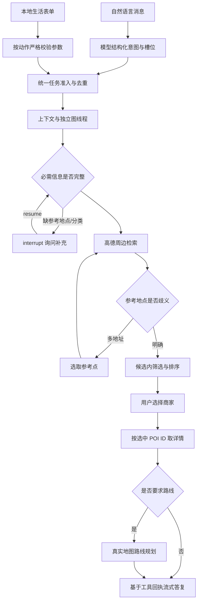

# 本地生活选取

## 已实现的范围

支持饭店、KTV、电影院、咖啡店的真实周边检索、筛选、选取、详情与路线规划。独立页面为 `/discover`，自然语言入口仍在对话页面。所有工具调用通过现有 Harness 和 MCP 执行，不直接从浏览器调用高德，不向浏览器传 Key。

默认表单参考地点是东南大学无锡国际校区，明确标记为参考点而非实时 GPS。对话中仅说“附近”而没有地点时，任务暂停询问参考地点。没有读取设备定位或自动记录用户实际位置。

## 使用场景

- “帮我找附近的 KTV”：先询问地点，补充地址后返回真实候选，再选取商家。
- “在东南大学无锡国际校区附近找 5 公里内、4 分以上、人均不超过 100 元的 KTV”。
- 页面选择电影院后，取得该商家实际 POI ID 对应的照片、电话等详情；可选择驾车、步行或骑行规划路线。
- “查无锡天气，同时在东南大学无锡国际校区附近找电影院”：两个领域独立运行，商家等待选择时天气可先完成。

## 编排与选型



自然语言需要模型理解模糊表达；表单已经有明确参数，直接使用 Schema 校验并记录为 `plan.completed/source=validated_form`，不让模型再猜分类和预算。两种入口均复用会话身份、请求去重、队列、参数验证、候选中断、Checkpoint、Trace 和最后的回复生成。

使用单独的 `local_life` 子图，避免把“找店”误当成已知目的地导航。商家选择绑定 POI ID，详情和路线不根据相似名称重新检索另一家店。路线复用已修复的地图工具；只读检索不要求写入确认，不代表已订座、已订票或已启动设备导航。

## 工具与数据口径

新增 `maps_local_search` 与 `maps_place_detail`，工具总数为11个，以 `/api/tools` 的 Schema 为准。

周边搜索输入包括分类、参考地点、城市提示、半径、关键词、排序、最低评分和参考人均上限。半径范围200至50000米；可选距离或本批评分优先，默认返回最多6条。半径只影响地点附近的范围，不保证附近结果覆盖全部商家。

搜索只取高德距离优先的首批最多20条，然后进行明确约束过滤与排序。缺失评分不满足最低评分约束，缺失人均不满足预算约束。保留未知字段数量、候选数量、匹配数量和明确停业排除数量，结果为空时建议用户调整条件，不自动放宽。

评分、人均、照片、电话与营业时间均来自高德。响应中的空数组转换为未知，而不是编造0元、满分或营业时间。明确在名称中标记暂停营业/歇业的商家默认排除；未标记的商家状态为 unknown，不推断为营业中。

不接入包厢余量、影院排期、座位库存、优惠券、支付、预订或电话外呼。参考人均不是实时价格承诺。

## 接口

```http
POST /api/local-life/tasks
Content-Type: application/json
```

```json
{
  "session_id": "已有会话ID",
  "mode": "live",
  "request_id": "每次新操作唯一，重试同一操作沿用",
  "action": "local_search",
  "parameters": {
    "category": "ktv",
    "anchor": "东南大学无锡国际校区",
    "city": "无锡市",
    "radius_m": 5000,
    "sort_by": "rating",
    "min_rating": 4,
    "max_cost": 100
  }
}
```

`local_detail` 的参数仅需 `poi_id`；`local_route` 需要 `poi_id`、`anchor` 和 `travel_mode`。未知参数与非法范围返回422；同一请求 ID 对应不同内容返回409。

通过标准 `/api/tasks/{id}`、`/trace`、`/events` 查看状态与真实回执。需要选择时返回标准 interrupt，使用 `/resume` 恢复；可在 `/runs/{id}` 查看执行链路。页面状态轮询与 SSE 文本并用，断流时不会丢失最终持久化结果。

页面 URL 保留 `?task=任务ID`，刷新后重新读取该任务、候选、详情和 Trace，仍使用原 interrupt 恢复；读取受现有会话用户命名空间校验。该恢复设计已实现，浏览器刷新操作本轮尚未做视觉交互验收。

## 验收

- 后端100项通过，1项默认关闭的 live 测试入口跳过，报告：[JUnit XML](../data/local-life-regression-tests.xml)。包括原导航流程兼容、严格筛选、未知字段、暂停营业排除、地点歧义、非法参考地点选项仍可恢复、ID不一致拒绝、表单参数不经模型改写、去重冲突和多领域并行。
- 真实 MCP 全量28/28通过，包含四类检索和四次商家详情查询：[工具报告](../data/local-life-tools-latest.json)。
- 真实模型/HTTP工作流5/5通过：[工作流报告](../data/local-life-workflows-latest.json)。覆盖KTV筛选、影院选择与详情、绑定影院ID的步行路线、自然语言地点澄清、天气与本地生活并行。
- 前端9项逻辑测试通过，TypeScript检查与生产构建通过。
- 未完成浏览器视觉和点击验收：此前页面授权被拒绝，本轮没有绕过权限。构建和API验证不替代页面交互验收。

本轮影院实际返回包含一条“暂停营业”记录，已在候选中排除。选择无锡影都后，以参考地点规划了约2815米的步行路线。以上是单次测试结果，不是稳定耗时、完整库存或长期营业承诺。

```bash
.venv/bin/python -m pytest -q --junitxml=data/local-life-regression-tests.xml
.venv/bin/python -m car_agent.tool_smoke --output data/local-life-tools-latest.json
.venv/bin/python -m car_agent.local_life_smoke --url http://127.0.0.1:8001
```

前端目录执行 `npm test`、`npm run build`。当前新版本地址为 `http://127.0.0.1:8001/discover`，8000旧进程未替换。

协议依据：[高德POI搜索与详情](https://lbs.amap.com/api/webservice/guide/api-advanced/search)、[官方POI分类表下载页](https://lbs.amap.com/api/webservice/download)。分类表核对 KTV=080302、影院=080601、咖啡厅=050500；饭店覆盖中餐、外国餐、快餐和休闲餐饮，不使用整个餐饮大类混入全部冷饮店。
